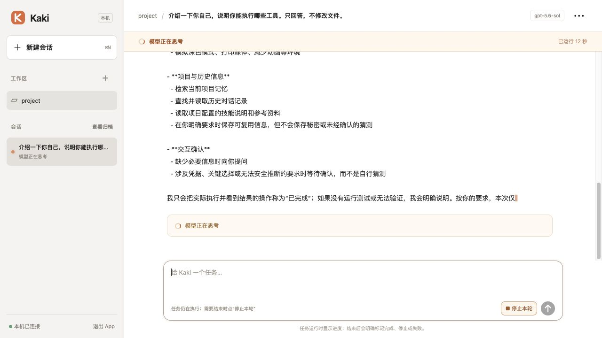
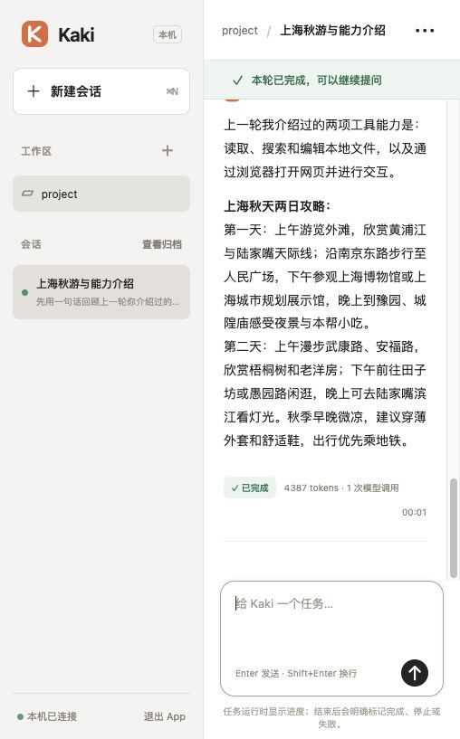
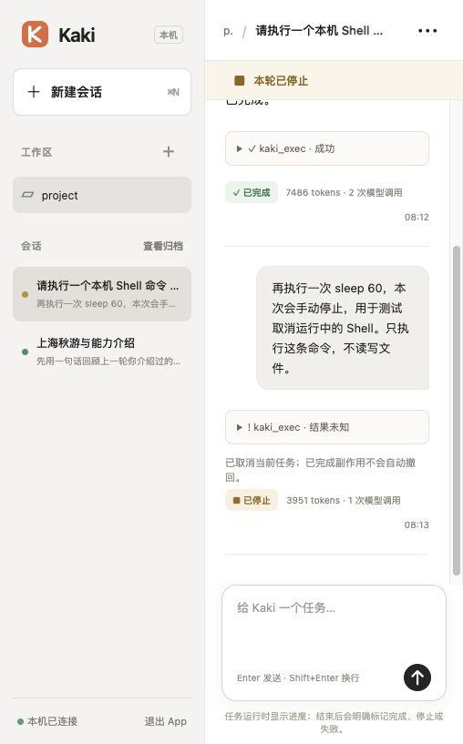

# Kaki App v0.2：安装、会话与操作指南

Kaki 现在默认打开一个简易的本机 App。左侧选择工作区和会话，右侧对话；底部多行输入，顶部持续显示本轮状态。已有 Python Agent 内核与 Right Code 配置继续使用。当前不是完整 Codex App 的功能复刻，暂未提供代码差异编辑器和图形化文件恢复审批。

学习 SQLite、源码阅读顺序和请求从启动到结束的详细过程，见 [源码阅读指南](source-reading-guide.md)。执行日志、数据库表和MCP stderr的查看方法见该指南第31步；第28步对照任务前后，第29步单独精读TUI。

## 1. 安装和启动

macOS 需要 Python3.12、uv、Git；编码搜索需要 ripgrep，浏览器 MCP 需要 Node/npm 和 Chrome。安装器生成用户级启动器，依赖仍由 uv 管理，无需管理员权限。

```bash
cd /Users/bytedance/github/kaki_agent
uv python install 3.12
uv sync --python 3.12 --extra dev --locked
uv tool install --editable /Users/bytedance/github/kaki_agent --python 3.12 --force
uv run python scripts/install_macos_app.py
open "$HOME/Applications/Kaki.app"
```

`~/Applications/Kaki.app` 可以放到 Dock。它是当前 Python 安装的启动器，不能单独复制到其他机器使用；移动/删除 uv 工具环境后需重新安装。首次升级到 v0.2 前退出旧的 Kaki TUI，避免旧版本进程继续写迁移后的数据库。

从任意终端明确指定目标仓库：

```bash
export PATH="$HOME/.local/bin:$PATH"
kaki-agent --version
kaki-agent -C /Users/bytedance/go/src/code.byted.org/larkvc/harness/teams_spec/be-vcs/byteview-mp-media_platform
# 等价入口
kaki-app -C /path/to/single-git-repo
# 无全局安装时，uv project 必须指向 Kaki，不是目标仓库
uv run --project /Users/bytedance/github/kaki_agent kaki-agent -C /path/to/repo
```

不指定目录时，优先配置的 workspace，其次当前 Git 根；Finder 启动没有有效项目时显示项目选择页。点击工作区的“＋”，输入本机 Git 仓库绝对路径；原生菜单也支持文件夹选择。重复启动复用已有窗口并切到目标工作区。

浏览器与终端回退：

```bash
kaki-agent -C /path/to/repo app --browser
kaki-agent -C /path/to/repo app --no-open --port 8877
kaki-agent -C /path/to/repo tui
```

`--no-open` 供诊断使用；裸地址没有访问权限，不要为图省事取消鉴权。正常用 `--browser` 自动打开带一次性启动路径的会话。服务只监听127.0.0.1，端口默认随机。

## 2. 对话和会话管理

1. 选择工作区，点“新建会话”（⌘N / Ctrl+N）。同一工作区可以保留多个独立上下文。
2. 在底部输入任务，Enter 发送，Shift+Enter 换行。中文输入法组合期间按 Enter 不会误发送。
3. 查看流式回答。工具会显示名称、执行中/成功/失败，可展开参数和结果摘要。
4. 顶部变成“本轮已完成，可以继续提问”后继续追问。同一项目有其他会话正在运行时可以浏览，但需等其结束或停止后再提交。
5. 标题右侧“…”可以重命名、归档或恢复。归档只隐藏会话，不删除消息、快照或代码；侧栏“查看归档”可找回。
6. 关掉再打开 App，历史从 SQLite 恢复。意外中断的工具如果结果未知，会明确记为 UNKNOWN；不会自动重放 Shell 或网络操作。

纯对话示例：

```text
介绍一下你自己，说明你能执行哪些工具。只回答，不修改文件。
```

下一轮：

```text
回顾上一轮的两项工具能力，再给我一份上海秋天两日旅游攻略，200字左右。只回答，不修改文件。
```

本机验收已通过这两轮真实 Right Code 对话，第二轮正确引用第一轮内容。攻略未联网核对营业时间，验收目的是对话、上下文和状态闭环。





以上为实际 App 同一前端的本机浏览器验收截图，非设计效果图；原生窗口采用相同页面和后台。

## 3. 如何判断结束，如何停止和退出

| 界面状态 | 含义 | 操作 |
|---|---|---|
| 橙色“正在准备/模型正在思考/正在执行工具”+计时 | 任务仍在运行 | 等待，或点“停止本轮” |
| “正在收尾，请稍候” | 正文生成完，但结果/上下文/快照还在保存 | 等待，不把文本不再增长当完成 |
| 绿色“本轮已完成，可以继续提问”+每轮完成标记 | 本轮 Runtime Task 已返回 | 可继续；是否测试通过仍看工具和测试记录 |
| “等待你的回答” | Agent 发出 ask_user | 点选项或输入回答，不会新建竞争任务 |
| “正在停止”→“本轮已停止” | 正在取消并保存执行结果 | 停止结束后可继续对话 |
| 红色“本轮失败” | 模型/工具编排异常已结束 | 看实际错误后重试，不冒充成功 |
| “连接中断，任务状态待确认” | 视图与后台失联 | 等待重连；禁止推断后台已完成 |

“停止本轮”只取消当前任务；已经修改的文件不自动回滚。关闭原生窗口、点“退出 App”或按 Control+C 会退出整个应用进程，保存已确定状态，关闭 MCP/数据库/监听；终端收到 SIGINT 返回130。Cmd+C 保持正常复制。退出路径省略新的 after 快照，避免为退出又等待全仓扫描；下次启动核对未完成操作。

浏览器模式关闭标签只关闭视图，后台继续；用页面的“退出 App”或启动终端的 Ctrl+C 结束进程。浏览器或宿主 App 可能拦截页面的 Control+C，因此浏览器模式以退出按钮、终端 SIGINT 为可靠退出方式。TUI 中 Ctrl+C 同样退出整个进程，界面停止按钮仅停本轮。

## 4. 修改 media_platform、review 和测试

选择 `byteview-mp-media_platform` 后可以直接给改代码任务。先交代目标、范围和验收要求，Agent 会读取规则、搜索、读写文件和执行 Shell；用户仍需审阅实际 diff。不要在业务仓中用实验性修改验证 App 本身。

```text
先阅读 AGENTS.md 和目标模块 spec，说明实现计划和涉及文件。
完成[具体需求]，只修改相关文件；保留已有用户改动。
完成后 review 自己的 diff，按仓库规则运行可用测试，列出命令、退出码、问题和未验证项。
不要自行提交、推送或部署。
```

后续可追问“检查 git diff，有哪些回归风险？对刚才改动补充并运行相关测试”。Agent 的“已完成”不替代 CI；看实际执行的工具结果和报告。

Finder 不继承 `.bash_profile` 的完整运行环境。启动器补充常见用户工具 PATH，但不会自动导出公司环境、Go版本、私有模块认证或任意 profile 脚本。需要特定 Go 环境时，从已配置的终端运行 `kaki-agent -C ...`，或按项目约定配置 `tools.exec.pathAppend`；先用终端核验：

```bash
command -v go
go version
git status --short
kaki-agent -C /path/to/repo doctor
```

Kaki 的边界检查不是操作系统沙箱，Shell 使用当前用户权限。快照只覆盖文件，不撤回浏览器/网络副作用；人工恢复预览保留在 TUI：

```bash
kaki-agent -C /path/to/repo tui
# 输入 /undo，查看预览，按提示输入 RESTORE 才执行无冲突文件恢复
```

## 5. 配置和持久化

继续使用 `~/.kaki/config.json`，字段与优先级保持兼容：CLI > 非空 KAKI_ 层级环境变量 > JSON > 默认值。Right Code 的 apiBase/apiKey/model 只在后台读取，App 不显示密钥，也不需要重新填写。新机器用 `kaki-agent setup` 隐藏输入，不把密钥放入命令行或 Git。

- `~/.kaki/app-workspaces.json`：最近的项目路径。
- `~/.kaki/app/instance.lock`、`instance.json`：单实例与本机临时访问凭据（0600）。
- `~/.kaki/projects/<项目名>-<路径hash>/kaki.sqlite3`：完整会话、工具、Turn、记忆和窗口状态。
- 同项目状态目录的 archives/artifacts/checkpoints/browser-profile：原文归档、大输出、独立 Git 快照、浏览器独立会话。

第一次打开 v1 数据库先自动一致备份，再升级至 schema2，为 sessions 增加 archived 默认0；不会清空历史。不要删除数据库来解决认证失败，密钥与历史是不同状态。

## 6. 常见问题与验证

“App 已经运行”表示单实例复用；原生窗口会显示。如果启动/退出阶段暂不可访问，等当前动作完成再重试，不要并行启动多份。模型401/403先核对 Right Code 渠道和密钥状态；MCP连接失败会有提示，不影响原有本地文件/Shell工具。大仓库有嵌套 Git/worktree 时，快照警告应单独处理，不能据此说模型认证失败。

```bash
cd /Users/bytedance/github/kaki_agent
uv run ruff check .
uv run ruff format --check .
uv run python -m compileall -q src
uv run pytest -q
node --check src/kaki/ui/app.mjs
node --test tests/ui-state.test.mjs
# macOS 有图形桌面时，显式验证原生窗口进程退出
KAKI_TEST_NATIVE=1 uv run pytest -q tests/test_app_process.py
# 会真实调用模型，可能产生费用
kaki-agent -C /path/to/repo doctor --probe
```

自动化验证涵盖会话持久化、归档/恢复、快照收尾时禁止提前报完成、ask_user、鉴权、断线状态、真实进程退出与 TUI 退出。GitHub Actions 在 Linux 跑同一套无原生窗口测试；macOS原生启动与进程退出需要本机验收。实现细节和字段定义见 [架构](architecture.md)、[App契约](module-spec/app.md)、[内核契约](module-spec/core.md)。

### v0.2 本机验收记录（2026-11-17）

| 验证 | 实际结果 |
|---|---|
| Python 完整回归 | 42 passed，1 skipped；跳过项为默认不自动拉起原生窗口的测试 |
| macOS 显式原生测试 | KAKI_TEST_NATIVE=1 启用后，原生/无窗口两个 SIGINT 测试均通过：退出130，实例文件移除，HTTP监听停止 |
| Node 界面状态测试 | 8 passed，含收尾、断线、关闭中与已退出的区分 |
| ruff / compileall / JS语法 / wheel | 通过；wheel 包含5个 UI 静态资源 |
| 真实 Right Code 对话 | 自我介绍→引用前文并输出上海秋游攻略；均 completed，无文件修改 |
| 真实 Shell / 停止后继续 | sleep40 完成；sleep60 运行中停止，Turn cancelled、工具结果保守标 UNKNOWN；随后对话成功 |
| 会话管理 | 新建、重命名、归档/恢复，重启后历史与标题保留 |
| 工具卡片 | 修复并复核历史/实时同一工具不再重复出现 |
| App退出 | 点击退出后进程0退出、HTTP监听关闭、实例记录清理 |

交互操作与截图在本机浏览器中完成，原生 WebKit 窗口已实际启动并完成进程测试；原生窗口的自动化控制接口超时，因此未声称通过自动化点击原生红色关闭按钮。浏览器页面的 Control+C 可能被宿主截获，测试以退出按钮和进程 SIGINT 为准。


