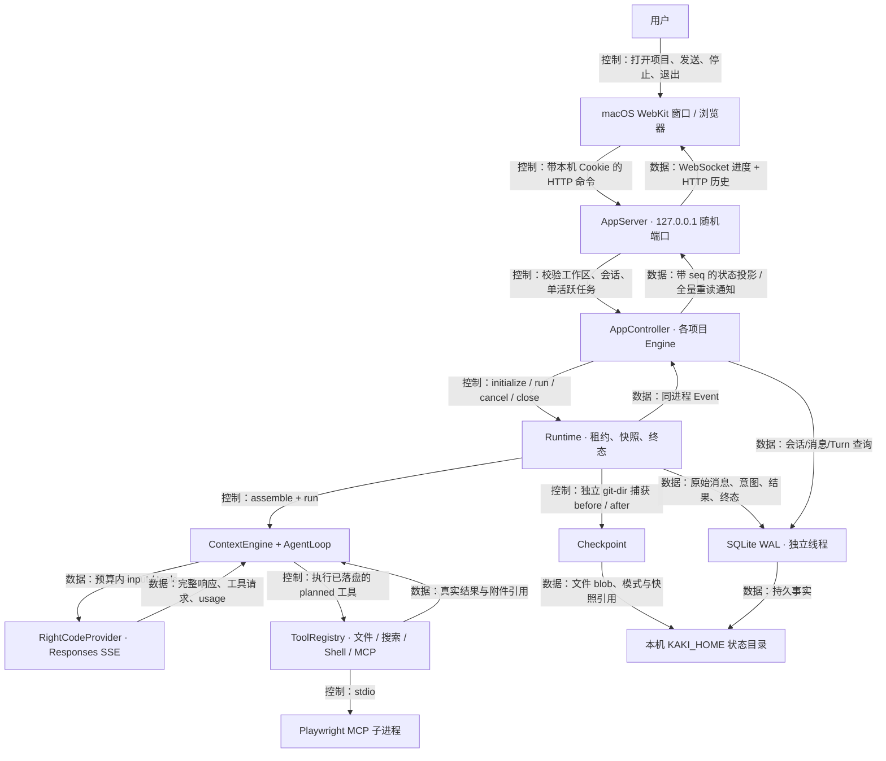

# Kaki v0.2 当前架构

默认入口现在是本机 App。macOS 使用 pywebview 的 Cocoa/WKWebView 原生窗口，其他系统可用浏览器模式。Python 内核、Right Code 配置、上下文规划、工具与持久化沿用 v0.1。入口和使用见 [app-guide.md](app-guide.md)，界面接口契约见 [module-spec/app.md](module-spec/app.md)，内核字段见 [module-spec/core.md](module-spec/core.md)。[v0.1 技术手册](kaki-agent-guide.md)保留当时的源代码摘录与图示。

这是一个应用进程。macOS 主线程运行 Cocoa，后台线程运行一个 asyncio 循环，SQLite 由一个专用线程执行；工具同步 I/O 通过线程卸载。HTTP/WS 只连接本机窗口和同进程后台，只监听 127.0.0.1。模型 API 和 stdio MCP 是独立的对外交互。

| 模块 | 拥有什么 | 事实边界 |
|---|---|---|
| desktop.py | 窗口、单实例、操作系统信号、应用生命周期 | 不生成 Turn 持久终态 |
| app_server.py | HTTP/WS 鉴权、路由、视图连接 | 不执行推理和工具决策 |
| app_controller.py | 工作区 Runtime、异步任务所有权、会话操作、实时投影 | 原始历史仍以 Store 为准 |
| ui/ | 会话导航、Markdown、输入、状态条、计时、停止/退出 | 断线必须显示状态待确认 |
| Runtime | 工作区租约、会话恢复、before/after 快照、唯一终态 | 工具成功以实际结果为准 |
| AgentLoop / ContextEngine | 有界模型循环、工具闭包、窗口选择与最终预算门 | 完整原始消息永远保留 |
| Provider / Tools / BrowserMcp | Responses 流解析、工具执行、MCP owner task | 模型草稿不能当已提交工具指令 |
| Store / Memory / Archive / Checkpoint | 事务事实、长期记忆、原文归档、文件快照 | Git 不能撤回浏览器/网络副作用 |

AppController 每个项目一个 Runtime，同一项目最多一个执行中的任务；多个会话可以随时查看，浏览其他会话不会改变正在执行的 Runtime.session_id。不同项目可各自运行，但没有多 Agent 规划和协作协议。

任务正文生成完成后，Runtime 仍可能保存最终结果、上下文和 after 快照。App 保持 `finishing`，直到拥有的 Task 返回后才开放下一轮。`completed` 仅表示 Agent 本轮结束，是否运行和通过测试仍看真实工具结果。

已有上下文能力保留：快慢路径、8 个 Curator 私有工具、manifest、working state、相关度衰减、无损归档、闭合工具调用组、整用户组裁剪、确定性回退、旧工具结果省略、循环内预算重平衡、溢出有限恢复与原生 reasoning 保留。Token 数为保守估算，不等同服务商 tokenizer 承诺。

本期没有代码差异编辑器、图形化文件回滚审批、可视化模型配置、多 Agent、远程 worker 或 Myna 服务。图形界面可继续要求模型 review、执行测试；人工文件恢复预览仍通过显式 `kaki-agent -C /path/to/repo tui` 的 `/undo` 完成。
