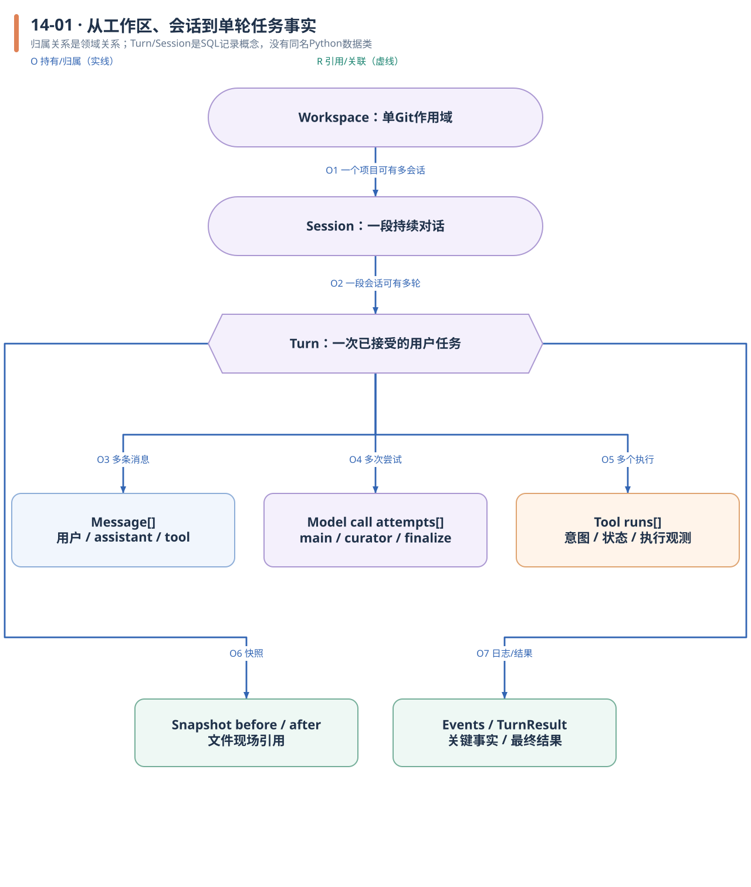
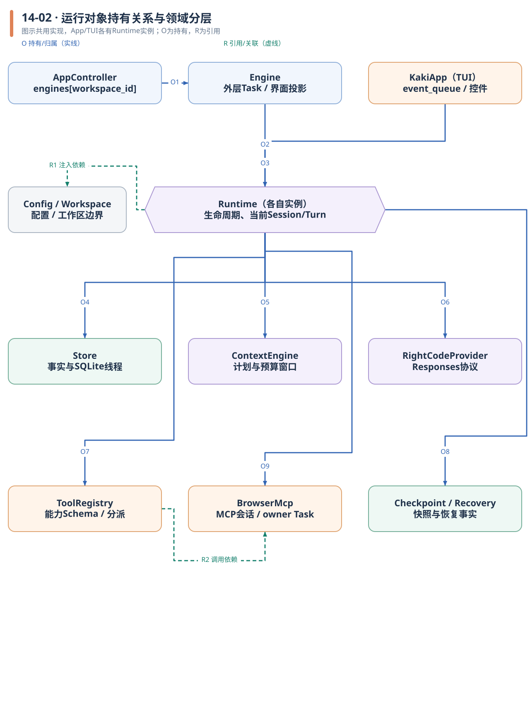
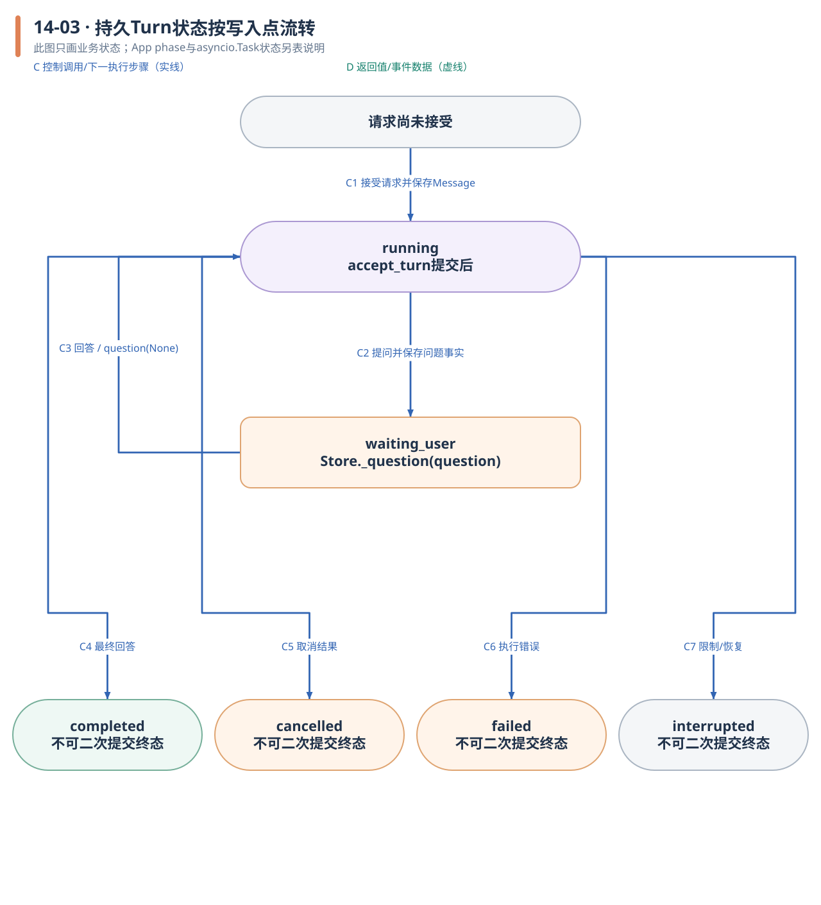
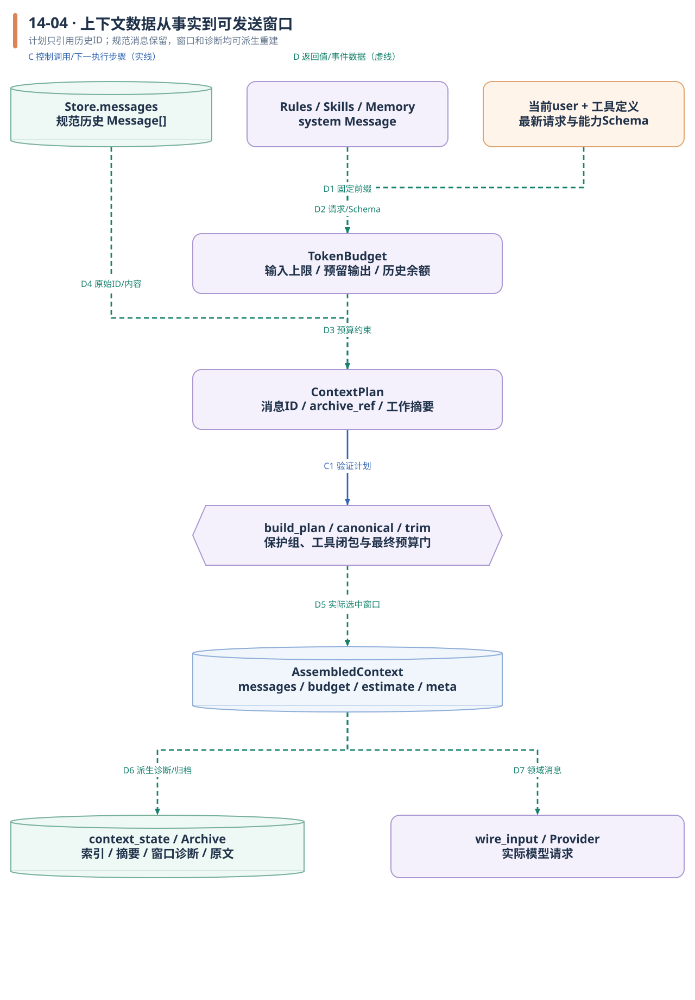
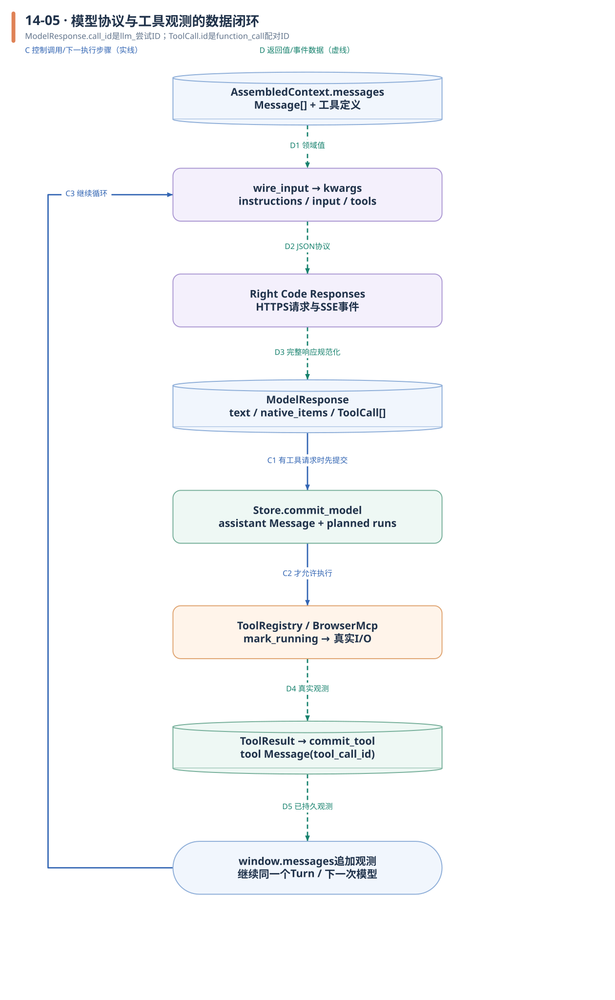
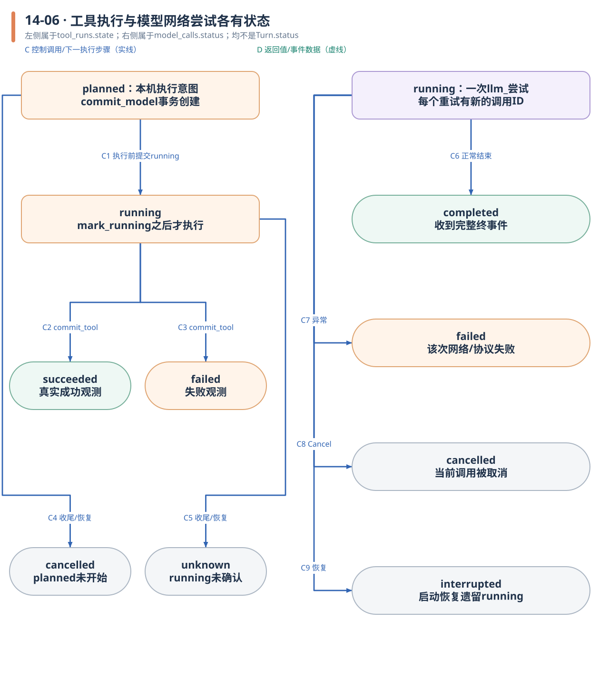
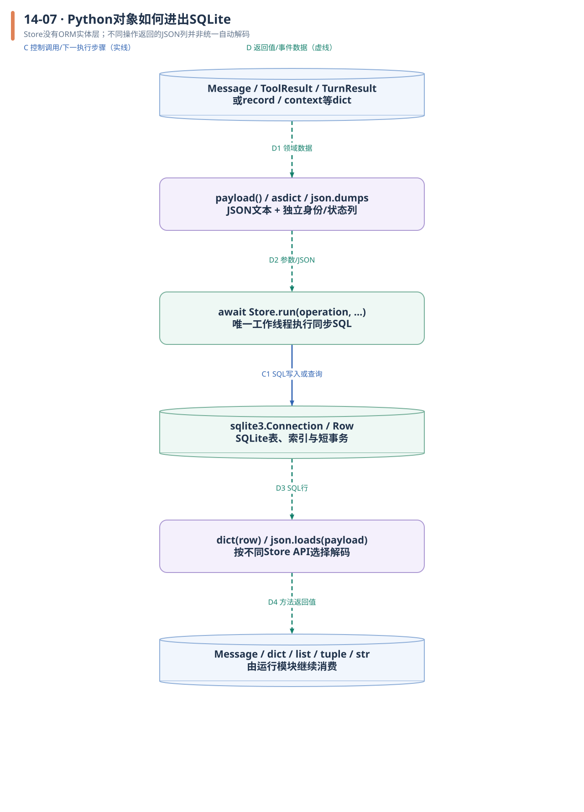
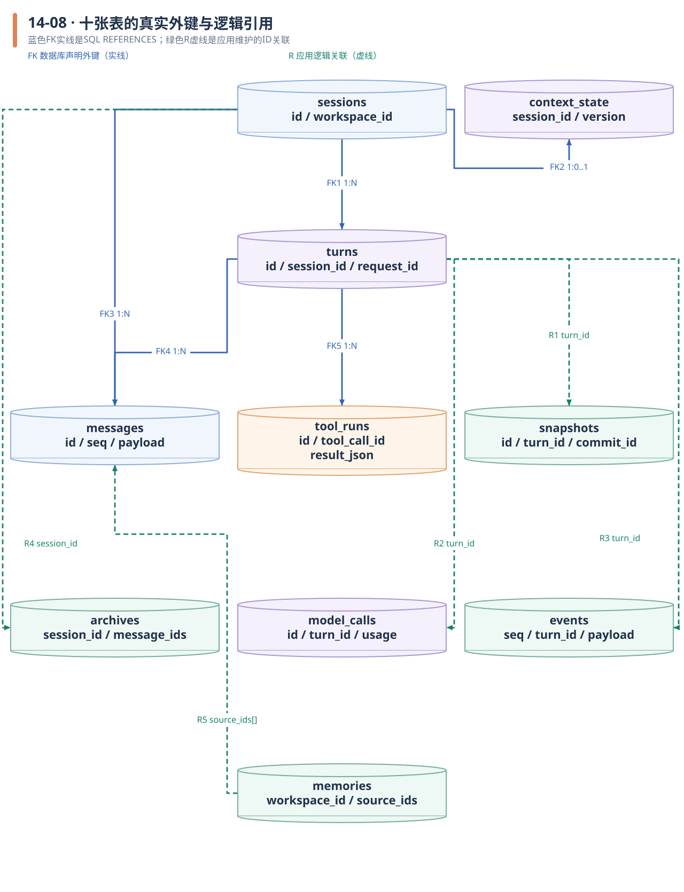

# 核心概念、数据结构与状态关系（Kaki v0.2）

本章按数据真正经过的顺序阅读：工作区和配置 → 会话与Turn → 消息和执行状态 → 上下文窗口 → 模型请求与工具观测 → 数据库与恢复 → 界面投影。源码固定到提交 [`df419e2`](https://github.com/anuolxl/kaki_agent/tree/df419e2ea8eeec2d86be610dc4f5165062cd773b)。示例ID和JSON均为教学示意，不是实际任务日志。

这里把四种东西分开标注：**数据类**（@dataclass）、**配置模型**（Pydantic）、**运行对象**（持有连接/Task/依赖的普通class）、**记录或协议字典**（dict/SQL行/JSON）。源码没有定义Turn、Session、ModelCall、RestorePlan等同名数据类；文中使用这些概念时会给出其真实表示，避免把讲解用的名称误认为可以直接import的类型。

图中O表示持有/归属，FK表示SQLite真正声明的外键，R表示通过ID形成的逻辑关联；流程图中的C表示调用或状态变更，D表示数据传递。请按每幅图的图例读箭头，不把“持有一个对象”理解成“继承这个类”。

## 01. 先理解Turn：一次用户任务的完整执行作用域

**Session是一段连续会话；Turn是其中一次被Runtime接受的用户任务。** 例如先说“介绍仓库”，再说“修改某函数并测试”，通常是同一Session中的两个Turn。第二个Turn可以多次调模型、执行多个工具、等待用户补充信息，直到产生终态。一次模型请求、一条assistant消息、一个asyncio.Task都不能单独代表整个Turn。



| 核心概念 | 真实表示 | 边界与关系 |
|---|---|---|
| Workspace | Workspace数据类；本地项目状态目录 | 规范化的单Git根目录；包含多个Session的持久事实 |
| Session | sessions表的一行；Store返回dict或session_id字符串 | 持续对话容器；不会为每次调用模型重建 |
| Request | text与可选request_id；App中还有pending_text | 用户提交的一次请求意图；接受前可以只有App内存状态 |
| Turn | turns表的一行；Runtime中active_turn保存其ID | 新请求接受事务产生；关联用户/模型/工具消息与执行记录 |
| Iteration | AgentLoop.run中的局部整数iteration | 一次主循环推进；重试、Curator与finalize使它不等于模型网络尝试总数 |
| Model call attempt | Provider的record字典、model_calls表行 | 一次实际网络尝试；同一complete调用重试会生成新的llm_ ID |
| ToolCall | ToolCall数据类 | 模型提出的工具名称与参数，尚未证明已执行 |
| Tool run | tool_runs表行、run_ ID | 本机执行意图、状态和真实结果；由Store在执行前登记 |
| Message | Message数据类、messages表行 | 规范会话事实；一个Turn通常包含多条Message |
| Event | Event数据类，或events表的另一种记录 | 运行通知与事务事实分别处理，详见第11节 |
| Window | AssembledContext | 本次可发送给模型的工作窗口；从事实历史派生 |
| Task / Future | asyncio.Task / asyncio.Future | 当前进程中的调度和等待对象；不会序列化进SQLite |

普通新任务在Store.accept_turn的事务内同时写Turn与用户Message。重复request_id会核对session和text：一致时复用已有执行事实，不一致时拒绝。**重复发送相同文字但使用新request_id，仍可以产生新Turn。**

源码节选：[src/kaki/store.py:206–229](https://github.com/anuolxl/kaki_agent/blob/df419e2ea8eeec2d86be610dc4f5165062cd773b/src/kaki/store.py#L206-L229)。

```python
    def _accept_turn(
        self, session: str, text: str, request_id: str | None = None
    ) -> tuple[str, Message, bool]:
        self._session(session)
        request_id = request_id or uid("r_")
        previous = self.db.execute("SELECT * FROM turns WHERE request_id=?", (request_id,)).fetchone()
        if previous:
            if previous["text"] != text or previous["session_id"] != session:
                raise KakiError("同一request_id不能提交不同任务")
            msg = next(m for m in self._messages(session) if m.turn_id == previous["id"] and m.role == "user")
            return previous["id"], msg, False
        turn = uid("t_")
        with self.db:
            self.db.execute(
                "INSERT INTO turns(id,session_id,request_id,status,text,created) VALUES(?,?,?,?,?,?)",
                (turn, session, request_id, "running", text, now()),
            )
            message = self._append(session, turn, Message("user", text))
            self.db.execute(
                "UPDATE sessions SET updated=?,title=CASE WHEN title='新会话' THEN ? ELSE title END WHERE id=?",
                (now(), text[:50], session),
            )
            self._event(session, turn, "turn.started", {"request_id": request_id, "message_id": message.id})
        return turn, message, True
```

ask_user的回答恢复同一Turn里等待的Future，不另外产生第二个Turn；/compact会接受一个Turn，但直接做上下文整理，不进入普通AgentLoop。App准备MCP时可能尚未创建Turn。工作区租约限制同一项目的执行并发；一个Session仍然可以先后包含很多Turn。

## 02. 从上到下的对象持有关系、职责与生命周期



| 层次 | 对象/结构 | 谁创建、持有 | 负责什么 | 生命周期 |
|---|---|---|---|---|
| 配置 | Config及子模型 | CLI加载，传给各运行对象 | 验证配置与预算参数；持有模型接口设置 | 通常贯穿进程 |
| 界面 | KakiApp / AppController / Engine | TUI直接持有Runtime；App每工作区一个Engine | 输入、状态投影、Task所有权、会话浏览 | 界面/已打开工作区 |
| 编排 | Runtime | 前端创建 | 依赖装配、当前session、接单、租约、快照和唯一终态 | 当前工作区运行实例 |
| 单轮执行 | AgentLoop及局部ctx/window | _turn进入普通任务时创建 | 模型—工具—观测循环 | 当前Turn |
| 上下文 | ContextEngine与Curator/Rules/Skills/Memory/Archive | Runtime.initialize装配 | 把会话事实与知识转换成受预算约束的窗口 | Engine长期存在，窗口按任务重建 |
| 外部I/O | RightCodeProvider / ToolRegistry / BrowserMcp | Runtime装配 | 模型协议、工具分派、MCP owner task | 通常复用至Runtime.close |
| 持久化 | Store / Checkpoint / Recovery | Runtime构造 | 数据库事实、独立Git快照、崩溃核验 | 运行对象短于磁盘事实 |

Runtime的字段直接展示了这组依赖：

源码节选：[src/kaki/runtime.py:27–48](https://github.com/anuolxl/kaki_agent/blob/df419e2ea8eeec2d86be610dc4f5165062cd773b/src/kaki/runtime.py#L27-L48)。

```python
    def __init__(self, workspace: Workspace, config: Config, *, provider=None, interactive: bool = True):
        self.workspace, self.config = workspace, config
        self.interactive = interactive
        self.store = Store(workspace.state / "kaki.sqlite3", workspace.id)
        self.provider = provider
        self.browser = BrowserMcp(workspace, config)
        self.context = None
        self.tools = None
        self.checkpoint = Checkpoint(workspace, self.store, config)
        self.recovery = Recovery(self.store)
        self.lease = WorkspaceLease(workspace.state)
        self.session_id = ""
        self.active = None
        self.active_turn = ""
        self.partial_text = ""
        self.listeners = []
        self.question = None
        self.initialized = False
        self.closed = False
        self.recovery_plan = {}
        self.browser_warning = None
        self._browser_attempted = False
```

这里的workspace/config/store/provider/context/tools等是对象引用。active是Task，active_turn是字符串ID，question是含Future的临时字典，recovery_plan是可重新生成的恢复说明，listeners是异步回调列表。两个前端进程可以读取同一个工作区数据库，但不共享这些内存对象。

## 03. 配置模型与Workspace：最上层的数据边界

### 03.1 Config采用嵌套配置模型，组合关系与继承关系不同

Options继承Pydantic BaseModel，统一camelCase别名、snake_case构造方式和未知字段拒绝。Config组合各子模型；Defaults、OpenAIOptions等继承的是Options，没有继承Config。

源码节选：[src/kaki/config.py:17–18](https://github.com/anuolxl/kaki_agent/blob/df419e2ea8eeec2d86be610dc4f5165062cd773b/src/kaki/config.py#L17-L18)。

```python
class Options(BaseModel):
    model_config = ConfigDict(alias_generator=to_camel, populate_by_name=True, extra="forbid")
```

源码节选：[src/kaki/config.py:122–137](https://github.com/anuolxl/kaki_agent/blob/df419e2ea8eeec2d86be610dc4f5165062cd773b/src/kaki/config.py#L122-L137)。

```python
class Config(Options):
    agents: Agents = Field(default_factory=Agents)
    providers: Providers = Field(default_factory=Providers)
    context: ContextOptions = Field(default_factory=ContextOptions)
    memory: MemoryOptions = Field(default_factory=MemoryOptions)
    runtime: RuntimeOptions = Field(default_factory=RuntimeOptions)
    tools: ToolsOptions = Field(default_factory=ToolsOptions)
    skill_forge: SkillOptions = Field(default_factory=SkillOptions)

    def validate_credentials(self):
        if not self.providers.openai.api_key.get_secret_value():
            raise KakiError("缺少providers.openai.apiKey；请运行kaki-agent setup --import-config <已有配置>")
        if not self.providers.openai.api_base.startswith(
            ("https://", "http://127.0.0.1", "http://localhost")
        ):
            raise KakiError("apiBase必须使用HTTPS（本机测试端点除外）")
```

| 配置路径 | 对应类 | 主要字段与当前默认值 | 主要消费者 |
|---|---|---|---|
| agents.defaults | Agents → Defaults | provider=openai；model=openai/gpt-5.6-sol；workspace=None；max_tokens=8192；context_window_tokens=65536；max_tool_iterations=40；temperature=0.1；空响应恢复与重试上限 | Runtime、Loop、Context、Provider |
| providers.openai | Providers → OpenAIOptions | api_base、SecretStr api_key、extra_headers=None、models=[]、timeout=120 | Provider构造AsyncOpenAI；Key只在请求边界解包 |
| context | ContextOptions | engine=unified；fast_path_threshold=0.6；curator_model=None；timeout=30；protect_first_n=3；archive_dir；相关度衰减0.95/增强0.15 | ContextEngine/Curator |
| memory | MemoryOptions | backend=local或null；user_id=default；memory_top_k=5 | 项目/用户作用域的显式长期记忆 |
| runtime.checkpoint | RuntimeOptions → CheckpointOptions | policy=interactive；shadow_dir=checkpoints/kaki-shadow.git | Runtime快照策略、Checkpoint |
| tools.exec | ToolsOptions → ExecOptions | timeout=60；path_append为空 | 本地Shell工具 |
| tools.mcp_servers.browser | dict[str,McpOptions] | type=stdio、command=npx、args/env、tool_timeout=45 | Playwright MCP启动和调用 |
| tools | ToolsOptions | restrict_to_workspace=True；disabled_tools=[] | disabled_tools影响注册；restrict_to_workspace当前未被执行器读取，设为False也不关闭Workspace.path边界 |
| skill_forge | SkillOptions → SkillRouter | router.enabled=True/top_k=5/local_min_score=0；inject_max=2；always_max=5；injection_mode=full_body | 本地Skill检索与注入 |

默认值来自类声明，实际运行值取决于CLI/非空环境变量/JSON合并。Config不是每次Turn重新建的请求体，也不会整体发送给大模型。dataclass的类型注解主要用于表达契约；配置的校验由Pydantic执行，工具参数由JSON Schema校验，Curator计划还要经过parse_plan与预算门。

### 03.2 Workspace把“目标代码目录”与“Agent状态目录”分开

源码节选：[src/kaki/workspace.py:18–25](https://github.com/anuolxl/kaki_agent/blob/df419e2ea8eeec2d86be610dc4f5165062cd773b/src/kaki/workspace.py#L18-L25)。

```python
@dataclass
class Workspace:
    root: Path
    state: Path
    id: str
    knowledge_roots: list[Path] = field(default_factory=list)
    rule_files: list[Path] = field(default_factory=list)

```

| 字段 | 类型 | 含义 |
|---|---|---|
| root | Path | Git规范根目录，代码读写作用域 |
| state | Path | ~/.kaki/projects/<仓库名>-<路径hash>/，保存DB、归档、附件、快照等 |
| id | str | 规范路径的SHA256前16位；路径变化会改变项目作用域 |
| knowledge_roots | list[Path] | 显式继承规则发现的只读知识目录 |
| rule_files | list[Path] | AGENTS.md/KAKI.md及允许的继承入口 |

Workspace.resolve构造这个对象并写workspace.json。它不是Git仓库内容的全量副本。Workspace.path负责真实路径归一化、单Git边界与凭据文件约束；knowledge_roots扩大的是允许读取的知识范围，不扩大代码写权限。WorkspaceLease持有文件句柄/flock，是执行互斥资源，不是业务Turn记录。

## 04. 任务状态的数据结构：TurnRecord、TurnResult、Task与Engine.phase

### 04.1 TurnRecord是SQL行，TurnResult是明确的数据类

turns行包含id、session_id、request_id、status、text、stop_reason、error、result_json、before_snapshot、after_snapshot、created、ended。Store._turns返回list[dict]，没有自动构造一个Turn类。

TurnResult在Loop或Runtime异常路径构造，Runtime再补用量/快照，最终asdict写入turns.result_json：

源码节选：[src/kaki/types.py:84–96](https://github.com/anuolxl/kaki_agent/blob/df419e2ea8eeec2d86be610dc4f5165062cd773b/src/kaki/types.py#L84-L96)。

```python
@dataclass
class TurnResult:
    turn_id: str
    status: TurnStatus
    text: str
    stop_reason: str
    tools: int = 0
    tool_failures: int = 0
    verification: dict[str, Any] = field(default_factory=lambda: {"status": "not_run", "commands": []})
    usage: dict[str, Any] = field(default_factory=dict)
    before_snapshot: str | None = None
    after_snapshot: str | None = None
    error: str | None = None
```

| 字段 | 语义与更新方 |
|---|---|
| turn_id / status / stop_reason | 执行身份、业务结果和结束原因；Loop/Runtime构造，Store.finish_turn提交 |
| text | 最终回答、未完成说明或部分草稿，不必然是“任务成功证明” |
| tools / tool_failures | 本轮普通工具完成统计，来自Loop |
| verification | dict；默认not_run/commands=[]；实际测试工具观测才更新 |
| usage | dict；Runtime从model_calls汇总当前Turn的已知调用和未知用量次数 |
| before_snapshot / after_snapshot | 快照记录ID，允许None；不是Git提交SHA本身 |
| error | 可公开的错误说明，允许None |

Loop识别到测试Shell命令后，把command/cwd/exit_code/artifacts/run_id写入verification.commands。当前实现的verification.status会随识别到的测试结果更新，不是自动覆盖率证明，也不是全量测试矩阵的归约。completed与verification=passed是两个判断。

源码节选：[src/kaki/loop.py:122–133](https://github.com/anuolxl/kaki_agent/blob/df419e2ea8eeec2d86be610dc4f5165062cd773b/src/kaki/loop.py#L122-L133)。

```python
                    if call.name == "kaki_exec" and rt.is_test_command(call.arguments.get("command", "")):
                        evidence = {
                            "command": call.arguments["command"],
                            "cwd": call.arguments.get("working_dir", str(rt.workspace.root)),
                            "exit_code": result.exit_code,
                            "artifacts": result.artifacts,
                            "run_id": by_call[call.id]["id"],
                        }
                        verification["commands"].append(evidence)
                        verification["status"] = (
                            "passed" if result.exit_code == 0 and not result.failed else "failed"
                        )
```

### 04.2 持久Turn状态与运行中界面状态分开读



源码节选：[src/kaki/types.py:10–11](https://github.com/anuolxl/kaki_agent/blob/df419e2ea8eeec2d86be610dc4f5165062cd773b/src/kaki/types.py#L10-L11)。

```python
TurnStatus = Literal["queued", "running", "waiting_user", "completed", "interrupted", "cancelled", "failed"]
TERMINAL = {"completed", "interrupted", "cancelled", "failed"}
```

| Turn.status | 真正的写入位置/触发点 | 可否继续同一Turn |
|---|---|---|
| running | accept_turn初始写入；question回答后的Store._question(None) | 是，模型/工具继续 |
| waiting_user | Store._question接收非空问题 | 是，回答Future后继续 |
| completed | finish_turn接收最终回答或手动整理结果 | 终态；后续任务创建新Turn |
| interrupted | Loop迭代上限/finalize结果；进程恢复时process_exit | 终态；新任务核验现场 |
| cancelled | 用户取消被Runtime转换成业务结果 | 终态；已完成副作用不自动撤回 |
| failed | 已接受任务后发生执行异常 | 终态；不能覆写成另一个结果 |
| queued | 类型声明和恢复查询支持的值 | 当前正常accept_turn直接写running，没有独立排队写入路径 |

Store._assert_active和_finish_turn阻止已结束Turn继续提交；恢复会把遗留活跃状态改为interrupted。Task的pending/done/cancelled属于Python调度状态，不写入Turn.status；Runtime捕获取消后正常返回TurnResult(cancelled)，所以Task正常完成也不能等同于业务成功。

### 04.3 Engine.phase是App投影，busy由外层Task决定

App的Engine可能已经preparing但还没有Turn；Turn数据库已completed时，Engine仍可能处于finishing，因为Runtime/Controller返回链尚未结束。unknown/archived/closing/closed等还可能由JS状态决策产生，并非Turn枚举。

| 判定 | 数据源 | 作用 |
|---|---|---|
| 本轮是否持久结束 | turns.status / TurnResult.status | 崩溃恢复与执行事实 |
| 本机执行协程是否结束 | Runtime.active.done() | 是否允许下一次Runtime.submit |
| App准备或执行是否仍占用工作区 | Engine.task及busy属性 | 覆盖切会话/MCP准备/Runtime执行/外层收尾 |
| 用户当前看见什么 | Engine.phase + JS statusFor | 显示“思考/工具/等待回答/收尾/断线”等 |

## 05. Message：原始会话事实与工具协议的连接点

源码节选：[src/kaki/types.py:22–45](https://github.com/anuolxl/kaki_agent/blob/df419e2ea8eeec2d86be610dc4f5165062cd773b/src/kaki/types.py#L22-L45)。

```python
@dataclass
class Message:
    role: str
    content: str = ""
    id: int = 0
    session_id: str = ""
    turn_id: str = ""
    tool_calls: list[dict[str, Any]] = field(default_factory=list)
    tool_call_id: str | None = None
    native_items: list[dict[str, Any]] = field(default_factory=list)
    parts: list[dict[str, Any]] = field(default_factory=list)
    artifacts: list[dict[str, Any]] = field(default_factory=list)
    created_at: str = field(default_factory=now)

    def payload(self) -> dict[str, Any]:
        return {
            "role": self.role,
            "content": self.content,
            "tool_calls": self.tool_calls,
            "tool_call_id": self.tool_call_id,
            "native_items": self.native_items,
            "parts": self.parts,
            "artifacts": self.artifacts,
        }
```

| 字段 | 层级与语义 |
|---|---|
| role / content | system/user/assistant/tool及正文；role实际注解是str，Provider会拒绝不支持的角色 |
| id | Store._append分配的SQLite整数主键；0表示尚未持久化的临时Message |
| session_id / turn_id | 原始消息归属；由Store赋值，窗口临时system消息不必有持久ID |
| tool_calls | list[dict]；assistant提出的工具请求，Store把ToolCall用asdict转换后保存 |
| tool_call_id | tool消息回答哪一个模型工具请求；连接assistant.tool_calls中的id |
| native_items | Responses原生output项，保留reasoning/function_call/message顺序与opaque信息 |
| parts | 本机附件引用或输入图片分段；在请求边界展开为模型协议内容 |
| artifacts | 完整工具输出/图片等可定位附件的元数据 |
| created_at | UTC ISO字符串；数据库列名为created |

payload()输出领域内容，不包含id、session_id、turn_id或created_at。这些身份字段存SQL独立列；读取时Store把payload与列重新合成Message。**Message类没有seq字段；消息顺序seq是messages表中每会话唯一的列。** 数字id是数据库主键，seq是会话顺序，二者不能互换。

消息分组三个尺度也不同：Session中有多次Turn；一组用户边界历史是history.groups按user消息切分；一组工具exchange是assistant发出的所有工具请求及其tool观测，必须保持配对。窗口裁剪会处理这些边界，但不删除messages里的原始事实。

源码节选：[src/kaki/context/history.py:24–46](https://github.com/anuolxl/kaki_agent/blob/df419e2ea8eeec2d86be610dc4f5165062cd773b/src/kaki/context/history.py#L24-L46)。

```python
def structural_errors(messages: list[Message]) -> list[str]:
    pending = {}
    errors = []
    for m in messages:
        if m.role == "assistant":
            if pending:
                errors.append("assistant arrived before previous tool results: " + ",".join(pending))
            for c in m.tool_calls:
                if not c.get("id") or c["id"] in pending:
                    errors.append("missing or duplicate tool_call_id")
                else:
                    pending[c["id"]] = m.id
        elif m.role == "tool":
            if m.tool_call_id not in pending:
                errors.append("orphan tool result: " + str(m.tool_call_id))
            else:
                del pending[m.tool_call_id]
        elif m.role == "user" and pending:
            errors.append("user message interrupts open tool exchange")
    if pending:
        errors.append("missing tool results: " + ",".join(pending))
    return errors

```

## 06. 上下文管理：预算、选择计划、实际窗口与派生状态



### 06.1 TokenBudget记录预算，不承载模型向量

源码节选：[src/kaki/types.py:114–129](https://github.com/anuolxl/kaki_agent/blob/df419e2ea8eeec2d86be610dc4f5165062cd773b/src/kaki/types.py#L114-L129)。

```python
@dataclass(frozen=True)
class TokenBudget:
    context_length: int
    reserved_output: int
    reserved_system: int
    reserved_tools: int
    reserved_user: int
    margin: int

    @property
    def input_limit(self) -> int:
        return self.context_length - self.reserved_output - self.margin

    @property
    def available_history(self) -> int:
        return max(0, self.input_limit - self.reserved_system - self.reserved_tools - self.reserved_user)
```

context_length是配置窗口cap；reserved_output预留回答；reserved_system/tools/user分别估算固定前缀、工具定义与当前请求；margin留安全余量。

```text
input_limit = context_length - reserved_output - margin
available_history = max(0, input_limit - reserved_system - reserved_tools - reserved_user)
```

默认窗口65536、输出8192，margin=max(128,int(65536×0.02))=1310，input_limit=56034。若固定前缀/工具/当前请求估算分别8000/4000/1000，历史可用预算为43034。此为教学预算，不是服务商用量报告；最终estimate还会按完整instructions/input/tools和图片开销重新核对。

源码节选：[src/kaki/context/tokens.py:28–38](https://github.com/anuolxl/kaki_agent/blob/df419e2ea8eeec2d86be610dc4f5165062cd773b/src/kaki/context/tokens.py#L28-L38)。

```python
def estimate(messages: list[Message], tools: list[dict] | None = None) -> int:
    system, items = wire_input(messages)
    # Image bytes remain in artifact storage. Reserve conservative image overhead, not base64 length.
    images = sum(len(m.parts) for m in messages)
    return (
        32
        + count_text(
            json.dumps({"instructions": system, "input": items, "tools": tools or []}, ensure_ascii=False)
        )
        + images * 4096
    )
```

本机tiktoken使用o200k_base，失败时按UTF-8字节估算；估算结构包含原生协议项，每个parts项另预留4096。TokenBudget没有embedding或向量字段，当前检索使用文本相关度算法；模型内部的embedding/隐藏状态不是Agent持久数据结构。

### 06.2 ContextPlan是一份“选择已有事实”的计划

源码节选：[src/kaki/types.py:132–139](https://github.com/anuolxl/kaki_agent/blob/df419e2ea8eeec2d86be610dc4f5165062cd773b/src/kaki/types.py#L132-L139)。

```python
@dataclass
class ContextPlan:
    include_message_ids: list[int] = field(default_factory=list)
    include_archive_refs: list[str] = field(default_factory=list)
    drop_message_ids: list[int] = field(default_factory=list)
    working_state_injection: str = ""
    memory_sections: list[str] = field(default_factory=list)
    notes: str = ""
```

| 字段 | 输入含义与约束 |
|---|---|
| include_message_ids | 希望保留的已有持久消息整数ID |
| include_archive_refs | 本会话归档ID，先解析为原始消息ID再选择 |
| drop_message_ids | 显式排除项；不能排除保护组或拆工具配对 |
| working_state_injection | 有损工作摘要，限量附加到system前缀 |
| memory_sections | 只接受已实现的working_state/memory别名 |
| notes | 计划说明，用于诊断，不是新的用户指令 |

Curator输出JSON需parse_plan校验；build_plan验证引用ID、展开归档、保护初始用户组、canonical补齐工具exchange，再trim到预算。不满足条件会返回规划失败或走确定性fallback。Plan被采纳也不等于已执行任何文件/浏览器操作；Curator只开放私有上下文工具。

### 06.3 AssembledContext是最终可发送窗口

源码节选：[src/kaki/types.py:142–147](https://github.com/anuolxl/kaki_agent/blob/df419e2ea8eeec2d86be610dc4f5165062cd773b/src/kaki/types.py#L142-L147)。

```python
@dataclass
class AssembledContext:
    messages: list[Message]
    budget: TokenBudget
    estimated_tokens: int
    metadata: dict[str, Any] = field(default_factory=dict)
```

messages按system → 选定历史 → 当前user排列，循环执行期间继续追加assistant/tool消息；budget携带预算；estimated_tokens是某次组装/重平衡的估算值，并非每次append后自动更新的计数器；metadata保留选择、校验、知识来源和路径。

| metadata字段 | 来源/用途 |
|---|---|
| path | fast / slow / fallback；slow可带curator_steps |
| included_ids / plan / validation | 实际入窗历史ID、ContextPlan快照和预算/协议校验 |
| history_messages / history_tokens | 历史概况，不能冒充整包请求精确计数 |
| context_window / input_limit | 当前配置cap与输入限制 |
| archive_ref | 被省略原文的归档引用，可缺省/None |
| memory_ids / memory_hits / Skill相关字段 | 前缀知识来源；Skill字段为injected_skill_ids/referenced_skill_ids/skill_source_failures/skill_versions |
| rebalanced / elided_tool_results | 循环过程中重平衡窗口的事实 |

metadata是实际dict，字段取决于路径，不是每次都有所有键。Loop每轮调用rebalance时重新estimate；旧窗口过大时先按完整用户组裁剪，再收敛旧工具正文与完整exchange；历史原文继续存在。

### 06.4 context_state把索引、工作摘要和上次窗口诊断分开

源码节选：[src/kaki/store.py:438–449](https://github.com/anuolxl/kaki_agent/blob/df419e2ea8eeec2d86be610dc4f5165062cd773b/src/kaki/store.py#L438-L449)。

```python
    def _context_get(self, session: str) -> dict:
        row = self.db.execute("SELECT * FROM context_state WHERE session_id=?", (session,)).fetchone()
        return (
            {
                "manifest": json.loads(row["manifest"]),
                "working": json.loads(row["working"]),
                "plan": json.loads(row["plan"]),
                "version": row["version"],
            }
            if row
            else {"manifest": {}, "working": {}, "plan": {}, "version": 0}
        )
```

| 派生结构 | 真实形状 | 持久/更新方式 |
|---|---|---|
| manifest | dict[str(message_id),{role,turn_id,tokens,snippet,relevance,archive_ref?}] | assemble更新相关度/索引，context_set保存 |
| working | dict；goals/open_threads/decisions/source_ids/last_turn等键按路径出现 | Curator.state或after_turn更新；不是完整聊天记录 |
| plan | dict；保存assembled.metadata | 这里的plan列是窗口诊断对象，里面才可能含ContextPlan的asdict；不是ContextPlan本身 |
| version | int，未存时0，每次context_set加1 | 变更计数，不是跨线程CAS锁 |

源码节选：[src/kaki/context/engine.py:149–163](https://github.com/anuolxl/kaki_agent/blob/df419e2ea8eeec2d86be610dc4f5165062cd773b/src/kaki/context/engine.py#L149-L163)。

```python
        relevant = {history[i].id: s for i, s in rank(user.content, [m.content for m in history])}
        for m in history:
            old = manifest.get(str(m.id), {})
            score = float(old.get("relevance", 0.5)) * self.config.context.relevance_decay
            if m.id in relevant:
                score = min(1, score + self.config.context.relevance_reference_boost)
            manifest[str(m.id)] = {
                **old,
                "role": m.role,
                "turn_id": m.turn_id,
                "tokens": count_text(m.content),
                "snippet": excerpt(m.content, 100),
                "relevance": score,
            }
        await self.store.run("context_set", session, manifest=manifest)
```

源码节选：[src/kaki/context/engine.py:275–289](https://github.com/anuolxl/kaki_agent/blob/df419e2ea8eeec2d86be610dc4f5165062cd773b/src/kaki/context/engine.py#L275-L289)。

```python
    async def after_turn(self, session: str, user: Message, result: TurnResult):
        state = await self.store.run("context_get", session)
        working = state["working"]
        working["goals"] = ([excerpt(user.content, 200)] + working.get("goals", []))[:8]
        working["source_ids"] = list(dict.fromkeys([user.id] + working.get("source_ids", [])))[:40]
        if result.status != "completed":
            working["open_threads"] = (
                [f"{result.stop_reason}: " + excerpt(user.content, 200)] + working.get("open_threads", [])
            )[:12]
        working["last_turn"] = {
            "id": result.turn_id,
            "status": result.status,
            "stop_reason": result.stop_reason,
        }
        await self.store.run("context_set", session, working=working)
```

Curator.state把goals/open_threads/decisions限制为8/12/20条；after_turn还维护至多40个source_ids和最近Turn摘要。这些键是动态字典契约，不是另一个WorkingState数据类。Memory是跨Session的显式项目记忆；working是会话级派生摘要；Archive是完整原文的可校验副本，三者不能互换。

### 06.5 CuratorPayload和Validation：规划输入与可验证输出

Curator有自己的私有Message列表，但复用相同Provider和Message类型。它看到的payload不是主模型完整窗口：先选最近消息、相关候选和保护组，再传摘要索引及全部可选ID，避免为压缩再复制一份无限长正文。

| payload字段 | 真实类型与来源 | 职责 |
|---|---|---|
| current_request | str；当前请求限量节选 | 告诉规划器此次要解决什么 |
| budget | dict；asdict(TokenBudget) | 展示预算基础字段；不含property计算字段 |
| working_state | dict；context_state.working | 保留未决事项与有效决策 |
| manifest | list[dict]；候选Message的id/role/turn_id/tokens/snippet/relevance | 让规划器选择真实消息ID，不伪造历史 |
| all_message_ids | list[int]；全部history消息ID | 提供可引用身份全集，不意味着全部内容已进入私有Prompt |

源码节选：[src/kaki/context/curator.py:115–131](https://github.com/anuolxl/kaki_agent/blob/df419e2ea8eeec2d86be610dc4f5165062cd773b/src/kaki/context/curator.py#L115-L131)。

```python
        payload = {
            "current_request": excerpt(user.content, 600),
            "budget": asdict(budget),
            "working_state": working,
            "manifest": [
                {
                    "id": m.id,
                    "role": m.role,
                    "turn_id": m.turn_id,
                    "tokens": count_text(m.content),
                    "snippet": excerpt(m.content, 120),
                    "relevance": manifest.get(str(m.id), {}).get("relevance", 0.5),
                }
                for m in sorted(selected.values(), key=lambda m: m.id)
            ],
            "all_message_ids": [m.id for m in history],
        }
```

私有规划器输出经parse_plan成为ContextPlan，build_plan再形成AssembledContext。Validation是trim返回的dict，含ok、estimated_tokens、input_limit、over_by、dropped_ids、errors、included_ids；它同时检查预算和工具配对。accepted=True表示候选计划可用，不表示已执行用户要求的代码修改或测试。

## 07. 与大模型交互：领域Message、Responses请求与ModelResponse



### 07.1 一次请求经过三种形态

| 阶段 | 真实类型 | 负责转换的函数 |
|---|---|---|
| Agent内核 | list[Message]、list[dict]工具定义 | ContextEngine/Loop准备 |
| 请求协议 | instructions:str、input:list[dict]、kwargs:dict | provider.wire_input与complete |
| SDK/网络 | AsyncOpenAI Responses请求、SSE事件对象 | RightCodeProvider处理 |
| 返回内核 | ModelResponse，其中tool_calls为list[ToolCall] | normalize_response |

源码节选：[src/kaki/provider.py:20–55](https://github.com/anuolxl/kaki_agent/blob/df419e2ea8eeec2d86be610dc4f5165062cd773b/src/kaki/provider.py#L20-L55)。

```python
def wire_input(messages: list[Message], resolve_part=None) -> tuple[str, list[dict[str, Any]]]:
    instructions = []
    items = []
    for m in messages:
        if m.role == "system":
            instructions.append(m.content)
        elif m.role == "user":
            parts = [{"type": "input_text", "text": m.content or "(empty)"}]
            parts.extend(expand_parts(m.parts, resolve_part))
            items.append({"role": "user", "content": parts})
        elif m.role == "assistant":
            if m.native_items:
                # Preserve the exact item ordering and opaque reasoning needed by the tool round-trip.
                items.extend(m.native_items)
            else:
                if m.content:
                    items.append(
                        {"role": "assistant", "content": [{"type": "output_text", "text": m.content}]}
                    )
                for call in m.tool_calls:
                    items.append(
                        {
                            "type": "function_call",
                            "call_id": call["id"],
                            "name": call["name"],
                            "arguments": json.dumps(call["arguments"], ensure_ascii=False),
                        }
                    )
        elif m.role == "tool":
            output: Any = m.content or "(no output)"
            if m.parts:
                output = [{"type": "input_text", "text": output}, *expand_parts(m.parts, resolve_part)]
            items.append({"type": "function_call_output", "call_id": m.tool_call_id, "output": output})
        else:
            raise ProviderError(f"不支持的消息角色：{m.role}", "protocol")
    return "\n\n".join(instructions), items
```

system合并进instructions；user变成input_text及图片parts；assistant优先重放native_items，没有原生项时才由文本/工具请求重建；tool变成function_call_output，并通过call_id回接原工具请求。模型只收到工具Schema，不会收到Python execute函数或整个Runtime。

源码节选：[src/kaki/provider.py:170–183](https://github.com/anuolxl/kaki_agent/blob/df419e2ea8eeec2d86be610dc4f5165062cd773b/src/kaki/provider.py#L170-L183)。

```python
        instructions, items = await asyncio.to_thread(wire_input, messages, self.part_resolver)
        kwargs = {
            "model": api_model,
            "input": items,
            "instructions": instructions,
            "stream": True,
            "max_output_tokens": max_tokens or self.config.agents.defaults.max_tokens,
            "store": False,
            "include": ["reasoning.encrypted_content"],
            "temperature": self.config.agents.defaults.temperature,
        }
        if tools:
            kwargs["tools"] = tools
            kwargs["tool_choice"] = tool_choice
```

kwargs中的model去掉openai/路由前缀，包含stream、max_output_tokens、store=False等字段。配置Key通过SDK认证设置使用，不放入Message、kwargs正文或App DTO。这里的store=False是上游Responses参数，不影响本机Store持久化。

### 07.2 ModelResponse是一次完整模型响应的领域结果

源码节选：[src/kaki/types.py:65–74](https://github.com/anuolxl/kaki_agent/blob/df419e2ea8eeec2d86be610dc4f5165062cd773b/src/kaki/types.py#L65-L74)。

```python
@dataclass
class ModelResponse:
    text: str = ""
    tool_calls: list[ToolCall] = field(default_factory=list)
    native_items: list[dict[str, Any]] = field(default_factory=list)
    usage: dict[str, int] = field(default_factory=dict)
    finish_reason: str = "completed"
    model: str = ""
    call_id: str = ""
    provider_id: str = ""
```

| 字段 | 含义 |
|---|---|
| text | 从output_text/refusal汇合的可展示正文 |
| tool_calls | 规范化ToolCall列表，等待Registry处理 |
| native_items | 原始output项；供下一轮协议重放 |
| usage | prompt_tokens/completion_tokens/total_tokens；还可含cached_tokens/reasoning_tokens |
| finish_reason | completed或incomplete原因；有截断工具请求时禁止执行 |
| model | 上游返回的模型名 |
| call_id | 本机llm_网络尝试ID；可用作UI draft_id |
| provider_id | 上游response ID；不是ToolCall.id |

ToolCall的arguments在Responses中是JSON字符串，normalize_response把它解析成dict；解析无效时保留_raw_arguments，后续由工具参数校验产生真实失败观测。SDK增量只用于展示，完整结束事件和工具参数检查通过后才执行工具。

源码节选：[src/kaki/provider.py:72–94](https://github.com/anuolxl/kaki_agent/blob/df419e2ea8eeec2d86be610dc4f5165062cd773b/src/kaki/provider.py#L72-L94)。

```python
def normalize_response(response: Any, call_id: str) -> ModelResponse:
    data = response.model_dump(exclude_none=True) if hasattr(response, "model_dump") else response
    native = data.get("output", [])
    text = []
    calls = []
    for item in native:
        typ = item.get("type")
        if typ == "message":
            for part in item.get("content", []):
                if part.get("type") == "output_text":
                    text.append(part.get("text", ""))
                elif part.get("type") == "refusal":
                    text.append(part.get("refusal", ""))
        elif typ == "function_call":
            if not item.get("call_id") or not item.get("name"):
                raise ProviderError("模型返回缺少call_id/name的工具请求，未执行", "protocol")
            try:
                args = json.loads(item.get("arguments") or "{}")
                if not isinstance(args, dict):
                    args = {"_raw_arguments": item.get("arguments")}
            except ValueError:
                args = {"_raw_arguments": item.get("arguments")}
            calls.append(ToolCall(item["call_id"], item["name"], args))
```

### 07.3 ModelCall记录与ModelResponse不是同一个结构

Provider每个网络尝试创建record={id,turn_id,kind,model,status,created,metadata}，结束后补usage/ended。metadata包括attempt、protocol、omitted_parameters，正常结束再补provider_id/duration_ms/finish_reason。record回调写model_calls；失败尝试也有记录，所以一轮主循环可能产生多条记录。

源码节选：[src/kaki/provider.py:185–204](https://github.com/anuolxl/kaki_agent/blob/df419e2ea8eeec2d86be610dc4f5165062cd773b/src/kaki/provider.py#L185-L204)。

```python
        for attempt in range(4):
            call_id = uid("llm_")
            started = now()
            visible = False
            stream = None
            record = {
                "id": call_id,
                "turn_id": turn_id,
                "kind": kind,
                "model": model,
                "status": "running",
                "created": started,
                "metadata": {
                    "attempt": attempt + 1,
                    "protocol": "responses",
                    "omitted_parameters": sorted(self.disabled_parameters),
                },
            }
            if self.record:
                await self.record(record)
```

kind=main是主循环，curator是私有上下文规划，finalize是迭代限制后的有界收束调用。网络尝试ID、响应ID、工具请求ID各有作用；见第12节ID对照表。cached_tokens是服务商返回的用量信息，不表示本机创建了模型KV Cache或向量库。

## 08. 工具与MCP的数据：能力定义、调用意图和执行观测

### 08.1 Tool定义能力；ToolCall提出请求；ToolResult提供事实

源码节选：[src/kaki/tools.py:25–51](https://github.com/anuolxl/kaki_agent/blob/df419e2ea8eeec2d86be610dc4f5165062cd773b/src/kaki/tools.py#L25-L51)。

```python
@dataclass
class Tool:
    name: str
    description: str
    properties: dict
    required: list[str]
    effect: str
    execute: Callable[[dict, dict], Awaitable[ToolResult]]
    safe_read: bool = False
    schema: dict | None = None

    def parameters(self):
        return self.schema or {
            "type": "object",
            "properties": self.properties,
            "required": self.required,
            "additionalProperties": False,
        }

    def definition(self):
        return {
            "type": "function",
            "name": self.name,
            "description": self.description,
            "parameters": self.parameters(),
            "strict": False,
        }
```

Tool的name/description/properties/required/schema用于生成工具协议；effect标注READ/WRITE/EXECUTE/EXTERNAL，safe_read允许连续安全读最多4个并行。execute是本机异步处理器引用，只由Registry调用。schema可覆盖自动拼装的parameters；definition输出type=function/name/description/parameters/strict=False。

源码节选：[src/kaki/types.py:48–52](https://github.com/anuolxl/kaki_agent/blob/df419e2ea8eeec2d86be610dc4f5165062cd773b/src/kaki/types.py#L48-L52)。

```python
@dataclass(frozen=True)
class ToolCall:
    id: str
    name: str
    arguments: dict[str, Any]
```

源码节选：[src/kaki/types.py:55–62](https://github.com/anuolxl/kaki_agent/blob/df419e2ea8eeec2d86be610dc4f5165062cd773b/src/kaki/types.py#L55-L62)。

```python
@dataclass
class ToolResult:
    text: str
    failed: bool = False
    artifacts: list[dict[str, Any]] = field(default_factory=list)
    parts: list[dict[str, Any]] = field(default_factory=list)
    exit_code: int | None = None
    touched_paths: list[str] = field(default_factory=list)
```

| 结构/字段 | 谁构造 | 谁消费 |
|---|---|---|
| ToolCall.id/name/arguments | Provider.normalize_response从完整模型输出构造 | Store登记planned；Registry验证和分派 |
| tool_runs.id/state/arguments | Store._commit_model | Loop用by_call把模型call_id映射到本机run_id |
| ToolResult.text/failed | 本地处理器或BrowserMcp | Store.commit_tool保存，Loop更新统计和窗口 |
| ToolResult.exit_code | Shell工具实际退出码 | 测试验证证据；不能只凭text中出现“通过” |
| artifacts / parts | 大输出截断、浏览器图片转换 | 原文查阅、图片输入和下一轮模型请求 |
| touched_paths | 文件写入/编辑处理器 | 工具结果持久化；不是代码审查结论 |

ToolCall与Event使用frozen=True，只限制属性重新赋值，不会深度冻结arguments/data里面的dict。每个列表/字典的default_factory创建独立容器，避免不同实例共用一个默认列表。



Store先在commit_model同一事务保存assistant消息与全部planned执行意图；真正I/O前mark_running；完成后commit_tool保存ToolResult与tool消息。程序中断时，planned→cancelled，running→unknown，并补齐失败/未知观测以关闭协议组。**unknown表示可能已有副作用但结果未确认，不是自动重试队列。**

源码节选：[src/kaki/store.py:243–272](https://github.com/anuolxl/kaki_agent/blob/df419e2ea8eeec2d86be610dc4f5165062cd773b/src/kaki/store.py#L243-L272)。

```python
    def _commit_model(self, session: str, turn: str, response: ModelResponse) -> tuple[Message, list[dict]]:
        with self.db:
            self._assert_active(turn)
            msg = self._append(
                session,
                turn,
                Message(
                    "assistant",
                    response.text,
                    tool_calls=[asdict(c) for c in response.tool_calls],
                    native_items=response.native_items,
                ),
            )
            runs = []
            for call in response.tool_calls:
                run = {
                    "id": uid("run_"),
                    "tool_call_id": call.id,
                    "name": call.name,
                    "arguments": call.arguments,
                }
                self.db.execute(
                    "INSERT INTO tool_runs(id,turn_id,tool_call_id,name,arguments,state) VALUES(?,?,?,?,?,?)",
                    (run["id"], turn, call.id, call.name, dumps(call.arguments), "planned"),
                )
                runs.append(run)
            self._event(
                session, turn, "model.committed", {"message_id": msg.id, "model_call_id": response.call_id}
            )
        return msg, runs
```

### 08.2 ctx与MCP队列都是实际存在的协议字典/元组

Loop给处理器的ctx={store,session_id,turn_id,user_message_id,user_text}，提供作用域与事实来源。它既不是Config，也不是发送给模型的全部上下文；ctx.store这种Python对象不会序列化给MCP。

源码节选：[src/kaki/loop.py:35–42](https://github.com/anuolxl/kaki_agent/blob/df419e2ea8eeec2d86be610dc4f5165062cd773b/src/kaki/loop.py#L35-L42)。

```python
        verification = {"status": "not_run", "commands": []}
        ctx = {
            "store": rt.store,
            "session_id": session,
            "turn_id": turn,
            "user_message_id": user.id,
            "user_text": user.content,
        }
```

BrowserMcp.tools由SDK的Tool列表转换为{name,original,description,parameters}字典。name是kaki_browser_别名，original是Playwright原名。Registry注册EXTERNAL Tool，把模型侧名称映射到本机处理器，再映射到MCP原名。

源码节选：[src/kaki/browser_mcp.py:71–86](https://github.com/anuolxl/kaki_agent/blob/df419e2ea8eeec2d86be610dc4f5165062cd773b/src/kaki/browser_mcp.py#L71-L86)。

```python
                    listing = await session.list_tools()
                    self.tools = []
                    for t in listing.tools:
                        original = t.name
                        alias = "kaki_browser_" + original.removeprefix("browser_")
                        self.tools.append(
                            {
                                "name": alias,
                                "original": original,
                                "description": t.description or original,
                                "parameters": t.inputSchema or {"type": "object", "properties": {}},
                            }
                        )
                    self.ready.set_result(self.tools)
                    while True:
                        item = await self.queue.get()
```

BrowserMcp.call把(original,arguments,future)放入asyncio.Queue；专用owner task取出后用ClientSession.call_tool调用子进程，填充Future。SDK CallToolResult.content里的TextContent/ImageContent/structuredContent/isError被转换成Kaki ToolResult；图片存附件，parts保存artifact_id。这里的ClientSession是MCP连接会话，不是Kaki的用户Session。

源码节选：[src/kaki/browser_mcp.py:150–164](https://github.com/anuolxl/kaki_agent/blob/df419e2ea8eeec2d86be610dc4f5165062cd773b/src/kaki/browser_mcp.py#L150-L164)。

```python
            log.close()

    async def call(self, name: str, arguments: dict) -> ToolResult:
        await self.start()
        if self.task.done():
            raise KakiError("浏览器MCP已退出；请重新启动Kaki后重试")
        original = next((t["original"] for t in self.tools if t["name"] == name), None)
        if not original:
            raise KakiError("未注册的浏览器工具")
        if "files" in arguments and isinstance(arguments["files"], list):
            arguments = {**arguments, "files": [str(self.workspace.path(p)) for p in arguments["files"]]}
        future = asyncio.get_running_loop().create_future()
        await self.queue.put((original, arguments, future))
        return await future

```

ready Future、调用Future、BrowserMcp.task和queue都属于当前进程；SQLite保存工具意图与确定结果，不能把一个Future直接“恢复运行”。MCP服务重启后，旧浏览器DOM引用也不能当作仍然有效的数据。

## 09. 数据库交互：对象、JSON文本、SQL行与事务

### 09.1 Store是普通运行类，不是ORM实体或远程数据库客户端



源码节选：[src/kaki/store.py:61–75](https://github.com/anuolxl/kaki_agent/blob/df419e2ea8eeec2d86be610dc4f5165062cd773b/src/kaki/store.py#L61-L75)。

```python
class Store:
    """Only this worker accesses the SQLite connection; external I/O never holds a transaction."""

    def __init__(self, path: Path, workspace_id: str):
        self.path = path
        self.workspace_id = workspace_id
        self.executor = ThreadPoolExecutor(max_workers=1, thread_name_prefix="kaki-store")
        self.db: sqlite3.Connection | None = None

    async def run(self, operation: str, *args, **kwargs):
        if operation.startswith("_"):
            raise ValueError("invalid store operation")
        method = getattr(self, "_" + operation)
        loop = asyncio.get_running_loop()
        return await loop.run_in_executor(self.executor, functools.partial(method, *args, **kwargs))
```

Store.run按字符串操作名找到同步方法，把它交给唯一ThreadPoolExecutor(1)线程。该线程拥有sqlite3.Connection，执行SQL后返回Message、dict、list、tuple或标量。没有SessionORM/TurnORM/ModelCallORM这一层。SQLite行是sqlite3.Row，代码按需dict(row)或json.loads。

序列化至少有三种路径：Message.payload()写领域内容，身份/时间单独存列；asdict(ModelResponse.tool_calls/ToolResult/TurnResult)写嵌套结果；context/record/归档元数据本来就是dict，再json.dumps写TEXT。恢复时要按对应API解码，不能把所有TEXT列都当成已解析对象。

### 09.2 十张表的真实关系



源码节选：[src/kaki/store.py:18–54](https://github.com/anuolxl/kaki_agent/blob/df419e2ea8eeec2d86be610dc4f5165062cd773b/src/kaki/store.py#L18-L54)。

```python
CREATE TABLE IF NOT EXISTS sessions(
 id TEXT PRIMARY KEY, workspace_id TEXT NOT NULL, title TEXT NOT NULL, created TEXT NOT NULL, updated TEXT NOT NULL,
 archived INTEGER NOT NULL DEFAULT 0);
CREATE TABLE IF NOT EXISTS turns(
 id TEXT PRIMARY KEY, session_id TEXT NOT NULL REFERENCES sessions(id), request_id TEXT UNIQUE NOT NULL,
 status TEXT NOT NULL, text TEXT NOT NULL, stop_reason TEXT, error TEXT, result_json TEXT,
 before_snapshot TEXT, after_snapshot TEXT, created TEXT NOT NULL, ended TEXT);
CREATE TABLE IF NOT EXISTS messages(
 id INTEGER PRIMARY KEY AUTOINCREMENT, session_id TEXT NOT NULL REFERENCES sessions(id),
 turn_id TEXT NOT NULL REFERENCES turns(id), seq INTEGER NOT NULL, role TEXT NOT NULL,
 content TEXT NOT NULL, payload TEXT NOT NULL, created TEXT NOT NULL, UNIQUE(session_id,seq));
CREATE TABLE IF NOT EXISTS tool_runs(
 id TEXT PRIMARY KEY, turn_id TEXT NOT NULL REFERENCES turns(id), tool_call_id TEXT NOT NULL,
 name TEXT NOT NULL, arguments TEXT NOT NULL, state TEXT NOT NULL, result_json TEXT, started TEXT, ended TEXT,
 UNIQUE(turn_id,tool_call_id));
CREATE TABLE IF NOT EXISTS events(
 seq INTEGER PRIMARY KEY AUTOINCREMENT, session_id TEXT, turn_id TEXT, type TEXT NOT NULL, payload TEXT NOT NULL, created TEXT NOT NULL);
CREATE TABLE IF NOT EXISTS model_calls(
 id TEXT PRIMARY KEY, turn_id TEXT, kind TEXT NOT NULL, model TEXT, status TEXT NOT NULL,
 usage TEXT, metadata TEXT, created TEXT NOT NULL, ended TEXT);
CREATE TABLE IF NOT EXISTS context_state(
 session_id TEXT PRIMARY KEY REFERENCES sessions(id), manifest TEXT NOT NULL DEFAULT '{}',
 working TEXT NOT NULL DEFAULT '{}', plan TEXT NOT NULL DEFAULT '{}', version INTEGER NOT NULL DEFAULT 0);
CREATE TABLE IF NOT EXISTS archives(
 id TEXT PRIMARY KEY, session_id TEXT NOT NULL REFERENCES sessions(id), message_ids TEXT NOT NULL,
 artifact TEXT NOT NULL, summary TEXT NOT NULL, tags TEXT NOT NULL, created TEXT NOT NULL);
CREATE TABLE IF NOT EXISTS memories(
 id TEXT PRIMARY KEY, workspace_id TEXT NOT NULL, user_id TEXT NOT NULL, content TEXT NOT NULL,
 kind TEXT NOT NULL, state TEXT NOT NULL, version INTEGER NOT NULL, source_ids TEXT NOT NULL,
 created TEXT NOT NULL, updated TEXT NOT NULL);
CREATE TABLE IF NOT EXISTS snapshots(
 id TEXT PRIMARY KEY, turn_id TEXT NOT NULL, phase TEXT NOT NULL, state TEXT NOT NULL,
 commit_id TEXT, metadata TEXT NOT NULL, created TEXT NOT NULL);
CREATE INDEX IF NOT EXISTS messages_session ON messages(session_id,seq);
CREATE INDEX IF NOT EXISTS turns_session ON turns(session_id,created);
CREATE INDEX IF NOT EXISTS events_turn ON events(turn_id,seq);
"""
```

| 表 | 主键/关联 | 核心内容和JSON列 |
|---|---|---|
| sessions | id；workspace_id为作用域字符串 | title、created、updated、archived；没有独立workspaces表 |
| turns | id；session_id外键；request_id唯一 | status/text/stop_reason/error；result_json；快照引用；created/ended |
| messages | 整数id；session_id/turn_id外键；(session_id,seq)唯一 | role/content；payload JSON；created |
| tool_runs | id；turn_id外键；(turn_id,tool_call_id)唯一 | name/state；arguments/result_json JSON；started/ended |
| events | 自增seq；session_id/turn_id为逻辑关联 | type/payload JSON；created；不是所有UI增量 |
| model_calls | id；turn_id为逻辑关联 | kind/model/status；usage/metadata JSON；created/ended |
| context_state | session_id主键且外键 | manifest/working/plan JSON；version |
| archives | id；session_id为逻辑关联 | message_ids/artifact/tags JSON；summary/created |
| memories | id；workspace_id/user_id作用域 | content/kind/state/version；source_ids JSON；时间戳 |
| snapshots | id；turn_id为逻辑关联 | phase/state/commit_id；metadata JSON；created |

数据库当前schema版本为2，由启动时PRAGMA user_version及迁移逻辑管理；Archive payload的schema_version=1是另一份文件格式版本，context_state.version则是每次更新的递增计数，三者不同。

图中的FK只对应SQL里实际写出的REFERENCES。events/model_calls/snapshots等虽带turn_id，但没有声明数据库外键；archives.message_ids与memories.source_ids是JSON数组，也没有逐项SQL外键。约束的一部分由应用校验承担，不应把概念ER关系画成全部由SQLite强制保证。

### 09.3 Store方法返回值的解码差异

| Store操作 | 返回类型 | JSON是否已经解析 |
|---|---|---|
| new_session / archive_add / remember | str | 返回实体ID |
| session / sessions / turns / tool_runs | dict或list[dict] | 原始SQL列；JSON TEXT通常仍是字符串 |
| messages | list[Message] | payload已解析并合并身份/时间列 |
| accept_turn | tuple[str,Message,bool] | 新Turn ID、已持久用户Message、是否新建 |
| commit_model | tuple[Message,list[dict]] | assistant消息与本机planned run描述 |
| commit_tool | Message | 已提交tool观测消息 |
| context_get | dict | manifest/working/plan均已解析；缺省为{} |
| archive_get | dict | message_ids/artifact已解析，tags仍按原列返回 |
| memories | list[dict] | source_ids仍是JSON字符串；Memory.recall额外加score |
| snapshots | list[dict] | metadata已解析 |
| usage | dict | 解码每条usage并汇总，包含calls/unknown_calls/by_kind；不单独累计cached_tokens/reasoning_tokens |

turns.result_json在运行中可能只有{draft:...}，结束后通常是asdict(TurnResult)；崩溃恢复改状态时未必重写成完整TurnResult。因此读历史时先判断记录形状，不能无条件TurnResult(**json.loads(...))。

### 09.4 四个必须连在一起的事实提交

| 事务 | 同时保存的内容 | 随后的外部动作 |
|---|---|---|
| accept_turn | Turn + user Message + 关键事件 + Session更新时间 | Runtime发布turn.started |
| commit_model | 完整assistant Message/native_items + 全部planned tool_runs + model.committed事实 | 才允许实际执行工具 |
| commit_tool | tool_run结果状态 + tool Message + tool.finished事实 | Loop把观测加入窗口，继续模型 |
| finish_turn | 关闭未完成工具协议组 + Turn终态/结果 + Session更新时间 + turn.finished事实 | Runtime再发布UI终态事件 |

数据库事务不包裹网络、Shell或浏览器副作用；文件shadow Git快照也不是跨数据库/浏览器的事务。若running工具在结果提交前中断，恢复状态为unknown，接下来必须核验现场。

## 10. 附件、归档、记忆、快照与恢复计划的字典契约

### 10.1 Artifact与Archive是两种引用体系

| 结构 | 字段 | 用途/位置 |
|---|---|---|
| Artifact dict | artifact_id、sha256、size、media_type、path | Workspace.artifact生成；完整工具输出/图片位于state/artifacts |
| Message.parts项 | type=input_image、artifact_id、media_type | 模型请求前由Runtime.image_part解析；图片bytes不直接写Message正文 |
| Archive payload | schema_version=1、session_id、reason、messages=[asdict(Message)] | context/archive/<内容hash>.json；完整原始数据，非摘要替身 |
| Archive record | id、session_id、message_ids、artifact、summary、tags、created | archives表；artifact含path/sha256/size |
| Archive read结果 | archive_ref、text、offset、next_offset、sha256、message_ids | 精确字符分页读取，不凭摘要猜原文 |

Artifact.id是文件名形式的内容hash引用；Archive.id是archive_逻辑记录ID。相同归档内容可以复用同一内容文件，但逻辑记录ID仍有自己的作用域。归档load校验路径和SHA256，原messages事实不删除。

源码节选：[src/kaki/context/archive.py:39–56](https://github.com/anuolxl/kaki_agent/blob/df419e2ea8eeec2d86be610dc4f5165062cd773b/src/kaki/context/archive.py#L39-L56)。

```python
        payload = {
            "schema_version": 1,
            "session_id": session,
            "reason": reason,
            "messages": [asdict(m) for m in selected],
        }
        raw = json.dumps(payload, ensure_ascii=False).encode()
        digest = hashlib.sha256(raw).hexdigest()
        file = self.root / (digest + ".json")
        if not file.exists():
            tmp = self.root / (uid("tmp_") + ".json")
            tmp.write_bytes(raw)
            tmp.chmod(0o600)
            tmp.replace(file)
        artifact = {"path": str(file), "sha256": digest, "size": len(raw)}
        return await self.store.run(
            "archive_add", session, [m.id for m in selected], artifact, summary, tags or []
        )
```

### 10.2 Memory记录显式长期事实，SkillEntry描述本地知识

memories记录具有active/superseded/retracted状态。remember(replaces=...)创建新m_ ID、version递增、把旧行标为superseded；retract只改状态。user_id默认字符串default，是检索作用域字段，不代表完整登录身份或权限系统。source_ids指向消息来源；Source的JSON存储/读取形状见上表。

SkillEntry是Skills.catalog生成的dict，包含id/path/directory/description/always/body/hash。resolve结果是注入文本与诊断metadata，Skill正文最终进入system前缀；它没有变成Tool.execute处理器或独立Agent对象。

源码节选：[src/kaki/context/knowledge.py:115–124](https://github.com/anuolxl/kaki_agent/blob/df419e2ea8eeec2d86be610dc4f5165062cd773b/src/kaki/context/knowledge.py#L115-L124)。

```python
                    name = str(meta.get("name") or file.parent.name)
                    entries[name] = {
                        "id": name,
                        "path": str(real),
                        "directory": str(real.parent),
                        "description": str(meta.get("description", "")),
                        "always": bool(meta.get("always", False)),
                        "body": body.strip(),
                        "hash": hashlib.sha256(raw.encode()).hexdigest(),
                    }
```

### 10.3 SnapshotRecord与RestorePlan：保存现场和安全恢复的依据

| 对象 | 真实表示及字段 | 谁消费 |
|---|---|---|
| SnapshotRecord | snapshots行：id/turn_id/phase/state/commit_id/metadata/created | Checkpoint、Recovery、TurnResult快照引用 |
| capture返回值 | dict：id/commit/state/phase，失败时error | Runtime补before_snapshot/after_snapshot和warnings |
| tree entry | {mode,oid,kind}，键是仓库相对路径 | 比较before/after Git树 |
| RestorePlan | dict：turn_id/before_snapshot/after_snapshot/paths | TUI /undo预览及RESTORE确认 |
| RestorePlan.paths项 | path/before/after/expected_current_oid/current_oid/current_mode/expected_current_mode/conflict | apply只恢复已批准且写入时再次核验的路径 |

源码节选：[src/kaki/checkpoint.py:176–198](https://github.com/anuolxl/kaki_agent/blob/df419e2ea8eeec2d86be610dc4f5165062cd773b/src/kaki/checkpoint.py#L176-L198)。

```python
                continue
            current = await asyncio.to_thread(self.current_oid, path)
            expected = b.get(path, {}).get("oid")
            mode = await asyncio.to_thread(self.current_mode, path)
            expected_mode = b.get(path, {}).get("mode")
            paths.append(
                {
                    "path": path,
                    "before": a.get(path),
                    "after": b.get(path),
                    "expected_current_oid": expected,
                    "current_oid": current,
                    "current_mode": mode,
                    "expected_current_mode": expected_mode,
                    "conflict": current != expected or mode != expected_mode,
                }
            )
        return {
            "turn_id": turn,
            "before_snapshot": before["id"],
            "after_snapshot": after["id"],
            "paths": paths,
        }
```

snap_ ID与Git commit_id不同：未变化的两次捕获可以引用同一Git提交，但仍有不同快照记录。state=creating/ready/failed与phase=before/after是两个维度；failed不能当作可用恢复点。blob oid使用Git对象语义，不能与Artifact的SHA256或Workspace路径hash混用。

### 10.4 RecoveryPlan只描述上次留下的事实，不恢复Task对象

Recovery.reconcile生成{recovered_turns,items,requires_new_observation}；每个item含turn_id/original_request/status/reason/known_results/unknown_or_cancelled/snapshots/draft。known_results保留已知工具结果状态，unknown_or_cancelled还保留原参数供核验。计划作为下一任务的恢复前缀，不自动重放旧Shell或浏览器动作。

源码节选：[src/kaki/recovery.py:23–46](https://github.com/anuolxl/kaki_agent/blob/df419e2ea8eeec2d86be610dc4f5165062cd773b/src/kaki/recovery.py#L23-L46)。

```python
                    "turn_id": turn["id"],
                    "original_request": turn["text"],
                    "status": turn["status"],
                    "reason": turn["stop_reason"],
                    "known_results": [
                        {"name": r["name"], "state": r["state"]}
                        for r in runs
                        if r["state"] in ("succeeded", "failed")
                    ],
                    "unknown_or_cancelled": [
                        {"name": r["name"], "state": r["state"], "arguments": json.loads(r["arguments"])}
                        for r in runs
                        if r["state"] in ("unknown", "cancelled")
                    ],
                    "snapshots": [
                        {"id": s["id"], "phase": s["phase"], "state": s["state"], "commit": s["commit_id"]}
                        for s in snapshots
                    ],
                    "draft": json.loads(turn["result_json"] or "{}").get("draft"),
                }
            )
        return {
            "recovered_turns": len(interrupted),
            "items": items,
```

## 11. App/TUI交互结构与两种Event

### 11.1 Engine是界面运行投影

源码节选：[src/kaki/app_controller.py:47–82](https://github.com/anuolxl/kaki_agent/blob/df419e2ea8eeec2d86be610dc4f5165062cd773b/src/kaki/app_controller.py#L47-L82)。

```python
@dataclass
class Engine:
    runtime: Runtime
    task: asyncio.Task | None = None
    session: str = ""
    phase: str = "idle"
    started: float | None = None
    turn_id: str = ""
    draft: dict = field(default_factory=dict)
    tools: dict = field(default_factory=dict)
    warnings: list[str] = field(default_factory=list)
    result: dict | None = None
    pending: str = ""
    notification: asyncio.TimerHandle | None = None

    @property
    def busy(self):
        return self.task is not None and not self.task.done()

    def live(self):
        q = self.runtime.question
        return {
            "workspace_id": self.runtime.workspace.id,
            "session_id": self.session,
            "busy": self.busy,
            "phase": self.phase,
            "label": PHASE_LABELS[self.phase],
            "started_at": self.started,
            "turn_id": self.turn_id,
            "drafts": self.draft.copy(),
            "tools": list(self.tools.values()),
            "warnings": self.warnings[:],
            "result": self.result,
            "pending_text": self.pending,
            "question": {k: q[k] for k in ("id", "question", "options")} if q else None,
        }
```

runtime是持久内核的对象引用；task是App外层_execute Task；session是执行/最后执行会话；phase表示展示阶段；pending是Turn接受前的文本；draft按llm_ ID合并模型增量；tools按tool_call_id索引；result是展示结果；notification是60ms合并通知TimerHandle。

Engine.live复制这些数据形成可JSON序列化DTO，并剔除question里的Future。AppController.detail又将Store事实转成session/messages/turns/live/model/context/seq，其中messages仅展示有正文的user/assistant，工具结果另形成工具卡片。看见的UI消息列表因此不是整个原始Message列表。

TUI没有Engine外层结构：KakiApp持有event_queue、bubbles、pending、question_id、ready_event、turn_done等。bubbles是Message ID/草稿ID到控件的映射，pending是尚未刷新的增量；turn_done是协程同步标记，既不是TurnResult，也不是数据库状态。

### 11.2 Event数据类、数据库事件行和WebSocket信封不同

源码节选：[src/kaki/types.py:77–81](https://github.com/anuolxl/kaki_agent/blob/df419e2ea8eeec2d86be610dc4f5165062cd773b/src/kaki/types.py#L77-L81)。

```python
@dataclass(frozen=True)
class Event:
    type: str
    turn_id: str = ""
    data: dict[str, Any] = field(default_factory=dict)
```

| 载体 | 字段与作用域 | 去向 |
|---|---|---|
| Runtime Event | type/turn_id/data，没有seq | listeners → TUI enqueue或App.observe |
| SQLite events行 | seq/session_id/turn_id/type/payload/created | 短事务内的关键事实，可事后查询 |
| App WS dict | type/seq，加workspace_id/live/reload等数据 | publish → 每视图Queue → WebSocket → JS |

Runtime.emit不会自动写events表；Store事务也不会自动调用Runtime.emit。数据库seq是当前项目DB的日志顺序；WS seq是AppController进程计数器；消息seq则是每Session消息顺序，三者不是同一序列。

question在Runtime中是{id,future,question,options}；Store._question把Turn改为waiting_user并记录问题事实；answer验证question_id后set_result，原工具/Loop继续。对前端只发{id,question,options}，不会传Future。

源码节选：[src/kaki/runtime.py:302–325](https://github.com/anuolxl/kaki_agent/blob/df419e2ea8eeec2d86be610dc4f5165062cd773b/src/kaki/runtime.py#L302-L325)。

```python
    async def ask_user(self, question: str, options: list[str]) -> str:
        if self.question:
            raise KakiError("已有未回答的问题")
        future = asyncio.get_running_loop().create_future()
        identity = uid("q_")
        self.question = {"id": identity, "future": future, "question": question, "options": options}
        await self.store.run(
            "question", self.active_turn, {"question_id": identity, "question": question, "options": options}
        )
        await self.emit(
            "question.requested",
            self.active_turn,
            {"question_id": identity, "question": question, "options": options},
        )
        try:
            return await future
        finally:
            self.question = None
            await self.store.run("question", self.active_turn, None)

    async def answer(self, question_id: str, text: str):
        if not self.question or self.question["id"] != question_id:
            raise KakiError("问题已过期或不属于当前任务")
        self.question["future"].set_result(text)
```

ProviderError还携带category与partial，分别决定可恢复类别和是否已输出可见文本；ContextOverflow区分预算/协议失败；KakiError是可向用户解释的基础执行错误。异常对象是当前进程控制信号，error字符串与TurnResult.status才是需要持久化的结果表达。

源码节选：[src/kaki/types.py:99–111](https://github.com/anuolxl/kaki_agent/blob/df419e2ea8eeec2d86be610dc4f5165062cd773b/src/kaki/types.py#L99-L111)。

```python
class KakiError(Exception):
    """An actionable public error, without credentials or raw transport dumps."""


class ContextOverflow(KakiError):
    pass


class ProviderError(KakiError):
    def __init__(self, message: str, category: str = "provider", *, partial: bool = False):
        super().__init__(message)
        self.category = category
        self.partial = partial
```

## 12. 用一个完整任务把所有ID、对象与记录串起来

### 12.1 最容易混淆的ID对照

| 名称 | 例子（教学） | 标识什么 | 连接在哪里 |
|---|---|---|---|
| workspace_id | 路径hash的16字符 | 单Git项目作用域 | Workspace.id、sessions/memories、Engine注册表 |
| session_id | s_demo | 连续会话 | sessions.id、Turn/Message/context_state |
| request_id | r_demo或App UUID | 接单幂等键 | turns.request_id唯一索引 |
| turn_id | t_demo | 本轮用户任务 | turns.id与本轮消息/工具/调用/快照 |
| message_id | 101 | 规范消息主键 | Message.id、manifest、archive/source_ids |
| message seq | 1、2、3 | Session内消息顺序 | messages.seq；不在Message数据类中 |
| model call_id | llm_demo | 本次模型网络尝试 | model_calls.id、ModelResponse.call_id、draft_id |
| provider_id | resp_demo | 上游Responses响应 | ModelResponse.provider_id、调用metadata |
| ToolCall.id | call_demo | 模型要求执行的某个工具请求 | assistant.tool_calls、tool消息call_id、tool_runs.tool_call_id |
| tool run_id | run_demo | 本机执行意图与结果 | tool_runs.id、verification.commands.run_id |
| question_id | q_demo | 当前等待用户回答的问题 | Runtime.question/Future、前端回答接口 |
| snapshot_id | snap_demo | 一次before/after记录 | snapshots.id、TurnResult快照字段 |
| archive_ref / memory_id | archive_demo / m_demo | 原文归档记录 / 显式记忆版本 | 归档读取或知识前缀来源 |

特别注意：ModelResponse.call_id与ToolCall.id都含call字样，但前者是llm_网络尝试，后者是上游function_call的配对键。一次ModelResponse可包含多个ToolCall，一个Turn可包含多个ModelResponse，以及main/curator/finalize的多次网络尝试。

### 12.2 教学任务：读取文件、修改函数、运行测试并报告review结果

| 顺序 | 本机对象/记录的变化 | 控制与数据流 |
|---|---|---|
| 1 提交文本 | App Engine.pending或TUI局部text；尚无新Turn也可能成立 | 前端 → Runtime.submit；App先经外层Task准备 |
| 2 接受请求 | 新t_demo与user Message(id=101)在事务中保存 | accept_turn → Runtime.emit(turn.started) |
| 3 捕获基线 | snap_before记录，state=ready后引用Git commit | Runtime → Checkpoint/Store |
| 4 组装窗口 | TokenBudget + ContextPlan → AssembledContext，含101及所选历史 | Rules/Skills/Memory/Recovery → system；历史ID经闭包/预算门 |
| 5 请求模型 | kwargs发送；model_calls新增llm_1；收到ModelResponse与ToolCall(call_read) | Provider → SSE/normalize → Loop |
| 6 登记并执行读工具 | assistant Message(id=102) + planned run_read；再改running | Store.commit_model → mark_running → Registry |
| 7 保存观测 | ToolResult → tool Message(id=103,tool_call_id=call_read) | commit_tool → window.messages.append，继续模型 |
| 8 修改与测试 | 更多assistant/tool消息和run记录；测试退出码进入verification | 仍是同一个Turn，不为每次工具新建Turn |
| 9 最终回答 | 完整assistant Message；Loop给出TurnResult | review是模型基于真实diff/工具观测形成的任务结果，本期没有独立ReviewResult数据类 |
| 10 收尾 | snap_after、累计usage、working/plan更新、turns终态和result_json | finish_turn提交 → turn.finished → lease释放 → Task返回 |
| 11 展示/再次提问 | Engine或TUI消费者显示终态；后续新请求新建Turn | 原Session与messages历史继续保留 |

以上没有实际修改业务仓或调用模型。它展示结构转换，不把“已写planned”“界面显示完成”当成工具真实成功的替代证据。

## 13. 源码阅读与结构索引

按顺序读types.py → config/workspace → Runtime字段与_turn → Loop → Context → Provider/Tools/MCP → Store → App/TUI。第13章已有连续执行源码，本章用于对照每个函数传入和产出哪些结构。

### 13.1 十二个数据类的源码入口与责任

| 数据类 | 字段数 | 源码 | 创建/消费边界 |
|---|---|---|---|
| Engine | 12 | [src/kaki/app_controller.py:47](https://github.com/anuolxl/kaki_agent/blob/df419e2ea8eeec2d86be610dc4f5165062cd773b/src/kaki/app_controller.py#L47) | AppController构造；持有Runtime与界面投影 |
| Tool | 8 | [src/kaki/tools.py:25](https://github.com/anuolxl/kaki_agent/blob/df419e2ea8eeec2d86be610dc4f5165062cd773b/src/kaki/tools.py#L25) | ToolRegistry注册；definition供模型、execute留本机 |
| Message | 11 | [src/kaki/types.py:22](https://github.com/anuolxl/kaki_agent/blob/df419e2ea8eeec2d86be610dc4f5165062cd773b/src/kaki/types.py#L22) | Store、Context、Provider、Loop共用；id由Store分配 |
| ToolCall | 3 | [src/kaki/types.py:48](https://github.com/anuolxl/kaki_agent/blob/df419e2ea8eeec2d86be610dc4f5165062cd773b/src/kaki/types.py#L48) | Provider构造；Store登记与Registry执行 |
| ToolResult | 6 | [src/kaki/types.py:55](https://github.com/anuolxl/kaki_agent/blob/df419e2ea8eeec2d86be610dc4f5165062cd773b/src/kaki/types.py#L55) | 工具/MCP构造；Store持久化、Loop消费 |
| ModelResponse | 8 | [src/kaki/types.py:65](https://github.com/anuolxl/kaki_agent/blob/df419e2ea8eeec2d86be610dc4f5165062cd773b/src/kaki/types.py#L65) | Provider规范化；Loop或Curator消费 |
| Event | 3 | [src/kaki/types.py:77](https://github.com/anuolxl/kaki_agent/blob/df419e2ea8eeec2d86be610dc4f5165062cd773b/src/kaki/types.py#L77) | Runtime构造；UI监听器消费 |
| TurnResult | 11 | [src/kaki/types.py:84](https://github.com/anuolxl/kaki_agent/blob/df419e2ea8eeec2d86be610dc4f5165062cd773b/src/kaki/types.py#L84) | Loop/Runtime构造；Store与UI消费 |
| TokenBudget | 6 | [src/kaki/types.py:114](https://github.com/anuolxl/kaki_agent/blob/df419e2ea8eeec2d86be610dc4f5165062cd773b/src/kaki/types.py#L114) | ContextEngine.budget构造；规划/预算门消费 |
| ContextPlan | 6 | [src/kaki/types.py:132](https://github.com/anuolxl/kaki_agent/blob/df419e2ea8eeec2d86be610dc4f5165062cd773b/src/kaki/types.py#L132) | 确定性策略或Curator构造；build_plan消费 |
| AssembledContext | 4 | [src/kaki/types.py:142](https://github.com/anuolxl/kaki_agent/blob/df419e2ea8eeec2d86be610dc4f5165062cd773b/src/kaki/types.py#L142) | ContextEngine构造；Loop/Provider消费 |
| Workspace | 5 | [src/kaki/workspace.py:18](https://github.com/anuolxl/kaki_agent/blob/df419e2ea8eeec2d86be610dc4f5165062cd773b/src/kaki/workspace.py#L18) | Workspace.resolve构造；运行模块共享项目边界 |

### 13.2 全部配置模型字段目录

以下是AST提取的本类字段，继承Options的别名/校验规则。字段名用Python snake_case展示；JSON可使用camelCase。默认值与限制以固定源码为准，表中不读取任何本机密钥。

| 类 | 继承 | 本类声明字段 |
|---|---|---|
| Options | BaseModel | 统一model_config（alias_generator/populate_by_name/extra） |
| Defaults | Options | `provider: Literal['openai', 'auto']`、`model: str`、`workspace: str \| None`、`max_tokens: int`、`context_window_tokens: int`、`max_tool_iterations: int`、`temperature: float`、`empty_recovery_enabled: bool`、`post_tool_empty_max_nudges: int`、`thinking_prefill_max_retries: int`、`empty_content_max_retries: int` |
| Agents | Options | `defaults: Defaults` |
| OpenAIOptions | Options | `api_base: str`、`api_key: SecretStr`、`extra_headers: dict[str, str] \| None`、`models: list[str]`、`timeout: float` |
| Providers | Options | `openai: OpenAIOptions` |
| ContextOptions | Options | `engine: Literal['unified']`、`fast_path_threshold: float`、`curator_model: str \| None`、`curator_timeout_seconds: float`、`protect_first_n: int`、`archive_dir: str`、`relevance_decay: float`、`relevance_reference_boost: float` |
| MemoryOptions | Options | `backend: Literal['local'] \| None`、`user_id: str`、`memory_top_k: int` |
| CheckpointOptions | Options | `policy: Literal['interactive', 'always', 'never']`、`shadow_dir: str` |
| RuntimeOptions | Options | `checkpoint: CheckpointOptions` |
| ExecOptions | Options | `timeout: int`、`path_append: str` |
| McpOptions | Options | `type: Literal['stdio']`、`command: str`、`args: list[str]`、`env: dict[str, str]`、`tool_timeout: int` |
| ToolsOptions | Options | `restrict_to_workspace: bool`、`exec: ExecOptions`、`mcp_servers: dict[str, McpOptions]`、`disabled_tools: list[str]` |
| SkillRouter | Options | `enabled: bool`、`top_k: int`、`local_min_score: float` |
| SkillOptions | Options | `router: SkillRouter`、`inject_max: int`、`always_max: int`、`injection_mode: Literal['full_body', 'summary']` |
| Config | Options | `agents: Agents`、`providers: Providers`、`context: ContextOptions`、`memory: MemoryOptions`、`runtime: RuntimeOptions`、`tools: ToolsOptions`、`skill_forge: SkillOptions` |

### 13.3 普通运行类与资源对象目录

| 模块 | 运行类 | 读代码时应找的内容 |
|---|---|---|
| src/kaki/app_controller.py | AppController | 工作区Engine注册、发送/取消、事件投影与订阅队列 |
| src/kaki/app_server.py | AppServer | HTTP/WS传输与视图DTO，不保存第二套业务事实 |
| src/kaki/browser_mcp.py | BrowserMcp | stdio子进程、ClientSession、owner Task与Future队列 |
| src/kaki/checkpoint.py | Checkpoint | 独立Git-dir/index、快照记录和冲突安全恢复 |
| src/kaki/context/archive.py | Archive | 原文JSON文件、引用、哈希和分页读取 |
| src/kaki/context/curator.py | Curator | 有界私有Message列表、八类规划工具和ContextPlan |
| src/kaki/context/engine.py | ContextEngine | 前缀、预算、选择计划、重平衡与派生状态 |
| src/kaki/context/knowledge.py | Memory | 显式长期记忆版本与文本召回 |
| src/kaki/context/knowledge.py | Skills | SkillEntry目录、版本与限量注入 |
| src/kaki/context/knowledge.py | Rules | 规则入口读取并生成前缀 |
| src/kaki/desktop.py | Instance | App单实例锁与instance.json；不等于Session |
| src/kaki/desktop.py | NativeService | 后台线程/事件循环及ready/done线程事件 |
| src/kaki/loop.py | AgentLoop | 一次Turn内部的模型/工具循环与局部ctx |
| src/kaki/provider.py | RightCodeProvider | 请求协议、SSE、完整ModelResponse和调用record |
| src/kaki/recovery.py | Recovery | 遗留事实核验、恢复计划；不重启旧Future |
| src/kaki/runtime.py | Runtime | 所有依赖、session_id、active Task、active_turn与生命周期 |
| src/kaki/store.py | Store | 单SQLite连接工作线程、事务、对象/JSON转换 |
| src/kaki/tools.py | ToolRegistry | Tool注册、Schema验证、并发策略和观测限额 |
| src/kaki/tui.py | ChatMessage | TUI显示控件；和领域Message不同 |
| src/kaki/tui.py | KakiApp | TUI事件/输入/控件状态和Runtime引用 |
| src/kaki/workspace.py | WorkspaceLease | 工作区执行互斥文件句柄与flock |

异常类另有KakiError、ContextOverflow、ProviderError；外部库类型包括asyncio.Task/Future/Queue、threading.Event、sqlite3.Connection/Row、MCP ClientSession/CallToolResult和OpenAI SDK响应事件，它们不计入本仓12个数据类。

### 13.4 没有同名class的关键字典/记录

| 讲解名称 | 真实落点 | 字段契约详解 |
|---|---|---|
| SessionRecord / TurnRecord | Store SQL行dict | 第01、04、09节 |
| ModelCallRecord / UsageSummary | Provider.record、Store.call_record/usage | 第07、09节 |
| ToolRunRecord / ToolContext | Store.commit_model、Loop.ctx | 第08节 |
| ContextState / Manifest / WorkingState / Validation | context_state与窗口metadata | 第06节 |
| Artifact / ArchiveRecord / ArchiveRead | Workspace.artifact、Archive/Store | 第10节 |
| MemoryRecord / SkillEntry | Store.memories、Skills.catalog | 第10节 |
| SnapshotRecord / RestorePlan / RecoveryPlan | Checkpoint、Store、Recovery | 第10节 |
| Question / Live / Detail / WS envelope | Runtime.question、Engine.live、Controller.detail/publish | 第11节 |

这份索引区分“数据对象”和“持有资源的执行组件”。新增或修改字段时，需要同时检查构造点、asdict/payload、SQL JSON、Provider请求、预算估算、恢复逻辑和UI投影；仅修改一个dataclass声明不能自动保持这些边界一致。

