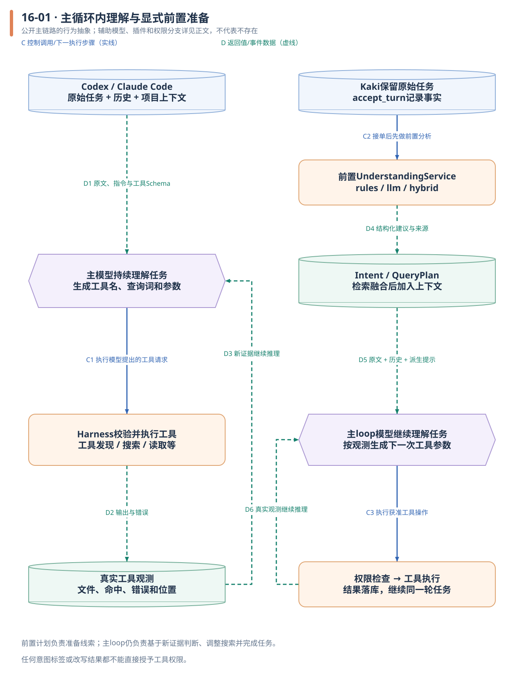

# 16 Codex、Claude Code与Kaki：意图识别和Query改写的实现对比

核对日期：2026-11-23。本章比较公开可证实的实现，不把闭源内部逻辑、实验代码和工程推断混为一谈。**三者都依靠主模型理解任务并在工具循环中调整行动；Kaki额外提供了显式、可配置的前置Intent/QueryPlan层。**“是否有独立分类器”与“是否能理解用户意图”不是一回事。

## 16.01 比较范围与证据边界

| 对象 | 本次依据 | 能确认的范围 |
|---|---|---|
| Codex | 本机CLI 0.170.0；官方标签rust-v0.170.0，提交`29eb79e9866b3262a777fdf8195c1b9e63684c91` | Rust harness的输入、主循环、工具分发与发现、Skill处理；不等于已公开桌面/云端每个外围服务 |
| Claude Code | 官方架构、Skills、Hooks、工具与auto mode文档；本机安装版2.1.126 | 文档说明的行为。没有据此宣称获得完整运行内核源码，也没有把当前文档全部新功能套到本机旧版本 |
| Kaki | 已部署0.3.0，提交`8a31ef9313af0ce8913ff9061cc0707b1337ad00` | 可逐行检查本地Python实现；上一章记录其真实验收。本章未执行三款产品的同条件性能对照实验 |

OpenAI的工程文章解释公共harness循环，但发布时间是2026-01-23；本章函数名和路径以较新的固定CLI标签为准。[Codex官方工程说明](https://openai.com/index/unrolling-the-codex-agent-loop/)。Claude Code公开仓库提供文档、插件、示例等，不能把它当成完整核心源码仓库；Agent SDK官方说明其复用Claude Code执行循环。[官方仓库](https://github.com/anthropics/claude-code)、[Agent SDK执行循环](https://code.claude.com/docs/en/agent-sdk/agent-loop)。

以下分别标注：**源码确认**、**官方文档确认**、**工程判断**、**未公开/未验证**。源码里“存在某模块”不证明该模块在所有账号、平台和配置下默认启用。

## 16.02 先区分四种容易混淆的工作

| 工作 | 输入与输出 | 在Agent中的意义 |
|---|---|---|
| 任务意图理解 | 用户原文、历史、项目证据 → 应回答、搜索、修改、测试还是询问 | 可由主模型连续推理完成，不必先生成固定标签 |
| 任务分类 | 原文/有限上下文 → coding、review、edit等标签 | Kaki显式输出Intent；标签可观测，不自动代表权限或独立Agent路由 |
| 检索问题/参数生成 | 任务及已知证据 → 文件名、关键词、正则、路径、工具发现query | 可以在任务前生成，也可以每次调用工具时再生成并根据结果修正 |
| 风险与授权判断 | 真实用户授权、候选工具及参数 → allow/ask/deny | 判定这一步能否执行；与“用户想做什么”的业务标签不同 |

此外，拼接prompt、展开Skill参数、压缩历史、为MCP发现工具、选择不同模型，是相关能力，但都不能直接等同于“把整条用户任务改写一遍”。本章把原始任务记为U，把本次搜索参数记为Q；U可以不变而Q在每次工具调用中不断变化。



图是公开行为的抽象，不是三款产品逐对象相同的类图。蓝色C为调用/执行，绿色D为数据流。左侧不表示没有辅助模型、插件、权限分类器或工具发现；右侧也不表示Kaki主循环不能自行调整搜索词。

## 16.03 Codex：公开CLI把任务理解放在模型循环中，检索与路由各有边界

### 16.03.1 从输入走到下一次行动

**源码确认：** `UserInput`区分文本、图片、Skill和结构化mention等输入。普通文本进入上下文；明确选择Skill/连接器已有结构化表示，不需要先用自然语言分类猜一次。[输入协议](https://github.com/openai/codex/blob/29eb79e9866b3262a777fdf8195c1b9e63684c91/codex-rs/protocol/src/user_input.rs#L17-L62)。

本次固定版本的关键调用关系：

```text
session/turn_input.rs::handle
  → 输入被接收为启动新轮或steer当前轮
  → RegularTask::run_turns
  → session/turn.rs::run_turn
      → 准备上下文/历史/扩展输入
      → run_sampling_request → build_prompt
      → try_run_sampling_request → 模型响应
      → 工具请求经ToolRouter和执行层处理
      → 工具观测进入后续采样，或输出最终答复
```

这是阅读路线，不是逐句复刻所有分支。`build_prompt`提供input、可见工具和基础指令，任务如何解释、下一次搜索用什么词，主要由模型结合这些输入决定。[主循环和prompt构造](https://github.com/openai/codex/blob/29eb79e9866b3262a777fdf8195c1b9e63684c91/codex-rs/core/src/session/turn.rs#L217)、[RegularTask入口](https://github.com/openai/codex/blob/29eb79e9866b3262a777fdf8195c1b9e63684c91/codex-rs/core/src/tasks/regular.rs#L159)。

**关键区别：** 在这条已核对的普通任务路径中，没有看到Kaki那样统一输出Intent+QueryPlan、随后交主loop消费的前置契约。这是有范围的源码观察，不是断言Codex所有客户端、服务或扩展都没有辅助分类/改写。

### 16.03.2 ToolRouter路由的是工具调用，不是用户自然语言意图

`ToolRouter::build_tool_call`处理模型已经输出的function call等结构，再按工具名称、命名空间和payload分发。它回答“调用哪个已注册工具”，不能仅凭Router这个类名就推导出一个coding/travel/review意图分类器。[ToolRouter源码](https://github.com/openai/codex/blob/29eb79e9866b3262a777fdf8195c1b9e63684c91/codex-rs/core/src/tools/router.rs#L278)。

搜索代码时，模型可以提出Shell搜索命令或可用的专用工具参数。看到结果后再改变词、路径或方法，属于主循环内的检索策略调整。Responses托管的Web搜索或MCP服务内部还可能有自己的检索处理；仅凭客户端源码无法确认它们内部完整的query rewriting算法。

### 16.03.3 工具发现确有本地检索，但搜索对象是工具目录

**源码确认：** `ToolSearchHandler`从模型调用参数取得query，检索延迟加载工具的元数据，返回匹配的工具定义。该固定版本使用本地BM25表示与打分，并在工具目录变化时更新缓存；这不是对用户仓库内容统一做语义改写。[工具发现实现](https://github.com/openai/codex/blob/29eb79e9866b3262a777fdf8195c1b9e63684c91/codex-rs/core/src/tools/handlers/tool_search.rs#L151-L183)。

因此要区分：模型产生“我需要哪个工具”的query，工具发现服务进行排序，随后模型使用找到的工具。这里的`bm25::Embedder`是该词法检索库的表示接口，不能凭名字就认定调用了GPT embedding接口或维护了一个语义向量数据库。

### 16.03.4 Skill选择：显式选择、隐式模型选择与shadow实验

官方文档说明两类调用：用户明确提及Skill，或模型根据description判断相关性；通常先显示元数据，使用时再读取主体。[官方Skills说明](https://learn.chatgpt.com/docs/build-skills#how-chatgpt-and-codex-use-skills)。固定源码的`collect_explicit_skill_mentions`处理用户明确给出的Skill/mention及文本引用，再准备相应指令。[显式选择实现](https://github.com/openai/codex/blob/29eb79e9866b3262a777fdf8195c1b9e63684c91/codex-rs/ext/skills/src/selection.rs#L20-L81)。

**特别容易误读的源码事实：** 0.170.0标签确实有BM25、字符特征、多查询词法召回、RRF等Skill选择器。多查询版本保留完整query并按句子、英文连接词等构造不同视图；RRF版本融合词法与字符召回。它们不是Kaki那种LLM独立问题改写。[多查询选择器](https://github.com/openai/codex/blob/29eb79e9866b3262a777fdf8195c1b9e63684c91/codex-rs/ext/skills/src/dynamic_skill_selector/multi_query_lexical.rs)、[RRF选择器](https://github.com/openai/codex/blob/29eb79e9866b3262a777fdf8195c1b9e63684c91/codex-rs/ext/skills/src/dynamic_skill_selector/rrf_lexical_char.rs)。

在本次跟踪的调用点，它们由`shadow_selection_enabled`控制，在后台评估，**不改变模型可见的Skill目录**。不能把实验代码存在写成默认在线裁剪已经生效。[配置中的shadow语义](https://github.com/openai/codex/blob/29eb79e9866b3262a777fdf8195c1b9e63684c91/codex-rs/ext/skills/src/config.rs#L18-L19)、[shadow实现](https://github.com/openai/codex/blob/29eb79e9866b3262a777fdf8195c1b9e63684c91/codex-rs/ext/skills/src/shadow_selection_experiment/mod.rs#L1-L3)。

这与Kaki有算法上的联系：都可用轻量词法检索和排序融合减少上下文负担；区别在于本次Codex实验排名不直接改prompt，而Kaki的Skills/Memory/History融合结果实际参与当前上下文组装。它也不证明Kaki实现直接来自这些源码。

## 16.04 Claude Code：模型理解目标，Harness组织上下文和执行

### 16.04.1 官方公开的处理路径

**官方文档确认：** Claude模型结合prompt、历史和工具结果理解目标，选择下一行动；Claude Code提供工具并管理模型看到的上下文。任务会在收集信息、行动、验证之间往返，不是预先固定的一次分类。[How Claude Code works](https://code.claude.com/docs/en/how-claude-code-works)。

可以按下面的抽象顺序理解：

```text
用户原文 + 指令/历史/已知项目上下文
  → Claude决定搜索、读取、修改、测试或询问
  → Harness检查并执行工具
  → 工具结果返回Claude
  → 根据新证据调整下一次参数，直到本次请求结束
```

该图表示官方行为，不是Claude Code私有源码函数名。本次没有证据证明它为每一条普通输入都先执行一个独立的Intent/QueryPlan分类改写服务；同样，公开资料不足以断言内部从不使用辅助模型。

### 16.04.2 Query常在使用工具时生成，并按结果继续细化

Anthropic的上下文工程文章明确介绍按需检索：保留路径等轻量引用，由模型产生针对性查询，再通过工具逐步获取证据。这与一次性改写整条用户任务不同。[官方按需检索与agentic search说明](https://www.anthropic.com/research/effective-context-engineering-for-ai-agents#context-retrieval-and-agentic-search)。

例如模型可以先找超时相关文件，再定位函数和调用方；无命中或结果过宽时，再改变关键词或缩小范围。具体用Grep/Glob、Bash还是其他工具取决于版本、平台和配置。当前官方工具文档甚至说明部分平台默认改用Shell搜索，所以不能把某一套工具名写成所有版本永恒不变的架构。[工具及搜索行为](https://code.claude.com/docs/en/tools-reference#grep-tool-behavior)。

### 16.04.3 Skills、Hooks、工具发现不能混成一种Query改写

- Skill的description帮助模型判断适用性，主体按使用时机加载；用户也可明确调用。它提供工作流指令，不等于一个固定意图标签模型。[Skills生命周期](https://code.claude.com/docs/en/skills#control-who-invokes-a-skill)。
- 自定义Skill可把参数展开成任务指令；这是用户配置的模板展开，不代表每条普通输入都如此处理。
- `UserPromptSubmit` hook可阻止处理或追加additionalContext；不能把stdout解释为默认完全替换用户原文。团队可据此接入自己的理解/检索逻辑，这属于定制扩展。[Hooks接口](https://code.claude.com/docs/en/hooks#userpromptsubmit-decision-control)。
- MCP ToolSearch按query发现需要的工具Schema，主要解决工具目录的上下文开销，不是在检索整个代码仓，更不是统一改写用户任务。[MCP工具发现](https://code.claude.com/docs/en/mcp#scale-with-mcp-tool-search)。

### 16.04.4 Auto mode的classifier主要判断授权与风险

官方auto mode工程说明公开了模型辅助审查：根据真实用户请求和拟执行动作判断其是否越界。它解决“这一步能否执行”，不能和coding/review/edit等业务分类等同。启用状态、模型和适用规则随版本、账号及部署变化；不能因此断言所有Claude Code请求都有同样的固定额外调用成本。[Auto mode设计说明](https://www.anthropic.com/research/claude-code-auto-mode)。

Codex公开源码同样有Guardian相关授权状态和评估结构；例如评估绑定权限快照并要求使用时复核。这也不等于一个通用任务改写器。[Codex授权评估上下文](https://github.com/openai/codex/blob/29eb79e9866b3262a777fdf8195c1b9e63684c91/codex-rs/core/src/guardian/score_authorization.rs#L8-L24)。

## 16.05 Kaki：显式前处理层之外，仍然保留主loop理解能力

Kaki当前链路可以写成：

```text
accept_turn保存用户原文
  → UnderstandingService.prepare
      → local_analysis
      → 必要时一次Right Code联合推理
      → 分别校验Intent与QueryPlan，独立回退
  → 必要时同Turn澄清，再本地refine
  → RequestContext
  → ContextEngine.assemble（原文仍保留）
  → AgentLoop：模型生成工具参数、读取结果、继续行动
  → PermissionService在真实工具执行前检查
```

### 16.05.1 识别/改写是显式建议，不是另一位Agent

源码节选：[src/kaki/understanding/service.py:40–46](https://github.com/anuolxl/kaki_agent/blob/8a31ef9313af0ce8913ff9061cc0707b1337ad00/src/kaki/understanding/service.py#L40-L46)。

```python
        complex_task = bool(
            POINTER.search(user.content) or len(intent.actions) > 1 or intent.domain == "unknown"
        )
        use_intent = cfg.intent.strategy == "llm" or cfg.intent.strategy == "hybrid" and complex_task
        use_rewrite = cfg.rewrite.strategy == "llm" or cfg.rewrite.strategy == "hybrid" and complex_task
        if not (use_intent or use_rewrite):
            return result
```

源码位置：`src/kaki/understanding/service.py`。两个组件独立选择策略，但需要模型时共享一个私有结构化调用，最多一次网络尝试，默认10秒超时回退。这个10秒只限制理解调用，不限制整轮任务或等待人类回答的时长。

当前本地分类通过关键词/正则及部分否定、测试规划规则产生动作，domain实际只产生coding/general；mixed/unknown在契约和模型输出中可表达。hybrid不是经过校准的置信度路由。Intent并没有把请求分发给多个专业Agent，也没有据此自动授予写入权限。

### 16.05.2 QueryPlan改变检索线索，不覆盖用户Message

源码节选：[src/kaki/understanding/types.py:18–23](https://github.com/anuolxl/kaki_agent/blob/8a31ef9313af0ce8913ff9061cc0707b1337ad00/src/kaki/understanding/types.py#L18-L23)。

```python
class QueryPlan(BaseModel):
    model_config = ConfigDict(extra="forbid")
    standalone_query: str = Field(default="", max_length=8000)
    queries: dict[Literal["skills", "history", "memory", "code"], list[str]] = Field(default_factory=dict)
    source_ids: list[int] = Field(default_factory=list, max_length=20)
    unresolved: list[str] = Field(default_factory=list, max_length=5)
```

`standalone_query`是派生的独立问题，`queries`分为skills/history/memory/code，`source_ids`定位证据，`unresolved`触发必要澄清。实际原文继续以user Message发送；派生提示放在标明用途的上下文中。

下面仅列部分字段用于解释结构，不是真实模型运行记录；41也只是示意来源ID：

```json
{
  "original_text": "修改src/client.py中刚才提到的超时逻辑，取消请求后立即退出；不要运行测试。",
  "intent": {"domain": "coding", "actions": ["edit"]},
  "rewrite": {
    "standalone_query": "修改src/client.py的超时处理，使请求取消后立即退出；不要运行测试。",
    "queries": {"code": ["修改src/client.py中刚才提到的超时逻辑，取消请求后立即退出；不要运行测试。", "timeout cancel"]},
    "source_ids": [41],
    "unresolved": []
  }
}
```

### 16.05.3 多查询融合用于上下文召回，代码搜索默认仍由主模型发起

源码节选：[src/kaki/understanding/retrieval.py:4–14](https://github.com/anuolxl/kaki_agent/blob/8a31ef9313af0ce8913ff9061cc0707b1337ad00/src/kaki/understanding/retrieval.py#L4-L14)。

```python
def fused_rank(queries, documents, min_score=0.0):
    from kaki.context.knowledge import rank

    scores = {}
    for index, query in enumerate(dict.fromkeys(queries)):
        weight = 2.0 if index == 0 else 1.0
        for position, (row, score) in enumerate(rank(query, documents), 1):
            if score < min_score:
                continue
            scores[row] = scores.get(row, 0.0) + weight / (60 + position)
    return sorted(scores.items(), key=lambda item: (-item[1], item[0]))
```

原文权重2、扩展权重1；各query先BM25，再加权RRF。它用于Skills、Memory和历史相关度，本期没有embedding召回。指代前处理只看受限历史，并不等于整个Kaki只能记住6条消息：主loop仍使用完整的上下文管理/压缩机制。

代码搜索的另一个关键限制是：`kaki_search`默认不使用任务扩展词。只有`use_task_queries=true`且不是regex模式，才额外搜索一条线索；路径/glob保持不变。因此不能把“配置了Query改写”写成“每个rg查询都自动被改写”。

源码节选：[src/kaki/tools.py:414–423](https://github.com/anuolxl/kaki_agent/blob/8a31ef9313af0ce8913ff9061cc0707b1337ad00/src/kaki/tools.py#L414-L423)。

```python
        queries = [a["query"]]
        request = ctx.get("request")
        if a.get("use_task_queries") and not a.get("regex") and request:
            queries += [q for q in request.queries_for("code")[1:] if q != a["query"]][:1]
        results = []
        failed = False
        for query in queries:
            result = await self._search_once([*args, "--", query, str(path)])
            failed = failed or result.failed
            results.extend(result.text.splitlines())
```

Kaki主loop本身仍可以根据工具结果再次选择不同query、工具和路径。这部分与Codex/Claude Code的循环式探索相通；显式QueryPlan不是后续所有检索的唯一来源。

## 16.06 区别与联系放在同一张表里看

| 维度 | Codex公开CLI | Claude Code官方公开行为 | 当前Kaki |
|---|---|---|---|
| 主要任务理解 | 主模型结合上下文持续判断 | Claude结合上下文持续判断 | 前置建议 + 主模型持续判断 |
| 固定Intent/QueryPlan契约 | 已核对主路径不以同样契约统一前置 | 未公开同样统一的每请求契约 | 明确的Pydantic/数据类及日志事件 |
| 输入显式操作 | 结构化Skill/mention、输入模式等 | Slash命令、Skill调用、模式等 | 本地命令/问答分流，原文中的Skill标记 |
| 本地代码搜索参数 | 模型提出命令或工具参数，结果反馈 | 模型选择搜索工具/命令并调整 | 主模型同样生成参数；任务扩展需opt-in |
| 工具发现 | 固定标签有本地BM25 ToolSearch实现 | 可按需发现MCP工具定义 | 浏览器MCP工具目录，未实现同规模延迟发现层 |
| Skill轻量召回 | 模型选择与显式选择；另有shadow检索实验 | description驱动的模型选择/明确调用 | BM25/RRF实际影响限量注入与引用 |
| 权限语义判断 | 规则/沙箱及配置相关的Guardian评估等 | 规则/权限模式及auto classifier等 | 规则能力检查、精确授权和任务范围；无OS沙箱 |
| 前置模型调用成本 | 不能由公开路径推导所有附加调用为零 | 辅助模型依版本/模式而变 | 理解阶段0或1次；不包括主模型/Curator等其他调用 |
| 学习和修改这层逻辑 | Rust harness开放，整体系统较大 | 官方行为公开，核心内部实现可见性有限 | Python小模块、明确字段和本地配置开关 |

这里的联系是架构思路上的：模型承担语义推理，Harness提供证据、上下文、工具和边界；不是说三者使用同一套分类模型、词表、向量库或协议字段。

## 16.07 各自的优势、代价和已知限制

**以下是工程判断，没有据此宣称某款产品准确率更高或总费用更低。** 模型版本、工具集合、权限、历史和预算都会改变效果。

| 方案 | 结构上的优势 | 代价/适用边界 |
|---|---|---|
| Codex/Claude Code公开主循环体现的模型驱动探索 | 解释任务时就能结合不断读到的新代码；搜索词随结果调整，不必把开放任务先压进少数标签 | 行为更依赖模型、上下文和工具设计；可能搜索多轮或走弯路。不能据此认定不存在分类日志或辅助调用 |
| Kaki rules/local | 可复现、无理解模型开销，容易定位规则问题；适合明确简单任务 | 关键词覆盖有限，对复杂否定、跨轮省略及复合动作容易误判 |
| Kaki llm/hybrid前处理 | Intent、来源、QueryPlan和fallback可检查；易做独立评测；可为中文/历史/记忆检索补词 | 复杂任务可能增加一次调用和等待；受限历史还没读当前代码；错误线索可能让检索偏离，主loop仍需核对 |
| Kaki固定契约和10秒回退 | 失败影响域与开销上限明确，可分别切换识别和改写 | 显式多一层不保证更聪明；可能重复主模型已有理解，或多问一次澄清。整个任务耗时仍无法仅由这10秒界定 |

Kaki当前还存在三个具体边界：

1. source_ids校验能确认来源ID存在，不能证明改写语义确实由该来源支持。
2. 标识符、数字和否定规则能拦截部分错误，不是完整的语义等价证明；standalone_query检查也不能等同于对所有检索词作形式化约束证明。
3. 一轮开始时产生的查询计划不随每次新代码观测自动重算；普通ask_user回答会清除过时的code扩展，主loop另外生成新query。不能称为持续自学习路由器。

因此，Kaki真正的优势是这层逻辑易读、可配置、可观察、易做受控实验。不能仅因为“多了意图识别模块”，就推导它在复杂代码任务上优于Codex或Claude Code；也不能把规则权限说成完整沙箱或成熟风险分类器的等价替代。

## 16.08 用同一个任务理解三者的处理差异

假设前文已讨论`src/client.py`，用户新任务为“修改其中刚才提到的超时逻辑，取消后立即退出；不要运行测试”。以下只是可能路径，不是三款模型已经执行过的轨迹：

- Codex/Claude Code：原文、历史和项目规则进入模型上下文；模型识别修改目标、选择搜索/读取参数，再根据代码证据编辑或询问。Harness在实际执行边界检查权限。
- Kaki：先得到Intent/QueryPlan并处理必要歧义，再把原文和派生提示交给主模型；主模型仍需读取代码、生成工具参数。PermissionService独立保留“不要运行测试”的限制，不能用edit标签批准测试执行。
- 后续如果发现真实入口叫`request_deadline`，三者的主模型都可能据此再搜新词。Kaki不必等下一Turn才有能力改变搜索词，变化可来自主loop自身。

同一个术语也要按产品定义理解：Kaki的Turn是一次接受的用户任务；Claude Agent SDK文档把一次模型输出/工具往返也称为turn。比较调用次数时请统一换算为“用户任务数、主模型采样数、辅助采样数、工具次数”，不要直接对比同名turn计数。[Claude SDK计数说明](https://code.claude.com/docs/en/agent-sdk/agent-loop#turns-and-messages)。

## 16.09 对Kaki有价值的验证方式与演进方向

先在同一Kaki主模型、相同初始历史/工作树/工具/权限下，比较以下三组，而不是一次改变整款产品和模型：

| 对照 | 配置 | 检查什么 |
|---|---|---|
| 不使用前置理解 | understanding.enabled=false | 主loop本身已有多少能力；这仍是Kaki，不是完整模拟Codex/Claude Code |
| 纯本地前处理 | intent=rules，rewrite=local | 确定性召回和可观测性是否有收益 |
| 默认混合前处理 | intent=hybrid，rewrite=hybrid | 指代/中文检索收益能否抵消额外成本和误澄清 |

应统计任务成功、错误修改/越权、必要与多余提问、首个有效证据耗时、总耗时、辅助/主模型tokens、Recall@k等；只看Intent标签准确率不足以评估Agent。对否定、缺失来源、同名函数、多文件目标、工具空结果和中途改需求单独设例。

这里enabled=false仍经过Runtime/prepare并构造最简RequestContext；它主要关闭理解输出和额外理解模型调用，不能解释成删除了Kaki其他上下文与检索机制。

本次没有执行这组对照，也没有修改运行配置。后续更值得优先验证的是：补全真正缺失的语义边界、让主loop及时获得有效证据、维持权限独立；不要仅为模仿术语再增加一个“意图Agent”。

## 16.10 源码阅读导航与尚不公开的部分

| 想验证的结论 | 权威入口 |
|---|---|
| Codex的普通任务从输入到模型/工具往返 | 固定标签的session/turn_input.rs、tasks/regular.rs、session/turn.rs |
| Codex工具调用分发与工具发现 | tools/router.rs、tools/handlers/tool_search.rs |
| Codex显式Skill选择与shadow边界 | ext/skills/src/selection.rs、config.rs、extension.rs、shadow_selection_experiment/mod.rs |
| Claude Code主模型与Harness职责 | how-claude-code-works、Agent SDK agent-loop官方页 |
| Claude的Skills/Hook/工具发现/风险分类 | skills、hooks、mcp、auto mode官方说明 |
| Kaki前置层与真实工具查询 | understanding/service.py、strategies.py、types.py、retrieval.py；runtime.py、context/engine.py、tools.py、loop.py |

尚不能据本次证据确认的包括：Claude Code当前所有私有辅助模型/内部特征、Codex桌面与云端全部外围处理、托管Web搜索/MCP服务内部的完整重排改写算法，以及三款产品在统一条件下的质量/延迟/成本排名。这里保留“不确定”，不以虚构内部类名填空。
