# 00 阅读说明、当前版本与验收结论

本文已从实施前技术方案重写为 **Kaki Agent v0.1 当前实现的原理、架构与操作手册**。代码位于 `/Users/bytedance/github/kaki_agent`，Python 3.12，分支 master；代码检查点为 `3e5540d`（本地提交，未推送）。验收发生于 2026-11-10 至 2026-11-11，本篇的现状结论来自实际源码、本地测试、Right Code 接口结果、实际 Textual TUI 及 Playwright MCP。

先读 01–03 建立整体模型；04 按模块阅读；05 深入上下文；06–08 查数据、接口与恢复；09–10 直接按命令使用；11 看真实验收与截图；12 查边界和与 Pico 的关系。目录由飞书原生标题生成，模块图仍复用原技术文档的画板。

## 00.1 已交付范围

| 能力 | 当前实现 | 验收口径 |
|---|---|---|
| 本地 CLI/TUI | 全局 kaki-agent；-C/--cwd；流式文本、提问、取消、会话命令 | 真实 PTY 启动/退出与实际 Textual 多轮输入 |
| 模型 | Right Code OpenAI Responses 兼容接口，保留原生 reasoning/function_call | 真实原生工具调用→结果回传→最终正文 |
| 改代码 | 文件读写/精确编辑/rg搜索/Shell/测试证据 | pricing.py 测试由退出1变为0，测试文件hash不变 |
| 浏览器 | Playwright MCP 0.0.85、stdio、项目独立profile | 发现25工具；about:blank、上海市文旅局页面导航及查找 |
| 上下文 | 快路、Curator、精确归档、相关度、工作状态、闭合与预算门 | 自动化长历史/超时/错误计划/溢出；真实慢路与超时回退 |
| 持久化 | SQLite原始消息、工具日志、模型用量、项目记忆 | 重开Runtime恢复会话；新会话召回记忆 |
| 文件快照 | 独立shadow Git before/after、冲突安全恢复 | 原字节/符号链接/权限/冲突与用户index不变测试 |
| Skills | 本地SKILL.md、显式引用、BM25/CJK、版本与目录内引用 | 自动化注入、中文召回、越界拒绝 |

`completed` 表示本次控制循环产出了完整答复，不表示所有业务目标或所有测试自动通过。只有真实测试命令、退出码和来源 run_id 支撑 `verification=passed`；旅游对话明确显示 `not_run`。

## 00.2 约束与部署形态

首期目标是个人本机 CLI、一个 Git 仓库，包含 media_platform 这种单仓编码现场。TUI 和 Agent 在同一 Python 进程中，通过函数、Task 和 Event 通信，没有本地 RPC Server，也没有远程执行微服务。浏览器 MCP 是独立子进程；模型通过 HTTPS 请求 Right Code。

单个 Runtime 只有一个活跃 Turn；同一工作区的多个 Kaki 进程通过 fcntl 文件租约互斥执行。它不是多 Agent、多仓事务、生产发布平台或 OS 沙箱。所有测试修改只发生在隔离 fixture，media_platform 未为本次验收改动。


# 01 仓库组织与领域边界

## 01.1 源码地图

```text
kaki_agent/
  pyproject.toml / uv.lock      依赖、Python版本与全局命令
  AGENTS.md                    开发与验证契约
  src/kaki/
    cli.py / __main__.py       参数、setup、doctor、run、sessions
    tui.py                    Textual界面与事件消费
    types.py                  Message/ToolCall/TurnResult/TokenBudget等
    config.py / workspace.py  配置合并、单Git与项目状态边界
    runtime.py / loop.py       生命周期与模型—工具循环
    provider.py               Right Code Responses/SSE/原生项重放
    tools.py                  内置工具、Schema、执行调度和附件限额
    browser_mcp.py            专用MCP owner task、stdio、独立profile
    context/
      engine.py               窗口组装、预算门、重平衡
      curator.py              有界私有规划和8个工具
      history.py / tokens.py  协议闭包、整组裁剪、Token估算
      archive.py              原始消息精确归档与分页读取
      knowledge.py            Rules/Skills/Memory、BM25和中文词项
    store.py / recovery.py    单worker SQLite、恢复事实
    checkpoint.py             独立Git-dir快照与冲突恢复
  tests/                      不依赖付费模型的行为测试
  scripts/                    隔离fixture、真实TUI验收脚本
  docs/                       当前实现指南与字段契约
```

## 01.2 为什么这样分层

交互层解决“用户如何输入和理解执行状态”；Runtime 解决“谁拥有任务、何时结束、能否继续”；Loop 解决“模型提出下一步之后怎么办”；Context 解决“这次到底发给模型哪些事实”；Provider 解决“如何讲 Responses 协议”；Tools 解决“如何产生真实观察和副作用”；Store 解决“哪些事实已经确定落盘”；Checkpoint 解决“如何为文件改动提供可复核恢复基线”。这几类生命周期不同，不把它们塞进一个无限 while 循环。

主要依赖方向是 CLI/TUI → Runtime/Loop → Context、Provider、Tools → Store/文件/MCP。领域值定义在 types.py，供边界两端共享。当前实现是轻量模块分层，没有强行引入插件容器、DDD repository接口或独立服务。

TUI 目前直接调用 Store 查询会话/记忆，并在人工确认后直接调用 Checkpoint.plan_restore/apply；这是真实存在的边界，不把它画成所有功能都经过 Runtime 的严格外观。正常任务的租约和唯一终态仍由 Runtime 持有。

# 02 总体架构、领域图与数据所有权

## 02.1 总体架构：控制与数据分别如何流动

图中 C 为控制调用，蓝色实线；D 为数据、观察与结果，绿色虚线；箭头指向接收方。Store 只在短事务内写事实，网络/浏览器/Shell执行不持有数据库事务。


[在线画板：当前总体架构：从TUI到模型、工具、持久事实和文件恢复](https://bytedance.larkoffice.com/docx/MdjydeNRXopJqbxd0frcFbtinFd#doxcnhGjiPfjGjo2SYi6eq52nsf)

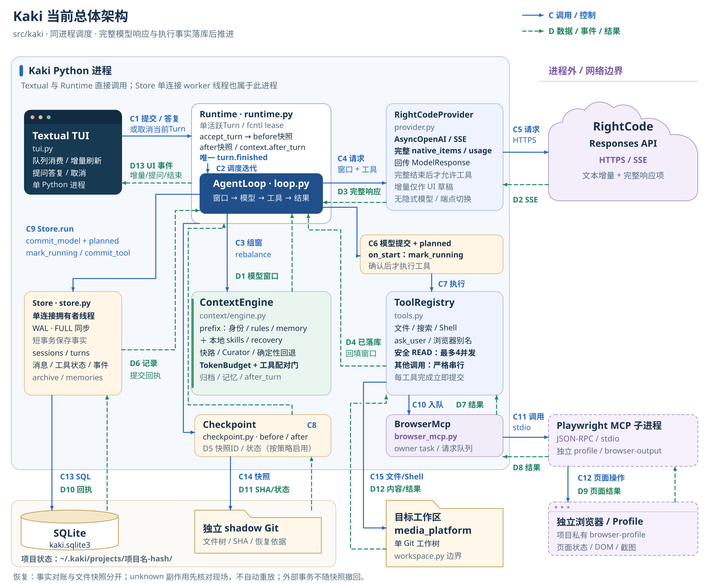


## 02.2 领域图与唯一所有者


[在线画板：当前领域分层：Task、上下文、执行适配与持久化所有权](https://bytedance.larkoffice.com/docx/MdjydeNRXopJqbxd0frcFbtinFd#doxcn3n0bnG0vSaVxedEO4qwvPc)

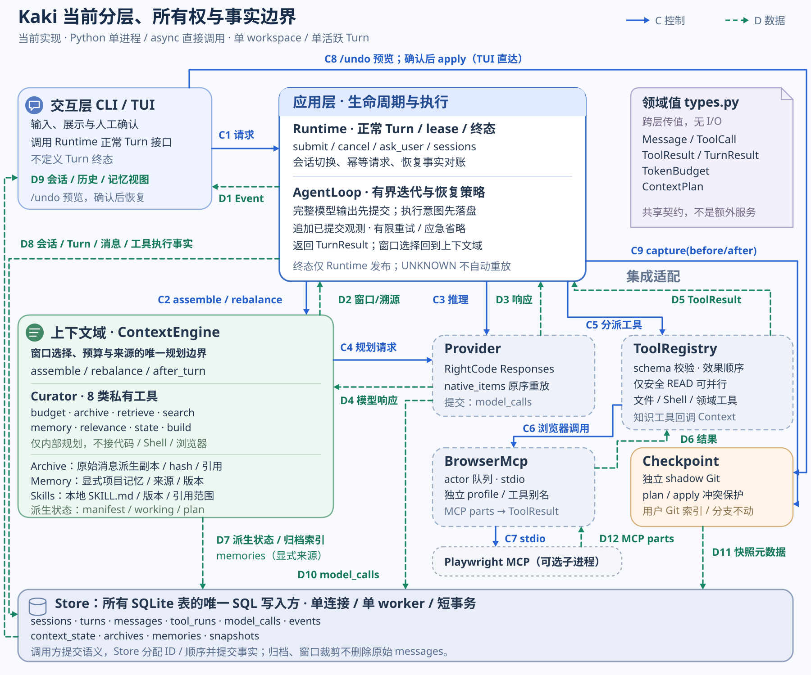


| 对象/状态 | 逻辑所有者 | 持久位置 | 不变量 |
|---|---|---|---|
| 用户输入、展示草稿 | TUI；草稿可丢弃 | 关键草稿间隔保存到turn.result_json | 草稿不能冒充已提交assistant |
| 活跃Task、问题、终态 | Runtime | turns/events | 一个工作区执行租约；每Turn只提交一次终态 |
| 当前推理窗口 | ContextEngine；Loop追加已提交观测 | context_state仅存派生计划 | 压缩不删除原始会话事实 |
| 原始消息、真实执行 | Store唯一物理写入者 | messages/tool_runs | 完整模型先提交，执行意图先落盘 |
| 模型网络协议 | Provider | model_calls | native_items顺序与call_id保留；增量参数不执行 |
| 真实文件/Shell/MCP | ToolRegistry及适配器 | tool_runs + artifacts | READ并发有界；副作用串行 |
| 长期项目记忆 | Memory逻辑管理、Store写入 | memories | 显式授权、来源ID、有效版本 |
| 文件基线与恢复 | Checkpoint | snapshots + shadow Git | 不操作用户Git索引/分支；冲突不覆盖 |

## 02.3 核心不变量

- 一次工具调用的 assistant function_call 和对应 tool output 构成协议组；选窗必须双向闭合，不能只保留一边。
- 只有 SSE 完整终事件才能形成可执行 ModelResponse；只收到函数参数增量或流断开时，不执行工具。
- commit_model 同事务写 assistant 与所有 planned；mark_running 在执行之前；commit_tool 同事务保存真实结果和 tool Message。
- 崩溃后的 running 只能判定 unknown；不知道副作用是否发生时先核对现场，不自动重放。
- Token 预算包含当前请求、系统前缀、工具Schema、历史与原生项，并预留输出和裕量；不能靠静默删除当前请求实现“成功”。
- 快照失败、模型截断、测试未执行、usage缺失都必须表达出来，不能换一个成功状态掩盖。


# 03 一次TUI请求的完整控制流与数据流

以“读取文件、修复函数、运行测试”为例：用户只有一次提交，模型可以在该 Turn 内经历多轮请求和多个工具调用。Session跨多个Turn保存完整会话；Turn不是一次HTTP请求。


[在线画板：一次请求时序：提交、模型、每工具持久化、下一轮与唯一终态](https://bytedance.larkoffice.com/docx/MdjydeNRXopJqbxd0frcFbtinFd#doxcnuTPKyGxaF36XVwamO3tgZd)

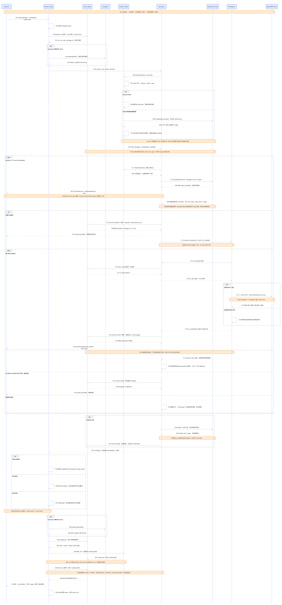


## 03.1 从启动到接单

| 步骤 | 控制方向 | 数据方向/内容 | 失败与落盘点 |
|---|---|---|---|
| 1 | Shell→cli.entry | -C/--config/--resume/--model | 参数解析失败直接退出 |
| 2 | CLI→load_config/Workspace.resolve | Config + Git规范根 + 状态目录 | Key/字段/路径错误不覆盖原配置 |
| 3 | TUI→Runtime.initialize | 选择/恢复Session；建立Provider/Context/Tools/MCP | 浏览器启动失败显示警告，其余本地能力可用 |
| 4 | Input→Runtime.submit | text、可选request_id→asyncio.Task | 活跃任务未结束时不接第二任务 |
| 5 | Runtime→workspace lease→Store.accept_turn | request_id去重；Turn与user Message | 用户输入在第一次模型请求前已提交 |
| 6 | Runtime→Checkpoint.before | 当前工作树→独立Git提交引用 | 失败显式warning；不伪造恢复可用 |
| 7 | Runtime→ContextEngine.assemble | 完整历史、当前用户、工具定义、恢复线索 | 固定开销太大明确失败 |

## 03.2 模型与工具之间的循环

| 步骤 | 控制方向 | 数据方向/内容 | 顺序保证 |
|---|---|---|---|
| 8 | Context→Memory/Skills/Rules | 并行构造相关前缀→Context | 摘要和外部内容是数据，用户当前任务优先 |
| 9 | Context→快路/Curator→闭包/预算门 | ContextPlan→AssembledContext | 所有历史选择通过同一结构门 |
| 10 | Loop→rebalance→Provider.complete | messages、tools、max_output_tokens | 每次网络请求前重新估算窗口 |
| 11 | Provider→Right Code | instructions/input/tools→HTTPS /responses | 无隐式换模型/换平台 |
| 12 | Provider→Runtime.emit→TUI | text.delta、call_id→草稿 | 60ms归并；此时不能执行工具 |
| 13 | 完整终事件→normalize_response | native_items、ToolCall、usage | 流断开/截断工具参数直接失败 |
| 14 | Loop→Store.commit_model | assistant + 全部planned | 同事务提交之后才允许执行 |
| 15 | 调度器→mark_running→具体工具 | schema校验；参数；执行意图 | 读最多4个并发；写/Shell/MCP串行 |
| 16 | 每工具完成→Store.commit_tool | ToolResult + 带来源的tool Message | 不等待同批其他安全读结束才落盘 |
| 17 | execute_many返回→Loop窗口 | 按原调用序追加已提交观测 | 数据库完成序可不同，协议通过call_id关联 |
| 18 | Loop→下一次rebalance/模型 | 原结果、最新工作状态→下一步 | 有界迭代，连续硬失败会提示换方法 |

## 03.3 如何结束与响应用户

模型无工具且有完整正文→completed；输出达到上限→interrupted；用户取消→cancelled；不可恢复错误→failed。达到迭代上限后再做一次关闭工具的总结请求，终态仍是 interrupted。空正文、思考预填、工具后空输出各有有限重试预算。

Runtime最终尽力取after快照、累计main/curator/finalize用量、更新派生工作状态，并由finish_turn把终态事实提交。未闭合工具被补成明确cancelled/unknown观察。之后只发布一次turn.finished给TUI，TUI显示停止原因、调用数、Token和真实验证状态。

取消不会自动回滚文件；终态也不代表浏览器或远程副作用能撤销。退出后用户可以通过--resume恢复上下文，再决定下一步。


# 04 各模块的实现、接口与源码


## 04.1 M01 CLI、配置和工作目录


[在线画板：CLI、配置与工作区：控制与数据的当前流向](https://bytedance.larkoffice.com/docx/MdjydeNRXopJqbxd0frcFbtinFd#doxcnhgWBfTsvNqq9jxhduNd2Rb)

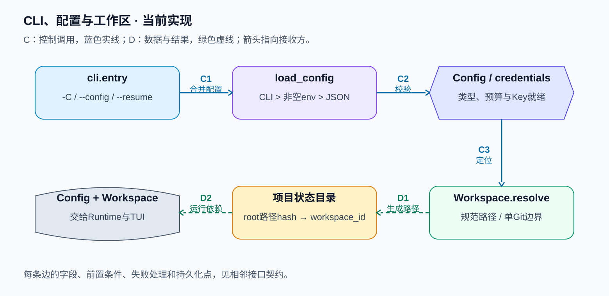


入口是 pyproject.toml 中 kaki-agent=kaki.cli:main。entry 无子命令时创建真实TUI；setup复制兼容OpenAI字段或隐藏输入Key；doctor可选择真实模型/浏览器探针；run复用同一Runtime作headless执行；sessions读取当前项目会话。

配置按 CLI > 非空KAKI_双下划线嵌套环境变量 > JSON > 默认值合并。normalize接受camel/snake，保留extraHeaders/env字典键大小写；Pydantic拒绝未知字段。apiKey用SecretStr，错误不回显原ValidationError输入。配置文件原子保存、权限0600。

Workspace.resolve通过git rev-parse确定规范根，路径hash构建workspace_id和独立状态目录；有.gitmodules的聚合仓直接拒绝，用户必须指定单Git子仓。root AGENTS/KAKI及其明确链接的直接父规则只读纳入，不把父目录规则解释成跨仓写权限。文件路径resolve后拒绝越界、.git、凭据和嵌套Git；Shell是宿主机进程，另见12的权限边界。


源码连续节选：`src/kaki/config.py:162`（SHA256前12位 `8a82f63dfda1`）；省略处请在本机查看完整函数。


```python
def load_config(path: Path | None = None, *, model: str | None = None) -> Config:
    path = config_path(path)
    try:
        data = normalize(json.loads(path.read_text())) if path.exists() else {}
    except (ValueError, OSError) as exc:
        raise KakiError(f"配置无法读取：{path}；未覆盖原文件（{type(exc).__name__}）") from None
    if not isinstance(data, dict):
        raise KakiError("配置顶层必须是JSON对象")
    for key, value in os.environ.items():
        if not key.startswith("KAKI_") or "__" not in key or not value.strip():
            continue
        parts = key[5:].lower().split("__")
        node = data
        for part in parts[:-1]:
            node = node.setdefault(part, {})
        try:
            node[parts[-1]] = json.loads(value)
        except ValueError:
            node[parts[-1]] = value
    if model:
        data.setdefault("agents", {}).setdefault("defaults", {})["model"] = model
    try:
        return Config.model_validate(data)
    except ValueError as exc:
        # ValidationError input can contain a secret; only expose field locations and messages.
        errors = getattr(exc, "errors", lambda **_: [])(include_input=False)
        raise KakiError(
            "配置校验失败：" + "; ".join(".".join(map(str, e["loc"])) + ": " + e["msg"] for e in errors)
        ) from None
```


源码连续节选：`src/kaki/workspace.py:27`（SHA256前12位 `f04559941c07`）；省略处请在本机查看完整函数。


```python
    def resolve(cls, cwd: Path | None, config: Config) -> Workspace:
        chosen = (cwd or Path(config.agents.defaults.workspace or Path.cwd())).expanduser().resolve()
        if not chosen.is_dir():
            raise KakiError(f"工作目录不存在：{chosen}")
        r = subprocess.run(
            ["git", "-C", str(chosen), "rev-parse", "--show-toplevel"],
            capture_output=True,
            text=True,
            timeout=10,
        )
        if r.returncode:
            raise KakiError("--cwd需要指向单个Git仓库；先在目标目录git init")
        root = Path(r.stdout.strip()).resolve()
        if (root / ".gitmodules").exists() and (root / ".gitmodules").read_text().strip():
            raise KakiError("当前目录含Git子模块；v0.1请指定media_platform等单Git子仓")
        slug = re.sub(r"[^A-Za-z0-9._-]", "-", root.name) or "workspace"
        identity = hashlib.sha256(os.fsencode(root)).hexdigest()[:16]
        state = kaki_home() / "projects" / f"{slug}-{identity}"
        state.mkdir(parents=True, exist_ok=True, mode=0o700)
        ws = cls(root, state, identity)
        pending = [root / name for name in ["AGENTS.md", "KAKI.md"]]
        seen = set()
        while pending and len(seen) < 16:
            p = pending.pop(0).resolve()
            if p in seen or not p.is_file():
                continue
            seen.add(p)
            ws.rule_files.append(p)
            # Explicit inherited rule documents are read-only knowledge, not a write grant.
            if p.parent != root and (p.parent / "docs").is_dir():
                ws.knowledge_roots.append((p.parent / "docs").resolve())
            for match in re.finditer(r"\]\(([^)]+(?:AGENTS|KAKI)\.md)\)", p.read_text(errors="replace")):
```


## 04.2 M02 Textual界面与事件归并


[在线画板：Textual TUI与事件消费：控制与数据的当前流向](https://bytedance.larkoffice.com/docx/MdjydeNRXopJqbxd0frcFbtinFd#doxcnflrHrKuxXHOAWIiWa3o9cc)

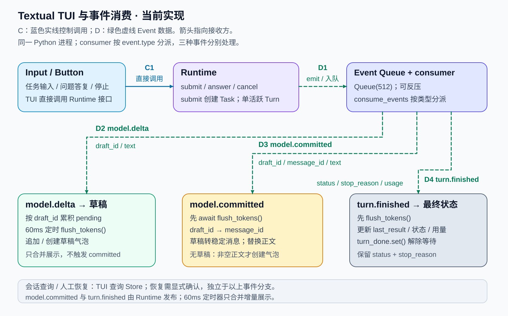


KakiApp.compose建立工作区/模型/Session栏、会话区、工具日志、状态、输入和按钮。Runtime listeners把Event送入容量512的队列，队列满时反压。consume_events单消费者处理；token先按draft-call-id暂存，60ms刷入同一bubble；model.committed把草稿键改成稳定message_id，避免流式文本与完整消息重复出现。

TUI也直接查询Store和执行经确认的Checkpoint恢复。ask_user期间输入作为回答而非新任务。Ctrl+C只取消当前Task，Ctrl+Q和/quit等待Runtime关闭后退出。退出标志使用_kaki_quitting，避免与Textual内部_closing冲突；真实PTY测试覆盖退出消息能被处理。

save_evidence导出实际界面，terminal_svg只修复Rich导出textLength对CJK双宽字符的计算，不改变文字、状态或结果。截图是实际Textual终端画面，不是手绘界面稿。


源码连续节选：`src/kaki/tui.py:145`（SHA256前12位 `5f4662775881`）；省略处请在本机查看完整函数。


```python
    async def consume_events(self):
        try:
            while True:
                event = await self.event_queue.get()
                d = event.data
                if event.type == "runtime.status":
                    self.query_one("#status", Static).update(d["text"])
                elif event.type == "runtime.ready":
                    if d.get("browser_warning"):
                        self.query_one("#tools", RichLog).write("浏览器未连接：" + d["browser_warning"])
                    else:
                        self.query_one("#tools", RichLog).write(
                            f"Playwright MCP：{d.get('browser_tools', 0)}个浏览器工具"
                        )
                elif event.type == "turn.started":
                    await self.bubble(str(d["message_id"]), "user", d["text"])
                    self.query_one("#status", Static).update("任务运行中…")
                elif event.type == "model.started":
                    self.query_one("#status", Static).update(
                        f"模型调用 · 第{d['iteration']}轮 · 当前输入估算{self.current_estimate} tokens"
                    )
                elif event.type == "model.delta":
                    key = "draft-" + d["draft_id"]
                    self.pending[key] = self.pending.get(key, "") + d["text"]
                elif event.type == "model.committed":
                    await self.flush_tokens()
                    draft = "draft-" + d.get("draft_id", "")
                    key = str(d["message_id"])
                    if draft in self.bubbles:
                        widget = self.bubbles.pop(draft)
                        self.bubbles[key] = widget
                        widget.replace(d["text"])
                    elif d["text"]:
                        await self.bubble(key, "assistant", d["text"])
                elif event.type == "tool.started":
                    args = json.dumps(d["arguments"], ensure_ascii=False)
                    self.query_one("#tools", RichLog).write("▶ " + d["name"] + " " + args[:220])
                elif event.type == "tool.finished":
                    self.query_one("#tools", RichLog).write(
                        ("✗ " if d["failed"] else "✓ ")
                        + d["name"]
                        + " · "
                        + d["preview"].replace("\n", " ")[:250]
                    )
                elif event.type in ("context.assembled", "context.compacted"):
```


源码连续节选：`src/kaki/tui.py:380`（SHA256前12位 `5f4662775881`）；省略处请在本机查看完整函数。


```python
    async def action_quit_safe(self):
        if self._kaki_quitting:
            return
        self._kaki_quitting = True
        await self.runtime.close()
        self.exit()
```


## 04.3 M03 Runtime和任务生命周期


[在线画板：Runtime生命周期：控制与数据的当前流向](https://bytedance.larkoffice.com/docx/MdjydeNRXopJqbxd0frcFbtinFd#doxcneVvCN8cg1y9e8ASnYwMFYd)

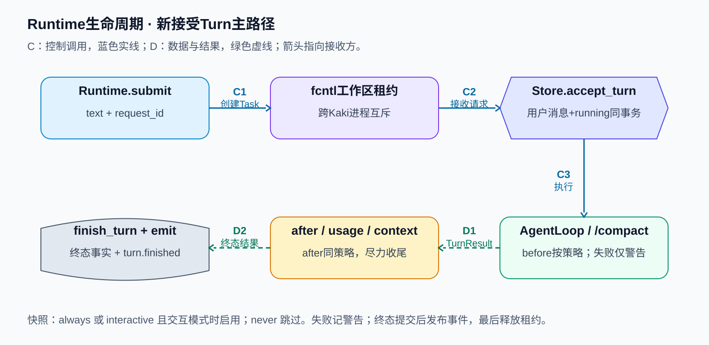


Runtime是依赖装配与任务所有者，initialize建立Store、Provider、Context、工具、Checkpoint与Session，恢复上次窗口计划。submit创建Task但拒绝第二个活跃Turn。_turn持有执行租约，accept_turn在模型前持久化用户输入；同request_id重复终态请求返回旧结果，不再执行。

正常路径是before→Loop→after→usage→派生context→finish_turn→唯一finished。失败/取消也尽力补after；快照失败有warning，recovery_available不能因有两个失败引用就变true。派生上下文失败不会阻止原始执行终态提交。

恢复先拿lease再改未完成状态；另一个进程活跃时只显示提示。主模型变更时拒绝直接恢复旧native reasoning，用户应新建会话。interactive快照策略仅TUI启用，always包含headless，never关闭。


源码连续节选：`src/kaki/runtime.py:167`（SHA256前12位 `8f5908b3a2f8`）；省略处请在本机查看完整函数。


```python
    def submit(self, text: str, request_id: str | None = None) -> asyncio.Task:
        if not self.initialized:
            raise KakiError("Runtime还未就绪")
        if self.active and not self.active.done():
            raise KakiError("当前任务仍在运行；可以取消或回答待确认问题")
        if not text.strip():
            raise KakiError("任务不能为空")
        self.active = asyncio.create_task(self._turn(text, request_id), name="kaki-user-turn")
        return self.active
```


源码连续节选：`src/kaki/runtime.py:180`（SHA256前12位 `8f5908b3a2f8`）；省略处请在本机查看完整函数。


```python
    async def _turn(self, text: str, request_id: str | None) -> TurnResult:
        turn = ""
        result = None
        user = None
        warnings = []
        before = None
        after = None
        self.partial_text = ""
        self.lease.acquire()
        try:
            accepted, user, created = await self.store.run("accept_turn", self.session_id, text, request_id)
            if not created:
                rows = await self.store.run("turns", self.session_id)
                previous = next(row for row in rows if row["id"] == accepted)
                if previous["status"] not in {"completed", "failed", "interrupted", "cancelled"}:
                    raise KakiError("此请求已经被接受且尚未结束；不重复执行")
                import json

                data = json.loads(previous["result_json"] or "{}")
                if "turn_id" not in data:
                    raise KakiError("此请求已中断；请查看恢复信息并提交新请求")
                await self.emit("request.duplicate", accepted, {"request_id": request_id})
                return TurnResult(**data)
            turn = accepted
            self.active_turn = turn
            await self.emit(
                "turn.started", turn, {"session_id": self.session_id, "message_id": user.id, "text": text}
            )
            if self.snapshots_enabled:
                await self.emit("runtime.status", turn, {"text": "建立工作区基线快照…"})
                snapshot = await self.checkpoint.capture(turn, "before")
                before = snapshot["id"]
                if snapshot["state"] != "ready":
                    warnings.append(snapshot.get("error", "快照失败"))
                    await self.emit("snapshot.warning", turn, snapshot)
            history = [m for m in await self.store.run("messages", self.session_id) if m.id != user.id]
            if text.strip() == "/compact":
                window = await self.context.assemble(
                    self.session_id,
                    history,
                    user,
                    self.tools.definitions(),
                    force=True,
                    recovery=self.recovery.context(self.recovery_plan),
                )
                from .types import ModelResponse

```


## 04.4 M04 主控制循环


[在线画板：模型—工具主循环：控制与数据的当前流向](https://bytedance.larkoffice.com/docx/MdjydeNRXopJqbxd0frcFbtinFd#doxcn0vXOAgUYBOTDuGvojVn58X)

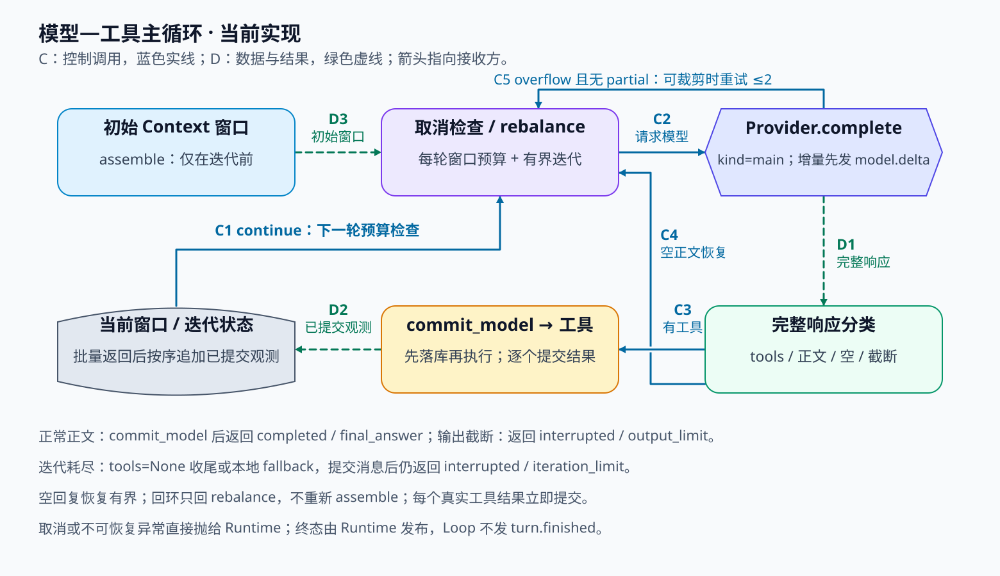


AgentLoop拿到组装好的窗口后，在每轮检查取消、迭代预算并rebalance；Provider.complete只负责生成，不执行工具。只有完整response落为assistant+planned，才调用execute_many。started回调先mark_running，completed回调立即commit_tool并累计真实工具/测试证据。

工具完成后按调用序把对应Observation放入下一次模型窗口。无工具且有完整正文正常结束；截断、空输出、连续硬失败与预算耗尽分开处理。循环结束时返回TurnResult，真正终态发布由Runtime负责。

verification是框架从真实kaki_exec的测试命令和退出码采集的证据，不以模型“测试已通过”的自然语言作判定。测试命令采用正则启发式识别，不解析完整Shell语义，必须结合commands原文与日志复核。它不是完整测试计划证明；多个不同测试命令的历史结果保留在commands列表，用户仍需评估覆盖范围。


源码连续节选：`src/kaki/loop.py:60`（SHA256前12位 `f5c027857061`）；省略处请在本机查看完整函数。


```python
            definitions = rt.tools.definitions()
            updated = await rt.context.rebalance(session, window, definitions)
            if updated is not window:
                window = updated
                await rt.emit(
                    "context.compacted", turn, window.metadata | {"estimated_tokens": window.estimated_tokens}
                )
            await rt.emit("model.started", turn, {"iteration": iteration, "model": cfg.model})
            draft_text = ""
            try:
                response = await rt.provider.complete(
                    window.messages, definitions, turn_id=turn, kind="main", on_delta=on_delta
                )
            except ProviderError as exc:
                if exc.category == "context_overflow" and not exc.partial and compressions < 2:
                    from .context.history import shrink_tool_text

                    reduced, elided = shrink_tool_text(window.messages, 3)
                    if elided:
                        window.messages = reduced
                        compressions += 1
                        iteration -= 1
                        await rt.emit(
                            "context.compacted",
                            turn,
                            {"reason": "provider_context_overflow", "elided_tool_results": elided},
                        )
                        continue
                raise
            if response.tool_calls:
                message, runs = await rt.store.run("commit_model", session, turn, response)
                window.messages.append(message)
                await rt.emit(
                    "model.committed",
                    turn,
                    {
                        "draft_id": response.call_id,
                        "message_id": message.id,
                        "text": response.text,
                        "tool_count": len(runs),
                    },
                )
                by_call = {r["tool_call_id"]: r for r in runs}
                observations = {}

                async def started(call):
                    await rt.store.run("mark_running", by_call[call.id]["id"])
                    await rt.emit(
```


源码连续节选：`src/kaki/loop.py:107`（SHA256前12位 `f5c027857061`）；省略处请在本机查看完整函数。


```python
                    await rt.emit(
                        "tool.started",
                        turn,
                        {"tool_call_id": call.id, "name": call.name, "arguments": call.arguments},
                    )

                async def completed(call, result):
                    nonlocal failures, tool_count
                    # Persist each completed observation immediately, even if another safe read is still running.
                    observation = await rt.store.run(
                        "commit_tool", session, turn, by_call[call.id]["id"], result
                    )
                    observations[call.id] = observation
                    tool_count += 1
                    failures += int(result.failed)
                    if call.name == "kaki_exec" and rt.is_test_command(call.arguments.get("command", "")):
                        evidence = {
                            "command": call.arguments["command"],
                            "cwd": call.arguments.get("working_dir", str(rt.workspace.root)),
                            "exit_code": result.exit_code,
                            "artifacts": result.artifacts,
                            "run_id": by_call[call.id]["id"],
                        }
                        verification["commands"].append(evidence)
                        verification["status"] = (
                            "passed" if result.exit_code == 0 and not result.failed else "failed"
                        )
                    await rt.emit(
                        "tool.finished",
                        turn,
                        {
                            "tool_call_id": call.id,
                            "name": call.name,
                            "failed": result.failed,
                            "preview": result.text[:600],
                            "artifacts": result.artifacts,
                            "exit_code": result.exit_code,
                        },
                    )

                results = await rt.tools.execute_many(response.tool_calls, ctx, started, completed)
                for call, result in zip(response.tool_calls, results, strict=True):
                    window.messages.append(observations[call.id])
                    if result.failed and not any(
                        t in result.text.lower() for t in ["timeout", "timed out", "429", "rate limit"]
                    ):
                        hard_count = hard_count + 1 if hard_name == call.name else 1
                        hard_name = call.name
                    else:
                        hard_count = 0
                        hard_name = None
                    if hard_count >= 2 and hard_nudges < 2:
                        from dataclasses import replace

                        window.messages[-1] = replace(
```


## 04.5 M05 Right Code Provider


[在线画板：Right Code Responses适配：控制与数据的当前流向](https://bytedance.larkoffice.com/docx/MdjydeNRXopJqbxd0frcFbtinFd#doxcnAA8LXV5oUr4oMzDPigAMTb)

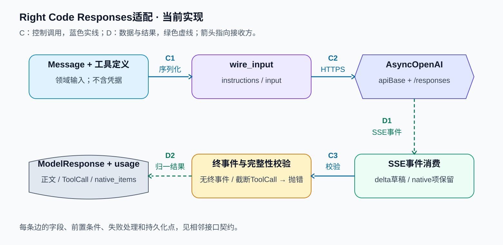


RightCodeProvider封装AsyncOpenAI，base_url取apiBase，只有本模块使用Key。complete显式传model、max_output_tokens、store=false、encrypted reasoning include与temperature；openai/模型前缀在请求前去掉，配置保留同一写法。

wire_input把system合并为instructions，把user转input_text，把assistant native_items原样顺序重放，把ToolResult转function_call_output并保留call_id。不能只重放自然语言正文，否则推理项和function调用上下文会丢失。

SSE正文可以实时显示；function参数增量不会被执行。只有response.completed/incomplete的完整response能normalize；缺终事件报stream_incomplete；截断的工具请求不执行。无可见输出前才对网络/429/上游错误有限重试；有输出后不自动重放。只允许明确不支持的temperature/include/store可选参数被省略，不悄悄换模型。

每个网络尝试记录main/curator/finalize及状态、usage、requestID和耗时；取消/失败无usage时计unknown，不能把它当免费调用。


源码连续节选：`src/kaki/provider.py:20`（SHA256前12位 `66f2aad949c1`）；省略处请在本机查看完整函数。


```python
def wire_input(messages: list[Message], resolve_part=None) -> tuple[str, list[dict[str, Any]]]:
    instructions = []
    items = []
    for m in messages:
        if m.role == "system":
            instructions.append(m.content)
        elif m.role == "user":
            parts = [{"type": "input_text", "text": m.content or "(empty)"}]
            parts.extend(expand_parts(m.parts, resolve_part))
            items.append({"role": "user", "content": parts})
        elif m.role == "assistant":
            if m.native_items:
                # Preserve the exact item ordering and opaque reasoning needed by the tool round-trip.
                items.extend(m.native_items)
            else:
                if m.content:
                    items.append(
                        {"role": "assistant", "content": [{"type": "output_text", "text": m.content}]}
                    )
                for call in m.tool_calls:
                    items.append(
                        {
                            "type": "function_call",
                            "call_id": call["id"],
                            "name": call["name"],
                            "arguments": json.dumps(call["arguments"], ensure_ascii=False),
                        }
                    )
        elif m.role == "tool":
            output: Any = m.content or "(no output)"
            if m.parts:
                output = [{"type": "input_text", "text": output}, *expand_parts(m.parts, resolve_part)]
            items.append({"type": "function_call_output", "call_id": m.tool_call_id, "output": output})
        else:
            raise ProviderError(f"不支持的消息角色：{m.role}", "protocol")
    return "\n\n".join(instructions), items
```


源码连续节选：`src/kaki/provider.py:211`（SHA256前12位 `66f2aad949c1`）；省略处请在本机查看完整函数。


```python
                    typ = event.type
                    if typ == "response.output_text.delta":
                        visible = True
                        if on_delta:
                            await on_delta(event.delta, call_id)
                    elif typ in ("response.completed", "response.incomplete"):
                        response = normalize_response(event.response, call_id)
                    elif typ in ("error", "response.failed"):
                        err = getattr(event, "error", None) or getattr(
                            getattr(event, "response", None), "error", None
                        )
                        raise ProviderError(
                            safe_error(getattr(err, "message", None) or err or typ),
                            "response_failed",
                            partial=visible,
                        )
                if response is None:
                    raise ProviderError(
                        "模型流提前断开，没有完整结束事件；未执行不完整工具请求",
                        "stream_incomplete",
                        partial=visible,
                    )
                if response.finish_reason != "completed" and response.tool_calls:
                    raise ProviderError(
                        "模型工具参数或响应被截断，未执行工具", "output_limit", partial=visible
                    )
                record.update(
                    status="completed",
                    ended=now(),
                    usage=response.usage,
                    metadata={
                        **record["metadata"],
                        "provider_id": response.provider_id,
                        "duration_ms": round((time.monotonic() - t0) * 1000),
                        "finish_reason": response.finish_reason,
```


## 04.6 M06 内置工具与执行策略


[在线画板：ToolRegistry与本地执行：控制与数据的当前流向](https://bytedance.larkoffice.com/docx/MdjydeNRXopJqbxd0frcFbtinFd#doxcnyvVbtYA3Uq8tFMOQJWP6Gh)

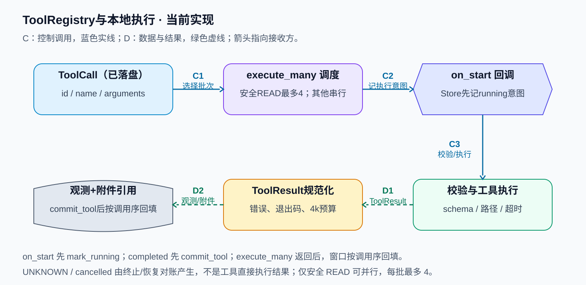


注册表保存Tool.name/description/parameters/effect/execute/safe_read。原生工具由kaki_命名，不复用pico变量。Draft202012Validator校验参数，仅对十进制整数串做有限兼容转换；无注册工具、坏参数、路径或超时错误返回failed观察。

kaki_read_file按行分页并返回SHA256，8MiB读上限；kaki_search用rg固定字符串或显式regex；kaki_write_file支持expected_hash并原子落盘；kaki_edit_file要求唯一old_text锚点，默认拒绝重复匹配并保留CRLF；kaki_exec用非login Bash、有界超时与进程组TERM/KILL，不继承KAKI Key变量。

Shell stdout/stderr各最多保留8MiB并报告丢弃字节数；模型可见正文超过4000tokens转本地artifact，给头尾和ID，可分页读。完整输出的承诺受采集上限限制，不声称无限日志都能保留。

只有safe_read的READ工具最多4并发，其余WRITE/EXECUTE/EXTERNAL串行。TaskGroup使持久化回调异常时其他读任务也被取消，不留下无人管理的后台读。


源码连续节选：`src/kaki/tools.py:251`（SHA256前12位 `786514371263`）；省略处请在本机查看完整函数。


```python
    async def execute_many(self, calls: list[ToolCall], ctx: dict, on_start, on_complete) -> list[ToolResult]:
        async def one(c):
            await on_start(c)
            result = await self.execute(c, ctx)
            await on_complete(c, result)
            return result

        results = []
        i = 0
        while i < len(calls):
            t = self.tools.get(calls[i].name)
            if t and t.effect == "READ" and t.safe_read:
                end = i
                while end < len(calls):
                    s = self.tools.get(calls[end].name)
                    if not s or s.effect != "READ" or not s.safe_read:
                        break
                    end += 1
                for at in range(i, end, 4):
                    async with asyncio.TaskGroup() as group:
                        tasks = [group.create_task(one(c)) for c in calls[at : min(at + 4, end)]]
                    results.extend(task.result() for task in tasks)
                i = end
            else:
                results.append(await one(calls[i]))
                i += 1
        return results
```


源码连续节选：`src/kaki/tools.py:376`（SHA256前12位 `786514371263`）；省略处请在本机查看完整函数。


```python
    async def edit(self, a, ctx):
        p = self.workspace.path(a["path"], write=True)
        raw = await asyncio.to_thread(p.read_bytes)
        if a.get("expected_hash") and hashlib.sha256(raw).hexdigest() != a["expected_hash"]:
            raise KakiError("文件hash已变化，拒绝编辑")
        crlf = b"\r\n" in raw
        text = raw.decode().replace("\r\n", "\n")
        old = a["old_text"].replace("\r\n", "\n")
        new = a["new_text"].replace("\r\n", "\n")
        if not old:
            raise KakiError("old_text不能为空")
        count = text.count(old)
        if not count:
            raise KakiError("未找到old_text，请重新读取文件")
        if count > 1 and not a.get("replace_all"):
            raise KakiError(f"old_text出现{count}次，锚点不唯一；请提供更多上下文")
        result = text.replace(old, new) if a.get("replace_all") else text.replace(old, new, 1)
        if crlf:
            result = result.replace("\n", "\r\n")
        await self._atomic_write(p, result.encode())
        return ToolResult("已修改 " + str(p), touched_paths=[str(p)])
```


## 04.7 M07 浏览器MCP与内容适配


[在线画板：Playwright MCP actor：控制与数据的当前流向](https://bytedance.larkoffice.com/docx/MdjydeNRXopJqbxd0frcFbtinFd#doxcnDqH3pXNFxVwkvZstA8rwQf)

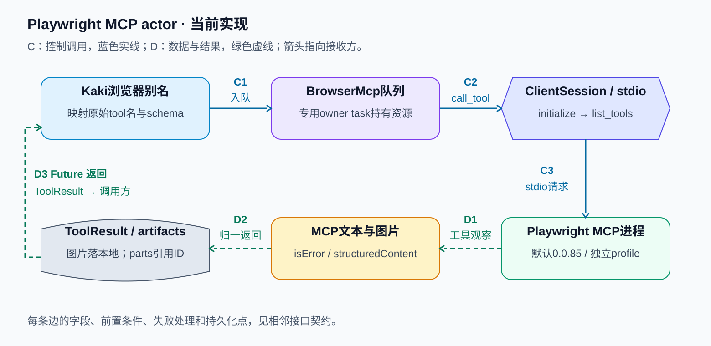


BrowserMcp.start创建专用owner Task。该Task在同一任务中进入和退出stdio_client/ClientSession，避免anyio取消作用域跨Task退出。initialize→list_tools把原Schema映射为kaki_browser_*；主模型仍使用统一原生工具调用，MCP并不是另一个主循环。

call把原名/参数/Future送入队列，owner串行call_tool，调用超时可取消对应请求。Playwright MCP固定0.0.85，并为每个项目设置独立user-data-dir和output-dir，不读取用户日常Chrome profile。

返回TextContent拼正文，ImageContent保存原附件并形成parts引用，structuredContent和isError进入ToolResult；Provider发送时才缩放/编码图片，Token估算按图片保守加预算。进程启动和清理在本地，服务端并不等于远程微服务。MCP本身具有浏览器执行能力，不把“独立profile”当OS沙箱。


源码连续节选：`src/kaki/browser_mcp.py:43`（SHA256前12位 `582e9ea19499`）；省略处请在本机查看完整函数。


```python
    async def _serve(self):
        opt = self.option
        args = list(opt.args or ["-y", f"@playwright/mcp@{PLAYWRIGHT_VERSION}", "--browser", "chrome"])
        if "--isolated" not in args and not any(x.startswith("--user-data-dir") for x in args):
            args += ["--user-data-dir", str(self.workspace.state / "browser-profile")]
        if not any(x.startswith("--output-dir") for x in args):
            args += ["--output-dir", str(self.workspace.state / "browser-output")]
        server = StdioServerParameters(
            command=opt.command, args=args, env=opt.env or None, cwd=self.workspace.root
        )

        async def roots(_):
            return types.ListRootsResult(
                roots=[types.Root(uri=self.workspace.root.as_uri(), name=self.workspace.root.name)]
            )

        log = (self.workspace.state / "browser-mcp.log").open("a")
        try:
            async with stdio_client(server, errlog=log) as (read, write):
                async with ClientSession(
                    read,
                    write,
                    read_timeout_seconds=timedelta(seconds=opt.tool_timeout),
                    list_roots_callback=roots,
                    client_info=types.Implementation(name="kaki-agent", version="0.1.0"),
                ) as session:
                    await session.initialize()
                    listing = await session.list_tools()
                    self.tools = []
                    for t in listing.tools:
                        original = t.name
                        alias = "kaki_browser_" + original.removeprefix("browser_")
                        self.tools.append(
                            {
                                "name": alias,
                                "original": original,
                                "description": t.description or original,
                                "parameters": t.inputSchema or {"type": "object", "properties": {}},
                            }
                        )
```


源码连续节选：`src/kaki/browser_mcp.py:151`（SHA256前12位 `582e9ea19499`）；省略处请在本机查看完整函数。


```python
    async def call(self, name: str, arguments: dict) -> ToolResult:
        await self.start()
        if self.task.done():
            raise KakiError("浏览器MCP已退出；请重新启动Kaki后重试")
        original = next((t["original"] for t in self.tools if t["name"] == name), None)
        if not original:
            raise KakiError("未注册的浏览器工具")
        if "files" in arguments and isinstance(arguments["files"], list):
            arguments = {**arguments, "files": [str(self.workspace.path(p)) for p in arguments["files"]]}
        future = asyncio.get_running_loop().create_future()
        await self.queue.put((original, arguments, future))
        return await future
```


## 04.8 M08 统一上下文与Curator


[在线画板：统一上下文窗口管理：控制与数据的当前流向](https://bytedance.larkoffice.com/docx/MdjydeNRXopJqbxd0frcFbtinFd#doxcnFPlUYcUT7goMCIyL4CdBfb)

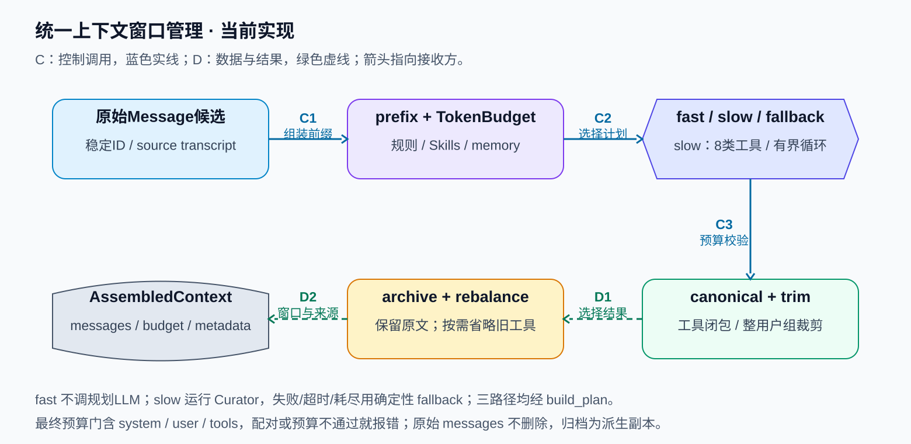


ContextEngine是历史选择与最终窗口预算的唯一组合入口。prefix并行取Rules、Skills、Memory，再放身份、工作目录和恢复线索。assemble把完整历史映射到带稳定ID的manifest，计算相关度与历史tokens，根据阈值走快路或私有Curator。

build_plan读取真实archive refs，校验ID存在与保护组，再canonical闭合，trim按整用户组删除低相关候选；最终assert_window同时验证配对与Token。未入窗原始消息自动精确归档，原Session不删除。

rebalance在每次模型请求之前重做预算；先删非保护旧组，再省略旧工具正文保留最近3条，必要时删当前Turn中较早完整exchange，最后仍超限就明确失败。更细机制见05。


源码连续节选：`src/kaki/context/engine.py:76`（SHA256前12位 `35e5d62f2a5f`）；省略处请在本机查看完整函数。


```python
    async def build_plan(
        self, session, history, user, system, tools, budget, manifest, plan: ContextPlan
    ) -> AssembledContext:
        ids = set(plan.include_message_ids)
        for ref in plan.include_archive_refs:
            row = await self.store.run("archive_get", session, ref)
            ids.update(row["message_ids"])
        allowed = {m.id for m in history}
        if ids - allowed:
            raise ContextOverflow("计划引用不存在的消息ID")
        protected = {m.id for g in self.protected_groups(history) for m in g}
        if protected & set(plan.drop_message_ids):
            raise ContextOverflow("计划试图排除初始保护约束")
        ids = (ids | protected) - set(plan.drop_message_ids)
        closed = canonical(history, list(ids))
        if {m.id for m in closed} & set(plan.drop_message_ids):
            raise ContextOverflow("排除项会拆散工具调用组")
        extra = []
        if plan.working_state_injection:
            extra.append("# Curator working state (summary)\n" + excerpt(plan.working_state_injection, 1200))
        for section in plan.memory_sections:
            if section in ("Working State", "working_state"):
                state = await self.store.run("context_get", session)
                extra.append("# Saved working state\n" + json.dumps(state["working"], ensure_ascii=False))
            elif section in ("Long-term Memory", "memory"):
                mem, _ = await self.memory.segment(user.content)
                if mem:
                    extra.append(mem)
            else:
                raise ContextOverflow("未知memory_sections：" + section)
        fixed = replace(system, content=system.content + ("\n\n" + "\n\n".join(extra) if extra else ""))
        selected, validation = trim(
            history,
            list(ids),
            protected,
            {m.id: manifest.get(str(m.id), {}).get("relevance", 0.5) for m in history},
            fixed,
            user,
            tools,
            budget.input_limit,
        )
        if not validation["ok"]:
            raise ContextOverflow(
                "上下文计划无法通过预算或工具配对：" + json.dumps(validation, ensure_ascii=False)
            )
        messages = [fixed, *selected, user]
        assert_window(messages, tools, budget.input_limit)
        return AssembledContext(
            messages,
            budget,
            validation["estimated_tokens"],
            {"validation": validation, "included_ids": [m.id for m in selected], "plan": asdict(plan)},
```


## 04.9 M08-Skills 本地知识技能


[在线画板：本地Skills发现与注入：控制与数据的当前流向](https://bytedance.larkoffice.com/docx/MdjydeNRXopJqbxd0frcFbtinFd#doxcncfhR3ct3z4stgwXsrTqWkb)

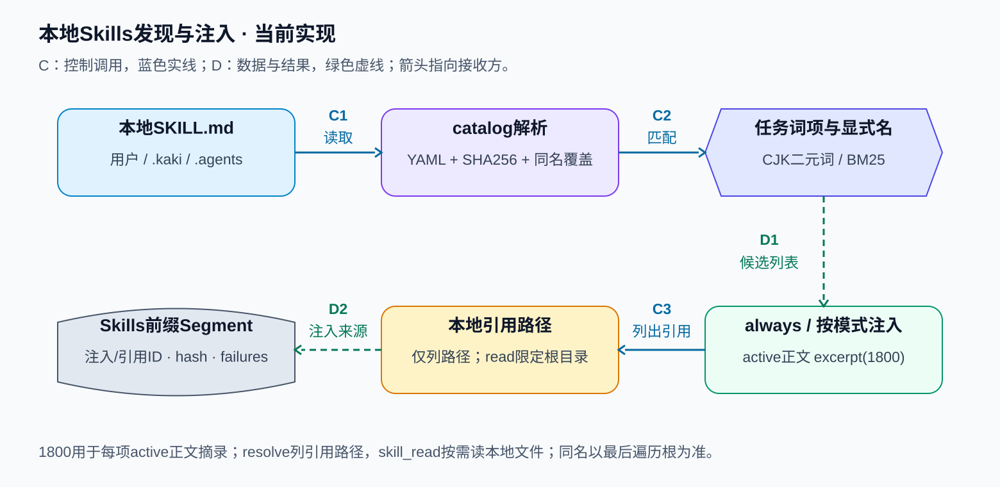


Skills依次扫描用户~/.kaki、项目.kaki、项目.agents下的一层*/SKILL.md，同名后者覆盖。解析YAML前言，保留描述、always、正文、目录和SHA256；无效技能记录failures，不把坏文件当成功。

显式$技能名或/skill技能名优先，中文二元词与BM25负责轻量召回；always默认最多5，按需正文默认最多2，每正文1800tokens，其他候选给引用。路径和版本写入上下文metadata。skill_read只允许已声明技能根内文件；链接引用不授予任意本地文件访问权限。

这是一套本地技能文档注入机制，不是远程SkillForge服务或可执行插件ABI；技能不能改变当前用户授权。


源码连续节选：`src/kaki/context/knowledge.py:129`（SHA256前12位 `3ccf4669aa68`）；省略处请在本机查看完整函数。


```python
    def resolve(self, query: str) -> tuple[str, dict]:
        rows, failures = self.catalog()
        cfg = self.config.skill_forge
        always = [r for r in rows if r["always"]][: cfg.always_max]
        hits = (
            rank(query, [r["id"] + " " + r["description"] + " " + r["body"][:1800] for r in rows])
            if cfg.router.enabled
            else []
        )
        explicit = [r for r in rows if "$" + r["id"] in query or "/skill " + r["id"] in query]
        candidates = [
            r
            for r in explicit + [rows[i] for i, s in hits if s >= cfg.router.local_min_score]
            if r not in always
        ]
        candidates = list({r["id"]: r for r in candidates}.values())[: cfg.router.top_k]
        active = always + (candidates[: cfg.inject_max] if cfg.injection_mode == "full_body" else [])
        references = [r for r in candidates if r not in active]
        sections = []
        for r in active:
            refs = []
            for name in re.findall(r"\[[^\]]+\]\(([^)#]+)(?:#[^)]*)?\)", r["body"]):
                if "://" in name:
                    continue
                p = (Path(r["directory"]) / name).resolve()
                if not p.is_relative_to(Path(r["directory"])):
                    failures.append(r["id"] + ": reference outside skill")
                    continue
                refs.append(str(p))
            sections.append(
                f"## {r['id']} [source={r['path']}; sha256={r['hash'][:12]}]\n{excerpt(r['body'], 1800)}\nLocal references: {refs}"
            )
        if references:
            sections.append(
                "Available skill references:\n"
                + "\n".join(f"- {r['id']}: {r['description']} ({r['path']})" for r in references)
            )
        return ("# Local Skills\n" + "\n\n".join(sections) if sections else ""), {
            "injected_skill_ids": [r["id"] for r in active],
            "referenced_skill_ids": [r["id"] for r in references],
            "skill_source_failures": failures,
            "skill_versions": {r["id"]: r["hash"] for r in active},
        }
```


## 04.10 M09 SQLite事实与执行日志


[在线画板：SQLite事实与短事务：控制与数据的当前流向](https://bytedance.larkoffice.com/docx/MdjydeNRXopJqbxd0frcFbtinFd#doxcno5QBpkQEFbij2z5hgOGssI)

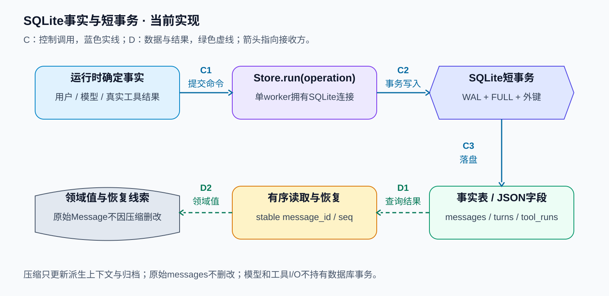


Store只通过ThreadPoolExecutor(max_workers=1)拥有并使用连接，避免Textual事件循环被同步SQLite阻塞。WAL允许稳定读取，FULL同步与外键约束维持原子事实。Store.run是内部异步操作入口，不是网络RPC。

核心事务分别为accept_turn、commit_model、mark_running、commit_tool、finish_turn。每次事务只处理持久状态，不跨HTTP或Shell等待。payload保留原生项、附件、调用关联和时间；消息ID/会话seq稳定递增。

schema_version=1，发现更高版本拒绝降级覆盖；数据库损坏时明确报错，没有“自动重置历史”。当前版本尚未提供未来schema自动迁移框架。


源码连续节选：`src/kaki/store.py:197`（SHA256前12位 `d9b7d2a9eb51`）；省略处请在本机查看完整函数。


```python
    def _commit_model(self, session: str, turn: str, response: ModelResponse) -> tuple[Message, list[dict]]:
        with self.db:
            self._assert_active(turn)
            msg = self._append(
                session,
                turn,
                Message(
                    "assistant",
                    response.text,
                    tool_calls=[asdict(c) for c in response.tool_calls],
                    native_items=response.native_items,
                ),
            )
            runs = []
            for call in response.tool_calls:
                run = {
                    "id": uid("run_"),
                    "tool_call_id": call.id,
                    "name": call.name,
                    "arguments": call.arguments,
                }
                self.db.execute(
                    "INSERT INTO tool_runs(id,turn_id,tool_call_id,name,arguments,state) VALUES(?,?,?,?,?,?)",
                    (run["id"], turn, call.id, call.name, dumps(call.arguments), "planned"),
                )
                runs.append(run)
            self._event(
                session, turn, "model.committed", {"message_id": msg.id, "model_call_id": response.call_id}
            )
        return msg, runs
```


源码连续节选：`src/kaki/store.py:241`（SHA256前12位 `d9b7d2a9eb51`）；省略处请在本机查看完整函数。


```python
    def _commit_tool(self, session: str, turn: str, run: str, result: ToolResult) -> Message:
        with self.db:
            row = self.db.execute("SELECT * FROM tool_runs WHERE id=? AND turn_id=?", (run, turn)).fetchone()
            if not row or row["state"] not in ("running", "planned"):
                raise KakiError("工具结果已经提交或已标记未知")
            state = "failed" if result.failed else "succeeded"
            self.db.execute(
                "UPDATE tool_runs SET state=?,result_json=?,ended=? WHERE id=?",
                (state, dumps(asdict(result)), now(), run),
            )
            # The observation is data; it cannot acquire the priority of a user/system instruction.
            boundary = uid("data_")
            text = f"[{boundary}: untrusted tool data; source={row['name']}]\n{result.text}\n[/{boundary}]"
            msg = self._append(
                session,
                turn,
                Message(
                    "tool",
                    text,
                    tool_call_id=row["tool_call_id"],
                    parts=result.parts,
                    artifacts=result.artifacts,
                ),
            )
            self._event(session, turn, "tool.finished", {"run_id": run, "state": state, "message_id": msg.id})
        return msg
```


## 04.11 M10 显式项目记忆


[在线画板：显式项目长期记忆：控制与数据的当前流向](https://bytedance.larkoffice.com/docx/MdjydeNRXopJqbxd0frcFbtinFd#doxcnhPtZJO7xVMmfFDwz72KDke)

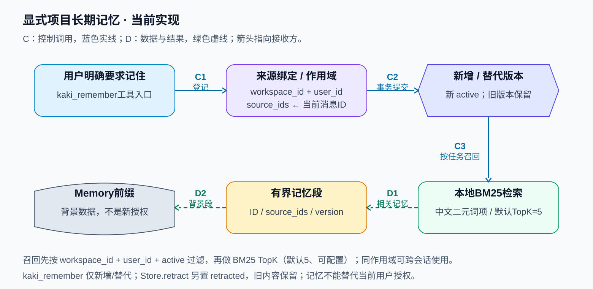


Memory持久在本地SQLite，按workspace_id和user_id隔离。kaki_remember只在当前用户明确要求“记住/remember/保存记忆”时开放写入，保存当前用户message_id作为来源，单条不超过4000字符，并拒绝常见Key模式。

替代旧记忆会建立新版本，旧行为superseded；撤回为retracted；召回只看active，BM25/CJK按当前问题TopK=5选取并标来源/版本。新会话也可用，但不会把模型每次总结自动升级为长期事实。

memory.backend=null可关闭这条能力。记忆是背景资料，不是对后续动作的新授权；用户最新指令优先。真实跨Runtime/新Session召回见11。


源码连续节选：`src/kaki/context/knowledge.py:62`（SHA256前12位 `3ccf4669aa68`）；省略处请在本机查看完整函数。


```python
    async def remember(
        self, content: str, source_ids: list[int], kind: str = "explicit", replaces: str | None = None
    ):
        if self.config.memory.backend is None:
            raise KakiError("memory.backend=null，长期记忆已关闭")
        if len(content) > 4000:
            raise KakiError("单条记忆过长，请保存可复用事实而非原始日志")
        if re.search(r"sk-[A-Za-z0-9_-]{12,}|(?i:authorization\s*:\s*bearer)", content):
            raise KakiError("凭据不应进入长期记忆")
        return await self.store.run(
            "remember", self.config.memory.user_id, content, kind, source_ids, replaces
        )
```


源码连续节选：`src/kaki/store.py:453`（SHA256前12位 `d9b7d2a9eb51`）；省略处请在本机查看完整函数。


```python
    def _remember(
        self, user_id: str, content: str, kind: str, source_ids: list[int], replaces: str | None = None
    ) -> str:
        identity = uid("m_")
        version = 1
        with self.db:
            if replaces:
                r = self.db.execute(
                    "SELECT * FROM memories WHERE id=? AND workspace_id=? AND user_id=?",
                    (replaces, self.workspace_id, user_id),
                ).fetchone()
                if not r:
                    raise KakiError("待替换记忆不存在")
                version = r["version"] + 1
                self.db.execute(
                    "UPDATE memories SET state='superseded',updated=? WHERE id=?", (now(), replaces)
                )
            self.db.execute(
                "INSERT INTO memories VALUES(?,?,?,?,?,?,?,?,?,?)",
                (
                    identity,
                    self.workspace_id,
                    user_id,
                    content,
                    kind,
                    "active",
                    version,
                    dumps(source_ids),
                    now(),
                    now(),
                ),
            )
        return identity
```


## 04.12 M11 独立工作区快照


[在线画板：独立快照与冲突恢复：控制与数据的当前流向](https://bytedance.larkoffice.com/docx/MdjydeNRXopJqbxd0frcFbtinFd#doxcnVMMOXewYxathR75DWZWLfc)

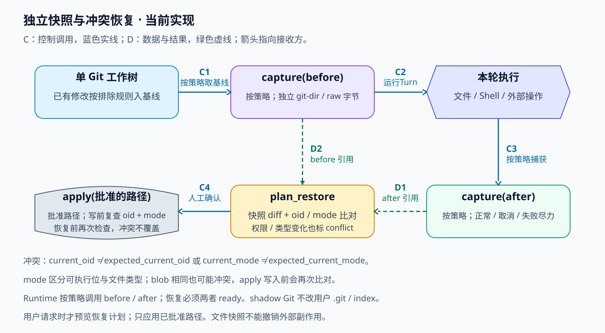


Checkpoint在状态目录下创建kaki-shadow.git，用--git-dir和--work-tree显式指向独立仓库和目标工作树；不复用用户index、分支或commit。Git hooks与用户filter/autocrlf被关闭，原字节、CRLF、二进制、符号链接与可执行位可恢复。敏感/大型生成目录被排除，规则不等于“备份所有文件”。

每Turn按策略取before与after。plan_restore比较两棵tree，并检查当前blob内容与Git文件模式是否仍等于after；apply仅恢复批准路径，写入时再次校验，后续用户修改标冲突不覆盖。

快照覆盖本轮期间整个被纳入工作树的差异，无法识别外部编辑器同时写入的所有权；必须看恢复预览。它不是浏览器、Shell网络副作用或多仓事务的回滚系统。


源码连续节选：`src/kaki/checkpoint.py:95`（SHA256前12位 `bcb55dabecda`）；省略处请在本机查看完整函数。


```python
    async def capture(self, turn: str, phase: str) -> dict:
        identity = uid("snap_")
        metadata = {
            "root": str(self.workspace.root),
            "excludes_sha256": hashlib.sha256(EXCLUDES.encode()).hexdigest(),
        }
        await self.store.run("snapshot", identity, turn, phase, "creating", None, metadata)
        try:
            await self.ensure()
            await self.git("add", "-A", "--", ".")
            _, staged, _ = await self.git("ls-files", "--stage", "-z")
            if any(x.startswith(b"160000 ") for x in staged.split(b"\0") if x):
                raise KakiError("快照发现嵌套Git单元；v0.1不把Gitlink当文件内容覆盖")
            rc, head, _ = await self.git("rev-parse", "--verify", "HEAD", check=False)
            changed, _, _ = await self.git("diff", "--cached", "--quiet", check=False)
            if rc or changed:
                await self.git("commit", "--allow-empty", "-m", f"Kaki {turn} [{phase}]")
                _, head, _ = await self.git("rev-parse", "HEAD")
                self.commits += 1
                if self.commits % 50 == 0:
                    await self.git("gc", "--auto")
            commit = head.decode().strip()
            metadata["unchanged"] = not bool(rc or changed)
            await self.store.run("snapshot", identity, turn, phase, "ready", commit, metadata)
            return {"id": identity, "commit": commit, "state": "ready", "phase": phase}
        except asyncio.CancelledError:
            await asyncio.shield(
                self.store.run(
                    "snapshot", identity, turn, phase, "failed", None, {**metadata, "error": "cancelled"}
                )
            )
            raise
        except Exception as exc:
            metadata["error"] = str(exc)
            await self.store.run("snapshot", identity, turn, phase, "failed", None, metadata)
            return {"id": identity, "commit": None, "state": "failed", "phase": phase, "error": str(exc)}
```


源码连续节选：`src/kaki/checkpoint.py:200`（SHA256前12位 `bcb55dabecda`）；省略处请在本机查看完整函数。


```python
    async def apply(self, plan: dict, approved_paths: list[str]) -> dict:
        allowed = {x["path"]: x for x in plan["paths"]}
        restored = []
        conflicts = []
        for name in approved_paths:
            item = allowed.get(name)
            if not item:
                raise KakiError("恢复选择不属于此计划")
            # Recheck at write time: a preview alone is not permission to clobber subsequent edits.
            if (
                await asyncio.to_thread(self.current_oid, name) != item["expected_current_oid"]
                or await asyncio.to_thread(self.current_mode, name) != item["expected_current_mode"]
            ):
                conflicts.append(name)
                continue
            p = self.workspace.root / name
            parent = p.parent.resolve()
            if not parent.is_relative_to(self.workspace.root):
                raise KakiError("恢复路径的父目录越界")
            target = item["before"]
            if p.is_symlink():
                p.unlink()
            if target is None:
                if p.is_file():
                    p.unlink()
            else:
                _, raw, _ = await self.git("cat-file", "blob", target["oid"])
                p.parent.mkdir(parents=True, exist_ok=True)
                if target["mode"] == "120000":
                    if p.exists():
                        p.unlink()
                    p.symlink_to(os.fsdecode(raw))
                else:
                    temp = p.parent / uid(".kaki-restore-")
                    temp.write_bytes(raw)
                    temp.chmod(0o755 if target["mode"] == "100755" else 0o644)
                    temp.replace(p)
            restored.append(name)
        return {"restored": restored, "conflicts": conflicts}
```


## 04.13 M12 中断恢复与继续


[在线画板：进程中断与下一轮恢复：控制与数据的当前流向](https://bytedance.larkoffice.com/docx/MdjydeNRXopJqbxd0frcFbtinFd#doxcnJ7Kuw1kcFhrTO9fS1QvUCg)

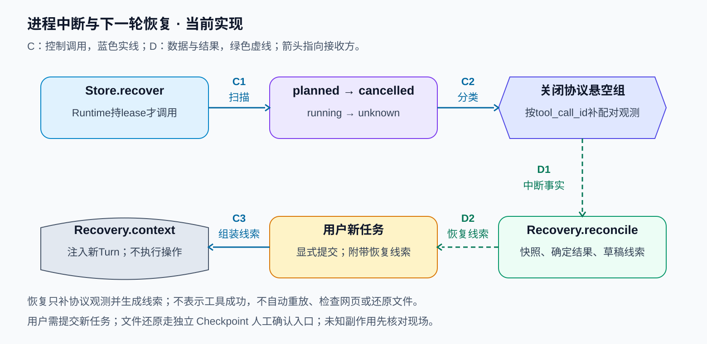


Recovery.reconcile在项目执行租约下读取未结束Turn、tool_runs、快照与草稿，Store.recover先将活跃任务标为interrupted，planned变cancelled，running变unknown，并补明确的协议观察以便下一次完整重放。

已完成的确定结果照常保留；未知操作带参数和run_id供下个任务核对。模型流草稿只作线索，不伪装成已提交assistant。恢复Context注入下一个用户请求，而不是后台重新执行旧命令。

浏览器页面状态没有跨进程承诺；恢复后仍需新的浏览器观察。文件恢复是另一条人工确认路径，--resume本身不会还原工作树。


源码连续节选：`src/kaki/recovery.py:12`（SHA256前12位 `b175815b80eb`）；省略处请在本机查看完整函数。


```python
    async def reconcile(self, session: str) -> dict:
        interrupted = await self.store.run("recover", session)
        turns = await self.store.run("turns", session)
        items = []
        for turn in turns[-5:]:
            if turn["status"] == "completed":
                continue
            runs = await self.store.run("tool_runs", turn["id"])
            snapshots = await self.store.run("snapshots", turn["id"])
            items.append(
                {
                    "turn_id": turn["id"],
                    "original_request": turn["text"],
                    "status": turn["status"],
                    "reason": turn["stop_reason"],
                    "known_results": [
                        {"name": r["name"], "state": r["state"]}
                        for r in runs
                        if r["state"] in ("succeeded", "failed")
                    ],
                    "unknown_or_cancelled": [
                        {"name": r["name"], "state": r["state"], "arguments": json.loads(r["arguments"])}
                        for r in runs
                        if r["state"] in ("unknown", "cancelled")
                    ],
                    "snapshots": [
                        {"id": s["id"], "phase": s["phase"], "state": s["state"], "commit": s["commit_id"]}
                        for s in snapshots
                    ],
                    "draft": json.loads(turn["result_json"] or "{}").get("draft"),
                }
            )
        return {
            "recovered_turns": len(interrupted),
            "items": items,
            "requires_new_observation": any(x["unknown_or_cancelled"] for x in items),
        }
```


源码连续节选：`src/kaki/store.py:311`（SHA256前12位 `d9b7d2a9eb51`）；省略处请在本机查看完整函数。


```python
    def _recover(self, session: str) -> list[dict]:
        self._session(session)
        recovered = []
        with self.db:
            rows = self.db.execute(
                "SELECT * FROM turns WHERE session_id=? AND status IN ('queued','running','waiting_user')",
                (session,),
            ).fetchall()
            for row in rows:
                self._pending_observations(row["id"], reason="上次进程退出")
                self.db.execute(
                    "UPDATE model_calls SET status='interrupted',ended=? WHERE turn_id=? AND status='running'",
                    (now(), row["id"]),
                )
                self.db.execute(
                    "UPDATE turns SET status='interrupted',stop_reason='process_exit',ended=? WHERE id=?",
                    (now(), row["id"]),
                )
                self._event(session, row["id"], "turn.recovered", {"reason": "process_exit"})
                recovered.append(dict(row))
        return recovered
```


[在线画板：工具状态机：执行意图、真实结果和UNKNOWN的区别](https://bytedance.larkoffice.com/docx/MdjydeNRXopJqbxd0frcFbtinFd#doxcn64phYAAiqq5PnHB2GgovNd)

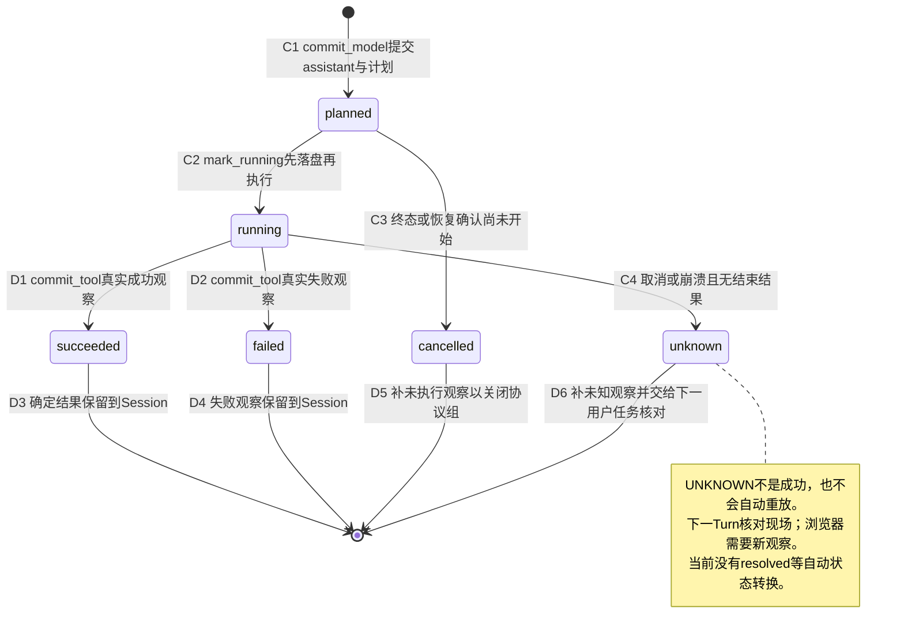


# 05 上下文压缩、窗口与Token管理

## 05.1 原始事实和模型窗口是两份不同职责的数据

messages表保留完整提交后的会话；ContextPlan只是本次选择哪些ID、哪些归档引用、哪些工作状态。模型窗口可以省略原文，但原始Session与附件保留，能够精确按ID/归档取回。摘要、manifest snippet和working state有损，不能充当唯一事实源。

Pico的核心机制被按当前单仓/Responses场景重新实现，而非复制Pico全部插件与Provider。保护策略采用最初3个完整用户消息组，避免裁剪时切碎早期约束；保护内容本身超限会显式失败。

## 05.2 预算公式

```text
W = agents.defaults.contextWindowTokens       # 手动窗口cap，默认65536
O = agents.defaults.maxTokens                 # 输出预留，默认8192
M = max(128, floor(W * 0.02))                  # 默认1310
input_limit = W - O - M                       # 默认56034
available_history = max(0, input_limit - reserved_system - reserved_tools - reserved_user)
最终门：estimate(完整wire input + tools) <= input_limit
```

reserved_system/tools/user是预算解释项；最后不是简单加每段估算，而是按Provider wire_input的完整序列化再估一次，包括native_items、工具定义、结构开销、图片。这样不会只看“聊天正文Token”而漏掉大工具Schema。

tiktoken使用o200k_base，编码器不可用时用UTF-8字节/3回退；每张图片另计4096。它是本地保守估算，不能保证等于Right Code背后模型的实际Tokenizer，usage才是服务返回的实际统计。请求显式传max_output_tokens，不能只在本地账本里“预留输出”。

## 05.3 快路径和慢路径

历史较少且未达到0.6*available_history时，快路用候选全历史，经同一build_plan/闭包/预算门生成窗口，不额外调用Curator。/compact可强制规划，即便历史较短。

慢路构造有界manifest：最近18条、与当前问题相关12条、保护组，加all_message_ids。Curator看摘要和ID，不先把无限原文复制到第二份模型上下文。最多12轮、默认30秒，输出限制min(2048,主maxTokens)，不开放编码/Shell/浏览器工具。

实际验收先观察到Curator在archive/state准备调用上消耗30秒而回退。优化后明确要求“预算够时首轮build；需要归档时批量处理并尽快build”，真实复测一轮build通过。截止时间与fallback仍保留，不把LLM规划当可靠基础设施。

## 05.4 八个私有工具

| 私有工具 | 关键输入 | 返回与校验 |
|---|---|---|
| kaki_context_budget | plan | 以完整前缀/工具预算验证候选；不直接结束规划 |
| kaki_context_archive | message_ids、reason、summary | 原始Message精确JSON归档，返回opaque archive_ref |
| kaki_context_retrieve | archive_ref、offset、limit | 会话作用域与hash校验后精确分页 |
| kaki_context_search | query | 从真实历史检索message_id和snippet |
| kaki_context_memory | query | active项目记忆及来源；backend=null时不注册 |
| kaki_context_relevance | updates[{message_id,relevance}] | ID存在且score在0..1 |
| kaki_context_state | goals/open_threads/decisions | 有界8/12/20条工作状态，当前有效决定 |
| kaki_context_build | ContextPlan各字段 | 最终闭包+预算门通过才accepted并返回窗口 |

Curator不能凭空引用ID、删除初始保护组、拆工具组或任意给memory_sections；无效计划会获得明确错误并有界修正。日志单独写context/traces，不混成主用户对话。

## 05.5 结构闭包与整组裁剪

canonical把被选assistant的全部tool children补齐，也把被选tool反向补到assistant及其兄弟结果。structural_errors检查orphan、重复/缺失call_id、未返回结果就出现下一assistant/user等。trim按用户组而非单条消息裁剪：相关度低且未保护的组先移除，最终再次检查完整wire预算。

相关度以0.95衰减，与当前问题匹配可增加0.15，上限1。manifest保留tokens、snippet、来源turn和archive_ref；这帮助选择，不能证明摘要语义一定正确。

## 05.6 确定性回退与精确归档

Curator超时、无有效build、输入上限、工具错误或步数用尽时，选保护组+最近候选+高相关候选，再经同一闭包/整组裁剪与预算门。计划未入窗的原始Message自动写归档，SQLite原文仍保留。

归档JSON包含schema_version、session_id、reason和完整Message（原生项、附件引用、调用关联、时间）。SQLite保存artifact path/hash/size，读取验证作用域和SHA256；kaki_archive_read精确分页，kaki_history_search查原始Session并给archive_ref。不存在的ID不被“成功归档”。

## 05.7 单次Turn内部也需要管理窗口

工具结果持续追加，不能只在接单时压缩一次。每个模型请求前rebalance：先移除旧非保护完整用户组；再把旧工具正文换为明确省略标记，保留最近3条；仍超限时移除当前Turn中较旧的完整模型-工具exchange，保留当前用户与最新exchange。所有省略源都可归档取回。

工具可见输出先有4000tokens限额，大正文变artifact；这与历史选窗是两级不同预算。若最新用户、规则、工具定义或被保护的必要内容本身仍放不下，失败并让用户缩小输入，不无声删约束。

## 05.8 Provider溢出与空输出恢复

只有未产生可见输出的context_overflow才尝试旧工具正文省略，最多2次，成功恢复不占用正常迭代预算；仍溢出则报错。没有可省略内容也不做无限重试。

思考预填最多2次、工具后空正文nudge最多1次、空正文retry最多3次；连续同名硬失败最多2次提示换方法。正常模型迭代40轮用完后只允许一次关闭工具总结，终态interrupted。Provider网络重试也有限，已显示部分响应后不自动重放。


源码连续节选：`src/kaki/context/history.py:48`（SHA256前12位 `b4566a28c803`）；省略处请在本机查看完整函数。


```python
def canonical(messages: list[Message], ids: list[int]) -> list[Message]:
    selected = set(ids)
    by_call = {}
    children = {}
    for m in messages:
        if m.role == "assistant":
            for c in m.tool_calls:
                by_call[c["id"]] = m.id
        elif m.role == "tool":
            children.setdefault(m.tool_call_id, []).append(m.id)
    changed = True
    while changed:
        changed = False
        for call, parent in by_call.items():
            related = {parent, *children.get(call, [])}
            if related & selected and not related <= selected:
                selected |= related
                changed = True
    # A complete user boundary is mandatory for history; do not manufacture an assistant-led past.
    result = [m for m in messages if m.id in selected]
    first = next((i for i, m in enumerate(result) if m.role == "user"), len(result))
    return result[first:]
```


源码连续节选：`src/kaki/context/engine.py:212`（SHA256前12位 `35e5d62f2a5f`）；省略处请在本机查看完整函数。


```python
    async def rebalance(self, session: str, window: AssembledContext, tools: list[dict]) -> AssembledContext:
        if estimate(window.messages, tools) <= window.budget.input_limit:
            assert_window(window.messages, tools, window.budget.input_limit)
            return window
        messages = window.messages
        original = messages[:]
        # First retain complete user turns when removing older, non-protected historical context.
        system = messages[0]
        user_index = max(i for i, m in enumerate(messages) if m.role == "user")
        history = messages[1:user_index]
        tail = messages[user_index:]
        protected = {m.id for g in self.protected_groups(history) for m in g}
        while estimate([system, *history, *tail], tools) > window.budget.input_limit:
            drop = next((g for g in groups(history) if not any(m.id in protected for m in g)), None)
            if not drop:
                break
            removed = {m.id for m in drop}
            history = [m for m in history if m.id not in removed]
        messages = [system, *history, *tail]
        messages, elided = shrink_tool_text(messages, 3)
        if estimate(messages, tools) > window.budget.input_limit:
            # Archive complete earlier model/tool exchanges within the active Turn, never one side of a call.
            start = max(i for i, m in enumerate(messages) if m.role == "user")
            prefix = messages[: start + 1]
            exchanges = []
            for m in messages[start + 1 :]:
                if m.role == "assistant" or not exchanges:
                    exchanges.append([])
                exchanges[-1].append(m)
            while (
                len(exchanges) > 1
                and estimate([*prefix, *(m for g in exchanges for m in g)], tools) > window.budget.input_limit
            ):
                exchanges.pop(0)
            messages = [*prefix, *(m for g in exchanges for m in g)]
        assert_window(messages, tools, window.budget.input_limit)
        retained = {m.id for m in messages}
        removed = [
            m.id
            for m in original
            if m.id
            and m.role != "system"
            and (
                m.id not in retained
                or m.role == "tool"
                and any(x.id == m.id and x.content != m.content for x in messages)
            )
        ]
        ref = (
            await self.archive.save(session, original, removed, "active window rebalance")
            if removed
            else None
        )
        result = AssembledContext(
            messages,
            window.budget,
            estimate(messages, tools),
            {**window.metadata, "rebalanced": True, "elided_tool_results": elided, "archive_ref": ref},
        )
        self.last_metadata = result.metadata
        await self.store.run("context_set", session, plan=result.metadata)
        return result
```


# 06 数据结构字典与构造点


[在线画板：核心对象关系：Workspace、Session、Turn、Message、ToolRun与派生上下文](https://bytedance.larkoffice.com/docx/MdjydeNRXopJqbxd0frcFbtinFd#doxcn3XHv6xA3bSUw0fho6YhU6c)

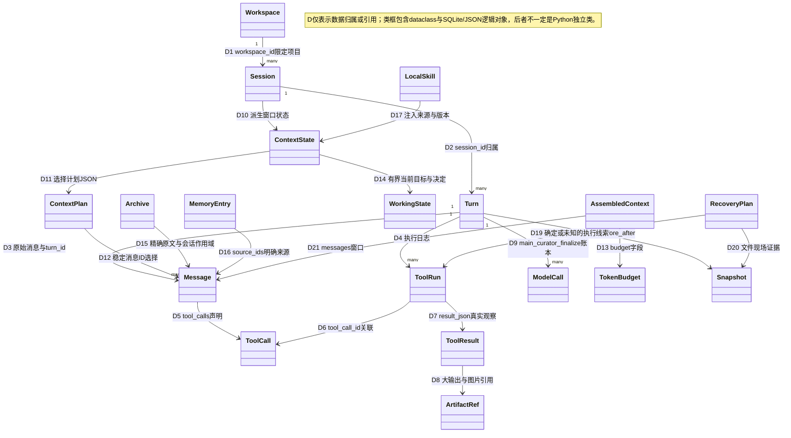


## 06.1 IDs与作用域

workspace_id由规范Git路径产生；session_id跨多个Turn；request_id是幂等键；turn_id是一次用户任务；Message.id是SQLite稳定整数；tool_call_id是模型协议关联，run_id才是本地执行记录；model_call_id标识每一次网络尝试。它们不可混用。

| 结构 | 必填/默认 | 所有者与用途 |
|---|---|---|
| Workspace | root/state/id，rule_files/knowledge_roots=[] | Workspace.resolve构造路径边界 |
| Message | role必填，content=''，id=0 | Store._append赋内部ID/seq，payload不把内部元数据发模型 |
| ToolCall | id/name/arguments必填 | Provider完整response构造；只有真正call_id可回传 |
| ToolResult | text必填；failed=False、exit_code=None | 工具真实观察；artifacts/parts/touched_paths默认空 |
| ModelResponse | 正文/工具/native_items/usage等有空默认 | Provider归一化，不包含Key |
| TurnResult | turn_id/status/text/stop_reason必填 | Loop产结果，Runtime补usage和snapshots |
| Event | type必填、turn_id=''、data={} | 本地UI事实投影，不等同全部持久事件 |
| TokenBudget | 各预留量必填 | ContextEngine构造，见05公式 |
| ContextPlan | 选择/排除/归档/记忆列表默认空 | Curator和fallback产生，必须经校验 |
| AssembledContext | messages/budget/estimated_tokens必填 | 唯一模型窗口输出与provenance |

## 06.2 真实领域值定义

以下展示当前类型，字段详细语义与兼容变更落点同时记录在仓库docs/module-spec/core.md。ModelResponse.native_items与Message.native_items是保留Responses reasoning/function调用顺序的关键；parts只存本地图片引用，发送时才编码；artifacts指向模型可见截断正文背后的完整采集输出。


源码连续节选：`src/kaki/types.py:1`（SHA256前12位 `7b0853a3b75e`）；省略处请在本机查看完整函数。


```python
"""Domain values shared across UI, execution, context and storage."""

from __future__ import annotations

import uuid
from dataclasses import dataclass, field
from datetime import UTC, datetime
from typing import Any, Literal

TurnStatus = Literal["queued", "running", "waiting_user", "completed", "interrupted", "cancelled", "failed"]
TERMINAL = {"completed", "interrupted", "cancelled", "failed"}


def now() -> str:
    return datetime.now(UTC).isoformat()


def uid(prefix: str = "") -> str:
    return prefix + uuid.uuid4().hex


@dataclass
class Message:
    role: str
    content: str = ""
    id: int = 0
    session_id: str = ""
    turn_id: str = ""
    tool_calls: list[dict[str, Any]] = field(default_factory=list)
    tool_call_id: str | None = None
    native_items: list[dict[str, Any]] = field(default_factory=list)
    parts: list[dict[str, Any]] = field(default_factory=list)
    artifacts: list[dict[str, Any]] = field(default_factory=list)
    created_at: str = field(default_factory=now)

    def payload(self) -> dict[str, Any]:
        return {
            "role": self.role,
            "content": self.content,
            "tool_calls": self.tool_calls,
            "tool_call_id": self.tool_call_id,
            "native_items": self.native_items,
            "parts": self.parts,
            "artifacts": self.artifacts,
        }


@dataclass(frozen=True)
class ToolCall:
    id: str
    name: str
    arguments: dict[str, Any]


@dataclass
class ToolResult:
    text: str
    failed: bool = False
    artifacts: list[dict[str, Any]] = field(default_factory=list)
    parts: list[dict[str, Any]] = field(default_factory=list)
    exit_code: int | None = None
    touched_paths: list[str] = field(default_factory=list)


@dataclass
class ModelResponse:
    text: str = ""
    tool_calls: list[ToolCall] = field(default_factory=list)
    native_items: list[dict[str, Any]] = field(default_factory=list)
    usage: dict[str, int] = field(default_factory=dict)
    finish_reason: str = "completed"
    model: str = ""
    call_id: str = ""
    provider_id: str = ""


@dataclass(frozen=True)
class Event:
    type: str
    turn_id: str = ""
    data: dict[str, Any] = field(default_factory=dict)


@dataclass
class TurnResult:
    turn_id: str
    status: TurnStatus
    text: str
    stop_reason: str
    tools: int = 0
    tool_failures: int = 0
    verification: dict[str, Any] = field(default_factory=lambda: {"status": "not_run", "commands": []})
    usage: dict[str, Any] = field(default_factory=dict)
    before_snapshot: str | None = None
    after_snapshot: str | None = None
    error: str | None = None


class KakiError(Exception):
    """An actionable public error, without credentials or raw transport dumps."""


class ContextOverflow(KakiError):
    pass


class ProviderError(KakiError):
    def __init__(self, message: str, category: str = "provider", *, partial: bool = False):
        super().__init__(message)
        self.category = category
        self.partial = partial


@dataclass(frozen=True)
class TokenBudget:
    context_length: int
    reserved_output: int
    reserved_system: int
    reserved_tools: int
    reserved_user: int
    margin: int

    @property
    def input_limit(self) -> int:
        return self.context_length - self.reserved_output - self.margin

    @property
    def available_history(self) -> int:
        return max(0, self.input_limit - self.reserved_system - self.reserved_tools - self.reserved_user)


@dataclass
class ContextPlan:
    include_message_ids: list[int] = field(default_factory=list)
    include_archive_refs: list[str] = field(default_factory=list)
    drop_message_ids: list[int] = field(default_factory=list)
    working_state_injection: str = ""
    memory_sections: list[str] = field(default_factory=list)
    notes: str = ""


@dataclass
class AssembledContext:
    messages: list[Message]
    budget: TokenBudget
    estimated_tokens: int
    metadata: dict[str, Any] = field(default_factory=dict)
```


## 06.3 派生与持久JSON结构

| JSON | 关键字段 | 语义 |
|---|---|---|
| Context metadata | path,validation,included_ids,plan,archive_ref,history_tokens,input_limit,skill_versions,memory_ids | 当前窗口选择与来源；不是完整对话 |
| manifest[message_id] | role,turn_id,tokens,snippet,relevance,archive_ref | 来源索引与相关性，不替代原文 |
| working | goals,open_threads,decisions,source_ids | 有损活动任务状态，不自动变长期记忆 |
| archive artifact | path,sha256,size | 必须校验目录、会话作用域与哈希 |
| memory | id,workspace_id,user_id,content,kind,state,version,source_ids | explicit来源、有版本active事实 |
| tool execution | id,tool_call_id,name,arguments,state,result_json,started,ended | 真实副作用与结果是否已提交 |
| verification | status,commands[{command,cwd,exit_code,artifacts,run_id}] | 真实命令证据，not_run与passed严格区分 |
| usage | prompt/completion/total_tokens,calls,unknown_calls,by_kind | 全Turn累计已知消耗与未知调用数 |
| snapshot | id,turn_id,phase,state,commit_id,metadata | ready才可构建恢复计划 |
| RestorePlan | turn_id,before/after_snapshot,paths[] | path内before/after/current/expected_current_oid/current_mode/expected_current_mode/conflict |

字段增加或语义变化需同步Store序列化、Provider wire、窗口估算、UI、恢复和行为测试。当前SQLite schema=1；更高版本拒绝降级，不声称未来版本已有完整迁移器。


# 07 接口契约、事件与错误语义

## 07.1 模块接口

| 接口 | 输入→输出 | 关键保证 |
|---|---|---|
| Runtime.initialize(resume) | Config/Workspace→Session就绪 | 同模型恢复；恢复状态改写持lease |
| Runtime.submit/run | text,request_id→Task/TurnResult | 单活跃Turn；重复幂等请求不执行 |
| Runtime.answer/cancel/close | question_id/text或控制信号 | 回答只归属当前问题；取消收尾后发布终态 |
| Provider.complete | messages/tools/model/max_tokens/kind/on_delta→ModelResponse | 完整终事件，显式输出限额与有限重试 |
| Context.assemble/rebalance | 原始历史/当前请求/Schema→AssembledContext | 配对、保护、来源和最终预算门 |
| ToolRegistry.execute_many | ToolCall列表/ctx/回调→输入顺序结果 | 安全读并发4，其余串行；每完成即提交 |
| BrowserMcp.start/call/close | 目录/原始参数→ToolResult | owner Task管理资源；stdio子进程 |
| Store.run(operation,*args) | 内部操作名/值→领域数据 | 单连接worker、短事务，不是RPC |
| Checkpoint.capture/plan_restore/apply | Turn/phase/批准路径→快照/计划/冲突结果 | 独立Git、写前复核，不覆盖后续编辑 |
| Archive.save/load/read | Session+稳定ID/ref→精确JSON/分页 | 无损原文、hash和会话作用域 |
| Memory.recall/remember/segment | 当前问题/显式事实+source_ids→相关背景 | active版本；显式写入 |
| Skills.catalog/resolve/read | 本地目录/任务/引用→正文+来源 | 有界注入与合法根目录 |

## 07.2 UI事件与顺序

常见顺序为runtime.status→runtime.ready→turn.started→context.assembled→model.started→model.delta*→model.committed→tool.started/finished*→下一轮→turn.finished。context.compacted可出现在模型前的重平衡；snapshot.warning、question.requested、turn.finalizing是分支。

运行时Event是同进程对象：type、turn_id、data。model.delta带draft_id/text；model.committed带draft_id/message_id/text；tool事件带tool_call_id/name/参数或结果preview；finished带TurnResult、warnings、recovery_available。增量不全量存事件表，稳定assistant/tool和终态由Store事务保存。多安全读的finished顺序按真实完成时间，模型窗口按原调用序追加，不假设UI完成顺序等于模型顺序。

## 07.3 错误如何影响结果

| 情况 | 处理 | 结果口径 |
|---|---|---|
| 401/403或凭据缺失 | 提示配置平台和字段，不回显Key | failed；不静默切平台 |
| 429/网络/5xx，无可见输出 | 有限退避；每尝试记账 | 用尽则failed，未知usage明确计数 |
| 流断开或工具参数截断 | 不执行不完整工具 | failed/interrupted，不成功 |
| 工具参数/路径/锚点错误 | failed ToolResult回模型 | 模型可分析并改方法 |
| 单次工具timeout | 杀进程组/取消MCP，明确失败观察 | 不声称副作用未发生 |
| 用户取消 | 取消Task、记录未知执行、尽力after | cancelled；不自动回滚 |
| maxToolIterations | 关闭工具做一次真实总结 | interrupted/iteration_limit |
| Curator故障 | 确定性回退+最终门 | metadata记录fallback_reason |
| 固定内容/保护内容超窗口 | 无法靠删历史解决 | failed，要求缩小输入 |
| SQLite损坏/未来schema | 明确报错，不重置 | 保留现场 |
| 快照失败 | warning、不可声称恢复可用 | 不伪装ready快照 |

测试passed仅是命令证据；例如Shell命令只跑一条空测试也可能退出0，框架不自动证明测试覆盖充分。最终交付仍由使用者按项目CI和业务验收判断。


# 08 状态持久化、恢复与快照一致性

## 08.1 本机目录

```text
~/.kaki/config.json                         # 0600配置，含Key，不进入Git
~/.kaki/skills/*/SKILL.md                    # 用户本地技能
~/.kaki/projects/<slug>-<root-path-hash>/
  workspace.json
  execution.lock                           # OS工作区执行租约
  kaki.sqlite3                             # WAL/FULL，事实与派生状态
  context/archive/<sha256>.json             # 精确原始Message归档
  context/traces/<session>/<turn>.jsonl     # Curator私有轨迹
  artifacts/<sha256>.*                      # 大工具输出、图片
  checkpoints/kaki-shadow.git/              # 独立索引和提交
  browser-profile/                         # 与日常Chrome独立
  browser-output/ / browser-mcp.log
```

root规范路径改变会改变workspace_id，移动仓库不会自动发现旧状态；需要显式迁移。不要合并两个项目的数据库，或把浏览器profile当完整会话事实。日志可能含项目代码/工具结果，Key不应写入其中；本地状态目录属于用户私有数据。

## 08.2 十张表和五个重要事务

sessions、turns、messages、tool_runs、events、model_calls、context_state、archives、memories、snapshots。完整字段在module spec及源码SCHEMA。SQLite连接只在单worker访问，事务中没有外部I/O。

```text
accept_turn:   Turn(running) + user Message + started event
commit_model:  assistant(native_items/calls) + 全部ToolRun(planned)
mark_running:  执行前的运行意图
commit_tool:   真实ToolResult + tool Message + 执行结束状态
finish_turn:   悬空工具关闭 + 不可变终态 + 结果/快照引用 + finished event
```

## 08.3 崩溃边界

- commit_model之前：没有可执行持久工具计划，不能从不完整参数恢复副作用。
- planned之后、running之前：取消计划，不执行。
- running之后、真实结果提交之前：unknown，即使文件可能已经改变；先核对当前hash/快照/外部现场。
- commit_tool之后：确定结果保留；同批另一工具中断不会抹去已提交结果。
- 终态提交之前进程退出：reconcile把活跃Turn标interrupted/process_exit，形成下一次任务的恢复线索。

--resume恢复消息和上下文，不自动重新执行旧任务；/undo才是有确认的文件恢复。单文件恢复冲突跳过，没有跨多个文件/浏览器的原子提交承诺。


# 09 安装、配置与部署操作手册

## 09.1 当前机器的真实部署

代码：`/Users/bytedance/github/kaki_agent`；分支master；Python 3.12.16；uv 0.13.7。项目.venv与uv tool环境分开，入口`~/.local/bin/kaki-agent`以editable方式指向仓库。Right Code配置已安全复制至`~/.kaki/config.json`，不会修改Pico配置或在文档中展示Key。

当前依赖锁定openai 2.54.0、textual 8.2.8、mcp 1.30.0、tiktoken 0.14.0，Playwright MCP 0.0.85；doctor真实发现25个浏览器工具。当前Right Code base为https://api.site/v1，模型配置openai/gpt-5.6-sol；这些是此机器已验证的配置，不是对所有Right Code账号的通用承诺。

## 09.2 从仓库安装

```bash
cd /Users/bytedance/github/kaki_agent
uv python install 3.12
uv sync --python 3.12 --extra dev --locked
uv tool install --editable /Users/bytedance/github/kaki_agent --python 3.12
export PATH="$HOME/.local/bin:$PATH"
kaki-agent --version
```

需要Git、Node/npm、ripgrep和Google Chrome。本机此前普通终端缺少rg，仅Codex内置路径有；已通过Homebrew安装ripgrep 15.2.0，保证脱离Codex后搜索也可用。新机器可按已安装工具补齐：

```bash
brew install uv ripgrep node
# 机器还没有Chrome时才安装
brew install --cask google-chrome
```

## 09.3 配置Key、Base和模型

```bash
# 本机已有兼容配置，安全复制支持的字段；不显示Key
kaki-agent setup --import-config /Users/bytedance/.pico/config.json

# 没有旧配置时使用隐藏输入
kaki-agent setup
```

Key默认在`~/.kaki/config.json`，不是必须写到.bashrc/.bash_profile。Shell profile只需配置PATH。setup已有Key时不会再次提示；如需换Key，在本机安全编辑该0600文件或使用环境覆盖，不要把Key提交进Git或贴到文档。

```json
{
  "providers": {"openai": {"apiBase": "https://api.site/v1", "apiKey": "<仅在本机填写>"}},
  "agents": {"defaults": {"provider": "openai", "model": "openai/gpt-5.6-sol", "maxTokens": 8192, "contextWindowTokens": 65536, "maxToolIterations": 40}},
  "context": {"fastPathThreshold": 0.6, "curatorTimeoutSeconds": 30, "protectFirstN": 3},
  "memory": {"backend": "local", "memoryTopK": 5},
  "runtime": {"checkpoint": {"policy": "interactive"}},
  "tools": {"mcpServers": {"browser": {"type": "stdio", "command": "npx", "args": ["-y", "@playwright/mcp@0.0.85", "--browser", "chrome"], "toolTimeout": 45}}}
}
```

以上是配置示例，Key占位符不能直接当真实密钥运行；本机已经配置真实Key。camelCase/snake_case都接受，未知字段拒绝。65536是保守配置cap，须按实际平台模型能力调整，输出限额必须小于窗口。

```bash
# 不含Key的环境覆盖示例；空字符串不会覆盖有效值
export KAKI_AGENTS__DEFAULTS__MAX_TOKENS=4096
export KAKI_CONTEXT__CURATOR_TIMEOUT_SECONDS=60
kaki-agent --config /path/to/config.json -C /path/to/single-git-repo
```

## 09.4 从任何目录指定目标项目

```bash
kaki-agent -C /Users/bytedance/go/src/code.byted.org/larkvc/harness/teams_spec/be-vcs/byteview-mp-media_platform

kaki-agent -C /path/to/single-git-repo --resume last

# 不安装全局命令也可明确uv项目归属
uv run --project /Users/bytedance/github/kaki_agent kaki-agent -C /path/to/single-git-repo
```

uv的--project指Kaki源码/依赖；Kaki的-C指被修改的目标仓库，二者不要混淆。不要在目标项目中用系统同名pico猜测入口。Kaki实现了-C/--cwd，不沿用Pico CLI不存在的参数。

## 09.5 环境诊断和付费探针

```bash
kaki-agent -C /path/to/repo doctor
kaki-agent -C /path/to/repo doctor --probe --browser --report /tmp/kaki-doctor.json
kaki-agent -C /path/to/repo sessions
kaki-agent -C /path/to/repo run -m '介绍你自己，不修改文件'
```

-C/--config/--resume放在子命令之前。普通doctor只查本地；--probe真实调用模型并可能产生费用，--browser启动独立浏览器并导航about:blank。headless run默认interactive快照策略不启用快照，需要时在配置设always。


# 10 日常使用、Skills与故障处理指南

## 10.1 一次编码任务的推荐写法

```text
读取本仓AGENTS.md和相关模块SPEC，分析XX函数。
修复YY边界行为，仅修改相关实现，保留现有用户改动。
先运行指定测试观察现状，再修复并重跑；最后报告命令、退出码、改动文件和未验证项。
```

media_platform遵循自己的AGENTS.md：macOS使用Stub模式、make test，禁止在macOS做生产go build。Kaki的实现并不自动替代项目CI，用户应继续按仓库流程评审与发布。

## 10.2 TUI操作

| 操作 | 命令/快捷键 | 结果 |
|---|---|---|
| 发送任务 | Enter/发送按钮 | 新建一个Turn |
| 回答Agent问题 | 输入框直接回答 | 关联当前question_id，不新建Turn |
| 取消 | Ctrl+C/停止按钮 | cancelled；确定副作用保留 |
| 新会话 | /new 或 Ctrl+N | 同项目新Session，仍可召回项目记忆 |
| 列表和恢复 | /sessions；/resume ID；--resume last | 重建稳定会话消息，不自动重放命令 |
| 看预算 | /context | 当前或恢复的上次plan来源、ID、Token |
| 手动整理 | /compact | Curator→slow或有理由的fallback |
| 看记忆 | /memory | active项目记忆及ID |
| 文件恢复 | /undo [turn_id]，检查后输入RESTORE | 只恢复无冲突已批准路径 |
| 退出 | /quit 或 Ctrl+Q | 关闭任务、MCP、Provider和Store后退出 |

建议终端宽120列以上。长中文任务可以粘贴，当前输入为单行Input，不是完整外部编辑器。若终端把Ctrl+Q用作流控，使用/quit即可。

## 10.3 本地Skill实例

```bash
cd /path/to/single-git-repo
mkdir -p .kaki/skills/python-review
cat > .kaki/skills/python-review/SKILL.md <<'SKILL'
---
name: python-review
description: Python 修改与 unittest 验证
---
先读相关代码和测试；修改保持最小范围；运行本仓规定的测试命令；报告真实退出码。
SKILL
```

在TUI输入`$python-review 检查当前改动`。也可在~/.kaki/skills配置用户级技能；目录内参考文件通过kaki_skill_read按需读取，不复制整份知识库进窗口。版本hash和失败原因在/context metadata可查。

## 10.4 记忆与恢复

```text
请记住本项目偏好：新建测试文件使用test_前缀，优先使用unittest。
/memory
/new
本项目此前保存的测试命名和框架偏好是什么？
```

记忆跨新Session保留，但按项目和user_id隔离。普通任务结果保留Session，不自动长期记忆；要替代旧事实应明确说出新要求，工具传replaces旧ID。关闭backend不会删除历史，只停止召回/新写。

进程异常退出后用--resume last，先让Agent核对未知工具执行和当前文件，再继续任务。不要把unknown强行改成功或直接重复外部操作。恢复工作树前看/undo预览；发生冲突则自行比较，不覆盖用户新改动。

## 10.5 常见问题

| 现象 | 定位与操作 |
|---|---|
| kaki-agent找不到 | command -v kaki-agent；确认uv tool安装和~/.local/bin PATH；也可uv run --project显式启动 |
| 被当成系统pico | 命令应为kaki-agent；-C是Kaki自己的参数 |
| 认证失败 | 检查providers.openai.apiKey与其Right Code渠道；apiBase含/v1；不要把平台名当模型名 |
| 配置报未知字段 | 当前仅兼容已实现子集；不要整份旧Pico配置原样复制，使用setup --import-config |
| 浏览器未连接 | doctor --browser；检查node/npx/Chrome、MCP日志；browser profile在项目状态目录 |
| 另一个任务占用工作区 | 等其结束/取消；不要删除execution.lock以绕过活跃进程 |
| context_overflow | /context看固定前缀/Schema/当前请求；缩小输入/工具输出；按真实模型能力调整cap |
| /compact显示fallback | 看fallback_reason与context/traces，回退合法不等于Curator成功；可配置更长截止时间 |
| 有正文但verification=not_run | 模型回答不等于执行测试；明确让它运行项目命令并检查退出码 |
| 路径超界/嵌套Git | -C指定真正单仓根；不能在Harness聚合根跨仓写 |
| 数据库损坏/未来schema | 保留状态目录备份并排查，不删除重置掩盖问题 |


# 11 实际验证记录、命令与界面截图

## 11.1 自动化与部署检查

本地行为测试28项通过，含真实PTY退出测试；compileall、ruff检查和格式检查以最终仓库实际输出为准。测试用临时Git目录与隔离KAKI_HOME，不依赖付费模型，不修改业务仓。

```bash
cd /Users/bytedance/github/kaki_agent
uv run python -m compileall -q src
uv run ruff check .
uv run ruff format --check .
uv run pytest -q
```

真实安装入口在普通PATH验证，浏览器启用/禁用两种PTY均成功就绪并通过/quit退出0（实测4.5秒和5.8秒）。先前退出消息丢弃缺陷已修复并添加回归，不隐藏失败尝试。

## 11.2 Right Code与MCP真实探针

原生kaki_probe工具请求后回传KAKI_READY，模型第二次回复KAKI_READY，完整闭环通过。Playwright发现25工具并成功导航about:blank。报告包含包版本、非敏感base/model、usage；不含Key。

## 11.3 实际TUI：上海秋天两日游

真实输入要求地铁/步行、600元预算、梧桐街区/滨江、雨天备选，并访问上海市文旅局官网核对资料。Agent真实调用kaki_browser_navigate和kaki_browser_find，再输出两日路线与预算；明确主页没有实时场馆票价/营业时间，因此标记待核实。此项证明模型—MCP—UI链路，不能保证每条旅行建议的事实都已充分核验。

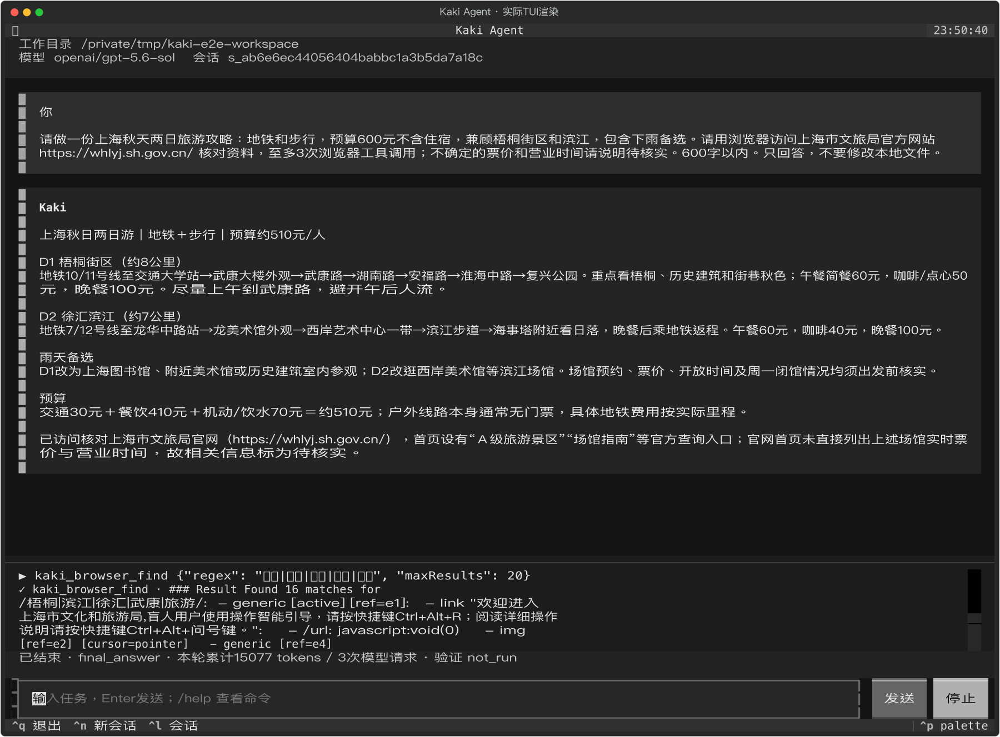

后续要求“沿用600元预算，第二天改为适合爸妈的慢节奏”，无额外浏览器调用，沿用上轮上下文给出三条调整。

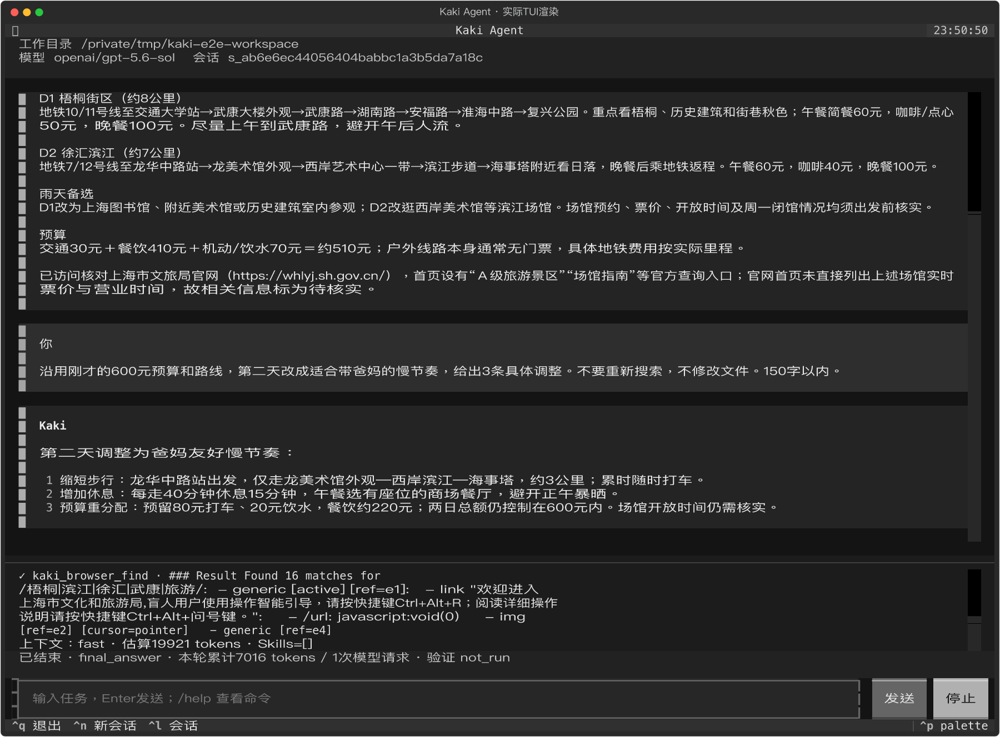

## 11.4 实际TUI：修改代码与测试闭环

隔离仓库/private/tmp/kaki-e2e-workspace初始discounted_price实现错误。Agent读取AGENTS、实现和测试，先运行python3 -m unittest -v退出1；只修改pricing.py后同命令退出0，3个测试通过。test_pricing.py的SHA256未变化，before/after快照均ready。工具总数6，模型请求7次。

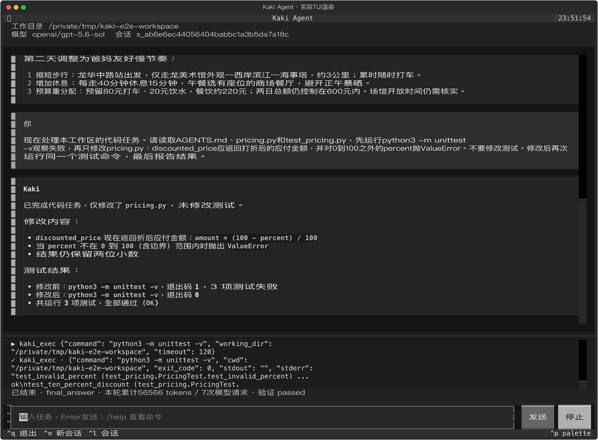

```python
def discounted_price(amount, percent):
    if not 0 <= percent <= 100:
        raise ValueError("percent must be between 0 and 100")
    return round(amount * (100 - percent) / 100, 2)
```

这是隔离测试结果，不声称media_platform全量编译/CI已通过。当前业务仓没有因此被修改。

## 11.5 压缩与重启

第一次/compact因30秒Curator准备操作过多超时，确定性fallback合法通过，原文仍保留，usage有1次unknown，不能把缺usage的请求当0消耗。改进规划指令后再次真实/compact，一轮build成功走slow，usage 4079tokens/1次curator请求。

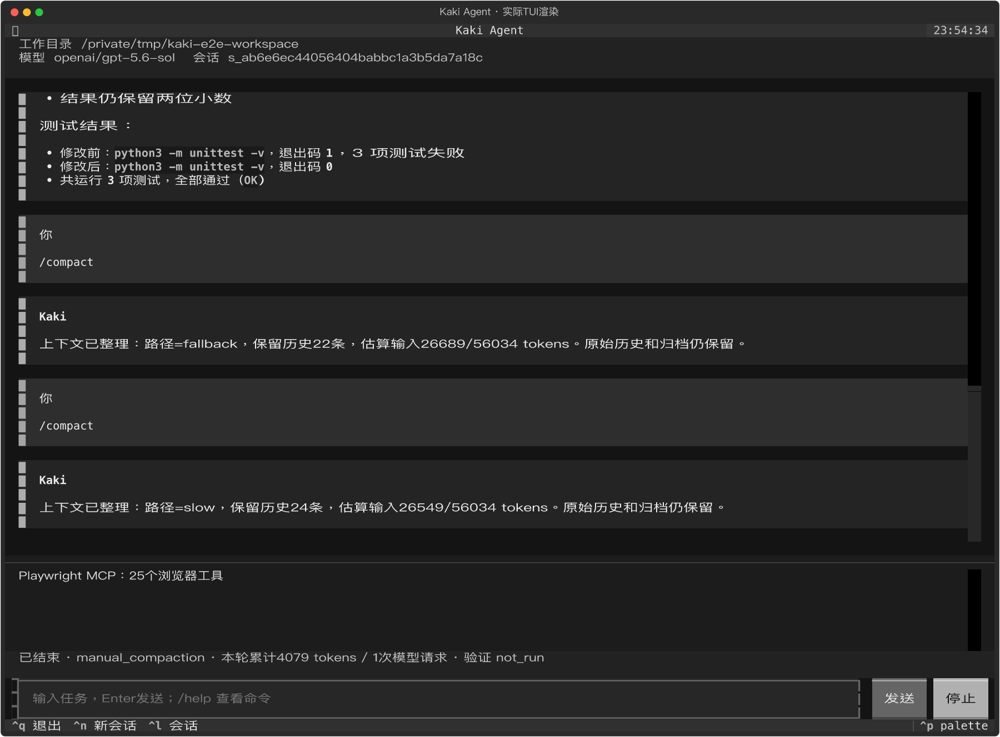

关闭Runtime后重新建立TUI，恢复同一Session的24条消息；后续/context也可显示保存的上次计划。

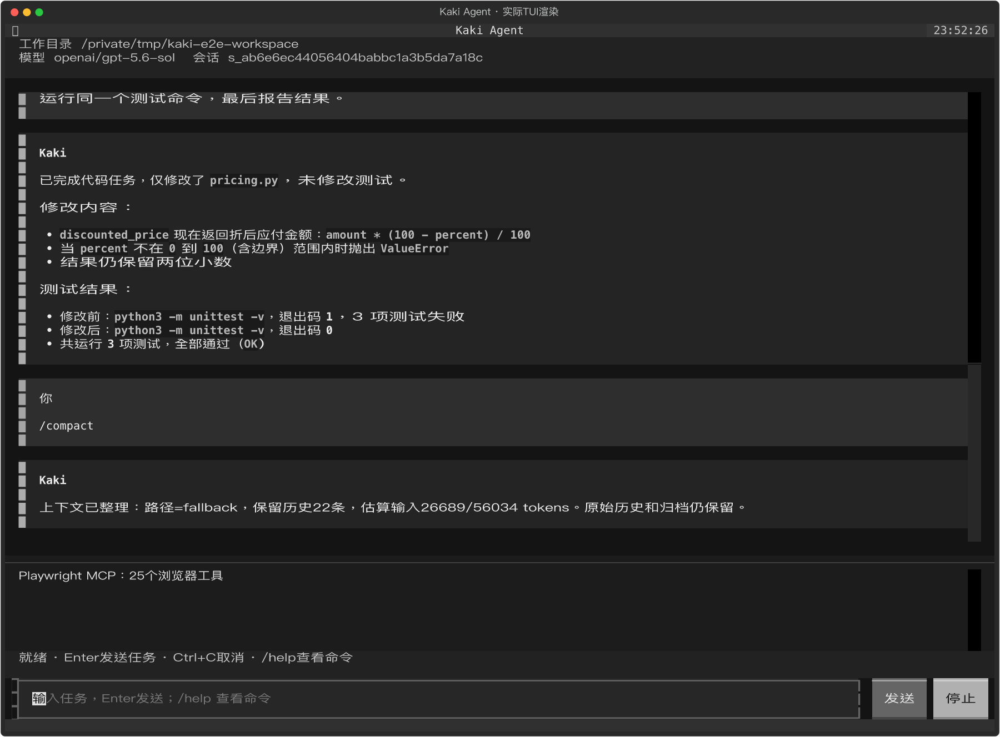

## 11.6 显式记忆跨新会话召回

用户明确要求保存“测试test_前缀、优先unittest”，真实kaki_remember写入。关闭Runtime后新Session问此前偏好，Memory命中1条并正确回答。写入2次模型请求、7585已知tokens；召回1次、3763tokens。来源ID和版本仍在SQLite，不靠沿用上一Session聊天文本实现。

## 11.7 用量账本

| 场景 | 主/私有请求数 | 已知total_tokens | 工具/结果 |
|---|---|---|---|
| 上海秋游 | main 3 | 15077 | 浏览器2次；completed |
| 慢节奏追问 | main 1 | 7016 | 无工具；completed |
| 隔离仓修复 | main 7 | 56566 | 工具6次；测试1→0 |
| 初次手动整理 | curator 4 | 13017 + 1次usage未知 | timeout→fallback |
| 慢路复测 | curator 1 | 4079 | 一轮build通过 |
| 项目记忆保存/召回 | main 2+1 | 7585+3763 | 新Session命中1条 |

这是本次运行的实际usage，不是价格报价或固定任务消耗。工具Schema、历史和重试均影响请求tokens；缓存/推理字段单独保存，已知账本不包含无法获知的上游消耗。

## 11.8 证据生成方式与复现

截图来自实际KakiApp+真实Right Code/Playwright的Textual原生导出，并转换PNG，非界面效果图；仅修正Rich SVG对CJK字体宽度的导出错误。macOS终端应用截图接口受运行环境限制，因此未把操作系统桌面截图当已完成。另有真实PTY驱动启动/输入/退出0的独立证据。

```bash
cd /Users/bytedance/github/kaki_agent
# 目标目录必须尚不存在；使用新父目录可以复跑
uv run python scripts/create_validation_fixture.py /tmp/kaki-validation-new/kaki-e2e-workspace
uv run python scripts/validate_live.py --workspace /tmp/kaki-validation-new/kaki-e2e-workspace --output /tmp/kaki-live-evidence
```

该脚本会真实调用模型、浏览器并产生API费用，输出实际SVG、events.jsonl、live-report.json与恢复结果，且只允许明确的disposable pricing fixture。当前本机原始证据在/private/tmp/kaki-evidence；私有会话和代码日志不应公开上传。


# 12 与Pico的联系、差异和当前限制

## 12.1 保留的机制与重新实现的部分

| 主题 | 与Pico的联系 | Kaki当前实现与取舍 |
|---|---|---|
| 主循环 | 模型→工具→观察→下一轮，有界恢复 | 独立AgentLoop与Runtime；无本地RPC |
| 配置 | providers.openai/agents.defaults等key与camel/snake | KAKI前缀、.kaki目录；只兼容已实现字段 |
| 上下文 | Curator、manifest、working state、归档、闭包、预算与回退 | 针对Responses原生项重放；单仓本地知识 |
| Provider | 统一模型响应和工具语义 | 仅Right Code Responses，不做多Provider路由 |
| 工具与MCP | 统一工具定义/调用/结果 | 本地文件+Shell+浏览器MCP，未接其余MCP |
| 会话与恢复 | 原始历史持久、恢复继续 | SQLite短事务执行日志、UNKNOWN语义与项目隔离 |
| 快照 | 工作区执行前后基线与恢复 | 独立shadow Git，避免用户index变更 |
| 记忆/Skills | 背景知识与渐进注入 | 本地显式Memory和Skills，无Myna/远端SkillForge依赖 |
| 可观测与评测 | 需要运行证据和Token统计 | 本地model_calls/events/traces；无完整Pico评测平台 |

Pico参考源码为d6c7a648，当前Kaki是独立实现；遵循Apache-2.0并在LICENSE/NOTICE记录来源。并非把Pico所有模块直接重命名，也不宣称完整复刻其全部产品能力。独立对比文档保留原设计阶段的比较，本篇现状以当前源码和验收为准。

## 12.2 当前明确没有的能力

- 多Agent、嵌套Agent、远程worker、RPC gateway、跨仓协调与事务。
- 多模型自动路由、模型切换后任意重放旧原生reasoning、多Provider完全兼容。
- Myna记忆服务、向量检索、远程技能平台、云端长期记忆同步。
- 完整评测框架、成本定价表、分布式Tracing、生产发布审批平台。
- OS级Shell沙箱、任意本地恶意代码隔离、浏览器网络副作用回滚。
- 无限工具日志保留、无限上下文、未来SQLite版本自动迁移、自动状态目录移动。

## 12.3 使用前必须理解的真实边界

文件工具的路径边界、凭据文件拒绝和部分Shell命令拒绝，是本地编码防误操作措施。Shell运行在宿主机，代码和MCP server拥有相应进程权限，不能当作安全隔离；只在可信项目和可信工具配置中使用。

Token估算与模型摘要都有误差；原文可检索不代表每次语义选择都最优。保护内容过大会使压缩失败，需要用户拆任务或调整有效窗口。项目规则目前读取根规则及明确直接父引用，不自动实现所有大型Harness多层Skill编排。

文件恢复通过预览和hash防止覆盖任务结束后的编辑，但无法识别任务执行期间外部编辑器写入的所有权，也不是多文件原子事务。测试命令退出0证明已执行的那个命令，不证明业务覆盖完整；未运行MR CI则不能声称CI通过。

## 12.4 后续演进的真实接缝

需要多Agent时，在Runtime之外增加显式调度与独立子任务/工作区租约，不让主循环递归创建无限Agent；需要更多Provider时，在完整native reasoning契约与模型切换策略明确后扩展Provider；需要更多MCP时，按effect和权限声明接入，不仅复制Schema；需要可靠自动压缩质量时，增加脱敏长会话基准与任务成功率评测。

当前v0.1已经是可以在本机使用的Agent；这些扩展边界不作为未完成首期功能隐藏在“已交付”里。
