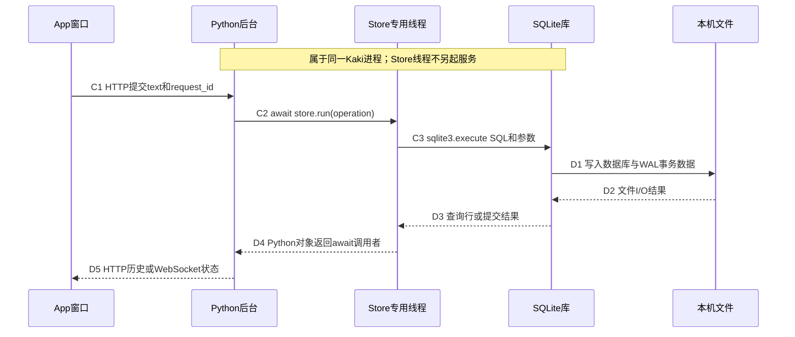
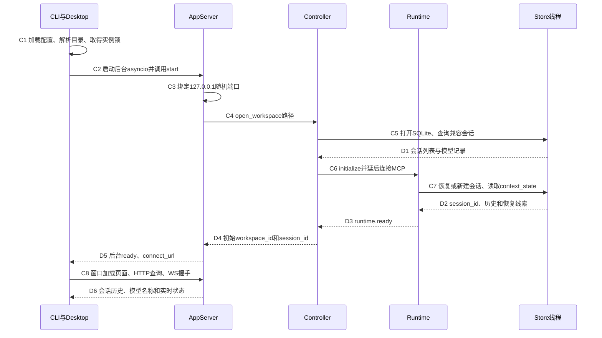
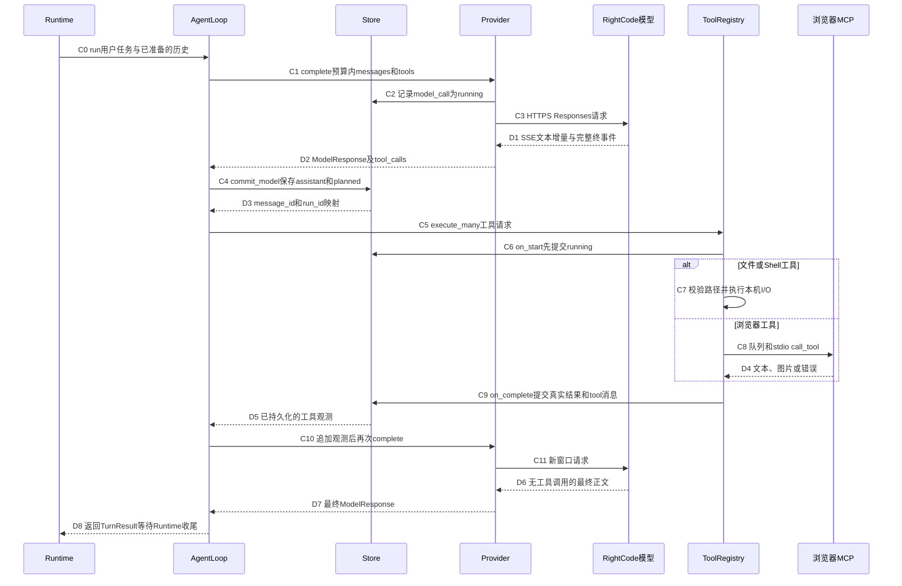
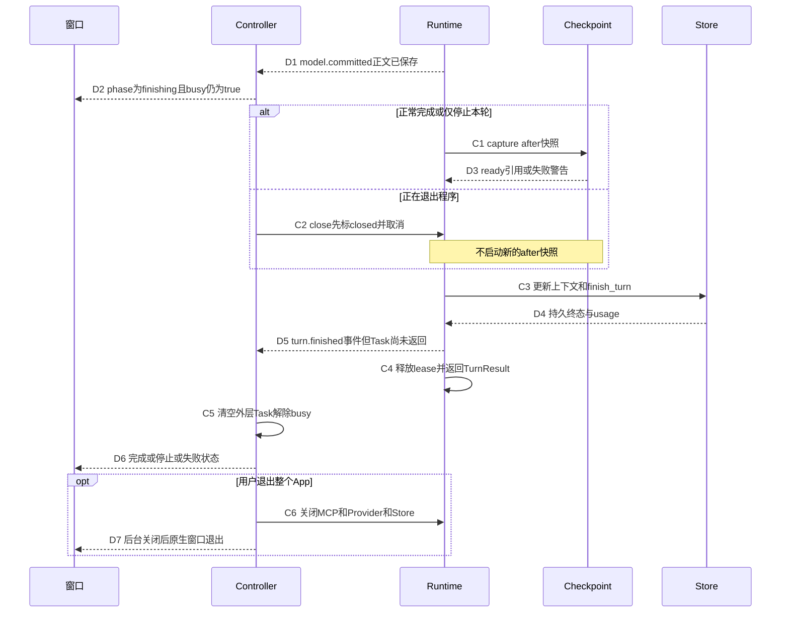

# SQLite、源码阅读与一次请求全链路（Kaki v0.2）

本文按当前桌面 App 的实际执行顺序读代码，补充原介绍文档第13章。源码基线为 [`686301b`](https://github.com/anuolxl/kaki_agent/tree/686301bec20ebda7e93b92d41760b29cea40ff00)，其内容对应已合入的 v0.2。代码链接固定到该提交，避免后续行号变化；安装操作见 [App指南](app-guide.md)，字段完整定义见 [核心契约](module-spec/core.md)和 [App契约](module-spec/app.md)。

每段“源码节选”直接提取仓库真实行，新增的 `# 阅读：` / `// 阅读：` 只是本文注释，没有修改运行源码。片段可能位于函数内部，应沿源码链接查看其完整上下文。示意任务和调用数据会明确标注，不冒充本次运行日志。

## 1. SQLite 是什么，是否需要启动服务

SQLite 是嵌入式关系型数据库引擎。在 Kaki 中，Python 标准库 `sqlite3` 调用本进程里的 SQLite 库，直接读写磁盘文件，不连接独立数据库服务器。因此不用启动 SQLite 守护进程、配置数据库端口或数据库服务账户。`sqlite3` 命令行只是临时打开文件执行查询的客户端工具。[SQLite官方说明](https://sqlite.org/serverless.html)、[Python3.12 sqlite3文档](https://docs.python.org/3.12/library/sqlite3.html)。

### 1.1 分清四条不同链路

| 链路 | 实际方式 | 对端 / 存储 |
|---|---|---|
| 窗口 ↔ Kaki后台 | 本机 HTTP 命令 + WebSocket 状态推送 | 同一 Kaki 应用的 AppServer，127.0.0.1随机端口 |
| Store ↔ SQLite | Python函数调用、文件I/O | 项目状态目录的 kaki.sqlite3，不是网络服务 |
| Provider ↔ 大模型 | HTTPS Responses + SSE | 配置的 Right Code 兼容接口 |
| BrowserMcp ↔ 浏览器工具服务 | 子进程 stdio JSON-RPC | Playwright MCP，再驱动独立浏览器会话 |

Kaki 的 **AppServer 是本机界面传输层**，不是数据库服务器。Store 是 Python 类；`store.run("accept_turn", ...)` 中的字符串用于选择本地 `_accept_turn` 方法，不是发往微服务的 RPC 方法名。MCP owner task 是后台协程，不是另一个推理 Agent。

图1按同一请求的访问次序展示边界。`C` 表示控制调用，`D` 表示返回或传递的数据；同步文件操作也有明确方向。



### 1.2 源码中怎么证明没有数据库服务

源码节选：[ src/kaki/store.py:64–89 ](https://github.com/anuolxl/kaki_agent/blob/686301bec20ebda7e93b92d41760b29cea40ff00/src/kaki/store.py#L64-L89)。

```python
    def __init__(self, path: Path, workspace_id: str):
        self.path = path
        self.workspace_id = workspace_id
        # 阅读：这是线程池，不是数据库服务进程。
        self.executor = ThreadPoolExecutor(max_workers=1, thread_name_prefix="kaki-store")
        self.db: sqlite3.Connection | None = None

    async def run(self, operation: str, *args, **kwargs):
        if operation.startswith("_"):
            raise ValueError("invalid store operation")
        method = getattr(self, "_" + operation)
        loop = asyncio.get_running_loop()
        # 阅读：把同步 SQL 工作交给唯一连接线程，await 结果时 asyncio 可处理其他事件。
        return await loop.run_in_executor(self.executor, functools.partial(method, *args, **kwargs))

    async def open(self):
        await self.run("open")

    def _open(self):
        if self.db is not None:
            return
        self.path.parent.mkdir(parents=True, exist_ok=True, mode=0o700)
        try:
            # 阅读：直接打开本地文件；这里没有 host、port 或网络客户端。
            self.db = sqlite3.connect(self.path, timeout=10)
            self.db.row_factory = sqlite3.Row
            self.db.execute("PRAGMA foreign_keys=ON")
            self.db.execute("PRAGMA journal_mode=WAL")
            self.db.execute("PRAGMA synchronous=FULL")
```

`ThreadPoolExecutor(max_workers=1)` 让创建连接和执行 SQL 都落在同一专用线程，满足 SQLite 连接的线程约束，也避免磁盘操作直接阻塞 asyncio。`run_in_executor` 不是向远端派任务。网络模型请求、Shell等待和浏览器等待在事务外进行，数据库只持有短事务。

每个项目路径规范化后生成 workspace_id，数据库路径为：

```text
KAKI_HOME（默认 ~/.kaki）
└── projects/<Git根目录名>-<规范路径SHA256前16位>/
    ├── workspace.json
    ├── kaki.sqlite3
    ├── kaki.sqlite3-wal       # 运行中可能存在
    ├── kaki.sqlite3-shm       # 运行中可能存在
    ├── context/traces/<session_id>/<turn_id>.jsonl
    ├── context/archive/       # 按需创建
    ├── artifacts/             # 按需创建
    ├── browser-mcp.log        # 连接MCP后创建
    └── checkpoints/kaki-shadow.git/
```

WAL 模式将事务更新先写入旁边的 WAL 文件，之后通过数据库 checkpoint 合入主文件；`-shm` 用于 WAL 索引协调。它们是数据库运行文件，不是 Agent 的文本执行日志。不要在运行期间随意删除这些旁文件。[SQLite WAL说明](https://sqlite.org/wal.html)。

这里的“SQLite checkpoint”和 `kaki/checkpoint.py` 完全不同：后者使用独立 Git 保存工作区文件版本。SQLite 事务不能撤销已经执行的 Shell、浏览器或网络副作用。

### 1.3 数据库里保存哪些东西

| 表 | 作用 | 阅读时重点 |
|---|---|---|
| sessions | 会话标题、项目归属、软归档标记 | 会话包含多次任务，archived不等于删除 |
| turns | 一次新任务的输入、状态、结果、错误 | request_id用于幂等，turn_id关联后续执行 |
| messages | 原始用户、assistant、tool消息 | 压缩窗口不删除这里的规范原文 |
| tool_runs | planned/running/真实结果/unknown | 是否真的执行过，以持久意图和观测为准 |
| model_calls | 每次网络尝试、Token用量、耗时、错误分类 | 一轮任务可能有多个main/curator/finalize调用 |
| events | 事务内关键事实事件 | 不等于全部实时UI事件 |
| context_state / archives | 派生窗口状态与原文归档引用 | 可重建状态与完整历史职责不同 |
| memories | 显式长期记忆及版本 | 目前不是embedding向量索引 |
| snapshots | before/after文件快照引用与成功状态 | 只有ready才有可用快照内容 |

SQLite 是此处的结构化持久层；本项目没有独立 embedding 调用或向量数据库模块。记忆/Skills 的相关性检索见 `context/knowledge.py` 的词项与排序逻辑，不能把它理解成“GPT维护的本地向量库”。

## 2. 源码按什么顺序读

先抓住一条纵向链路，再读每个模块的失败分支。不要从依赖、配置字段或所有工具定义开始逐行遍历。

| 顺序 | 文件 / 关键入口 | 要回答的问题 |
|---|---|---|
| 1 | pyproject.toml 的 project.scripts；cli.py 的 entry/main | 命令到底进入哪个Python函数？默认App与tui/run怎样分流？ |
| 2 | desktop.py 的 launch/native_window/NativeService/serve | 单实例、Cocoa主线程、后台asyncio循环怎样建立？ |
| 3 | app_server.py 的 start/guard/send/events | HTTP与WS接到哪里，谁校验身份和Origin？ |
| 4 | ui/app.mjs 的 sendText/connect；app_controller.py 的 open_workspace/send/_execute/observe | 页面状态如何投影，谁持有后台任务？ |
| 5 | types.py；runtime.py 的 initialize/submit/_turn | 核心对象是什么，谁拥有会话、租约、快照和终态？ |
| 6 | loop.py 的 AgentLoop.run | 模型、工具、真实观测如何构成有界循环？ |
| 7 | provider.py 的 wire_input/normalize_response/complete | 内部Message怎样变成Responses请求，流式终事件怎样解析？ |
| 8 | tools.py 的 execute/execute_many/exec；browser_mcp.py | 真正的I/O在哪里，MCP怎样发现和分派工具？ |
| 9 | context/engine.py → history.py/tokens.py → curator.py | 输入窗口怎样选、怎样裁剪、如何失败回退？ |
| 10 | store.py → checkpoint.py → recovery.py | 哪些写入同事务，进程中断怎样恢复未知操作？ |
| 11 | tests/test_app_controller.py、test_store_runtime.py、test_context.py、test_app_process.py | 用哪些反例验证上面的约束？ |

核心调用链可以先在IDE中连续跳转：

```text
kaki-agent
  → kaki.cli.main / entry
  → desktop.launch → NativeService → serve → AppServer.start
  → AppController.open_workspace → Runtime.initialize

点击发送
  → ui.sendText → POST .../send → AppServer.send
  → AppController.send → 外层Task(_execute)
  → Runtime.run → submit → 内层Task(_turn)
  → ContextEngine → AgentLoop → Provider → ToolRegistry / BrowserMcp
  → Store提交事实 → Runtime收尾 → 外层Task解除busy → UI显示终态
```

读代码时要分清两个同名“task”：`asyncio.Task` 是同一事件循环中的协程任务；业务 Turn 是数据库里的用户任务。它们都不是新进程或多 Agent。AppController 和 Runtime 各持有一层 Task，分别约束界面生命周期和本轮业务执行。

## 3. 先认识关键数据结构

| 对象 / ID | 构造位置 | 作用 |
|---|---|---|
| Workspace / workspace_id | Workspace.resolve | 规范Git根目录、状态目录、知识边界；路径变化会改变作用域 |
| session_id（s_） | Store._new_session | 同一项目的一段连续对话 |
| turn_id（t_） | Store._accept_turn | 一次新任务，关联消息、工具、模型尝试和快照 |
| request_id | 前端crypto.randomUUID或Runtime生成 | 避免同一请求重试导致再次执行；不同内容不能复用同ID |
| Message | types.Message / Store._append | role/content/tool_calls/native_items/parts/artifacts；落库后拥有稳定ID |
| ModelResponse | normalize_response | text、tool_calls、原生output、usage、finish_reason、provider_id |
| ToolCall / tool_call_id | 模型function_call解析 | 调用名称与JSON参数；call_id用于回传配对 |
| ToolRun / run_id（run_） | Store._commit_model | 本机一次执行意图，不能与模型call_id混为一谈 |
| ToolResult | 工具处理器返回 | 正文、失败标志、退出码、附件、涉及文件；是真实观测 |
| TurnResult | AgentLoop产生，Runtime补充 | status/text/stop_reason/tools/verification/usage/快照/错误 |
| Engine | AppController.open_workspace | Runtime、外层Task、phase、drafts和当前执行会话的内存投影 |
| TokenBudget / ContextPlan / AssembledContext | ContextEngine | 预算、历史选择计划、最终可发送窗口 |

Store 内每会话的消息 `seq` 与消息稳定主键 `id` 不同。上下文计划引用消息 `id`；MCP和上游模型也有自己的ID，不应当作会话主键。

## 4. 启动：从命令到可以看会话的窗口

### 4.1 入口与配置读取

`pyproject.toml` 注册 `kaki-agent = "kaki.cli:main"` 和 `kaki-app = "kaki.desktop:main"`。uv安装的是这两个入口脚本；目标代码仓库不用安装Kaki依赖。

源码节选：[ src/kaki/cli.py:40–47 ](https://github.com/anuolxl/kaki_agent/blob/686301bec20ebda7e93b92d41760b29cea40ff00/src/kaki/cli.py#L40-L47)。

```python
        raise typer.Exit()
    ctx.obj = {"cwd": cwd, "config": config, "resume": resume, "model": model}
    if ctx.invoked_subcommand is not None:
        return
    # 阅读：默认入口已经切到 App；tui/run/doctor 走各自子命令。
    from kaki.desktop import launch

    raise typer.Exit(launch(cwd, config, resume, model))

```

配置在 `desktop.launch` 开始时加载：显式 CLI 模型覆盖 > 非空 `KAKI_...__...` 环境变量 > JSON > 默认值。`providers.openai.apiBase/apiKey` 与 `agents.defaults.model` 继续兼容camelCase/snake_case，空环境值不会抹掉有效配置。这里只读取凭据，浏览器页面不会获得API Key。

源码节选：[ src/kaki/desktop.py:235–256 ](https://github.com/anuolxl/kaki_agent/blob/686301bec20ebda7e93b92d41760b29cea40ff00/src/kaki/desktop.py#L235-L256)。

```python
def launch(cwd=None, config_path=None, resume=None, model=None, *, browser=False, no_open=False, port=0):
    config = load_config(config_path, model=model)
    path = choose_path(cwd, config)
    instance = Instance()
    try:
        # 阅读：同一个 KAKI_HOME 只保留一个 App 实例；二次启动唤起现有窗口。
        if not instance.acquire():
            reuse(instance, path, browser)
            return 0
        # 阅读：macOS 默认原生窗口；浏览器与无窗口模式共用同一后台。
        if sys.platform == "darwin" and not browser and not no_open:
            return native_window(instance, config, path, resume, port)

        def ready(server):
            if not no_open:
                webbrowser.open(server.connect_url)

        try:
            asyncio.run(serve(instance, config, path, resume, port, on_ready=ready))
        except KeyboardInterrupt:
            return 130
        return 0
    finally:
        instance.close()
```

`choose_path` 优先显式 `-C`，其次配置workspace，再尝试当前Git根。`Instance` 用用户状态目录的flock保证单实例；已有实例只接收focus/打开项目请求，不另起第二套模型后台。要改变已运行实例的模型或配置，退出后重启。

### 4.2 原生窗口和后台线程

源码节选：[ src/kaki/desktop.py:114–134 ](https://github.com/anuolxl/kaki_agent/blob/686301bec20ebda7e93b92d41760b29cea40ff00/src/kaki/desktop.py#L114-L134)。

```python
    def _run(self):
        async def run():
            self.loop = asyncio.get_running_loop()

            def ready(server):
                self.server = server
                self.ready.set()

            await serve(*self.args, on_ready=ready)

        try:
            # 阅读：后台线程拥有 asyncio loop，Cocoa 留在主线程。
            asyncio.run(run())
        except BaseException as exc:
            self.error = safe_error(exc)
        finally:
            self.ready.set()
            self.done.set()

    def stop(self):
        if self.loop and self.server and not self.done.is_set():
            # 阅读：跨线程退出使用线程安全投递，不直接跨线程操作 asyncio.Event。
            self.loop.call_soon_threadsafe(self.server.stop_event.set)
```

macOS主线程运行Cocoa/WKWebView；后台线程内的 `asyncio.run` 运行本机AppServer、Controller和Agent内核。Store另有专用SQL线程，耗时同步文件工作通过线程卸载。Shell、Git和MCP按需创建子进程。

`serve` 创建 `AppServer(AppController(config))` 并启动。AppServer只监听127.0.0.1，默认随机端口，校验Host、Origin及本机capability。窗口先访问connect入口，获得HttpOnly/SameSite Cookie，再跳到正文页；HTTP读历史，WS收进度。单实例凭据和模型API Key是两种不同凭据。

### 4.3 打开项目、恢复历史，不立刻执行旧任务

源码节选：[ src/kaki/app_controller.py:209–229 ](https://github.com/anuolxl/kaki_agent/blob/686301bec20ebda7e93b92d41760b29cea40ff00/src/kaki/app_controller.py#L209-L229)。

```python
        async with self.lock:
            # 阅读：规范化 Git 根目录，生成项目隔离的状态目录。
            ws = await asyncio.to_thread(Workspace.resolve, Path(path), self.config)
            if ws.id in self.engines:
                return self.engines[ws.id]
            rt = self.runtime_factory(ws, self.config)
            engine = Engine(rt)
            # 阅读：事件监听是进程内函数回调。
            rt.listeners.append(lambda event: self.observe(engine, event))
            try:
                await rt.store.open()
                rows = await rt.store.run("sessions")
                selected = None
                for row in rows:
                    models = await rt.store.run("session_models", row["id"])
                    if all(
                        m.removeprefix("openai/") == self.config.agents.defaults.model.removeprefix("openai/")
                        for m in models
                    ):
                        selected = row["id"]
                        break
                # 阅读：先恢复历史；首次真正发任务时再连接浏览器 MCP。
                await rt.initialize(selected, connect_browser=False)
                engine.session = rt.session_id
```

Workspace.resolve确认目标为单Git根，生成路径hash和状态目录。Controller每工作区保留一个Engine/Runtime。选取最近且主模型兼容的未归档会话；没有则新建。打开其他会话只是读取历史，不会在已有任务运行中把Runtime切换走。

源码节选：[ src/kaki/runtime.py:67–76 ](https://github.com/anuolxl/kaki_agent/blob/686301bec20ebda7e93b92d41760b29cea40ff00/src/kaki/runtime.py#L67-L76)。

```python
    async def initialize(self, resume: str | None = None, *, connect_browser: bool = True):
        if self.initialized:
            return
        await self.store.open()
        if self.provider is None:
            self.provider = RightCodeProvider(
                # 阅读：每次模型调用的记录回调也落入同一个 Store。
                self.config, lambda record: self.store.run("call_record", record), self.image_part
            )
        self.context = ContextEngine(self.workspace, self.store, self.config, self.provider)
        self.tools = ToolRegistry(self.workspace, self.config, self.context, self.browser, self.ask_user)
```

Runtime创建Provider、ContextEngine、ToolRegistry，添加附件读取等工具。恢复阶段先取得工作区lease再核对未完成记录；其他进程占有lease时，不擅自改写其活跃状态。App用 `connect_browser=False` 初始化，因此看历史不依赖MCP启动；首次发送时才 `ensure_browser`。

SQLite版本1升级到2前用backup API保存包含WAL的一致备份，再增加sessions.archived。备份迁移不删除旧对话。恢复会话也不会自动重放结果未知的Shell或浏览器操作。

图2是启动控制流和返回数据。实际CLI配置读取发生在launch阶段；图中把NativeService内部线程创建折叠为“启动后台”。



## 5. 接单：用户按下发送后发生什么

### 5.1 页面发HTTP，202不是任务完成

源码节选：[ src/kaki/ui/app.mjs:150–158 ](https://github.com/anuolxl/kaki_agent/blob/686301bec20ebda7e93b92d41760b29cea40ff00/src/kaki/ui/app.mjs#L150-L158)。

```javascript
async function sendText(text){
  const status=statusFor(state.detail,state.connected,state.closed,state.closing);if(!status.canSend||!text.trim()||state.sending)return;
  state.sending=true;clearError();updateStatus();
  try{
    // 阅读：回答 ask_user 仍属于当前 Turn；不另起一个竞争任务。
    if(status.question)await api(route('/answer'),{method:'POST',body:{question_id:status.question.id,text}});
    // 阅读：普通新任务携带幂等 request_id，正文与任务ID一起传给本机后台。
    else await api(route('/send'),{method:'POST',body:{text,request_id:crypto.randomUUID()}});
    $('prompt').value='';await refresh();
  }finally{state.sending=false;updateStatus();}
}
```

源码节选：[ src/kaki/app_server.py:203–211 ](https://github.com/anuolxl/kaki_agent/blob/686301bec20ebda7e93b92d41760b29cea40ff00/src/kaki/app_server.py#L203-L211)。

```python
    async def send(self, request):
        data = await request.json()
        await self.controller.send(
            request.match_info["workspace"],
            request.match_info["session"],
            data["text"],
            data.get("request_id"),
        )
        # 阅读：202 只表示调度已接收，不能据此显示本轮已完成。
        return web.json_response({"accepted": True}, status=202)
```

`POST /api/workspaces/{workspace}/sessions/{session}/send` 传 `text/request_id`。接入层负责鉴权与参数传递，不直接调用大模型。202只表示Controller已创建可管理的异步任务；MCP准备、工作区租约或模型请求仍可能在之后失败。

### 5.2 外层Task覆盖准备、运行和收尾

源码节选：[ src/kaki/app_controller.py:334–358 ](https://github.com/anuolxl/kaki_agent/blob/686301bec20ebda7e93b92d41760b29cea40ff00/src/kaki/app_controller.py#L334-L358)。

```python
    async def send(self, workspace: str, session: str, text: str, request_id=None):
        e = self.engine(workspace)
        if self.closed:
            raise KakiError("App正在退出")
        if e.busy:
            raise KakiError("该仓库已有任务正在运行，请等待或停止后再发送")
        if not text.strip() or len(text) > 100000:
            raise KakiError("消息需要1–100000个字符")
        row = await e.runtime.store.run("session", session)
        if row["archived"]:
            raise KakiError("请先恢复已归档会话")
        # 阅读：await 会让出执行权，返回后要再次检查 busy，避免两个请求同时通过。
        # Recheck after the asynchronous lookup, before installing the owned Task.
        if e.busy:
            raise KakiError("该仓库已有任务正在运行")
        e.session = session
        e.phase = "preparing"
        e.started = time.time()
        e.turn_id = ""
        e.draft = {}
        e.tools = {}
        e.warnings = []
        e.result = None
        e.pending = text
        # 阅读：Controller 拥有外层 App Task；此时 Turn 还可能尚未入库。
        e.task = asyncio.create_task(self._execute(e, text, request_id), name="kaki-app-turn")
        self.notify(e)
```

源码节选：[ src/kaki/app_controller.py:360–385 ](https://github.com/anuolxl/kaki_agent/blob/686301bec20ebda7e93b92d41760b29cea40ff00/src/kaki/app_controller.py#L360-L385)。

```python
    async def _execute(self, e: Engine, text, request_id):
        try:
            if e.runtime.session_id != e.session:
                await e.runtime.switch_session(e.session)
            # 阅读：MCP 准备发生在 Runtime 接受 Turn 之前。
            await e.runtime.ensure_browser()
            # 阅读：必须等 Runtime.run 返回，才把 phase 改成它的终态。
            result = await e.runtime.run(text, request_id)
            e.result = e.result or asdict(result)
            e.phase = result.status
        except asyncio.CancelledError:
            await e.runtime.cancel()
            e.phase = "cancelled"
            if e.result is None:
                e.result = {"status": "cancelled", "text": "已停止本轮任务", "stop_reason": "user_cancel"}
        except Exception as exc:
            e.phase = "failed"
            e.result = {
                "status": "failed",
                "text": safe_error(exc),
                "error": safe_error(exc),
                "stop_reason": "app_error",
            }
        finally:
            e.draft = {}
            e.pending = ""
            # 阅读：外层任务解除占用以后，前端才能发送下一轮。
            e.task = None
            self.notify(e, reload=True)
```

`e.session` 表示当前执行会话；页面当前查看的 `state.sid` 可以不同。`busy` 在外层Task整个生命周期内为真。因此同项目另一会话可以查看但不能竞争发送。不同项目各有独立Runtime，并不代表已经实现了多Agent协作系统。

### 5.3 Runtime接受请求并创建业务Turn

源码节选：[ src/kaki/runtime.py:179–190 ](https://github.com/anuolxl/kaki_agent/blob/686301bec20ebda7e93b92d41760b29cea40ff00/src/kaki/runtime.py#L179-L190)。

```python
    def submit(self, text: str, request_id: str | None = None) -> asyncio.Task:
        if not self.initialized:
            raise KakiError("Runtime还未就绪")
        if self.active and not self.active.done():
            raise KakiError("当前任务仍在运行；可以取消或回答待确认问题")
        if not text.strip():
            raise KakiError("任务不能为空")
        # 阅读：内层 Task 执行本轮业务，不是新线程，也不是另一个 Agent。
        self.active = asyncio.create_task(self._turn(text, request_id), name="kaki-user-turn")
        return self.active

    async def run(self, text: str, request_id: str | None = None) -> TurnResult:
        return await self.submit(text, request_id)
```

源码节选：[ src/kaki/runtime.py:200–227 ](https://github.com/anuolxl/kaki_agent/blob/686301bec20ebda7e93b92d41760b29cea40ff00/src/kaki/runtime.py#L200-L227)。

```python
        # 阅读：文件级租约还防止另一个 Kaki 进程同时执行此仓库。
        self.lease.acquire()
        try:
            # 阅读：把用户请求和 Turn 接受记录一起持久化，幂等检查在 Store 内。
            accepted, user, created = await self.store.run("accept_turn", self.session_id, text, request_id)
            if not created:
                rows = await self.store.run("turns", self.session_id)
                previous = next(row for row in rows if row["id"] == accepted)
                if previous["status"] not in {"completed", "failed", "interrupted", "cancelled"}:
                    raise KakiError("此请求已经被接受且尚未结束；不重复执行")
                import json

                data = json.loads(previous["result_json"] or "{}")
                if "turn_id" not in data:
                    raise KakiError("此请求已中断；请查看恢复信息并提交新请求")
                await self.emit("request.duplicate", accepted, {"request_id": request_id})
                return TurnResult(**data)
            turn = accepted
            self.active_turn = turn
            await self.emit(
                "turn.started", turn, {"session_id": self.session_id, "message_id": user.id, "text": text}
            )
            if self.snapshots_enabled:
                await self.emit("runtime.status", turn, {"text": "建立工作区基线快照…"})
                # 阅读：基线快照采用独立 shadow Git，不操作用户 Git index。
                snapshot = await self.checkpoint.capture(turn, "before")
                before = snapshot["id"]
                if snapshot["state"] != "ready":
                    warnings.append(snapshot.get("error", "快照失败"))
                    await self.emit("snapshot.warning", turn, snapshot)
            history = [m for m in await self.store.run("messages", self.session_id) if m.id != user.id]
```

外层Controller先做MCP准备，Runtime随后取得lease并调用accept_turn。此处才创建可持久查询的Turn。因此HTTP已返回202，但若在MCP准备阶段就失败，可能只有App内存错误，数据库里还没有这次Turn；当前没有完整接入访问日志去覆盖这段空白。

源码节选：[ src/kaki/store.py:208–229 ](https://github.com/anuolxl/kaki_agent/blob/686301bec20ebda7e93b92d41760b29cea40ff00/src/kaki/store.py#L208-L229)。

```python
    ) -> tuple[str, Message, bool]:
        self._session(session)
        request_id = request_id or uid("r_")
        previous = self.db.execute("SELECT * FROM turns WHERE request_id=?", (request_id,)).fetchone()
        if previous:
            if previous["text"] != text or previous["session_id"] != session:
                raise KakiError("同一request_id不能提交不同任务")
            msg = next(m for m in self._messages(session) if m.turn_id == previous["id"] and m.role == "user")
            return previous["id"], msg, False
        turn = uid("t_")
        # 阅读：同一短事务内创建 Turn、用户消息及 turn.started 事件。
        with self.db:
            self.db.execute(
                "INSERT INTO turns(id,session_id,request_id,status,text,created) VALUES(?,?,?,?,?,?)",
                (turn, session, request_id, "running", text, now()),
            )
            message = self._append(session, turn, Message("user", text))
            self.db.execute(
                "UPDATE sessions SET updated=?,title=CASE WHEN title='新会话' THEN ? ELSE title END WHERE id=?",
                (now(), text[:50], session),
            )
            self._event(session, turn, "turn.started", {"request_id": request_id, "message_id": message.id})
        return turn, message, True
```

同一个request_id再次提交时，Store核对session和text是否一致；已经完成的任务返回原TurnResult，不重新执行副作用。新的request_id则表示用户明确发起另一轮任务。

## 6. 上下文准备：SQLite历史怎样变成模型输入

### 6.1 原文库、派生状态、当次窗口

三层数据要分别看：`messages` 是规范原文；`context_state` 的manifest/working/plan是派生状态；`AssembledContext.messages` 是本次准备发给模型的窗口。归档或裁剪窗口不是删除数据库消息。

源码节选：[ src/kaki/context/engine.py:45–74 ](https://github.com/anuolxl/kaki_agent/blob/686301bec20ebda7e93b92d41760b29cea40ff00/src/kaki/context/engine.py#L45-L74)。

```python
    async def prefix(self, user: Message, recovery: str = "") -> tuple[Message, dict]:
        memory_task = self.memory.segment(user.content)
        skill_task = asyncio.to_thread(self.skills.resolve, user.content)
        rules_task = asyncio.to_thread(self.rules.segment)
        # 阅读：规则、Skills、长期记忆作为上下文贡献者并发准备。
        (memory, mm), (skills, sm), rules = await asyncio.gather(memory_task, skill_task, rules_task)
        text = "\n\n---\n\n".join(
            x
            for x in [
                IDENTITY,
                f"工作目录：{self.workspace.root}\n状态目录：{self.workspace.state}",
                rules,
                memory,
                skills,
                recovery,
            ]
            if x
        )
        return Message("system", text), {**mm, **sm}

    def budget(self, system: Message, user: Message, tools: list[dict]) -> TokenBudget:
        # 阅读：配置窗口是本地预算；输出和安全余量先预留。
        d = self.config.agents.defaults
        margin = max(128, int(d.context_window_tokens * 0.02))
        return TokenBudget(
            d.context_window_tokens,
            d.max_tokens,
            count_text(system.content),
            count_text(json.dumps(tools, ensure_ascii=False)),
            count_text(user.content),
            margin,
        )
```

system前缀组合身份约束、目录、仓库规则、本地Skills、显式长期记忆及恢复提示。它们受预算约束，不是无上限地全部加入。当前用户请求始终单独保留，不会因“压缩”被替换成旧摘要。

默认窗口65536、输出8192时，margin为 `int(65536×2%)=1310`，输入上限为56034；历史可用预算再减规则、工具schema和当前用户请求。最终按完整wire表示估算，不能只数聊天正文。

### 6.2 快路径、Curator与确定性回退

源码节选：[ src/kaki/context/engine.py:164–190 ](https://github.com/anuolxl/kaki_agent/blob/686301bec20ebda7e93b92d41760b29cea40ff00/src/kaki/context/engine.py#L164-L190)。

```python
        history_tokens = sum(x["tokens"] for x in manifest.values() if isinstance(x, dict) and "tokens" in x)
        plan = ContextPlan(
            include_message_ids=[m.id for m in history],
            working_state_injection=json.dumps(working, ensure_ascii=False) if working else "",
        )
        fallback = {}
        assembled = None
        if history and (
            force or history_tokens >= budget.available_history * self.config.context.fast_path_threshold
        ):
            # 阅读：慢路径使用 Curator 私有工具挑选历史；不是把整库无限交给主模型。
            assembled, fallback = await self.curator.run(
                session, history, user, system, tools, budget, manifest, working, user.turn_id
            )
        elif not force or not history:
            assembled = await self.build_plan(session, history, user, system, tools, budget, manifest, plan)
            assembled.metadata["path"] = "fast"
        # 阅读：规划失败用确定性方案回退，仍须通过同一预算与协议校验。
        if assembled is None:
            protected = [m.id for g in self.protected_groups(history) for m in g]
            recent = [m.id for m in history[-16:]]
            high = sorted(history, key=lambda m: (manifest[str(m.id)]["relevance"], m.id), reverse=True)[:12]
            plan = ContextPlan(
                include_message_ids=sorted(set(protected + recent + [m.id for m in high])),
                working_state_injection=json.dumps(working, ensure_ascii=False) if working else "",
                notes="deterministic fallback",
            )
            assembled = await self.build_plan(session, history, user, system, tools, budget, manifest, plan)
            assembled.metadata.update(path="fallback", **fallback)
```

历史较小时走fast；达到可用历史预算60%或显式/compact时启动私有Curator。Curator最多12步、默认30秒，工具仅服务历史/预算/归档/记忆/working state/build，不能借这条路径任意执行本地Shell。它生成的是选择计划，不是面向用户的最终回答。

Curator超时、无效计划或预算不合格则确定性回退：初始保护组+最近历史+相关候选。选中的ID必须存在，工具调用与结果必须闭合；最终仍由Python代码裁剪和验证。

源码节选：[ src/kaki/context/engine.py:106–128 ](https://github.com/anuolxl/kaki_agent/blob/686301bec20ebda7e93b92d41760b29cea40ff00/src/kaki/context/engine.py#L106-L128)。

```python
        fixed = replace(system, content=system.content + ("\n\n" + "\n\n".join(extra) if extra else ""))
        # 阅读：整组裁剪，不允许单独丢掉工具调用或它对应的结果。
        selected, validation = trim(
            history,
            list(ids),
            protected,
            {m.id: manifest.get(str(m.id), {}).get("relevance", 0.5) for m in history},
            fixed,
            user,
            tools,
            budget.input_limit,
        )
        if not validation["ok"]:
            raise ContextOverflow(
                "上下文计划无法通过预算或工具配对：" + json.dumps(validation, ensure_ascii=False)
            )
        messages = [fixed, *selected, user]
        # 阅读：最终预算门不通过就明确失败，不盲目向上游发送。
        assert_window(messages, tools, budget.input_limit)
        return AssembledContext(
            messages,
            budget,
            validation["estimated_tokens"],
            {"validation": validation, "included_ids": [m.id for m in selected], "plan": asdict(plan)},
        )
```

落选原文保存到archive并保留消息来源；`context.assembled`诊断写入JSONL。tiktoken的o200k_base用于本机估算，失败则按UTF8字节近似回退；图片另预留预算。它不是下游模型真实tokenizer的保证。实际计费用量以Provider回传的usage为准。

## 7. 主循环：模型如何决定继续调用工具还是结束

### 7.1 AgentLoop是有界的状态推进

源码节选：[ src/kaki/loop.py:55–88 ](https://github.com/anuolxl/kaki_agent/blob/686301bec20ebda7e93b92d41760b29cea40ff00/src/kaki/loop.py#L55-L88)。

```python
        iteration = 0
        while iteration < cfg.max_tool_iterations:
            iteration += 1
            if asyncio.current_task().cancelling():
                raise asyncio.CancelledError
            definitions = rt.tools.definitions()
            # 阅读：每轮工具输出都会增大窗口，因此每次调用模型前再次检查。
            updated = await rt.context.rebalance(session, window, definitions)
            if updated is not window:
                window = updated
                await rt.emit(
                    "context.compacted", turn, window.metadata | {"estimated_tokens": window.estimated_tokens}
                )
            await rt.emit("model.started", turn, {"iteration": iteration, "model": cfg.model})
            draft_text = ""
            try:
                # 阅读：模型只返回文本和工具请求，执行权仍在 Python 内核。
                response = await rt.provider.complete(
                    window.messages, definitions, turn_id=turn, kind="main", on_delta=on_delta
                )
            except ProviderError as exc:
                # 阅读：仅对尚无可见输出的上下文溢出，最多进行两次应急恢复。
                if exc.category == "context_overflow" and not exc.partial and compressions < 2:
                    from .context.history import shrink_tool_text

                    reduced, elided = shrink_tool_text(window.messages, 3)
                    if elided:
                        window.messages = reduced
                        compressions += 1
                        iteration -= 1
                        await rt.emit(
                            "context.compacted",
                            turn,
                            {"reason": "provider_context_overflow", "elided_tool_results": elided},
                        )
                        continue
                raise
```

默认maxToolIterations=40。每次迭代前rebalance；模型调用产生ModelResponse。`tool_calls`非空则提交完整响应、执行工具、追加观测并continue；没有工具且有完整正文才走最终回答分支。工具不会自己再次调用主模型，下一次推理由Loop统一发起。

异常策略也是有界的：上游context_overflow在尚无可见输出时最多应急2次，且不消耗正常迭代次数；空正文、reasoning-only和工具后的空回复有有限恢复；连续同名工具硬失败会给模型提示更换方法；达到迭代上限后关闭工具，用已有证据总结未完成项，不能假装正常完成。

### 7.2 commit_model先于工具执行

源码节选：[ src/kaki/loop.py:89–118 ](https://github.com/anuolxl/kaki_agent/blob/686301bec20ebda7e93b92d41760b29cea40ff00/src/kaki/loop.py#L89-L118)。

```python
            if response.tool_calls:
                # 阅读：先将完整模型消息及全部 planned 工具意图同事务落库。
                message, runs = await rt.store.run("commit_model", session, turn, response)
                window.messages.append(message)
                await rt.emit(
                    "model.committed",
                    turn,
                    {
                        "draft_id": response.call_id,
                        "message_id": message.id,
                        "text": response.text,
                        "tool_count": len(runs),
                    },
                )
                by_call = {r["tool_call_id"]: r for r in runs}
                observations = {}

                async def started(call):
                    # 阅读：副作用开始前，running 必须先持久化。
                    await rt.store.run("mark_running", by_call[call.id]["id"])
                    await rt.emit(
                        "tool.started",
                        turn,
                        {"tool_call_id": call.id, "name": call.name, "arguments": call.arguments},
                    )

                async def completed(call, result):
                    nonlocal failures, tool_count
                    # Persist each completed observation immediately, even if another safe read is still running.
                    # 阅读：每个工具完成立即保存结果，不能等整批结束才保存。
                    observation = await rt.store.run(
                        "commit_tool", session, turn, by_call[call.id]["id"], result
                    )
```

源码节选：[ src/kaki/store.py:243–272 ](https://github.com/anuolxl/kaki_agent/blob/686301bec20ebda7e93b92d41760b29cea40ff00/src/kaki/store.py#L243-L272)。

```python
    def _commit_model(self, session: str, turn: str, response: ModelResponse) -> tuple[Message, list[dict]]:
        # 阅读：assistant 消息、工具意图和 model.committed 事件属于同一事务。
        with self.db:
            self._assert_active(turn)
            msg = self._append(
                session,
                turn,
                Message(
                    "assistant",
                    response.text,
                    tool_calls=[asdict(c) for c in response.tool_calls],
                    native_items=response.native_items,
                ),
            )
            runs = []
            for call in response.tool_calls:
                run = {
                    "id": uid("run_"),
                    "tool_call_id": call.id,
                    "name": call.name,
                    "arguments": call.arguments,
                }
                self.db.execute(
                    "INSERT INTO tool_runs(id,turn_id,tool_call_id,name,arguments,state) VALUES(?,?,?,?,?,?)",
                    (run["id"], turn, call.id, call.name, dumps(call.arguments), "planned"),
                )
                runs.append(run)
            self._event(
                session, turn, "model.committed", {"message_id": msg.id, "model_call_id": response.call_id}
            )
        return msg, runs
```

模型返回“调用工具”只是请求，不代表工具已经执行。`commit_model`同事务保存assistant的原生项、所有planned工具及事件，`mark_running`在真实I/O之前提交。崩溃时如果只有planned，知道未开始；如果running但没有结果，只能记UNKNOWN。

### 7.3 实际结果回到模型

源码节选：[ src/kaki/loop.py:134–168 ](https://github.com/anuolxl/kaki_agent/blob/686301bec20ebda7e93b92d41760b29cea40ff00/src/kaki/loop.py#L134-L168)。

```python
                    await rt.emit(
                        "tool.finished",
                        turn,
                        {
                            "tool_call_id": call.id,
                            "name": call.name,
                            "failed": result.failed,
                            "preview": result.text[:600],
                            "artifacts": result.artifacts,
                            "exit_code": result.exit_code,
                        },
                    )

                # 阅读：工具注册表负责实际执行，模型没有直接执行系统命令。
                results = await rt.tools.execute_many(response.tool_calls, ctx, started, completed)
                for call, result in zip(response.tool_calls, results, strict=True):
                    # 阅读：真实观测追加进当前窗口，continue 后交给模型继续判断。
                    window.messages.append(observations[call.id])
                    if result.failed and not any(
                        t in result.text.lower() for t in ["timeout", "timed out", "429", "rate limit"]
                    ):
                        hard_count = hard_count + 1 if hard_name == call.name else 1
                        hard_name = call.name
                    else:
                        hard_count = 0
                        hard_name = None
                    if hard_count >= 2 and hard_nudges < 2:
                        from dataclasses import replace

                        window.messages[-1] = replace(
                            window.messages[-1],
                            content=window.messages[-1].content
                            + "\n[Kaki] 同名工具连续硬失败，请分析原因并更换方法。",
                        )
                        hard_count = 0
                        hard_nudges += 1
                previous_tools = True
```

每个工具完成就commit_tool，即使同一批另一个只读工具仍在运行。这样后续取消不会抹掉已经完成的观测。窗口按输入工具顺序追加对应tool消息，下一次Provider请求通过call_id交给上游。

## 8. Provider：内部Message如何与Right Code交互

### 8.1 内部协议到Responses协议

源码节选：[ src/kaki/provider.py:26–65 ](https://github.com/anuolxl/kaki_agent/blob/686301bec20ebda7e93b92d41760b29cea40ff00/src/kaki/provider.py#L26-L65)。

```python
        elif m.role == "user":
            parts = [{"type": "input_text", "text": m.content or "(empty)"}]
            parts.extend(expand_parts(m.parts, resolve_part))
            items.append({"role": "user", "content": parts})
        elif m.role == "assistant":
            if m.native_items:
                # Preserve the exact item ordering and opaque reasoning needed by the tool round-trip.
                items.extend(m.native_items)
            else:
                if m.content:
                    items.append(
                        {"role": "assistant", "content": [{"type": "output_text", "text": m.content}]}
                    )
                for call in m.tool_calls:
                    items.append(
                        {
                            "type": "function_call",
                            # 阅读：原生 output 项保持原顺序，包括工具调用依赖的 opaque reasoning。
                            "call_id": call["id"],
                            "name": call["name"],
                            "arguments": json.dumps(call["arguments"], ensure_ascii=False),
                        }
                    )
        elif m.role == "tool":
            output: Any = m.content or "(no output)"
            if m.parts:
                output = [{"type": "input_text", "text": output}, *expand_parts(m.parts, resolve_part)]
            items.append({"type": "function_call_output", "call_id": m.tool_call_id, "output": output})
        else:
            raise ProviderError(f"不支持的消息角色：{m.role}", "protocol")
    return "\n\n".join(instructions), items


def expand_parts(parts, resolver):
    result = []
    # 阅读：工具观测用 function_call_output 回传，靠 call_id 与请求配对。
    for p in parts:
        if "artifact_id" in p:
            result.append(
                resolver(p)
                if resolver
                else {"type": "input_image", "image_url": "artifact://" + p["artifact_id"]}
```

system消息合并为instructions；user消息变input_text/图片part；assistant优先使用保存的native_items，保持原始输出顺序；工具结果变function_call_output。模型call_id和本机run_id不同，协议配对靠前者。加密reasoning项被原样保留，不表示Agent能读取模型内部推理过程。

### 8.2 网络请求与有限重试

源码节选：[ src/kaki/provider.py:168–194 ](https://github.com/anuolxl/kaki_agent/blob/686301bec20ebda7e93b92d41760b29cea40ff00/src/kaki/provider.py#L168-L194)。

```python
        model = model or self.config.agents.defaults.model
        # 阅读：去掉配置中的 openai/前缀，作为兼容接口的 model 参数。
        api_model = model.removeprefix("openai/")
        instructions, items = await asyncio.to_thread(wire_input, messages, self.part_resolver)
        kwargs = {
            "model": api_model,
            "input": items,
            "instructions": instructions,
            # 阅读：通过 Responses 的流式协议接收增量。
            "stream": True,
            "max_output_tokens": max_tokens or self.config.agents.defaults.max_tokens,
            "store": False,
            "include": ["reasoning.encrypted_content"],
            "temperature": self.config.agents.defaults.temperature,
        }
        if tools:
            kwargs["tools"] = tools
            kwargs["tool_choice"] = tool_choice
        # No implicit fallback to another model or endpoint. Only unsupported optional parameters may be omitted.
        for attempt in range(4):
            # 阅读：有限尝试，每次尝试都有独立 llm_ 调用记录。
            call_id = uid("llm_")
            started = now()
            visible = False
            stream = None
            record = {
                "id": call_id,
                "turn_id": turn_id,
                "kind": kind,
                "model": model,
```

Provider使用AsyncOpenAI客户端、配置apiBase和apiKey，显式关闭SDK隐式重试。这里请求的是Right Code的Responses兼容接口，`openai/`是配置里的命名约定，不意味着走OpenRouter或直连官方OpenAI。

每次网络尝试生成独立llm_ID，kind=main/curator/finalize并入model_calls。只有未产生可见输出的network/rate_limit/upstream错误才有限退避；可选temperature/include/store被上游明确拒绝时可省略重试。401/403归类authentication，不自动换模型、换平台或轮换密钥。

### 8.3 流式显示不等于完整响应

源码节选：[ src/kaki/provider.py:210–249 ](https://github.com/anuolxl/kaki_agent/blob/686301bec20ebda7e93b92d41760b29cea40ff00/src/kaki/provider.py#L210-L249)。

```python
                async for event in stream:
                    typ = event.type
                    # 阅读：delta 先交给界面展示，不代表完整响应已经提交。
                    if typ == "response.output_text.delta":
                        visible = True
                        if on_delta:
                            await on_delta(event.delta, call_id)
                    # 阅读：只有完整终事件才转为 ModelResponse。
                    elif typ in ("response.completed", "response.incomplete"):
                        response = normalize_response(event.response, call_id)
                    elif typ in ("error", "response.failed"):
                        err = getattr(event, "error", None) or getattr(
                            getattr(event, "response", None), "error", None
                        )
                        raise ProviderError(
                            safe_error(getattr(err, "message", None) or err or typ),
                            "response_failed",
                            partial=visible,
                        )
                if response is None:
                    raise ProviderError(
                        "模型流提前断开，没有完整结束事件；未执行不完整工具请求",
                        "stream_incomplete",
                        partial=visible,
                    )
                # 阅读：响应被截断时，不执行不完整工具参数。
                if response.finish_reason != "completed" and response.tool_calls:
                    raise ProviderError(
                        "模型工具参数或响应被截断，未执行工具", "output_limit", partial=visible
                    )
                record.update(
                    status="completed",
                    ended=now(),
                    usage=response.usage,
                    metadata={
                        **record["metadata"],
                        "provider_id": response.provider_id,
                        "duration_ms": round((time.monotonic() - t0) * 1000),
                        "finish_reason": response.finish_reason,
                    },
                )
                if self.record:
                    await self.record(record)
```

SSE delta触发 `model.delta`；完整终事件才normalize为可提交响应。流突然中断、缺少终事件、工具参数不完整，都不能执行半条工具指令。成功保存provider_id、耗时、finish_reason和usage；失败记录错误分类，面向用户的错误经过safe_error处理。

## 9. Tools与MCP：最终由谁真的修改文件、执行命令

### 9.1 ToolRegistry是本机执行适配层

源码节选：[ src/kaki/tools.py:208–237 ](https://github.com/anuolxl/kaki_agent/blob/686301bec20ebda7e93b92d41760b29cea40ff00/src/kaki/tools.py#L208-L237)。

```python
    async def execute(self, call: ToolCall, ctx: dict) -> ToolResult:
        tool = self.tools.get(call.name)
        if not tool:
            return ToolResult("工具不存在：" + call.name, failed=True)
        args = dict(call.arguments)
        try:
            for key, prop in tool.parameters().get("properties", {}).items():
                if prop.get("type") == "integer" and isinstance(args.get(key), str) and args[key].isdigit():
                    # 阅读：参数先按工具的 JSON Schema 校验，再分派给处理函数。
                    args[key] = int(args[key])
            errors = sorted(
                Draft202012Validator(tool.parameters()).iter_errors(args), key=lambda e: str(e.path)
            )
            if errors:
                return ToolResult("参数校验失败：" + "; ".join(e.message for e in errors)[:1200], failed=True)
            if call.name == "kaki_ask_user":
                result = await tool.execute(args, ctx)
            else:
                timeout = (
                    (args.get("timeout") or self.config.tools.exec.timeout) + 10
                    if tool.effect == "EXECUTE"
                    else 120
                )
                # 阅读：除 ask_user 外都有超时边界；取消异常继续向上传播。
                result = await asyncio.wait_for(tool.execute(args, ctx), timeout)
            return self.bound(result, call.name)
        except asyncio.CancelledError:
            raise
        except Exception as exc:
            return ToolResult(
                "工具失败：" + safe_error(exc) + "\n请分析真实错误并更换方法，不要重复无效调用。", failed=True
            )
```

工具schema作为模型的function定义；模型返回名称和参数后，Registry用字典找到本地处理器，校验JSON Schema、路径、超时，再执行。`kaki_read/kaki_search/kaki_write/kaki_edit/kaki_exec`等是内置能力；Shell使用当前用户权限，工作区检查不是OS沙箱。

源码节选：[ src/kaki/tools.py:252–278 ](https://github.com/anuolxl/kaki_agent/blob/686301bec20ebda7e93b92d41760b29cea40ff00/src/kaki/tools.py#L252-L278)。

```python
        async def one(c):
            await on_start(c)
            result = await self.execute(c, ctx)
            await on_complete(c, result)
            return result

        results = []
        i = 0
        while i < len(calls):
            t = self.tools.get(calls[i].name)
            if t and t.effect == "READ" and t.safe_read:
                end = i
                while end < len(calls):
                    s = self.tools.get(calls[end].name)
                    # 阅读：仅标记为安全只读的连续工具最多并发4个，其余串行。
                    if not s or s.effect != "READ" or not s.safe_read:
                        break
                    end += 1
                for at in range(i, end, 4):
                    async with asyncio.TaskGroup() as group:
                        tasks = [group.create_task(one(c)) for c in calls[at : min(at + 4, end)]]
                    results.extend(task.result() for task in tasks)
                i = end
            else:
                results.append(await one(calls[i]))
                i += 1
        return results

```

最多4个安全只读工具并发；写文件、Shell、外部浏览器操作等按当前策略串行。ask_user用Future等待人的回答，不受普通工具超时策略约束；它仍属于当前Turn。

### 9.2 Shell进程、输出与取消

源码节选：[ src/kaki/tools.py:442–462 ](https://github.com/anuolxl/kaki_agent/blob/686301bec20ebda7e93b92d41760b29cea40ff00/src/kaki/tools.py#L442-L462)。

```python
        process = await asyncio.create_subprocess_exec(
            "/bin/bash",
            "-c",
            command,
            cwd=cwd,
            env=env,
            stdout=asyncio.subprocess.PIPE,
            stderr=asyncio.subprocess.PIPE,
            # 阅读：单独进程组，取消时可结束命令及其子进程。
            start_new_session=True,
        )

        async def capture(reader):
            chunks = []
            size = 0
            discarded = 0
            while chunk := await reader.read(65536):
                # 阅读：每个输出流最多捕获8MiB；不是无限量的终端日志。
                room = max(0, 8 * 1024 * 1024 - size)
                chunks.append(chunk[:room])
                size += min(room, len(chunk))
                discarded += max(0, len(chunk) - room)
            return b"".join(chunks), discarded
```

源码节选：[ src/kaki/tools.py:470–497 ](https://github.com/anuolxl/kaki_agent/blob/686301bec20ebda7e93b92d41760b29cea40ff00/src/kaki/tools.py#L470-L497)。

```python
        try:
            (out, out_discarded), (err, err_discarded) = await asyncio.wait_for(
                collect(), a.get("timeout", self.config.tools.exec.timeout)
            )
        except BaseException:
            # 阅读：超时/取消先 TERM，必要时再 KILL，之后继续传播异常。
            if process.returncode is None:
                with __import__("contextlib").suppress(ProcessLookupError):
                    os.killpg(process.pid, signal.SIGTERM)
                try:
                    await asyncio.wait_for(process.wait(), 2)
                except TimeoutError:
                    with __import__("contextlib").suppress(ProcessLookupError):
                        os.killpg(process.pid, signal.SIGKILL)
                    await process.wait()
            raise
        # 阅读：完成后的 stdout、stderr、退出码包装进 ToolResult。
        payload = {
            "command": command,
            "cwd": str(cwd),
            "exit_code": process.returncode,
            "stdout": out.decode(errors="replace"),
            "stderr": err.decode(errors="replace"),
            "capture_discarded_bytes": {"stdout": out_discarded, "stderr": err_discarded},
        }
        return ToolResult(
            json.dumps(payload, ensure_ascii=False),
            failed=process.returncode != 0,
            exit_code=process.returncode,
        )
```

Shell的stdout/stderr在内存中收集，结束后包装为ToolResult，当前不逐行实时推送终端输出。每个输出流最多捕获8MiB，超出部分计入discarded；不能承诺无限完整保存。超过工具Token展示预算时，已捕获全文移入artifacts，模型和App拿到摘要/引用。

### 9.3 MCP初始化、发现schema、执行调用

源码节选：[ src/kaki/browser_mcp.py:44–74 ](https://github.com/anuolxl/kaki_agent/blob/686301bec20ebda7e93b92d41760b29cea40ff00/src/kaki/browser_mcp.py#L44-L74)。

```python
    async def _serve(self):
        opt = self.option
        args = list(opt.args or ["-y", f"@playwright/mcp@{PLAYWRIGHT_VERSION}", "--browser", "chrome"])
        if "--isolated" not in args and not any(x.startswith("--user-data-dir") for x in args):
            # 阅读：每个项目使用独立浏览器 profile。
            args += ["--user-data-dir", str(self.workspace.state / "browser-profile")]
        if not any(x.startswith("--output-dir") for x in args):
            args += ["--output-dir", str(self.workspace.state / "browser-output")]
        server = StdioServerParameters(
            command=opt.command, args=args, env=opt.env or None, cwd=self.workspace.root
        )

        async def roots(_):
            return types.ListRootsResult(
                roots=[types.Root(uri=self.workspace.root.as_uri(), name=self.workspace.root.name)]
            )

        # 阅读：浏览器 MCP 的 stderr 单独追加到 browser-mcp.log。
        log = (self.workspace.state / "browser-mcp.log").open("a")
        try:
            # 阅读：stdio 传 JSON-RPC；与 UI 的 HTTP/WS、SQLite 文件访问是三条不同链路。
            async with stdio_client(server, errlog=log) as (read, write):
                async with ClientSession(
                    read,
                    write,
                    read_timeout_seconds=timedelta(seconds=opt.tool_timeout),
                    list_roots_callback=roots,
                    client_info=types.Implementation(name="kaki-agent", version=__version__),
                ) as session:
                    # 阅读：先 initialize，再 list_tools，把返回 schema 注册给主模型。
                    await session.initialize()
                    listing = await session.list_tools()
                    self.tools = []
                    for t in listing.tools:
                        original = t.name
```

初始化顺序是：启动stdio子进程 → ClientSession.initialize → list_tools → 原schema及description注册到ToolRegistry。模型看到的是 `kaki_browser_*` 别名；实际MCP工具名保存在original字段。

源码节选：[ src/kaki/browser_mcp.py:152–163 ](https://github.com/anuolxl/kaki_agent/blob/686301bec20ebda7e93b92d41760b29cea40ff00/src/kaki/browser_mcp.py#L152-L163)。

```python
    async def call(self, name: str, arguments: dict) -> ToolResult:
        await self.start()
        if self.task.done():
            raise KakiError("浏览器MCP已退出；请重新启动Kaki后重试")
        # 阅读：kaki_browser_别名映射回 MCP 的原工具名。
        original = next((t["original"] for t in self.tools if t["name"] == name), None)
        if not original:
            raise KakiError("未注册的浏览器工具")
        if "files" in arguments and isinstance(arguments["files"], list):
            arguments = {**arguments, "files": [str(self.workspace.path(p)) for p in arguments["files"]]}
        future = asyncio.get_running_loop().create_future()
        # 阅读：调用交给同一个 owner task；Future 传回结果或取消。
        await self.queue.put((original, arguments, future))
        return await future
```

真正的 `_serve` owner task 从队列取请求，调用session.call_tool，再将TextContent、ImageContent和structuredContent统一转ToolResult。图片正文存为artifact，parts作为后续视觉输入引用。enter/exit ClientSession及AnyIO cancel scope都归同一个owner，避免跨任务关闭会话。

本期只接browser这一类MCP；没有通用MCP服务市场或多Agent调度。stdio内部使用JSON-RPC不意味着部署了远端微服务。

### 9.4 工具真实观测的事务边界

源码节选：[ src/kaki/store.py:287–312 ](https://github.com/anuolxl/kaki_agent/blob/686301bec20ebda7e93b92d41760b29cea40ff00/src/kaki/store.py#L287-L312)。

```python
    def _commit_tool(self, session: str, turn: str, run: str, result: ToolResult) -> Message:
        # 阅读：工具行、tool 消息和 tool.finished 事件一起提交。
        with self.db:
            row = self.db.execute("SELECT * FROM tool_runs WHERE id=? AND turn_id=?", (run, turn)).fetchone()
            if not row or row["state"] not in ("running", "planned"):
                raise KakiError("工具结果已经提交或已标记未知")
            state = "failed" if result.failed else "succeeded"
            self.db.execute(
                "UPDATE tool_runs SET state=?,result_json=?,ended=? WHERE id=?",
                (state, dumps(asdict(result)), now(), run),
            )
            # 阅读：工具正文以不可信数据边界包装，不能提升成用户/系统授权。
            # The observation is data; it cannot acquire the priority of a user/system instruction.
            boundary = uid("data_")
            text = f"[{boundary}: untrusted tool data; source={row['name']}]\n{result.text}\n[/{boundary}]"
            msg = self._append(
                session,
                turn,
                Message(
                    "tool",
                    text,
                    tool_call_id=row["tool_call_id"],
                    parts=result.parts,
                    artifacts=result.artifacts,
                ),
            )
            self._event(session, turn, "tool.finished", {"run_id": run, "state": state, "message_id": msg.id})
        return msg
```

工具行的结果、tool消息和tool.finished同事务提交。工具正文被标记为不可信数据，不能因网页或文件中的文字获得更高指令优先级。完整大输出仍受采集上限约束，最终事实以实际退出码/失败标记/附件为准。

图3展开一次含工具调用的模型循环。`C`是控制调用，`D`是返回数据；图中本地文件/Shell由Registry处理，MCP走独立stdio通道。



## 10. 收尾：正文生成完后为什么还显示正在运行

### 10.1 Loop给出结果，Runtime负责完整结束

源码节选：[ src/kaki/loop.py:208–218 ](https://github.com/anuolxl/kaki_agent/blob/686301bec20ebda7e93b92d41760b29cea40ff00/src/kaki/loop.py#L208-L218)。

```python
                    continue
                raise ProviderError("模型空响应恢复次数已用尽；任务未被标为成功", "empty_response")
            msg, _ = await rt.store.run("commit_model", session, turn, response)
            await rt.emit(
                "model.committed",
                turn,
                # 阅读：这里生成 TurnResult；最终落库和 after 快照仍由 Runtime 负责。
                {"draft_id": response.call_id, "message_id": msg.id, "text": response.text},
            )
            return TurnResult(
                turn, "completed", response.text, "final_answer", tool_count, failures, verification
            )
```

源码节选：[ src/kaki/runtime.py:276–300 ](https://github.com/anuolxl/kaki_agent/blob/686301bec20ebda7e93b92d41760b29cea40ff00/src/kaki/runtime.py#L276-L300)。

```python
                    if self.snapshots_enabled and not self.closed:
                        try:
                            # 阅读：普通任务先等结束快照，所以文本不再增长仍可能在收尾。
                            snapshot = await asyncio.shield(self.checkpoint.capture(turn, "after"))
                            after = snapshot["id"]
                            if snapshot["state"] != "ready":
                                warnings.append(snapshot.get("error", "结束快照失败"))
                                await self.emit("snapshot.warning", turn, snapshot)
                        except Exception as exc:
                            warnings.append("结束快照失败：" + safe_error(exc))
                    elif self.snapshots_enabled:
                        warnings.append("程序退出，未等待结束快照；会话与已确定执行结果仍保留")
                    result.before_snapshot = before
                    result.after_snapshot = after
                    result.usage = await self.store.run("usage", turn)
                    try:
                        await self.context.after_turn(self.session_id, user, result)
                    except Exception as exc:
                        warnings.append("派生上下文更新失败，原始执行事实仍保留：" + safe_error(exc))
                    # 阅读：原始记录、上下文更新后，提交唯一 Turn 终态。
                    await self.store.run("finish_turn", result)
                    await self.emit("turn.finished", turn, as_result(result, warnings))
                    self.recovery_plan = {}
            finally:
                self.active_turn = ""
                # 阅读：释放租约后 Runtime Task 才真正返回。
                self.lease.release()
        return result
```

Runtime的正常收尾顺序是：after快照 → 累计所有模型调用usage → 更新working state → finish_turn持久化终态 → turn.finished通知 → 释放lease → Task返回。快照失败可以形成警告而保留模型结果；不能因此宣称存在可恢复快照。

源码节选：[ src/kaki/app_controller.py:168–201 ](https://github.com/anuolxl/kaki_agent/blob/686301bec20ebda7e93b92d41760b29cea40ff00/src/kaki/app_controller.py#L168-L201)。

```python
            case "model.committed":
                engine.draft.pop(data.get("draft_id", ""), None)
                if data.get("text") and not data.get("tool_count"):
                    engine.phase = "finishing"
            case "tool.started":
                engine.phase = "waiting_user" if data["name"] == "kaki_ask_user" else "tool"
                engine.tools[data["tool_call_id"]] = {**data, "state": "running"}
            case "tool.finished":
                engine.tools[data["tool_call_id"]] = {
                    **engine.tools.get(data["tool_call_id"], {}),
                    **data,
                    "state": "failed" if data["failed"] else "succeeded",
                }
            case "question.requested":
                engine.phase = "waiting_user"
            case "context.compacted" | "turn.finalizing":
                engine.phase = "compacting"
            case "runtime.status":
                if "快照" in data["text"]:
                    engine.phase = "preparing" if "基线" in data["text"] else "finishing"
            case "snapshot.warning":
                engine.warnings.append(data.get("error", "文件快照不可用"))
            case "runtime.warning":
                engine.warnings.append(data["text"])
            # 阅读：收到 turn.finished 时内层 Task 仍未返回，界面继续显示 finishing。
            case "turn.finished":
                # The Runtime Task has not returned yet: keep controls busy until _execute awaits it.
                engine.result = data
                engine.phase = "finishing"
            case _:
                pass
        self.notify(
            engine,
            reload=event.type
            in {"turn.started", "model.committed", "tool.started", "tool.finished", "turn.finished"},
```

`model.committed`只表示完整模型消息已入库。`turn.finished`事件发出时Runtime Task仍未返回，Controller保持finishing；只有 `_execute` 的await返回、finally清空Task以后，前端才显示“本轮已完成，可以继续提问”。

App的WS发送Engine完整状态投影，delta按draft_id合并并约60ms节流。UI收到reload重新GET持久历史；草稿被完整消息替代，工具按tool_call_id去重。慢客户端队列满时发resync；断线显示“状态待确认”，不能当成功结束。

### 10.2 四个不同的成功语义

| 观测 | 真实含义 | 不能推导什么 |
|---|---|---|
| HTTP202 | Controller接受调度 | Turn已经落库、模型成功或任务结束 |
| model.committed | 完整模型输出已保存 | 没有工具、after快照完成或任务成功 |
| tool_runs.succeeded | 该次工具返回成功观测 | 用户整体需求全部完成 |
| Turn completed + 外层Task结束 | 该轮正常回答并完成收尾 | 所有测试通过、所有文件可回滚 |

`verification.commands`保留识别出的测试命令、退出码和run_id。当前 `verification.status` 会随最近一次匹配测试命令更新；它不是“所有历史测试都通过”的聚合保证，应逐项检查commands。Agent completed更不等于CI通过。

## 11. 长任务期间的窗口管理、快照和恢复

### 11.1 一次Turn内部也会重平衡

源码节选：[ src/kaki/context/engine.py:212–247 ](https://github.com/anuolxl/kaki_agent/blob/686301bec20ebda7e93b92d41760b29cea40ff00/src/kaki/context/engine.py#L212-L247)。

```python
    async def rebalance(self, session: str, window: AssembledContext, tools: list[dict]) -> AssembledContext:
        if estimate(window.messages, tools) <= window.budget.input_limit:
            assert_window(window.messages, tools, window.budget.input_limit)
            return window
        messages = window.messages
        original = messages[:]
        # First retain complete user turns when removing older, non-protected historical context.
        system = messages[0]
        user_index = max(i for i, m in enumerate(messages) if m.role == "user")
        history = messages[1:user_index]
        tail = messages[user_index:]
        protected = {m.id for g in self.protected_groups(history) for m in g}
        # 阅读：先去掉不受保护的旧用户组。
        while estimate([system, *history, *tail], tools) > window.budget.input_limit:
            drop = next((g for g in groups(history) if not any(m.id in protected for m in g)), None)
            if not drop:
                break
            removed = {m.id for m in drop}
            history = [m for m in history if m.id not in removed]
        messages = [system, *history, *tail]
        # 阅读：再省略旧工具正文；数据库里的原文仍保留。
        messages, elided = shrink_tool_text(messages, 3)
        if estimate(messages, tools) > window.budget.input_limit:
            # Archive complete earlier model/tool exchanges within the active Turn, never one side of a call.
            start = max(i for i, m in enumerate(messages) if m.role == "user")
            prefix = messages[: start + 1]
            exchanges = []
            for m in messages[start + 1 :]:
                if m.role == "assistant" or not exchanges:
                    exchanges.append([])
                exchanges[-1].append(m)
            while (
                len(exchanges) > 1
                and estimate([*prefix, *(m for g in exchanges for m in g)], tools) > window.budget.input_limit
            ):
                exchanges.pop(0)
            messages = [*prefix, *(m for g in exchanges for m in g)]
        # 阅读：裁剪后仍必须检查预算和工具协议配对。
        assert_window(messages, tools, window.budget.input_limit)
```

工具输出不断增加时，rebalance先裁掉不受保护的旧用户组，再省略旧工具正文；仍超限则移除完整旧模型/工具exchange。当前用户输入和工具配对必须保留。去掉的事实仍在messages和归档中；最终门仍不通过就明确报错。

### 11.2 文件快照是什么

源码节选：[ src/kaki/checkpoint.py:95–119 ](https://github.com/anuolxl/kaki_agent/blob/686301bec20ebda7e93b92d41760b29cea40ff00/src/kaki/checkpoint.py#L95-L119)。

```python
    async def capture(self, turn: str, phase: str) -> dict:
        identity = uid("snap_")
        metadata = {
            "root": str(self.workspace.root),
            "excludes_sha256": hashlib.sha256(EXCLUDES.encode()).hexdigest(),
        }
        await self.store.run("snapshot", identity, turn, phase, "creating", None, metadata)
        try:
            await self.ensure()
            # 阅读：操作的是独立 --git-dir 对应的 index；不是用户工作仓的 index。
            await self.git("add", "-A", "--", ".")
            _, staged, _ = await self.git("ls-files", "--stage", "-z")
            # 阅读：遇到 Gitlink 明确警告，不声称包含了嵌套仓文件快照。
            if any(x.startswith(b"160000 ") for x in staged.split(b"\0") if x):
                raise KakiError("快照发现嵌套Git单元；v0.1不把Gitlink当文件内容覆盖")
            rc, head, _ = await self.git("rev-parse", "--verify", "HEAD", check=False)
            changed, _, _ = await self.git("diff", "--cached", "--quiet", check=False)
            if rc or changed:
                await self.git("commit", "--allow-empty", "-m", f"Kaki {turn} [{phase}]")
                _, head, _ = await self.git("rev-parse", "HEAD")
                self.commits += 1
                if self.commits % 50 == 0:
                    await self.git("gc", "--auto")
            commit = head.decode().strip()
            metadata["unchanged"] = not bool(rc or changed)
            await self.store.run("snapshot", identity, turn, phase, "ready", commit, metadata)
            return {"id": identity, "commit": commit, "state": "ready", "phase": phase}
```

Checkpoint的所有Git调用明确指定状态目录下的 `--git-dir` 和目标 `--work-tree`，关闭用户hooks、filters和文本转换。它保存文件字节和模式，不能代表浏览器/网络事务。遇到嵌套Gitlink会警告，不能说已经对嵌套仓内容做了完整快照。

人工恢复仍在TUI的/undo预览中，需确认路径；应用前再次检查当前内容与Git模式是否仍符合结束快照，避免覆盖后续用户修改。App本期尚无图形化diff/恢复审批页面。

### 11.3 正常停止、程序退出、进程中断

源码节选：[ src/kaki/runtime.py:327–341 ](https://github.com/anuolxl/kaki_agent/blob/686301bec20ebda7e93b92d41760b29cea40ff00/src/kaki/runtime.py#L327-L341)。

```python
    async def cancel(self):
        if self.active and not self.active.done():
            self.active.cancel()
            with contextlib.suppress(asyncio.CancelledError):
                await self.active

    async def close(self):
        if self.closed:
            return
        # 阅读：先标记进程关闭，避免取消后又启动新的 after 快照。
        self.closed = True
        await self.cancel()
        await self.browser.close()
        if self.provider and hasattr(self.provider, "close"):
            await self.provider.close()
        await self.store.close()
```

“停止本轮”调用Controller.stop，取消活跃Runtime任务后等待其正常收尾，App仍可继续对话。“退出App”或原生关闭/终端SIGINT先标记closed，再取消任务并关闭MCP、Provider和Store；退出路径不再启动新的after快照。

macOS原生层还需读desktop.py的closing/monitor/install_cocoa_signals：pywebview默认Mach SIGINT可能直接terminate Cocoa，因此Kaki在run loop中安装自己的处理，先让后台done，再关闭窗口。Ctrl+C进程退出码130，正常退出0。浏览器关标签仅断开视图，不结束后台；页面快捷键可能被宿主拦截，以退出按钮或终端SIGINT为准。

源码节选：[ src/kaki/store.py:359–377 ](https://github.com/anuolxl/kaki_agent/blob/686301bec20ebda7e93b92d41760b29cea40ff00/src/kaki/store.py#L359-L377)。

```python
        recovered = []
        with self.db:
            rows = self.db.execute(
                "SELECT * FROM turns WHERE session_id=? AND status IN ('queued','running','waiting_user')",
                (session,),
            ).fetchall()
            for row in rows:
                # 阅读：原先正在执行的副作用只能判 UNKNOWN，不能宣称失败后随便重试。
                self._pending_observations(row["id"], reason="上次进程退出")
                self.db.execute(
                    "UPDATE model_calls SET status='interrupted',ended=? WHERE turn_id=? AND status='running'",
                    (now(), row["id"]),
                )
                self.db.execute(
                    # 阅读：遗留活跃 Turn 标记 interrupted/process_exit。
                    "UPDATE turns SET status='interrupted',stop_reason='process_exit',ended=? WHERE id=?",
                    (now(), row["id"]),
                )
                self._event(session, row["id"], "turn.recovered", {"reason": "process_exit"})
                recovered.append(dict(row))
        return recovered
```

异常进程结束后：planned→cancelled，running→unknown，活跃Turn→interrupted/process_exit。Recovery生成下一轮可读的恢复提示，不自动继续未知副作用。SQLite能保证自己的短事务一致性，但无法知道被强杀时某条远端操作究竟有没有完成。

图4把“正文完成”“任务完成”和“窗口退出”分开，避免把某个界面信号当全部执行已经结束。



## 12. TUI和headless入口与App有什么关系

| 入口 | 前端接单方式 | 共用部分 |
|---|---|---|
| kaki-agent / kaki-app | WebKit页面 → HTTP/WS → Controller | Runtime及下面所有内核模块 |
| kaki-agent -C /path/to/repo tui | Textual Input → submit_text；ask_user走answer，普通任务走Runtime | 同一Store、Provider、Loop、Tools、Context和Checkpoint |
| kaki-agent -C /path/to/repo run -m '任务' | CLI读取参数 → Runtime.initialize/run | 同一内核；默认interactive=False |
| doctor / sessions | 诊断或直接查询 | 不等于一次完整用户Turn |

默认checkpoint.policy=interactive包括App/TUI；headless run需要always才自动快照。旧介绍里的“无子命令默认TUI”和“Ctrl+C只取消任务”属于v0.1历史；当前默认App、TUI显式tui、Ctrl+C退出整个进程。

## 13. 怎样按代码和日志核对一次请求

### 13.1 日志落点和边界

| 需要定位的问题 | 读取位置 | 当前边界 |
|---|---|---|
| 用户任务是否被Runtime接受 | turns + events.turn.started | MCP准备或鉴权失败可能尚无Turn |
| 模型为什么失败、用了多少Token | turns.error、model_calls.metadata/usage | 没有完整HTTP报文或SSE逐帧归档 |
| 工具是否真的开始与结束 | tool_runs的state/started/ended/result_json | running中断只能判unknown |
| Shell输出 | ToolResult.text和artifacts引用 | 完成后落库，单流8MiB上限，无逐行实时终端流 |
| 浏览器MCP进程报错 | 项目状态目录/browser-mcp.log | 这是MCP stderr，不是全量工具执行流水 |
| 上下文为什么省略某段 | context/traces/session/turn.jsonl | 保存规划与选择诊断，不是所有UI事件 |
| App启动/未捕获异常 | 启动终端stdout/stderr，需自行重定向 | 默认没有统一app.log，HTTP access_log被关闭 |

纠正一个容易混淆的点：MCP显式用errlog写browser-mcp.log，因此把App的stderr重定向到app.log，不会把MCP这一路自动汇总进去。SQLite的WAL更不是这两类文本日志。

### 13.2 只读查询当前项目，按turn_id串联

以下是本机media_platform的已确认状态路径。其他机器或仓库先从workspace.json找到对应目录；设置KAKI_HOME时根目录不同。变量仅为当前Shell查询辅助，不是新配置项。

```bash
kaki_log_dir="$HOME/.kaki/projects/byteview-mp-media_platform-d43b352d573e14cd"
kaki_log_db="$kaki_log_dir/kaki.sqlite3"
sqlite3 -readonly -header -column "$kaki_log_db" "
SELECT id AS turn_id, session_id, status,
       datetime(created,'+8 hours') AS started_beijing,
       substr(text,1,60) AS request
FROM turns ORDER BY created DESC LIMIT 10;
"
```

复制目标turn_id后，在同一终端查询；以下ID为占位符。

```bash
kaki_turn_id="t_替换成实际ID"
sqlite3 -readonly -line "$kaki_log_db" <<SQL
SELECT id,request_id,text,status,stop_reason,error,result_json
FROM turns WHERE id='$kaki_turn_id';
SELECT seq,created,type,payload
FROM events WHERE turn_id='$kaki_turn_id' ORDER BY seq;
SELECT name,arguments,state,started,ended,result_json
FROM tool_runs WHERE turn_id='$kaki_turn_id' ORDER BY rowid;
SELECT id,kind,model,status,usage,metadata
FROM model_calls WHERE turn_id='$kaki_turn_id' ORDER BY created;
SELECT seq,role,content
FROM messages WHERE turn_id='$kaki_turn_id' ORDER BY seq;
SQL
```

库内时间为UTC，查询里的+8 hours仅为显示北京时间。没有工具行不代表日志丢失；纯对话本来可能只出现turn.started→model.committed→turn.finished。原生浏览器准备日志与Agent注册工具调用也不是同一类记录。

先用App“退出App”结束已有实例，再记录新启动进程的输出；二次启动只唤起现有进程，不能接管其stdout。

```bash
mkdir -p "$HOME/.kaki/logs"
kaki-agent -C /path/to/repo >> "$HOME/.kaki/logs/app.log" 2>&1
# 在另一终端查看启动输出和未捕获异常
tail -f "$HOME/.kaki/logs/app.log"
# 浏览器MCP的stderr单独查看（启用并连接后才有文件）
tail -f "$kaki_log_dir/browser-mcp.log"
```

### 13.3 建议的IDE断点顺序

使用项目 `.venv/bin/python` 作为解释器，优先以 `python -m kaki -C /path/to/repo app --browser` 调试，减少Cocoa主线程对断点观察的干扰；它与原生窗口共用后台。按以下次序下断点：

1. `AppServer.send`：看收到的text/request_id，确认还没有Turn完成承诺。
2. `AppController._execute`：看MCP准备和Runtime.run之前的阶段。
3. `Runtime._turn` / `Store._accept_turn`：看session、lease、生成turn_id及用户消息事务。
4. `ContextEngine.assemble`：看history、budget、included_ids、path和archive_ref。
5. `RightCodeProvider.complete`：看wire_input产物、tool schema与终事件，不展开或输出API Key。
6. `AgentLoop` 的response.tool_calls分支：看模型请求怎样转planned/run_id。
7. `ToolRegistry.execute` / `BrowserMcp.call`：看真实I/O、参数和结果。
8. `Store._commit_tool`：确认结果已持久化后再继续模型。
9. `Runtime._turn` 的finally和 `AppController._execute` 的finally：分别核对终态落盘和busy解除。

如果想在运行中观察这些结构，优先使用独立教学Git仓库，不以修改media_platform作为阅读实验。IDE停住主事件循环时，窗口计时或WS心跳也可能暂停，这不是模型一定卡住的证据。

## 14. 用两个场景把阅读路径串起来

### 14.1 纯对话：介绍你自己，只回答不修改文件

预期分支是：发送→Controller准备→Runtime接受Turn→before快照（启用时）→组装窗口→Provider流式正文→无tool_calls→commit_model→TurnResult→after快照与finish_turn→App显示完成。模型schema里即使有工具，也不代表一定调用过。工具是否执行要看tool_runs，不凭自然语言自述推断。

### 14.2 编码任务：修复一个测试，再review和验证

下面是教学控制流，不是这次文档更新已经执行过的编码任务：

1. 用户提交目标和验收要求，Runtime把请求与session绑定。
2. Context注入相关仓库规则和Skills；模型返回read/search等function_call。
3. Store先保存planned，工具读取真实文件，结果逐项提交并回传。
4. 模型依据原内容返回edit/write；路径与原内容校验通过后才修改。
5. 模型选择exec运行测试，ToolResult记录退出码、stdout/stderr；失败结果也回模型。
6. Loop继续“观察→修正→测试”，有界重试；是否review由任务和模型工具行为决定，内核没有独立Reviewer Agent。
7. 最终正文总结实际改动、验证证据和未完成项；Runtime做快照、保存状态后结束。

“返回最终回答”只是循环分支；“需求验收通过”需要人和真实测试证据。单个工具成功、最后一次测试成功或Turn completed，都不应被扩大成“所有验证都已经通过”。

## 15. 模块职责与当前阅读边界

| 领域 | 唯一主要责任 | 常见误读 |
|---|---|---|
| Desktop / AppServer | 窗口生命周期、本机传输和鉴权 | 把本机端口当SQLite服务或远程微服务 |
| Controller / UI | 外层任务所有权、会话操作、状态投影 | 把内存phase或HTTP202当持久终态 |
| Runtime | 工作区lease、恢复、快照、唯一Turn结束 | 把Loop返回正文当已经完成所有收尾 |
| Loop | 有界推理与工具观测循环 | 认为模型能绕过Registry直接执行本机命令 |
| Provider | wire转换、HTTPS/SSE、模型调用记录 | 把增量草稿当完整工具指令 |
| Context | 历史选择、协议闭包、预算门、归档 | 把压缩理解为删除原文，或把预算估算当上游真实Tokenizer |
| Tools / MCP | 本地与外部I/O适配 | 把owner task当子Agent，把快照当远端事务回滚 |
| Store / Memory / Checkpoint | 持久事实、显式记忆和文件版本 | 把SQLite当向量库或把WAL当请求日志 |

本次只是源码说明和文档更新，没有更改Agent运行逻辑、数据库结构、模型配置或业务仓库代码。原生App与内核的自动化能力见现有测试；这里新增的验证重点是源码节选与基线逐段一致、链接可定位、图示和正文顺序相符，以及飞书原有资源保留。
