# TUI、App启动交互与公共内核源码精读（Kaki v0.2）

本章按两种交互形式分别介绍完整链路：先读TUI，再读App，两端各自从命令启动走到任务接收、输出、提问和停止；真正共用的Runtime/模型/工具实现集中在公共C链，只展开一次。每个前端章节在调用公共内核处都会就地列明它的输入、内部执行顺序和返回位置，首次阅读不必往返不同模块章节拼接。

源码基线固定到 [`41dc503`](https://github.com/anuolxl/kaki_agent/tree/41dc5033839a6ff26039cea40ba06827c1aac655)。源码节选直接提取该提交；“阅读”注释只用于解释。本文区分普通新任务、斜杠命令、提问回答和界面操作，不把所有输入都叫作“启动新loop”。

图中蓝色实线C表示控制调用或控制流继续，绿色虚线D表示返回值、工具观测或事件数据；同级辅助函数节点表示调用方按顺序执行下一句，不表示前一个辅助函数直接调用后一个。图下注明简化范围，完整分支以随后的源码为准。

**“公共链路”指复用同一套类和方法，不是两个界面共享同一个内存Runtime。** TUI创建自己的Runtime实例；App为每个已打开工作区持有一个Runtime。两个进程在相同KAKI_HOME和工作区下可看到同一个SQLite持久历史，但Future、active Task和浏览器ClientSession各自持有，不能把App当成另一个TUI任务的控制台。

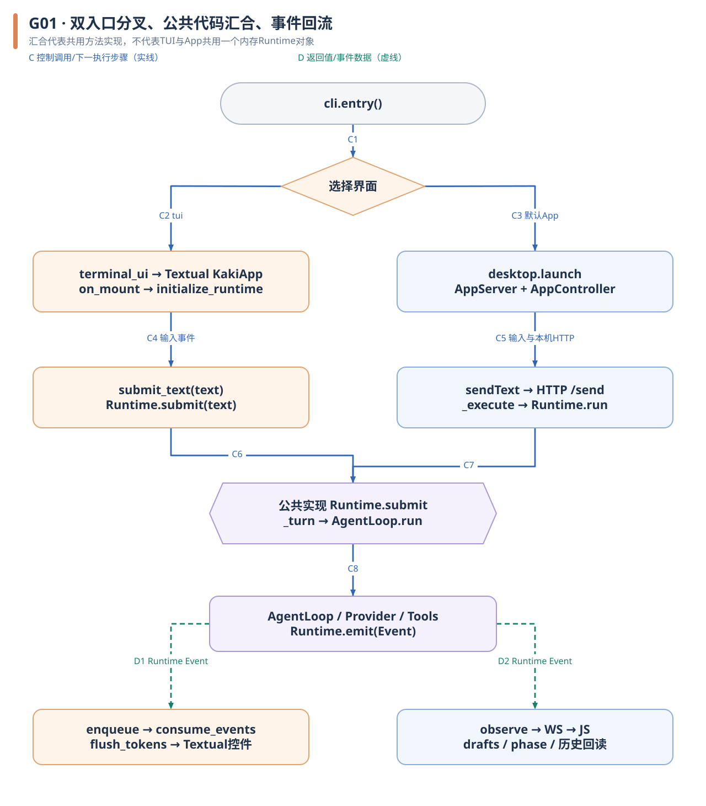

阅读路线：TUI用户顺读T01–T12；App用户顺读A01–A20；深入推理和工具内部时，再一次性顺读C01–C12。前端章节的图已经给出调用公共内核及结果回传关系，公共源码不复制成两份。安装操作见[App指南](app-guide.md)，字段定义见[核心契约](module-spec/core.md)与[App契约](module-spec/app.md)。

## 01. TUI：启动、输入与后续交互独立链

命令：`kaki-agent -C /path/to/single-git-repo tui`。这里的KakiApp是Textual前端类，不是新桌面窗口。

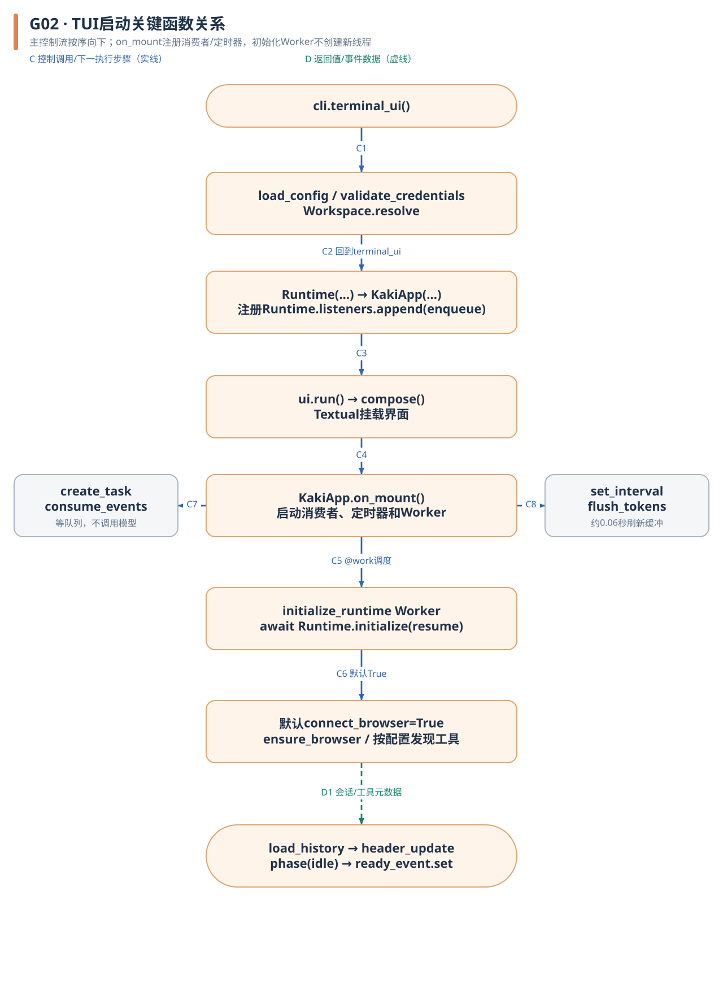

### T01. CLI选择tui子命令，先准备配置和工作区

源码节选：[src/kaki/cli.py:72–82](https://github.com/anuolxl/kaki_agent/blob/41dc5033839a6ff26039cea40ba06827c1aac655/src/kaki/cli.py#L72-L82)。

```python
@app.command("tui")
def terminal_ui(ctx: typer.Context):
    """终端界面：Ctrl+C退出整个进程，停止按钮仅停止本轮任务。"""
    options = load_config(ctx.obj["config"], model=ctx.obj["model"])
    options.validate_credentials()
    workspace = Workspace.resolve(ctx.obj["cwd"], options)
    from kaki.tui import KakiApp

    ui = KakiApp(Runtime(workspace, options), resume=ctx.obj["resume"])
    ui.run()
    raise typer.Exit(ui.return_code)
```

entry发现有子命令后返回，Typer调用terminal_ui。它加载配置、进行本地凭据校验、解析Workspace，再先构造Runtime，最后构造KakiApp。没有调用desktop.launch、AppServer或原生WebKit。

### T02. KakiApp保存Runtime，创建队列和界面状态

源码节选：[src/kaki/tui.py:69–87](https://github.com/anuolxl/kaki_agent/blob/41dc5033839a6ff26039cea40ba06827c1aac655/src/kaki/tui.py#L69-L87)。

```python
    ]

    def __init__(self, runtime, resume: str | None = None, **kwargs):
        kwargs.setdefault("ansi_color", False)
        super().__init__(**kwargs)
        self.runtime = runtime
        self.resume = resume
        self.event_queue = asyncio.Queue(maxsize=512)
        self.bubbles = {}
        self.pending = {}
        self.question_id = None
        self.ready_event = asyncio.Event()
        self.turn_done = asyncio.Event()
        self.last_result = None
        self.current_estimate = 0
        self._consumer = None
        self._kaki_quitting = False
        self.undo_plan = None
        self.runtime.listeners.append(self.enqueue)
```

self是当前KakiApp实例。event_queue属于这个界面实例，Runtime.listeners追加的enqueue把进度事件放进这个队列。ready_event、turn_done是协程之间的同步标记，不是线程或子Agent。

随后ui.run进入Textual框架事件循环，compose创建控件。发送按钮初始disabled=True，状态显示正在初始化，不提前宣称就绪。

### T03. 挂载界面后执行on_mount的三行注册

源码节选：[src/kaki/tui.py:102–123](https://github.com/anuolxl/kaki_agent/blob/41dc5033839a6ff26039cea40ba06827c1aac655/src/kaki/tui.py#L102-L123)。

```python
    async def enqueue(self, event: Event):
        await self.event_queue.put(event)

    async def on_mount(self):
        # 阅读：把长期消费者交给当前事件循环，不在这里等待它永久结束。
        self._consumer = asyncio.create_task(self.consume_events())
        # 阅读：传入绑定方法，定时器之后再调用；这不是直接调用flush_tokens。
        self.set_interval(0.06, self.flush_tokens)
        self.initialize_runtime()

    # 阅读：@work会创建Textual管理的Worker，所以调用处不写await。
    @work
    async def initialize_runtime(self):
        try:
            await self.runtime.initialize(self.resume)
            await self.load_history()
            self.header_update()
            self.query_one("#status", Static).update("就绪 · Enter发送 · 停止按钮仅停止本轮 · Ctrl+C退出程序")
            self.query_one("#prompt", Input).focus()
            self.phase("idle", "○ 已就绪 · 可发送任务")
            self.ready_event.set()
        except Exception as exc:
            self.query_one("#status", Static).update("初始化失败：" + safe_error(exc))
            self.query_one("#tools", RichLog).write(safe_error(exc))
            self.ready_event.set()
```

这三行有明确次序：

1. 调用consume_events先得到协程对象，create_task将其交给当前循环调度，把Task句柄保存在self._consumer；on_mount不等待这个长期循环结束。
2. 注册约0.06秒的定时刷新回调。self.flush_tokens没有括号，传的是绑定方法，之后才由定时器调用。
3. 调用被@work包装的initialize_runtime，创建Textual管理的异步Worker。它不是普通async函数的裸调用，因此调用处不写await。

on_mount本身没有await也合法；它很快返回，让框架继续处理挂载与输入。async声明不会自动创建线程，create_task和@work在这里安排的是协程任务。

### T04. 消费者开始等事件；Worker进入Runtime.initialize

消费者的等待位置是：

源码节选：[src/kaki/tui.py:153–166](https://github.com/anuolxl/kaki_agent/blob/41dc5033839a6ff26039cea40ba06827c1aac655/src/kaki/tui.py#L153-L166)。

```python
    async def consume_events(self):
        try:
            while True:
                event = await self.event_queue.get()
                d = event.data
                if event.type == "runtime.status":
                    self.query_one("#status", Static).update(d["text"])
                elif event.type == "runtime.ready":
                    if d.get("browser_warning"):
                        self.query_one("#tools", RichLog).write("浏览器未连接：" + d["browser_warning"])
                    else:
                        self.query_one("#tools", RichLog).write(
                            f"Playwright MCP：{d.get('browser_tools', 0)}个浏览器工具"
                        )
```

队列为空时，await只暂停消费者协程，事件循环仍可运行初始化Worker、定时器等；没有事件不会触发一次模型调用。

与此同时，Worker执行`await self.runtime.initialize(self.resume)`。同样依次打开Store、创建Provider/Context/Registry、恢复或新建会话。区别在于这里没有显式connect_browser=False，因此使用默认True，在runtime.ready之前就执行ensure_browser和MCP工具发现。

下面就地展开本入口调用的Runtime.initialize，默认connect_browser=True；本节读完无需跳到App启动里找初始化代码。

源码节选：[src/kaki/runtime.py:67–123](https://github.com/anuolxl/kaki_agent/blob/41dc5033839a6ff26039cea40ba06827c1aac655/src/kaki/runtime.py#L67-L123)。

```python
    async def initialize(self, resume: str | None = None, *, connect_browser: bool = True):
        if self.initialized:
            return
        await self.store.open()
        if self.provider is None:
            self.provider = RightCodeProvider(
                self.config, lambda record: self.store.run("call_record", record), self.image_part
            )
        self.context = ContextEngine(self.workspace, self.store, self.config, self.provider)
        self.tools = ToolRegistry(self.workspace, self.config, self.context, self.browser, self.ask_user)
        self.tools.add(
            Tool(
                "kaki_artifact_read",
                "Read full stored text tool output by artifact_id with exact character pagination.",
                {"artifact_id": string(), "offset": integer(), "limit": integer("characters", 100, 16000)},
                ["artifact_id"],
                "READ",
                self.tools.artifact_read,
                True,
            )
        )
        sessions = await self.store.run("sessions")
        if resume:
            if resume == "last":
                if not sessions:
                    raise KakiError("当前项目还没有可恢复会话")
                self.session_id = sessions[0]["id"]
            else:
                matches = [s for s in sessions if s["id"] == resume or s["id"].startswith(resume)]
                if len(matches) != 1:
                    raise KakiError("会话不存在或前缀不唯一")
                self.session_id = matches[0]["id"]
            await self.check_session_model(self.session_id)
            try:
                self.lease.acquire()
            except KakiError:
                self.recovery_plan = {"items": [], "notice": "工作区仍有其他活跃任务，未执行恢复改写"}
            else:
                try:
                    self.recovery_plan = await self.recovery.reconcile(self.session_id)
                finally:
                    self.lease.release()
        else:
            self.session_id = await self.store.run("new_session")
        self.context.last_metadata = (await self.store.run("context_get", self.session_id))["plan"]
        if connect_browser:
            await self.ensure_browser()
        self.initialized = True
        await self.emit(
            "runtime.ready",
            data={
                "session_id": self.session_id,
                "browser_tools": len(self.browser.tools),
                "browser_warning": self.browser_warning,
                "recovery": self.recovery_plan,
            },
        )
```

### T05. Worker等待初始化完成，才载入历史并开放发送

Runtime.initialize返回后，下一句await load_history才执行：

源码节选：[src/kaki/tui.py:139–151](https://github.com/anuolxl/kaki_agent/blob/41dc5033839a6ff26039cea40ba06827c1aac655/src/kaki/tui.py#L139-L151)。

```python
    async def load_history(self):
        self.bubbles = {}
        self.pending = {}
        await self.query_one("#chat", VerticalScroll).remove_children()
        if not self.runtime.session_id:
            return
        for message in await self.runtime.store.run("messages", self.runtime.session_id):
            if message.role in ("user", "assistant") and message.content:
                await self.bubble(str(message.id), message.role, message.content)
        if self.runtime.recovery_plan.get("items"):
            self.query_one("#tools", RichLog).write(
                "已恢复会话；上次中断/未知操作将作为下一任务的核验线索，不自动重放。"
            )
```

它读取消息并绘制user/assistant正文，显示恢复提示，再回到Worker更新标题、焦点、idle状态和ready_event。

注意失败分支也设置ready_event，这表示“初始化尝试结束”，不保证成功。判断可用还需结合Runtime.initialized、错误状态和发送按钮。MCP失败被降级为warning时，内核仍可能就绪；这也不表示浏览器工具一定可用。

定时刷新此时已经注册，但无增量时pending为空；实际输出消费在T09顺序展开。

### T06. 等待用户：TUI此时已有MCP，但仍无新任务和模型调用

在启用MCP且初始化成功的正常情况下，此时消费者Task等待queue，Worker已完成，定时器继续工作；新Turn=0、模型调用=0。MCP stderr文件可能已经创建，但业务网页导航、文件改写和Shell执行仍未自动发生。

这与App的延迟MCP不同。不能把这段on_mount当作默认桌面App启动代码；两种前端只是在Runtime及下面的内核汇合。

### T07. TUI接收输入：先由Textual处理，再分流

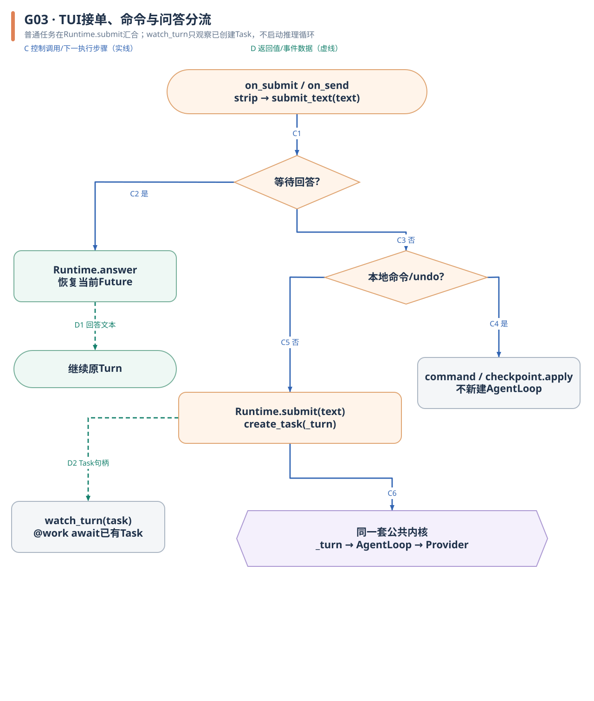

上图只展开关键分支；undo确认与斜杠命令归入本地处理。先收到Textual的输入/按钮事件，处理器去首尾空白，然后把text交给submit_text：

源码节选：[src/kaki/tui.py:260–274](https://github.com/anuolxl/kaki_agent/blob/41dc5033839a6ff26039cea40ba06827c1aac655/src/kaki/tui.py#L260-L274)。

```python
    @on(Input.Submitted, "#prompt")
    async def on_submit(self, event: Input.Submitted):
        text = event.value.strip()
        if not text:
            return
        event.input.value = ""
        await self.submit_text(text)

    @on(Button.Pressed, "#send")
    async def on_send(self):
        field = self.query_one("#prompt", Input)
        text = field.value.strip()
        field.value = ""
        if text:
            await self.submit_text(text)
```

进入submit_text后，按代码先后判断question_id、undo_plan、斜杠命令，最后才是普通新任务：

源码节选：[src/kaki/tui.py:280–310](https://github.com/anuolxl/kaki_agent/blob/41dc5033839a6ff26039cea40ba06827c1aac655/src/kaki/tui.py#L280-L310)。

```python
    async def submit_text(self, text: str):
        try:
            if self.question_id:
                identity = self.question_id
                self.question_id = None
                await self.runtime.answer(identity, text)
                return
            if self.undo_plan is not None:
                plan = self.undo_plan
                self.undo_plan = None
                if text.strip().upper() == "RESTORE":
                    self.runtime.lease.acquire()
                    try:
                        r = await self.runtime.checkpoint.apply(
                            plan, [x["path"] for x in plan["paths"] if not x["conflict"]]
                        )
                    finally:
                        self.runtime.lease.release()
                    await self.bubble(
                        "restore-" + str(len(self.bubbles)), "assistant", json.dumps(r, ensure_ascii=False)
                    )
                else:
                    self.query_one("#tools", RichLog).write("已放弃恢复")
                return
            if text.startswith("/") and text != "/compact":
                await self.command(text)
                return
            self.turn_done.clear()
            self.last_result = None
            task = self.runtime.submit(text)
            self.watch_turn(task)
```

因此“按Enter”不一定启动AgentLoop。输入是现有问题的回答时，调用Runtime.answer；确认RESTORE时执行已预览的恢复计划；本地命令交给command。普通任务才runtime.submit。TUI没有HTTP传输和HTTP202，运行错误由当前界面捕获后写状态/RichLog。

### T08. submit启动内层Task，watch_turn只是观察；公共调用就在这里发生

源码节选：[src/kaki/tui.py:316–324](https://github.com/anuolxl/kaki_agent/blob/41dc5033839a6ff26039cea40ba06827c1aac655/src/kaki/tui.py#L316-L324)。

```python
    @work
    async def watch_turn(self, task):
        try:
            await task
        except asyncio.CancelledError:
            pass
        except Exception as exc:
            self.query_one("#status", Static).update(safe_error(exc))
            self.turn_done.set()
```

先执行`task = runtime.submit(text)`，创建运行_turn的Task；随后@work的watch_turn等待这个已存在的Task。不是watch_turn启动AgentLoop，也不是每个Worker都新开线程。

在这个调用点，公共内核实际按下面顺序执行；本节先给完整顺序，公共C链稍后逐段展开对应源码：

```text
Runtime.submit(text)
 → create_task(Runtime._turn)
 → lease / Store.accept_turn / before快照
 → AgentLoop.run → ContextEngine.assemble
 → while中的rebalance / Provider.complete
 → 有工具请求：planned → running → 真正I/O → commit_tool → 下一轮模型
 → 最终正文 / TurnResult
 → after快照 / working state / finish_turn / release lease
 → Task结束，watch_turn的await返回
```

与此同时，Runtime事件持续送入初始化时已注册的消费者。下面沿这条并发的回流路径继续，不等整个模型循环结束才渲染。

### T09. TUI接收模型增量和终态：队列与定时缓冲，不经过WebSocket

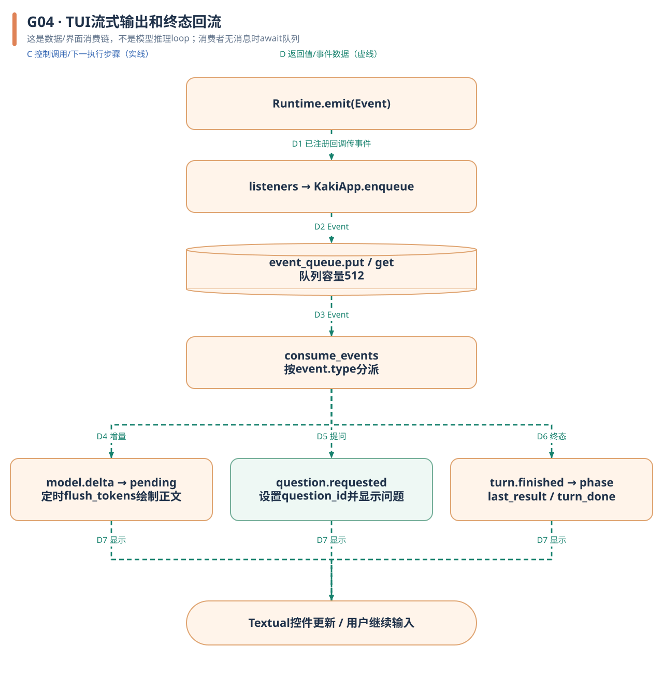

Runtime.emit统一调用已注册监听器，TUI注册的是enqueue：

源码节选：[src/kaki/runtime.py:50–53](https://github.com/anuolxl/kaki_agent/blob/41dc5033839a6ff26039cea40ba06827c1aac655/src/kaki/runtime.py#L50-L53)。

```python
    async def emit(self, kind: str, turn: str = "", data: dict | None = None):
        event = Event(kind, turn, data or {})
        for listener in self.listeners:
            await listener(event)
```

源码节选：[src/kaki/tui.py:102–103](https://github.com/anuolxl/kaki_agent/blob/41dc5033839a6ff26039cea40ba06827c1aac655/src/kaki/tui.py#L102-L103)。

```python
    async def enqueue(self, event: Event):
        await self.event_queue.put(event)
```

consume_events从容量512的event_queue取事件。model.delta先按draft_id积累pending；model.committed先刷完pending，再将草稿气泡切换为稳定message_id，避免正文重复：

源码节选：[src/kaki/tui.py:175–197](https://github.com/anuolxl/kaki_agent/blob/41dc5033839a6ff26039cea40ba06827c1aac655/src/kaki/tui.py#L175-L197)。

```python
                elif event.type == "model.delta":
                    key = "draft-" + d["draft_id"]
                    self.pending[key] = self.pending.get(key, "") + d["text"]
                elif event.type == "model.committed":
                    await self.flush_tokens()
                    draft = "draft-" + d.get("draft_id", "")
                    key = str(d["message_id"])
                    if draft in self.bubbles:
                        widget = self.bubbles.pop(draft)
                        self.bubbles[key] = widget
                        widget.replace(d["text"])
                    elif d["text"]:
                        await self.bubble(key, "assistant", d["text"])
                elif event.type == "tool.started":
                    args = json.dumps(d["arguments"], ensure_ascii=False)
                    self.query_one("#tools", RichLog).write("▶ " + d["name"] + " " + args[:220])
                elif event.type == "tool.finished":
                    self.query_one("#tools", RichLog).write(
                        ("✗ " if d["failed"] else "✓ ")
                        + d["name"]
                        + " · "
                        + d["preview"].replace("\n", " ")[:250]
                    )
```

on_mount之前注册的定时器约每0.06秒调用flush_tokens，实际把缓冲追加到Textual控件：

源码节选：[src/kaki/tui.py:240–250](https://github.com/anuolxl/kaki_agent/blob/41dc5033839a6ff26039cea40ba06827c1aac655/src/kaki/tui.py#L240-L250)。

```python
            self.turn_done.set()

    async def flush_tokens(self):
        pending = self.pending
        self.pending = {}
        for key, text in pending.items():
            if key in self.bubbles:
                self.bubbles[key].append(text)
            else:
                await self.bubble(key, "assistant", text)
        if pending:
```

turn.finished由同一个消费者处理，更新last_result、phase、用量和turn_done：

源码节选：[src/kaki/tui.py:216–239](https://github.com/anuolxl/kaki_agent/blob/41dc5033839a6ff26039cea40ba06827c1aac655/src/kaki/tui.py#L216-L239)。

```python
                elif event.type == "turn.finished":
                    await self.flush_tokens()
                    self.last_result = d
                    u = d.get("usage", {})
                    v = d.get("verification", {})
                    labels = {
                        "completed": "✓ 本轮已完成，可以继续提问",
                        "interrupted": "! 本轮未完成，可继续处理",
                        "cancelled": "■ 本轮已停止，可以继续提问",
                        "failed": "! 本轮失败，请查看错误",
                    }
                    self.phase(d["status"], labels[d["status"]])
                    self.query_one("#status", Static).update(
                        f"{labels[d['status']]} · {d['stop_reason']} · 本轮累计{u.get('total_tokens', 0)} tokens / {u.get('calls', 0)}次模型请求 · 验证 {v.get('status', 'not_run')}"
                    )
                    if d.get("error"):
                        self.query_one("#tools", RichLog).write("错误：" + d["error"])
                    if d["status"] == "cancelled" and not self.bubbles:
                        await self.bubble("cancel-" + event.turn_id, "assistant", d["text"])
                    self.turn_done.set()
        except asyncio.CancelledError:
            raise
        except Exception as exc:
            self.query_one("#status", Static).update("界面事件错误：" + safe_error(exc))
```

这与App的Controller外层busy管理不同。TUI以收到的运行事件更新界面；watch_turn主要观察任务完成/异常，不负责把模型流直接绘制出来。Textual的ui.run是框架事件循环，Runtime.run是单任务提交包装，AgentLoop.run才是推理/工具循环，三个run不是同一个东西。

### T10. TUI收到ask_user以后，下一条输入恢复原Turn

模型调用kaki_ask_user后，公共Runtime持有question Future并发question.requested。TUI消费者保存问题ID并显示选项：

源码节选：[src/kaki/tui.py:205–213](https://github.com/anuolxl/kaki_agent/blob/41dc5033839a6ff26039cea40ba06827c1aac655/src/kaki/tui.py#L205-L213)。

```python
                elif event.type == "question.requested":
                    self.phase("running", "? 等待你的回答 · 本轮任务尚未结束", waiting=True)
                    self.question_id = d["question_id"]
                    await self.bubble(
                        "question-" + self.question_id,
                        "assistant",
                        d["question"] + "\n" + " / ".join(d.get("options", [])),
                    )
                    self.query_one("#status", Static).update("等待你的回答；输入框中直接回复，或Ctrl+C取消")
```

下一次submit_text先检查question_id，再调用Runtime.answer。回答填入Future以后，原工具返回ToolResult，原AgentLoop继续；不会因为这次回答再创建第二个Turn。循环之后仍可能继续调用模型，这与“回答不新建任务”不是矛盾。

公共Future的创建和恢复方式为：

源码节选：[src/kaki/runtime.py:302–325](https://github.com/anuolxl/kaki_agent/blob/41dc5033839a6ff26039cea40ba06827c1aac655/src/kaki/runtime.py#L302-L325)。

```python
    async def ask_user(self, question: str, options: list[str]) -> str:
        if self.question:
            raise KakiError("已有未回答的问题")
        future = asyncio.get_running_loop().create_future()
        identity = uid("q_")
        self.question = {"id": identity, "future": future, "question": question, "options": options}
        await self.store.run(
            "question", self.active_turn, {"question_id": identity, "question": question, "options": options}
        )
        await self.emit(
            "question.requested",
            self.active_turn,
            {"question_id": identity, "question": question, "options": options},
        )
        try:
            return await future
        finally:
            self.question = None
            await self.store.run("question", self.active_turn, None)

    async def answer(self, question_id: str, text: str):
        if not self.question or self.question["id"] != question_id:
            raise KakiError("问题已过期或不属于当前任务")
        self.question["future"].set_result(text)
```

question_id属于当前进程的Runtime，不是跨不同前端共享的问答通道。

源码中的问题提示仍有一处旧文案“Ctrl+C取消”；实际按键绑定已经走action_interrupt → _quit(130)，会退出程序。判断行为应以T12的调用路径为准，不能据这句旧文案推导仍只是取消任务。

### T11. TUI命令、会话切换和undo独立于普通新任务

command解析器先按第一个空格拆命令与参数，再调用本地能力：

源码节选：[src/kaki/tui.py:326–343](https://github.com/anuolxl/kaki_agent/blob/41dc5033839a6ff26039cea40ba06827c1aac655/src/kaki/tui.py#L326-L343)。

```python
    async def command(self, text: str):
        command, _, arg = text.partition(" ")
        if command == "/new":
            await self.action_new()
        elif command == "/sessions":
            await self.action_sessions()
        elif command == "/resume":
            await self.runtime.switch_session(arg.strip() or "last")
            await self.load_history()
            self.header_update()
        elif command == "/context":
            await self.bubble(
                "context-" + str(len(self.bubbles)),
                "assistant",
                "```json\n"
                + json.dumps(self.runtime.context.last_metadata, ensure_ascii=False, indent=2)
                + "\n```",
            )
```

| 输入/操作 | TUI实际路径 | 是否新建推理Turn |
|---|---|---|
| /new | action_new → Runtime.new_session → load_history | 否；active任务运行时拒绝切换 |
| /sessions | Store.sessions → 本地气泡列表 | 否 |
| /resume ID | Runtime.switch_session → load_history | 否；直接改变当前Runtime执行会话 |
| /context、/memory | 查询已有诊断/记忆并显示 | 否 |
| /undo | 生成恢复预览，下一输入RESTORE才apply | 否 |
| /compact | 特意绕过TUI.command，交Runtime专用分支 | 创建Turn，按需Curator；不走普通AgentLoop |
| /help、/quit | 本地说明或退出 | 否 |

源码节选：[src/kaki/tui.py:378–393](https://github.com/anuolxl/kaki_agent/blob/41dc5033839a6ff26039cea40ba06827c1aac655/src/kaki/tui.py#L378-L393)。

```python
    async def action_new(self):
        try:
            await self.runtime.new_session()
            await self.load_history()
            self.header_update()
            self.query_one("#status", Static).update("新会话已就绪")
        except Exception as exc:
            self.query_one("#status", Static).update(safe_error(exc))

    async def action_sessions(self):
        rows = await self.runtime.store.run("sessions")
        await self.bubble(
            "sessions-" + str(len(self.bubbles)),
            "assistant",
            "当前项目会话（/resume ID切换）：\n" + "\n".join(f"- {s['id']} · {s['title']}" for s in rows),
        )
```

**当前兼容缺口需要明确：** 输入开头的`/skill ...`会被TUI当成斜杠命令，但command表没有/skill分支，最后进入未知命令：

源码节选：[src/kaki/tui.py:367–376](https://github.com/anuolxl/kaki_agent/blob/41dc5033839a6ff26039cea40ba06827c1aac655/src/kaki/tui.py#L367-L376)。

```python
        elif command == "/quit":
            await self.action_quit_safe()
        elif command == "/help":
            await self.bubble(
                "help-" + str(len(self.bubbles)),
                "assistant",
                "/new 新会话 · /sessions 会话列表 · /resume ID/last 恢复 · /compact 手动整理上下文 · /context 预算诊断 · /memory 项目记忆 · /undo [turn_id] 文件恢复预览 · /quit 退出。\n停止按钮仅停止本轮；Ctrl+C退出整个程序。已发生的文件修改不会自动撤回。",
            )
        else:
            raise KakiError("未知命令，使用 /help")
```

Skills.resolve本身可以识别`$技能名`或文本中的`/skill 技能名`；这不代表TUI前置解析一定把开头的/skill放行。两端共同显式选技能可使用`$技能名 ...`。App输入框没有相同的本地斜杠命令解析，所以/new等同名文本也不应假定与TUI等价。这是现状说明，本次未修改路由逻辑。

### T12. TUI停止和退出：目标是自己持有的Runtime

源码节选：[src/kaki/tui.py:395–416](https://github.com/anuolxl/kaki_agent/blob/41dc5033839a6ff26039cea40ba06827c1aac655/src/kaki/tui.py#L395-L416)。

```python
    async def action_cancel(self):
        await self.runtime.cancel()

    async def action_quit_safe(self):
        await self._quit(0)

    async def action_interrupt(self):
        await self._quit(130)

    async def _quit(self, exit_code):
        if self._kaki_quitting:
            return
        self._kaki_quitting = True
        await self.runtime.close()
        self.exit(return_code=exit_code)

    async def on_unmount(self):
        if self._consumer:
            self._consumer.cancel()
            with contextlib.suppress(asyncio.CancelledError):
                await self._consumer
        await self.runtime.close()
```

停止按钮调用Runtime.cancel，仅取消当前内层Task，界面保留。Ctrl+C绑定action_interrupt → _quit(130)，正常退出走_quit(0)，都先close当前Runtime再退出Textual；卸载时取消消费者并等待它清理。

这条路径没有AppController、HTTP stop/shutdown，也不会关闭另一个App进程中的Runtime。已发生的文件/网络副作用不因取消自动回滚。

## 02. App：启动、输入与后续交互独立链

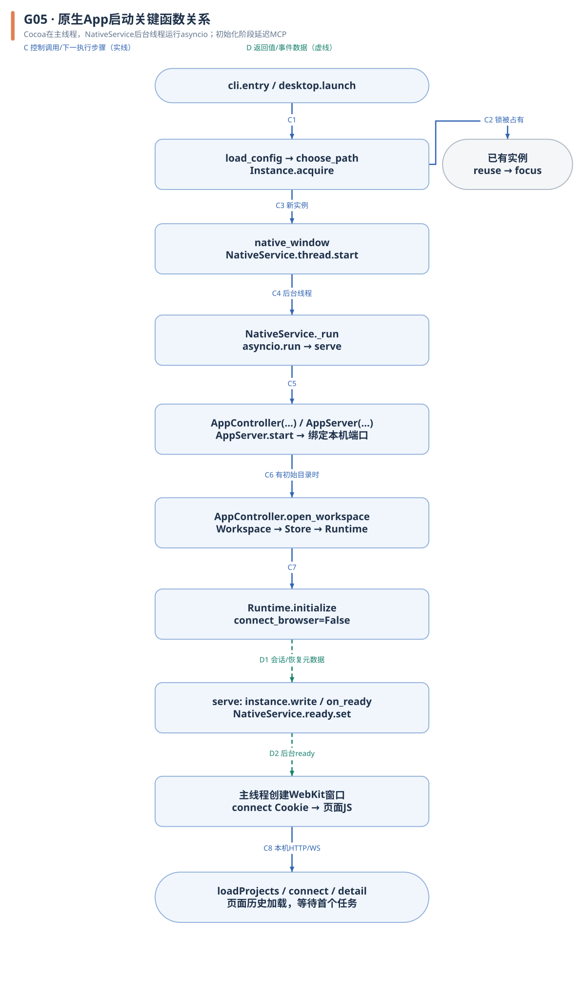

### A01. 在终端执行命令，先进入安装好的Python入口

```bash
kaki-agent -C /path/to/single-git-repo
```

这里的`-C`指定要工作的代码仓库。Kaki自己的Python依赖来自此前uv安装的工具环境，不要求目标仓库也是Python项目。安装脚本的入口映射是：

源码节选：[pyproject.toml:18–20](https://github.com/anuolxl/kaki_agent/blob/41dc5033839a6ff26039cea40ba06827c1aac655/pyproject.toml#L18-L20)。

```toml
[project.scripts]
kaki-agent = "kaki.cli:main"
kaki-app = "kaki.desktop:main"
```

因此这条命令进入`kaki.cli.main()`，由Typer解析参数并调用`entry()`。当前没有子命令，继续走默认App分支：

源码节选：[src/kaki/cli.py:29–46](https://github.com/anuolxl/kaki_agent/blob/41dc5033839a6ff26039cea40ba06827c1aac655/src/kaki/cli.py#L29-L46)。

```python
@app.callback()
def entry(
    ctx: typer.Context,
    cwd: Path | None = typer.Option(None, "--cwd", "-C", help="目标单Git仓库，默认当前目录"),
    config: Path | None = typer.Option(None, "--config", help="配置文件，默认~/.kaki/config.json"),
    resume: str | None = typer.Option(None, "--resume", help="恢复会话ID或last，不自动重放未知操作"),
    model: str | None = typer.Option(None, "--model"),
    version: bool = typer.Option(False, "--version", is_eager=True),
):
    if version:
        console.print("Kaki Agent " + __version__)
        raise typer.Exit()
    ctx.obj = {"cwd": cwd, "config": config, "resume": resume, "model": model}
    # 阅读：有子命令就交给子命令；本主线是无子命令的默认App。
    if ctx.invoked_subcommand is not None:
        return
    from kaki.desktop import launch

    raise typer.Exit(launch(cwd, config, resume, model))
```

**本步结束后继续执行：** `desktop.launch(cwd, config, resume, model)`。此时尚未创建窗口、Runtime或本轮任务。

如果用`uv run --project /Users/bytedance/github/kaki_agent kaki-agent -C /path/to/repo`启动，uv可能先检查/同步Kaki依赖；那发生在Python入口之前。Kaki正常启动本身不会自动运行uv sync、下载目标Go项目依赖、构建业务代码或启动Docker。需要这些动作时应显式运行诊断或让后续任务执行。

### A02. launch先加载配置，再决定目录和是否复用实例

**调用位置：** 当前执行栈为`cli.entry → desktop.launch`。

源码节选：[src/kaki/desktop.py:235–256](https://github.com/anuolxl/kaki_agent/blob/41dc5033839a6ff26039cea40ba06827c1aac655/src/kaki/desktop.py#L235-L256)。

```python
def launch(cwd=None, config_path=None, resume=None, model=None, *, browser=False, no_open=False, port=0):
    config = load_config(config_path, model=model)
    path = choose_path(cwd, config)
    instance = Instance()
    try:
        # 阅读：同一个 KAKI_HOME 只保留一个 App 实例；二次启动唤起现有窗口。
        if not instance.acquire():
            reuse(instance, path, browser)
            return 0
        # 阅读：macOS 默认原生窗口；浏览器与无窗口模式共用同一后台。
        if sys.platform == "darwin" and not browser and not no_open:
            return native_window(instance, config, path, resume, port)

        def ready(server):
            if not no_open:
                webbrowser.open(server.connect_url)

        try:
            asyncio.run(serve(instance, config, path, resume, port, on_ready=ready))
        except KeyboardInterrupt:
            return 130
        return 0
    finally:
        instance.close()
```

按代码顺序，第一行先执行`load_config`。进入这个函数：

源码节选：[src/kaki/config.py:162–191](https://github.com/anuolxl/kaki_agent/blob/41dc5033839a6ff26039cea40ba06827c1aac655/src/kaki/config.py#L162-L191)。

```python
def load_config(path: Path | None = None, *, model: str | None = None) -> Config:
    path = config_path(path)
    try:
        data = normalize(json.loads(path.read_text())) if path.exists() else {}
    except (ValueError, OSError) as exc:
        raise KakiError(f"配置无法读取：{path}；未覆盖原文件（{type(exc).__name__}）") from None
    if not isinstance(data, dict):
        raise KakiError("配置顶层必须是JSON对象")
    for key, value in os.environ.items():
        # 阅读：此处只合并非空的层级环境配置，不启动任何模型请求。
        if not key.startswith("KAKI_") or "__" not in key or not value.strip():
            continue
        parts = key[5:].lower().split("__")
        node = data
        for part in parts[:-1]:
            node = node.setdefault(part, {})
        try:
            node[parts[-1]] = json.loads(value)
        except ValueError:
            node[parts[-1]] = value
    if model:
        data.setdefault("agents", {}).setdefault("defaults", {})["model"] = model
    try:
        return Config.model_validate(data)
    except ValueError as exc:
        # ValidationError input can contain a secret; only expose field locations and messages.
        errors = getattr(exc, "errors", lambda **_: [])(include_input=False)
        raise KakiError(
            "配置校验失败：" + "; ".join(".".join(map(str, e["loc"])) + ": " + e["msg"] for e in errors)
        ) from None

```

它读取JSON、规范化camelCase/snake_case、合并非空层级环境变量，并应用显式`--model`覆盖，再进行本地字段校验。这里不会向Right Code发送请求。`apiKey`非空等凭据校验在后续Provider构造时进行；本地校验通过也不表示远端已经认证成功。

`load_config`返回Config对象后，回到launch的下一行`choose_path`：

源码节选：[src/kaki/desktop.py:60–68](https://github.com/anuolxl/kaki_agent/blob/41dc5033839a6ff26039cea40ba06827c1aac655/src/kaki/desktop.py#L60-L68)。

```python
def choose_path(cwd, config):
    if cwd:
        return Path(cwd).expanduser().resolve()
    if config.agents.defaults.workspace:
        return Path(config.agents.defaults.workspace).expanduser()
    result = subprocess.run(
        ["git", "rev-parse", "--show-toplevel"], capture_output=True, text=True, timeout=5
    )
    return Path(result.stdout.strip()) if result.returncode == 0 else None
```

显式`-C`优先，其次配置workspace，再尝试当前Git根。目录确定后创建Instance并取得实例锁：

源码节选：[src/kaki/desktop.py:35–41](https://github.com/anuolxl/kaki_agent/blob/41dc5033839a6ff26039cea40ba06827c1aac655/src/kaki/desktop.py#L35-L41)。

```python
    def acquire(self):
        try:
            # 阅读：失败表示已有App，此次启动只唤起现有窗口。
            fcntl.flock(self.file, fcntl.LOCK_EX | fcntl.LOCK_NB)
            self.owner = True
            return True
        except BlockingIOError:
            return False
```

本主线是新实例，因此继续进入`native_window`。如果锁已被占有，launch调用`reuse`，向现有App发送focus/打开项目请求后直接返回，不创建另一套后台。App实例锁在进程存活期间保留；它与后面“执行一次任务时使用的工作区lease”不是同一把锁。

**本步输出：** Config、目标路径、App实例所有权。**下一步：** 创建后台线程。

### A03. native_window启动真实线程，线程里面才启动asyncio

**当前执行栈：** `launch → native_window`。

源码节选：[src/kaki/desktop.py:137–155](https://github.com/anuolxl/kaki_agent/blob/41dc5033839a6ff26039cea40ba06827c1aac655/src/kaki/desktop.py#L137-L155)。

```python
def native_window(instance, config, path, resume, port):
    import webview
    from PyObjCTools import AppHelper, MachSignals
    from webview.menu import Menu, MenuAction

    service = NativeService(instance, config, path, resume, port)
    service.thread.start()
    # 阅读：ready事件也可能在错误收尾中设置，必须同时检查server是否存在。
    if not service.ready.wait(20) or not service.server:
        service.stop()
        raise KakiError(service.error or "App本地服务启动超时")
    window = webview.create_window(
        "Kaki",
        service.server.connect_url,
        width=1280,
        height=860,
        min_size=(900, 640),
        background_color="#FFFFFF",
        text_select=True,
    )
```

这里的`service.thread.start()`才是启动实际Python线程。`async def`和`asyncio.create_task`本身不等于创建线程。主线程随后等待后台ready；后台线程执行`NativeService._run`：

源码节选：[src/kaki/desktop.py:114–134](https://github.com/anuolxl/kaki_agent/blob/41dc5033839a6ff26039cea40ba06827c1aac655/src/kaki/desktop.py#L114-L134)。

```python
    def _run(self):
        async def run():
            self.loop = asyncio.get_running_loop()

            def ready(server):
                self.server = server
                self.ready.set()

            await serve(*self.args, on_ready=ready)

        try:
            # 阅读：后台线程拥有 asyncio loop，Cocoa 留在主线程。
            asyncio.run(run())
        except BaseException as exc:
            self.error = safe_error(exc)
        finally:
            self.ready.set()
            self.done.set()

    def stop(self):
        if self.loop and self.server and not self.done.is_set():
            # 阅读：跨线程退出使用线程安全投递，不直接跨线程操作 asyncio.Event。
            self.loop.call_soon_threadsafe(self.server.stop_event.set)
```

`asyncio.run(run())`创建并运行该线程的事件循环。`run()`取得loop引用后，执行`await serve(...)`。主线程此时仍等待ready，尚未创建WebKit窗口。

**本步输出：** 后台asyncio循环已经存在；但这不表示工作区、模型客户端和会话都已就绪。**下一步：** 跟入serve。

### A04. serve先创建Controller和Server，再启动本机服务

**当前执行栈：** `NativeService._run/run → serve`。

源码节选：[src/kaki/desktop.py:92–102](https://github.com/anuolxl/kaki_agent/blob/41dc5033839a6ff26039cea40ba06827c1aac655/src/kaki/desktop.py#L92-L102)。

```python
async def serve(instance, config, path, resume, port, *, on_ready=None):
    # 阅读：先构造Controller和Server，再启动；不是立刻运行AgentLoop。
    server = AppServer(AppController(config), port=port, initial_path=path, resume=resume)
    try:
        await server.start()
        instance.write(server)
        print(f"Kaki App已启动：{server.origin} · Ctrl+C退出进程", flush=True)
        if on_ready:
            on_ready(server)
        # 阅读：启动后挂起这个协程等待退出，其他HTTP/WS任务仍由事件循环调度。
        await server.stop_event.wait()
    finally:
        await server.close()
```

Python会先计算构造参数`AppController(config)`，因此先进入Controller构造器：

源码节选：[src/kaki/app_controller.py:85–117](https://github.com/anuolxl/kaki_agent/blob/41dc5033839a6ff26039cea40ba06827c1aac655/src/kaki/app_controller.py#L85-L117)。

```python
class AppController:
    def __init__(self, config: Config, *, runtime_factory=Runtime):
        self.config, self.runtime_factory = config, runtime_factory
        self.engines: dict[str, Engine] = {}
        self.subscribers: set[asyncio.Queue] = set()
        self.lock = asyncio.Lock()
        self.closed = False
        self.seq = 0
        self.registry = kaki_home() / "app-workspaces.json"
        self.paths = self._read_paths()
# 阅读：只读最近项目路径，不会在此打开全部项目或执行历史任务。

    def _read_paths(self):
        if self.registry.exists():
            try:
                data = json.loads(self.registry.read_text())
                if data.get("schema_version") == 1 and isinstance(data.get("paths"), list):
                    return list(dict.fromkeys(p for p in data["paths"] if isinstance(p, str)))[:50]
            except (ValueError, OSError):
                pass
        paths = []
        for file in sorted(
            (kaki_home() / "projects").glob("*/workspace.json"), key=lambda p: p.stat().st_mtime, reverse=True
        ):
            try:
                value = json.loads(file.read_text())["root"]
                if Path(value).is_dir() and not value.startswith(
                    ("/private/tmp/", "/tmp/", "/private/var/folders/")
                ):
                    paths.append(value)
            except (OSError, ValueError, KeyError, TypeError):
                continue
        return list(dict.fromkeys(paths))[:50]

```

它准备Engine字典、订阅队列集合、创建工作区的锁，并读取最近项目路径。这里只发现候选项目，不会把列表里的每个仓库都打开，也不会执行历史任务。

Controller构造完成后，AppServer保存它及端口、初始目录等参数，准备随机本机访问凭据和停止事件。回到serve的`await server.start()`：

源码节选：[src/kaki/app_server.py:77–122](https://github.com/anuolxl/kaki_agent/blob/41dc5033839a6ff26039cea40ba06827c1aac655/src/kaki/app_server.py#L77-L122)。

```python
    async def start(self):
        application = web.Application(middlewares=[self.guard], client_max_size=512 * 1024)
        application.add_routes(
            [
                web.get("/", self.index),
                web.get("/assets/{name}", self.asset),
                web.get("/connect/{ticket}", self.connect),
                web.get("/health", self.health),
                web.get("/api/state", self.state),
                web.get("/api/events", self.events),
                web.post("/api/workspaces", self.open_workspace),
                web.get("/api/workspaces/{workspace}/sessions", self.sessions),
                web.post("/api/workspaces/{workspace}/sessions", self.new_session),
                web.get("/api/workspaces/{workspace}/sessions/{session}", self.detail),
                web.patch("/api/workspaces/{workspace}/sessions/{session}", self.edit_session),
                web.post("/api/workspaces/{workspace}/sessions/{session}/send", self.send),
                web.post("/api/workspaces/{workspace}/sessions/{session}/stop", self.stop),
                web.post("/api/workspaces/{workspace}/sessions/{session}/answer", self.answer),
                web.post("/api/shutdown", self.shutdown),
                web.post("/api/focus", self.focus),
            ]
        )
        self.runner = web.AppRunner(application, access_log=None, shutdown_timeout=3)
        await self.runner.setup()
        sock = socket.socket(socket.AF_INET, socket.SOCK_STREAM)
        sock.setsockopt(socket.SOL_SOCKET, socket.SO_REUSEADDR, 1)
        sock.bind(("127.0.0.1", self.port))
        sock.listen(32)
        sock.setblocking(False)
        self.port = sock.getsockname()[1]
        self.origin = f"http://127.0.0.1:{self.port}"
        self.cookie = f"kaki_app_{self.port}"
        # 阅读：此时端口可以接收连接，但初始工作区仍可能未完成。
        await web.SockSite(self.runner, sock).start()
        if self.initial_path:
            try:
                engine = await self.controller.open_workspace(str(self.initial_path))
                if self.resume and self.resume != "last":
                    rows = await self.controller.sessions(engine.runtime.workspace.id)
                    matches = [s for s in rows if s["id"] == self.resume or s["id"].startswith(self.resume)]
                    if len(matches) != 1:
                        raise KakiError("会话不存在或前缀不唯一")
                    engine.session = matches[0]["id"]
                self.initial = {"workspace_id": engine.runtime.workspace.id, "session_id": engine.session}
            except Exception as exc:
                # 阅读：工作区失败也可保留App，让用户从界面选择或修复项目。
                self.initial_error = safe_error(exc)
        return self
```

按顺序，start注册HTTP/WS路由，创建AppRunner，然后绑定127.0.0.1并启动SockSite。**走到第109行时只是端口已监听。** 初始工作区仍在紧接着的`open_workspace`中准备。

如果工作区初始化失败，start会保存`initial_error`，仍可能返回可用的App外壳，让用户选其他项目。因此`/health`能返回200，只证明本机服务可响应，不证明Git目录、Runtime和远端模型都可用。

**本步结束后继续执行：** 本主线传了有效初始目录，跟入`controller.open_workspace(path)`。

### A05. 打开工作区：先确定Git边界，再构造Runtime

**当前执行栈：** `AppServer.start → AppController.open_workspace`。

源码节选：[src/kaki/app_controller.py:209–229](https://github.com/anuolxl/kaki_agent/blob/41dc5033839a6ff26039cea40ba06827c1aac655/src/kaki/app_controller.py#L209-L229)。

```python
        async with self.lock:
            # 阅读：规范化 Git 根目录，生成项目隔离的状态目录。
            ws = await asyncio.to_thread(Workspace.resolve, Path(path), self.config)
            if ws.id in self.engines:
                return self.engines[ws.id]
            rt = self.runtime_factory(ws, self.config)
            engine = Engine(rt)
            # 阅读：事件监听是进程内函数回调。
            rt.listeners.append(lambda event: self.observe(engine, event))
            try:
                await rt.store.open()
                rows = await rt.store.run("sessions")
                selected = None
                for row in rows:
                    models = await rt.store.run("session_models", row["id"])
                    if all(
                        m.removeprefix("openai/") == self.config.agents.defaults.model.removeprefix("openai/")
                        for m in models
                    ):
                        selected = row["id"]
                        break
                # 阅读：先恢复历史；首次真正发任务时再连接浏览器 MCP。
                await rt.initialize(selected, connect_browser=False)
                engine.session = rt.session_id
```

首先执行`Workspace.resolve`，不是立即发模型请求。进入该函数：

源码节选：[src/kaki/workspace.py:26–68](https://github.com/anuolxl/kaki_agent/blob/41dc5033839a6ff26039cea40ba06827c1aac655/src/kaki/workspace.py#L26-L68)。

```python
    @classmethod
    def resolve(cls, cwd: Path | None, config: Config) -> Workspace:
        chosen = (cwd or Path(config.agents.defaults.workspace or Path.cwd())).expanduser().resolve()
        if not chosen.is_dir():
            raise KakiError(f"工作目录不存在：{chosen}")
        r = subprocess.run(
            ["git", "-C", str(chosen), "rev-parse", "--show-toplevel"],
            capture_output=True,
            text=True,
            timeout=10,
        )
        if r.returncode:
            raise KakiError("--cwd需要指向单个Git仓库；先在目标目录git init")
        root = Path(r.stdout.strip()).resolve()
        if (root / ".gitmodules").exists() and (root / ".gitmodules").read_text().strip():
            raise KakiError("当前目录含Git子模块；v0.1请指定media_platform等单Git子仓")
        slug = re.sub(r"[^A-Za-z0-9._-]", "-", root.name) or "workspace"
        identity = hashlib.sha256(os.fsencode(root)).hexdigest()[:16]
        state = kaki_home() / "projects" / f"{slug}-{identity}"
        state.mkdir(parents=True, exist_ok=True, mode=0o700)
        ws = cls(root, state, identity)
        # 阅读：先发现规则入口；这里会读取规则文档以识别继承链接。
        pending = [root / name for name in ["AGENTS.md", "KAKI.md"]]
        seen = set()
        while pending and len(seen) < 16:
            p = pending.pop(0).resolve()
            if p in seen or not p.is_file():
                continue
            seen.add(p)
            ws.rule_files.append(p)
            # Explicit inherited rule documents are read-only knowledge, not a write grant.
            if p.parent != root and (p.parent / "docs").is_dir():
                ws.knowledge_roots.append((p.parent / "docs").resolve())
            for match in re.finditer(r"\]\(([^)]+(?:AGENTS|KAKI)\.md)\)", p.read_text(errors="replace")):
                target = (p.parent / match[1]).resolve()
                if target.name in {"AGENTS.md", "KAKI.md"} and target in (
                    root / target.name,
                    *root.parents[0].glob(target.name),
                ):
                    pending.append(target)
        # 阅读：写的是Kaki状态目录里的项目元数据。
        (state / "workspace.json").write_text(
            json.dumps({"workspace_id": identity, "root": str(root)}, ensure_ascii=False)
        )
        return ws
```

它确认目录存在，调用git确定规范根，检查子模块边界，以规范路径生成workspace_id，在KAKI_HOME下建立项目状态目录并写workspace.json。

这里还会发现AGENTS.md/KAKI.md，读取这些规则文档以寻找允许继承的入口。**所以“任务前完全不读文件”不准确；但这也不是扫描整个业务源码或为项目建立向量索引。** 真正为当前用户任务拼接规则正文，要等收到任务后。

Workspace对象返回后，回到Controller。若已有同workspace_id的Engine就复用；本主线尚无Engine，于是创建Runtime：

源码节选：[src/kaki/runtime.py:27–48](https://github.com/anuolxl/kaki_agent/blob/41dc5033839a6ff26039cea40ba06827c1aac655/src/kaki/runtime.py#L27-L48)。

```python
    def __init__(self, workspace: Workspace, config: Config, *, provider=None, interactive: bool = True):
        self.workspace, self.config = workspace, config
        self.interactive = interactive
        # 阅读：只创建Store对象/执行器，连接在后续store.open中打开。
        self.store = Store(workspace.state / "kaki.sqlite3", workspace.id)
        self.provider = provider
        # 阅读：创建MCP适配对象不等于启动MCP子进程。
        self.browser = BrowserMcp(workspace, config)
        self.context = None
        self.tools = None
        self.checkpoint = Checkpoint(workspace, self.store, config)
        self.recovery = Recovery(self.store)
        self.lease = WorkspaceLease(workspace.state)
        self.session_id = ""
        self.active = None
        self.active_turn = ""
        self.partial_text = ""
        self.listeners = []
        self.question = None
        self.initialized = False
        self.closed = False
        self.recovery_plan = {}
        self.browser_warning = None
        self._browser_attempted = False
```

这些构造动作只建立模块对象和状态引用：

| 此时创建的对象 | 当前已经发生 | 还没有发生 |
|---|---|---|
| Store | 准备文件路径和单线程执行器 | 后续open才打开连接并运行SQL |
| BrowserMcp | 保存browser配置、队列和空工具列表 | 不启动MCP子进程 |
| Checkpoint | 校验shadow Git目录位置 | 不创建before/after文件快照 |
| Recovery | 保存Store引用 | 不重放任何旧命令 |
| Runtime状态 | session_id为空、active为空、initialized为False | 没有用户Turn或推理循环 |

Controller接着创建Engine，给Runtime挂上`observe`监听器，然后执行`await rt.store.open()`。

### A06. 首次打开SQLite：在专用线程直接读写本机文件

**当前执行栈：** `open_workspace → Store.open → Store.run("open") → Store._open`。

源码节选：[src/kaki/store.py:64–89](https://github.com/anuolxl/kaki_agent/blob/41dc5033839a6ff26039cea40ba06827c1aac655/src/kaki/store.py#L64-L89)。

```python
    def __init__(self, path: Path, workspace_id: str):
        self.path = path
        self.workspace_id = workspace_id
        # 阅读：这是线程池，不是数据库服务进程。
        self.executor = ThreadPoolExecutor(max_workers=1, thread_name_prefix="kaki-store")
        self.db: sqlite3.Connection | None = None

    async def run(self, operation: str, *args, **kwargs):
        if operation.startswith("_"):
            raise ValueError("invalid store operation")
        method = getattr(self, "_" + operation)
        loop = asyncio.get_running_loop()
        # 阅读：把同步 SQL 工作交给唯一连接线程，await 结果时 asyncio 可处理其他事件。
        return await loop.run_in_executor(self.executor, functools.partial(method, *args, **kwargs))

    async def open(self):
        await self.run("open")

    def _open(self):
        if self.db is not None:
            return
        self.path.parent.mkdir(parents=True, exist_ok=True, mode=0o700)
        try:
            # 阅读：直接打开本地文件；这里没有 host、port 或网络客户端。
            self.db = sqlite3.connect(self.path, timeout=10)
            self.db.row_factory = sqlite3.Row
            self.db.execute("PRAGMA foreign_keys=ON")
            self.db.execute("PRAGMA journal_mode=WAL")
            self.db.execute("PRAGMA synchronous=FULL")
```

SQLite是嵌入Kaki进程的数据库库。这里的`sqlite3.connect(self.path)`直接打开本地文件，不需要启动独立数据库服务或连接数据库端口。Store.run把同步SQL交给唯一连接线程执行，等待时后台asyncio仍可响应其他事件。

打开后还核对数据库版本：

源码节选：[src/kaki/store.py:90–106](https://github.com/anuolxl/kaki_agent/blob/41dc5033839a6ff26039cea40ba06827c1aac655/src/kaki/store.py#L90-L106)。

```python
            version = self.db.execute("PRAGMA user_version").fetchone()[0]
            if version > 2:
                raise KakiError("状态数据库版本比当前Kaki新，请不要降级覆盖")
            # Preserve a SQLite-consistent copy, including WAL data, before adding App metadata.
            if version == 1:
                backup = self.path.with_name(self.path.name + ".v1-" + uid()[:12] + ".backup")
                descriptor = os.open(backup, os.O_WRONLY | os.O_CREAT | os.O_EXCL, 0o600)
                os.close(descriptor)
                # 阅读：迁移前使用SQLite一致备份，不直接复制可能仍有WAL的主文件。
                with sqlite3.connect(backup) as connection:
                    self.db.backup(connection)
            self.db.executescript(SCHEMA)
            columns = {row[1] for row in self.db.execute("PRAGMA table_info(sessions)")}
            if "archived" not in columns:
                self.db.execute("ALTER TABLE sessions ADD COLUMN archived INTEGER NOT NULL DEFAULT 0")
            self.db.execute("PRAGMA user_version=2")
            self.db.commit()
            os.chmod(self.path, 0o600)
```

旧schema1先用SQLite backup API备份，再增加归档字段并升级schema2；不会通过删库解决问题。WAL和shm是SQLite的运行旁文件，不是Agent的文本执行日志。

**本步输出：** 可用的SQLite连接和表结构。数据库里可能已经有旧会话。**下一步：** 回到Controller查询sessions及其主模型记录，挑选最近兼容会话，再调用`Runtime.initialize(selected, connect_browser=False)`。

### A07. initialize建立内核依赖；此刻仍没有任务Prompt

**当前执行栈：** `open_workspace → Runtime.initialize`。

源码节选：[src/kaki/runtime.py:67–76](https://github.com/anuolxl/kaki_agent/blob/41dc5033839a6ff26039cea40ba06827c1aac655/src/kaki/runtime.py#L67-L76)。

```python
    async def initialize(self, resume: str | None = None, *, connect_browser: bool = True):
        if self.initialized:
            return
        await self.store.open()
        if self.provider is None:
            self.provider = RightCodeProvider(
                # 阅读：每次模型调用的记录回调也落入同一个 Store。
                self.config, lambda record: self.store.run("call_record", record), self.image_part
            )
        self.context = ContextEngine(self.workspace, self.store, self.config, self.provider)
        self.tools = ToolRegistry(self.workspace, self.config, self.context, self.browser, self.ask_user)
```

Store.open第二次被调用时因已有连接而直接返回。接着才创建RightCodeProvider：

源码节选：[src/kaki/provider.py:137–150](https://github.com/anuolxl/kaki_agent/blob/41dc5033839a6ff26039cea40ba06827c1aac655/src/kaki/provider.py#L137-L150)。

```python
class RightCodeProvider:
    def __init__(self, config: Config, record: Record | None = None, part_resolver=None):
        # 阅读：本地校验配置，并非向Right Code验证密钥。
        config.validate_credentials()
        self.config = config
        self.record = record
        self.part_resolver = part_resolver
        p = config.providers.openai
        # 阅读：构造客户端，实际网络请求在complete中。
        self.client = AsyncOpenAI(
            api_key=p.api_key.get_secret_value(),
            base_url=p.api_base.rstrip("/"),
            default_headers=p.extra_headers or {},
            timeout=p.timeout,
            max_retries=0,
        )
```

这里是本地凭据/地址校验以及AsyncOpenAI客户端构造，不是向Right Code登录，也不是预热GPT。首次真正HTTPS模型请求在后面的Provider.complete中。

接下来创建ContextEngine：

源码节选：[src/kaki/context/engine.py:32–40](https://github.com/anuolxl/kaki_agent/blob/41dc5033839a6ff26039cea40ba06827c1aac655/src/kaki/context/engine.py#L32-L40)。

```python
class ContextEngine:
    def __init__(self, workspace: Workspace, store: Store, config: Config, provider):
        self.workspace, self.store, self.config, self.provider = workspace, store, config, provider
        self.memory = Memory(store, config)
        self.skills = Skills(workspace, config)
        self.rules = Rules(workspace)
        # 阅读：Archive构造器会创建状态子目录，但此时没有归档用户任务。
        self.archive = Archive(workspace, store, config)
        self.curator = Curator(self)
        self.last_metadata = {}
```

它创建Memory、Skills、Rules、Archive和Curator对象。Memory/Skills/Rules此时主要保存依赖或根目录，尚未按某个用户输入检索。Archive有一处实际目录操作：

源码节选：[src/kaki/context/archive.py:16–22](https://github.com/anuolxl/kaki_agent/blob/41dc5033839a6ff26039cea40ba06827c1aac655/src/kaki/context/archive.py#L16-L22)。

```python
class Archive:
    def __init__(self, workspace: Workspace, store: Store, config: Config):
        self.workspace, self.store = workspace, store
        self.root = (workspace.state / config.context.archive_dir).resolve()
        if self.root == workspace.state or not self.root.is_relative_to(workspace.state):
            raise KakiError("context.archiveDir必须位于项目状态目录内部")
        self.root.mkdir(parents=True, exist_ok=True, mode=0o700)
```

因此启动时可以已经存在空的context/archive目录，但没有因此生成一次任务归档。Checkpoint也是同样的区分：构造对象不等于已经保存工作区快照。

回到initialize下一行，ToolRegistry创建内置文件、搜索、Shell、提问和记忆工具的schema及处理器引用，再添加artifact读取工具。**注册工具不等于执行工具；`self.read`等是函数引用，不是在这里读取用户业务文件。** 浏览器schema还没发现，因为本入口显式传了connect_browser=False。

**本步输出：** 内核依赖对象、内置工具目录。**下一步：** 继续initialize后半段，确定会话与恢复状态。

### A08. 恢复会话与派生状态，不执行旧任务

源码节选：[src/kaki/runtime.py:88–123](https://github.com/anuolxl/kaki_agent/blob/41dc5033839a6ff26039cea40ba06827c1aac655/src/kaki/runtime.py#L88-L123)。

```python
        sessions = await self.store.run("sessions")
        if resume:
            if resume == "last":
                if not sessions:
                    raise KakiError("当前项目还没有可恢复会话")
                self.session_id = sessions[0]["id"]
            else:
                matches = [s for s in sessions if s["id"] == resume or s["id"].startswith(resume)]
                if len(matches) != 1:
                    raise KakiError("会话不存在或前缀不唯一")
                self.session_id = matches[0]["id"]
            await self.check_session_model(self.session_id)
            try:
                self.lease.acquire()
            except KakiError:
                self.recovery_plan = {"items": [], "notice": "工作区仍有其他活跃任务，未执行恢复改写"}
            else:
                try:
                    # 阅读：恢复数据库事实，不能自动重放未完成副作用。
                    self.recovery_plan = await self.recovery.reconcile(self.session_id)
                finally:
                    self.lease.release()
        else:
            self.session_id = await self.store.run("new_session")
        self.context.last_metadata = (await self.store.run("context_get", self.session_id))["plan"]
        # 阅读：App显式传False；TUI默认True，后面分别说明。
        if connect_browser:
            await self.ensure_browser()
        self.initialized = True
        await self.emit(
            "runtime.ready",
            data={
                "session_id": self.session_id,
                "browser_tools": len(self.browser.tools),
                "browser_warning": self.browser_warning,
                "recovery": self.recovery_plan,
            },
        )
```

本主线恢复Controller已选中的兼容会话；没有可恢复会话时创建新session_id。恢复前先检查主模型兼容性，再取得工作区lease，调用Recovery.reconcile：

源码节选：[src/kaki/recovery.py:12–48](https://github.com/anuolxl/kaki_agent/blob/41dc5033839a6ff26039cea40ba06827c1aac655/src/kaki/recovery.py#L12-L48)。

```python
    async def reconcile(self, session: str) -> dict:
        interrupted = await self.store.run("recover", session)
        turns = await self.store.run("turns", session)
        items = []
        for turn in turns[-5:]:
            if turn["status"] == "completed":
                continue
            runs = await self.store.run("tool_runs", turn["id"])
            snapshots = await self.store.run("snapshots", turn["id"])
            items.append(
                {
                    "turn_id": turn["id"],
                    "original_request": turn["text"],
                    "status": turn["status"],
                    "reason": turn["stop_reason"],
                    "known_results": [
                        {"name": r["name"], "state": r["state"]}
                        for r in runs
                        if r["state"] in ("succeeded", "failed")
                    ],
                    "unknown_or_cancelled": [
                        {"name": r["name"], "state": r["state"], "arguments": json.loads(r["arguments"])}
                        for r in runs
                        if r["state"] in ("unknown", "cancelled")
                    ],
                    "snapshots": [
                        {"id": s["id"], "phase": s["phase"], "state": s["state"], "commit": s["commit_id"]}
                        for s in snapshots
                    ],
                    "draft": json.loads(turn["result_json"] or "{}").get("draft"),
                }
            )
        return {
            "recovered_turns": len(interrupted),
            "items": items,
            "requires_new_observation": any(x["unknown_or_cancelled"] for x in items),
        }
```

进入这个函数后，首先执行store.run("recover")，底层SQL的关键部分是：

源码节选：[src/kaki/store.py:359–377](https://github.com/anuolxl/kaki_agent/blob/41dc5033839a6ff26039cea40ba06827c1aac655/src/kaki/store.py#L359-L377)。

```python
        recovered = []
        with self.db:
            rows = self.db.execute(
                "SELECT * FROM turns WHERE session_id=? AND status IN ('queued','running','waiting_user')",
                (session,),
            ).fetchall()
            for row in rows:
                # 阅读：原先正在执行的副作用只能判 UNKNOWN，不能宣称失败后随便重试。
                self._pending_observations(row["id"], reason="上次进程退出")
                self.db.execute(
                    "UPDATE model_calls SET status='interrupted',ended=? WHERE turn_id=? AND status='running'",
                    (now(), row["id"]),
                )
                self.db.execute(
                    # 阅读：遗留活跃 Turn 标记 interrupted/process_exit。
                    "UPDATE turns SET status='interrupted',stop_reason='process_exit',ended=? WHERE id=?",
                    (now(), row["id"]),
                )
                self._event(session, row["id"], "turn.recovered", {"reason": "process_exit"})
                recovered.append(dict(row))
        return recovered
```

底层recover将旧planned标为cancelled、旧running标为unknown、旧活跃Turn标为interrupted。随后Recovery汇总最近未完成任务、确定结果、未知参数和快照引用，供下一次新任务核对现场。它不会执行原先那条Shell、恢复网页动作或自动继续旧推理。

读取`context_state.plan`只恢复上次诊断元数据，不是重新组装当前模型窗口。由于App传了False，initialize跳过ensure_browser，设置initialized=True并发出runtime.ready。

现在回到Controller的initialize下一行：

源码节选：[src/kaki/app_controller.py:230–248](https://github.com/anuolxl/kaki_agent/blob/41dc5033839a6ff26039cea40ba06827c1aac655/src/kaki/app_controller.py#L230-L248)。

```python
                # An existing process holding the lease retains its running records.
                try:
                    rt.lease.acquire()
                except KakiError:
                    pass
                else:
                    try:
                        # 阅读：核对其余会话的孤儿状态；不是批量重新执行任务。
                        for row in rows:
                            await rt.store.run("recover", row["id"])
                    finally:
                        rt.lease.release()
            except BaseException:
                await rt.close()
                raise
            self.engines[ws.id] = engine
            self.paths = [str(ws.root), *(p for p in self.paths if p != str(ws.root))][:50]
            await asyncio.to_thread(self._save_paths)
            self.publish("projects.changed")
            return engine
```

Controller在能取得lease时核对其余会话的孤儿记录，然后保存Engine和最近工作区列表。**此时可能已经写入session、恢复记录、workspace元数据和状态目录；但没有新用户请求、before快照或模型调用。**

**返回路径：** Controller返回Engine → AppServer.start保存initial workspace/session并返回 → serve写instance.json、调用on_ready → NativeService保存server引用并设置ready。

### A09. 后台ready后，主线程才创建窗口并注册关闭处理

回到App A03里等待的主线程。它同时检查ready和server引用，然后创建WebKit窗口，指向受保护的connect_url。

ready不是“所有功能都健康”的单一布尔值：NativeService的finally在失败时也会设置ready以唤醒等待者，所以代码还检查server是否存在；AppServer也可能携带initial_error。已创建的Runtime还可能有浏览器警告，或者远端密钥在首次实际请求时才被服务端拒绝。

窗口启动前还注册关闭回调、done监控、SIGINT/SIGTERM处理和菜单。主线程进入Cocoa事件循环，后台线程继续自己的asyncio循环。退出信号使用线程安全投递，先完成后台清理再关闭窗口，不在这一阶段启动AgentLoop。

**本步输出：** 原生窗口开始加载页面。**下一步：** 走窗口的首次HTTP请求和页面脚本。

### A10. 在首个任务之前，页面加载历史、订阅状态，然后待命

窗口先访问connect入口。服务端核对本机访问凭据，设置HttpOnly/SameSite Cookie后跳回页面：

源码节选：[src/kaki/app_server.py:140–145](https://github.com/anuolxl/kaki_agent/blob/41dc5033839a6ff26039cea40ba06827c1aac655/src/kaki/app_server.py#L140-L145)。

```python
    async def connect(self, request):
        if not hmac.compare_digest(request.match_info["ticket"], self.secret):
            raise web.HTTPForbidden()
        result = web.Response(status=303, headers={"Location": "/"})
        result.set_cookie(self.cookie, self.secret, httponly=True, samesite="Strict", path="/")
        return result
```

页面加载HTML/CSS/JS后，执行app.mjs末尾的启动代码：

源码节选：[src/kaki/ui/app.mjs:215–220](https://github.com/anuolxl/kaki_agent/blob/41dc5033839a6ff26039cea40ba06827c1aac655/src/kaki/ui/app.mjs#L215-L220)。

```javascript
setInterval(updateElapsed,1000);
try{
  // 阅读：先取项目元数据，再建立WebSocket，不触发模型推理。
  const info=await loadProjects();connect();if(info.initial_error)showError(info.initial_error);
  if(info.initial){const project=state.projects.find(p=>p.workspace_id===info.initial.workspace_id);if(project){state.wid=info.initial.workspace_id;state.path=project.path;await loadSessions();await selectSession(info.initial.session_id);renderProjects();}}
  updateStatus();
}catch(error){showError(error);$('status-text').textContent='请从 Kaki App 启动器重新打开窗口';}
```

第一步`loadProjects`只请求本机元数据：

源码节选：[src/kaki/ui/app.mjs:19–21](https://github.com/anuolxl/kaki_agent/blob/41dc5033839a6ff26039cea40ba06827c1aac655/src/kaki/ui/app.mjs#L19-L21)。

```javascript
async function loadProjects(){
  const info=await api('/api/state');state.projects=info.projects;$('model').textContent=info.model.replace(/^openai\//,'');
  renderProjects();return info;
```

然后建立WebSocket；服务端为这一个视图建立队列和writer Task：

源码节选：[src/kaki/app_server.py:239–254](https://github.com/anuolxl/kaki_agent/blob/41dc5033839a6ff26039cea40ba06827c1aac655/src/kaki/app_server.py#L239-L254)。

```python
    async def events(self, request):
        if request.headers.get("Origin") != self.origin:
            raise web.HTTPForbidden()
        ws = web.WebSocketResponse(heartbeat=20, max_msg_size=1024)
        await ws.prepare(request)
        queue = asyncio.Queue(maxsize=256)
        self.controller.subscribers.add(queue)
        self.sockets.add(ws)

        async def writer():
            await ws.send_json({"type": "connected", "seq": self.controller.seq})
            while True:
                # 阅读：无事件时等待队列，不在这里轮询模型。
                message = await queue.get()
                await asyncio.wait_for(ws.send_str(json.dumps(message, ensure_ascii=False)), 5)

        task = asyncio.create_task(writer(), name="kaki-app-viewer")
```

没有新事件时，writer挂在queue.get等待，不会轮询模型。此处while True是视图推送循环，不是Agent推理循环。heartbeat处理连接保活，不意味着在请求GPT。

页面随后取会话列表，选中初始会话并读取detail。refresh的调用和渲染顺序是：

源码节选：[src/kaki/ui/app.mjs:61–75](https://github.com/anuolxl/kaki_agent/blob/41dc5033839a6ff26039cea40ba06827c1aac655/src/kaki/ui/app.mjs#L61-L75)。

```javascript
async function refresh(){
  if(!state.wid||!state.sid||state.closed)return;
  state.refreshAgain=true;
  if(state.refreshTask)return state.refreshTask;
  state.refreshTask=(async()=>{
    while(state.refreshAgain&&!state.closed){
      state.refreshAgain=false;const workspace=state.wid, session=state.sid;
      const detail=await api(route());
      if(workspace!==state.wid||session!==state.sid)continue;
      state.detail=detail;$('session-title').textContent=detail.session.title;
      $('project-title').textContent=state.path?.split('/').at(-1)||'工作区';$('project-title').title=state.path||'';
      renderTranscript();updateStatus();await loadSessions();
    }
  })().finally(()=>{state.refreshTask=null;});
  return state.refreshTask;
```

Controller.detail读取完整消息、Turn、工具行和context_state，页面显示历史正文和状态。新建/重命名/归档/切换会话也可以发生在第一个新任务之前，这些操作会读写本机状态，但不会自动启动模型。

此时Engine的初始状态来自：

源码节选：[src/kaki/app_controller.py:47–64](https://github.com/anuolxl/kaki_agent/blob/41dc5033839a6ff26039cea40ba06827c1aac655/src/kaki/app_controller.py#L47-L64)。

```python
@dataclass
class Engine:
    runtime: Runtime
    task: asyncio.Task | None = None
    session: str = ""
    phase: str = "idle"
    started: float | None = None
    turn_id: str = ""
    draft: dict = field(default_factory=dict)
    tools: dict = field(default_factory=dict)
    warnings: list[str] = field(default_factory=list)
    result: dict | None = None
    pending: str = ""
    notification: asyncio.TimerHandle | None = None

    @property
    def busy(self):
        return self.task is not None and not self.task.done()
```

正常情况下为phase=idle、task=None、busy=False，Runtime.initialized=True。已有会话可以有旧历史，但当前没有活跃Turn。App路径里浏览器MCP尚未启动，Skills没有按当前任务匹配，当前Prompt尚未组装，也没有后台主动压缩或Prompt Cache预热。

这里的idle是Engine内存状态。恢复旧会话时，页面还可能显示上一次Turn的completed/interrupted等历史状态；那不表示本次启动已经替用户执行了一轮新任务。

后台并非退出了：serve等待stop_event，aiohttp等待HTTP/WS事件，队列writer等新消息，前端定时器更新已运行时间（空闲时为空）。真正持续运行的是**asyncio事件循环**；`AgentLoop.run`的while还没进入。以下启动总时序图对应刚才App A01–A10，先不要把它与后面的单次任务循环混为一谈。

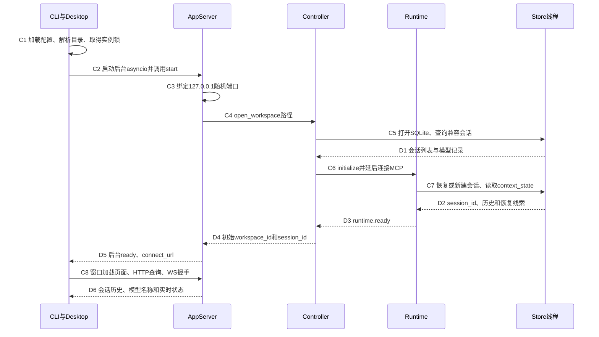

### A11. 用户第一次点击发送：页面提交文本和请求ID

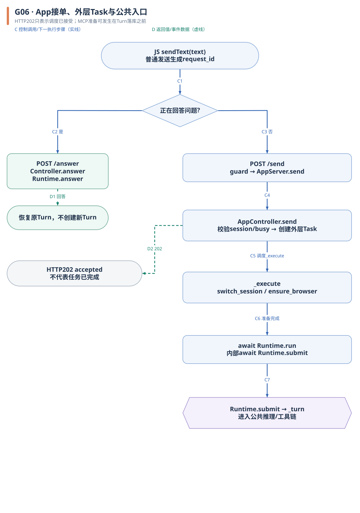

前面已经把App准备到可交互状态。现在才出现一个新的用户任务，例如教学输入“读取README并简要介绍此仓库，不修改文件”。接下来的代码依次处理这一次任务，而不是重新启动整个App。

**当前函数：** 浏览器里的`sendText(text)`。

源码节选：[src/kaki/ui/app.mjs:150–158](https://github.com/anuolxl/kaki_agent/blob/41dc5033839a6ff26039cea40ba06827c1aac655/src/kaki/ui/app.mjs#L150-L158)。

```javascript
async function sendText(text){
  const status=statusFor(state.detail,state.connected,state.closed,state.closing);if(!status.canSend||!text.trim()||state.sending)return;
  state.sending=true;clearError();updateStatus();
  try{
    // 阅读：回答 ask_user 仍属于当前 Turn；不另起一个竞争任务。
    if(status.question)await api(route('/answer'),{method:'POST',body:{question_id:status.question.id,text}});
    // 阅读：普通新任务携带幂等 request_id，正文与任务ID一起传给本机后台。
    else await api(route('/send'),{method:'POST',body:{text,request_id:crypto.randomUUID()}});
    $('prompt').value='';await refresh();
  }finally{state.sending=false;updateStatus();}
}
```

先检查连接/会话是否可发送，再设置sending，防止页面重复提交。普通任务发往send；如果当时正在回答ask_user，则发往answer，继续原Turn。当前主线是新任务，因此发送text和新request_id。

request_id用于幂等，不是聊天内容。它与workspace_id、session_id通过URL和JSON一起进入本机HTTP层。

### A12. AppServer接到HTTP：先校验，再交给Controller

AppServer的guard先核对Host、Origin和本机访问凭据。通过后才进入send路由：

源码节选：[src/kaki/app_server.py:203–211](https://github.com/anuolxl/kaki_agent/blob/41dc5033839a6ff26039cea40ba06827c1aac655/src/kaki/app_server.py#L203-L211)。

```python
    async def send(self, request):
        data = await request.json()
        await self.controller.send(
            request.match_info["workspace"],
            request.match_info["session"],
            data["text"],
            data.get("request_id"),
        )
        # 阅读：202 只表示调度已接收，不能据此显示本轮已完成。
        return web.json_response({"accepted": True}, status=202)
```

路由解析JSON，将三个作用域参数和文本传给`controller.send`。不要因为看见这一行await，就认为路由要等整个Agent执行结束：await等待的是Controller完成接收和调度，不是等待Runtime完成任务。

**下一步进入Controller.send。它返回后，路由发送HTTP202。** 后台Task和响应发送都受事件循环调度，二者可以交错；不能把“浏览器收到202”当成MCP启动之前的固定分界，更不能当成任务完成。

### A13. Controller建立外层Task：此时还可能没有Turn

源码节选：[src/kaki/app_controller.py:334–358](https://github.com/anuolxl/kaki_agent/blob/41dc5033839a6ff26039cea40ba06827c1aac655/src/kaki/app_controller.py#L334-L358)。

```python
    async def send(self, workspace: str, session: str, text: str, request_id=None):
        e = self.engine(workspace)
        if self.closed:
            raise KakiError("App正在退出")
        if e.busy:
            raise KakiError("该仓库已有任务正在运行，请等待或停止后再发送")
        if not text.strip() or len(text) > 100000:
            raise KakiError("消息需要1–100000个字符")
        row = await e.runtime.store.run("session", session)
        if row["archived"]:
            raise KakiError("请先恢复已归档会话")
        # 阅读：await 会让出执行权，返回后要再次检查 busy，避免两个请求同时通过。
        # Recheck after the asynchronous lookup, before installing the owned Task.
        if e.busy:
            raise KakiError("该仓库已有任务正在运行")
        e.session = session
        e.phase = "preparing"
        e.started = time.time()
        e.turn_id = ""
        e.draft = {}
        e.tools = {}
        e.warnings = []
        e.result = None
        e.pending = text
        # 阅读：Controller 拥有外层 App Task；此时 Turn 还可能尚未入库。
        e.task = asyncio.create_task(self._execute(e, text, request_id), name="kaki-app-turn")
        self.notify(e)
```

先检查App关闭状态、工作区busy、文本长度和会话是否归档。查询session会await并让出执行权，所以回来后再次检查busy，然后设置执行会话、preparing、起始时间和pending_text。

最后`create_task(_execute(...))`安装外层任务所有权；它不是新线程。pending_text属于Engine内存，用来在Turn尚未接受时展示输入，还不是messages里的规范用户消息。

Controller.send通知视图并返回。HTTP层可以完成202响应，后台则开始执行_execute。下面只沿这个后台Task继续。

### A14. _execute先切会话和准备MCP，然后才调用Runtime.run

源码节选：[src/kaki/app_controller.py:360–365](https://github.com/anuolxl/kaki_agent/blob/41dc5033839a6ff26039cea40ba06827c1aac655/src/kaki/app_controller.py#L360-L365)。

```python
    async def _execute(self, e: Engine, text, request_id):
        try:
            if e.runtime.session_id != e.session:
                await e.runtime.switch_session(e.session)
            # 阅读：App第一次任务先完成MCP发现；Runtime此时尚未创建这次Turn。
            await e.runtime.ensure_browser()
            result = await e.runtime.run(text, request_id)
```

如果用户新建或切换到了其他会话，先switch_session核对模型并恢复该会话派生状态；这不等于启动另一Agent。之后await ensure_browser：

源码节选：[src/kaki/runtime.py:125–138](https://github.com/anuolxl/kaki_agent/blob/41dc5033839a6ff26039cea40ba06827c1aac655/src/kaki/runtime.py#L125-L138)。

```python
    async def ensure_browser(self):
        """App history opens immediately; MCP initialization is deferred until task execution."""
        if not self.browser.enabled or self._browser_attempted:
            return
        self._browser_attempted = True
        await self.emit("runtime.status", data={"text": "正在连接Playwright MCP…"})
        try:
            await self.tools.connect_browser()
        except asyncio.CancelledError:
            self._browser_attempted = False
            raise
        except Exception as exc:
            self.browser_warning = safe_error(exc)
            await self.emit("runtime.warning", data={"text": "浏览器未连接：" + self.browser_warning})
```

无browser配置时立即返回；本Runtime此前已经尝试连接过时也不会每轮重新启动。本主线第一次使用已配置浏览器，因此先进入ToolRegistry.connect_browser：

源码节选：[src/kaki/tools.py:196–203](https://github.com/anuolxl/kaki_agent/blob/41dc5033839a6ff26039cea40ba06827c1aac655/src/kaki/tools.py#L196-L203)。

```python
    async def connect_browser(self):
        for t in await self.browser.start():
            name = t["name"]

            async def call(args, ctx, n=name):
                return await self.browser.call(n, args)

            self.add(Tool(name, t["description"], {}, [], "EXTERNAL", call, schema=t["parameters"]))
```

这里调用browser.start，首次创建MCP owner Task并等ready Future：

源码节选：[src/kaki/browser_mcp.py:36–42](https://github.com/anuolxl/kaki_agent/blob/41dc5033839a6ff26039cea40ba06827c1aac655/src/kaki/browser_mcp.py#L36-L42)。

```python
    async def start(self):
        if not self.enabled:
            return []
        if self.task is None:
            self.ready = asyncio.get_running_loop().create_future()
            self.task = asyncio.create_task(self._serve(), name="kaki-browser-mcp")
        return await asyncio.wait_for(asyncio.shield(self.ready), 90)
```

owner Task执行下面的启动过程：

源码节选：[src/kaki/browser_mcp.py:44–84](https://github.com/anuolxl/kaki_agent/blob/41dc5033839a6ff26039cea40ba06827c1aac655/src/kaki/browser_mcp.py#L44-L84)。

```python
    async def _serve(self):
        opt = self.option
        args = list(opt.args or ["-y", f"@playwright/mcp@{PLAYWRIGHT_VERSION}", "--browser", "chrome"])
        if "--isolated" not in args and not any(x.startswith("--user-data-dir") for x in args):
            args += ["--user-data-dir", str(self.workspace.state / "browser-profile")]
        if not any(x.startswith("--output-dir") for x in args):
            args += ["--output-dir", str(self.workspace.state / "browser-output")]
        server = StdioServerParameters(
            command=opt.command, args=args, env=opt.env or None, cwd=self.workspace.root
        )

        async def roots(_):
            return types.ListRootsResult(
                roots=[types.Root(uri=self.workspace.root.as_uri(), name=self.workspace.root.name)]
            )

        # 阅读：MCP的stderr单独落盘到这个文件。
        log = (self.workspace.state / "browser-mcp.log").open("a")
        try:
            async with stdio_client(server, errlog=log) as (read, write):
                async with ClientSession(
                    read,
                    write,
                    read_timeout_seconds=timedelta(seconds=opt.tool_timeout),
                    list_roots_callback=roots,
                    client_info=types.Implementation(name="kaki-agent", version=__version__),
                ) as session:
                    # 阅读：工具协议握手/发现，不等于执行了页面导航。
                    await session.initialize()
                    listing = await session.list_tools()
                    self.tools = []
                    for t in listing.tools:
                        original = t.name
                        alias = "kaki_browser_" + original.removeprefix("browser_")
                        self.tools.append(
                            {
                                "name": alias,
                                "original": original,
                                "description": t.description or original,
                                "parameters": t.inputSchema or {"type": "object", "properties": {}},
                            }
                        )
                    self.ready.set_result(self.tools)
```

按顺序准备项目独立profile/output目录参数，打开browser-mcp.log承接stderr，启动stdio子进程，初始化ClientSession，获取工具列表，把原名、别名、description和schema保存下来。ready.set_result解除start的等待，然后connect_browser把这些工具注册到Registry。

**返回路径：** MCP工具列表 → ToolRegistry注册完成 → ensure_browser返回 → _execute继续下一行Runtime.run。

这一步完成的是工具发现，不表示已经执行browser_navigate或打开某个业务网页；真实浏览器进程何时创建由MCP内部实现决定。即使用户只做纯对话，目前App也会先调用ensure_browser，随后才让模型决定是否用工具，没有本地意图分类器来提前跳过这段准备。

MCP连接失败会形成warning，核心本地工具仍可继续；连接准备被取消或会话不兼容时，则可能尚未创建本次Turn。这也是“HTTP已接收，但数据库里还没有该请求”的一个实际边界。

### A15. App进入公共内核：外层Task覆盖准备阶段和内层执行

App调用Runtime.run，而TUI直接submit；run只是在内部await submit，没有另一套模型执行器。当前调用点实际是：

```text
HTTP /send → AppController.send → create_task(_execute)
 → 可选switch_session → ensure_browser
 → await Runtime.run(text, request_id)
 → await Runtime.submit(text, request_id)
 → _turn → AgentLoop / Context / Provider / Tools / Store
 → 内层Task返回TurnResult
 → 回到_execute设置phase并解除外层busy
```

HTTP202只等Controller接收调度，不等整个执行完成。Runtime的active约束内层Turn，Controller的e.task还覆盖MCP/切会话准备和外层收尾；“两层”描述执行所有权，不是整个进程恰好只有两个Task。

### A16. App接收增量：Controller状态投影 → WS → 页面

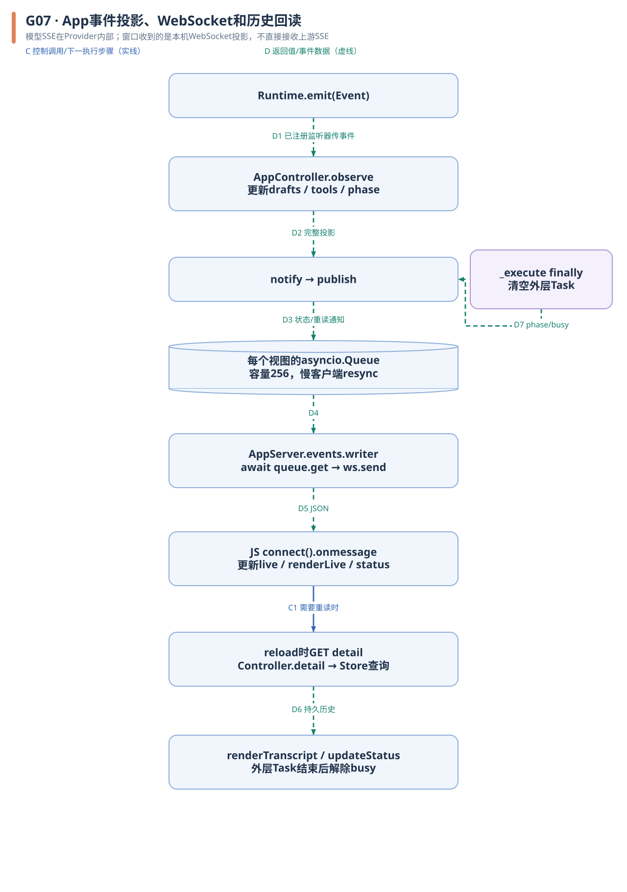

本入口注册的是Controller.observe，而不是Textual.enqueue。模型增量、工具和问题先改变Engine内存投影：

源码节选：[src/kaki/app_controller.py:151–202](https://github.com/anuolxl/kaki_agent/blob/41dc5033839a6ff26039cea40ba06827c1aac655/src/kaki/app_controller.py#L151-L202)。

```python
    async def observe(self, engine: Engine, event: Event):
        data = event.data
        match event.type:
            case "turn.started":
                engine.turn_id = event.turn_id
                engine.phase = "running"
                engine.pending = ""
            case "model.started":
                engine.phase = "model"
            case "model.delta":
                key = data["draft_id"]
                engine.draft[key] = engine.draft.get(key, "") + data["text"]
                if engine.notification is None:
                    engine.notification = asyncio.get_running_loop().call_later(
                        0.06, lambda: self.notify(engine)
                    )
                return
            case "model.committed":
                engine.draft.pop(data.get("draft_id", ""), None)
                if data.get("text") and not data.get("tool_count"):
                    engine.phase = "finishing"
            case "tool.started":
                engine.phase = "waiting_user" if data["name"] == "kaki_ask_user" else "tool"
                engine.tools[data["tool_call_id"]] = {**data, "state": "running"}
            case "tool.finished":
                engine.tools[data["tool_call_id"]] = {
                    **engine.tools.get(data["tool_call_id"], {}),
                    **data,
                    "state": "failed" if data["failed"] else "succeeded",
                }
            case "question.requested":
                engine.phase = "waiting_user"
            case "context.compacted" | "turn.finalizing":
                engine.phase = "compacting"
            case "runtime.status":
                if "快照" in data["text"]:
                    engine.phase = "preparing" if "基线" in data["text"] else "finishing"
            case "snapshot.warning":
                engine.warnings.append(data.get("error", "文件快照不可用"))
            case "runtime.warning":
                engine.warnings.append(data["text"])
            case "turn.finished":
                # The Runtime Task has not returned yet: keep controls busy until _execute awaits it.
                engine.result = data
                engine.phase = "finishing"
            case _:
                pass
        self.notify(
            engine,
            reload=event.type
            in {"turn.started", "model.committed", "tool.started", "tool.finished", "turn.finished"},
        )
```

notify/publish将完整live投影或重读通知发给各WS视图队列。每个连接有容量256的队列；慢客户端收到resync后重新读权威状态。服务端writer的实际调用顺序是：

源码节选：[src/kaki/app_server.py:239–265](https://github.com/anuolxl/kaki_agent/blob/41dc5033839a6ff26039cea40ba06827c1aac655/src/kaki/app_server.py#L239-L265)。

```python
    async def events(self, request):
        if request.headers.get("Origin") != self.origin:
            raise web.HTTPForbidden()
        ws = web.WebSocketResponse(heartbeat=20, max_msg_size=1024)
        await ws.prepare(request)
        queue = asyncio.Queue(maxsize=256)
        self.controller.subscribers.add(queue)
        self.sockets.add(ws)

        async def writer():
            await ws.send_json({"type": "connected", "seq": self.controller.seq})
            while True:
                message = await queue.get()
                await asyncio.wait_for(ws.send_str(json.dumps(message, ensure_ascii=False)), 5)

        task = asyncio.create_task(writer(), name="kaki-app-viewer")
        try:
            async for message in ws:
                if message.type == WSMsgType.ERROR:
                    break
        finally:
            self.controller.subscribers.discard(queue)
            self.sockets.discard(ws)
            task.cancel()
            with contextlib.suppress(asyncio.CancelledError, ConnectionError, TimeoutError, RuntimeError):
                await task
        return ws
```

页面收到的是本机WS JSON，不是直接订阅Right Code SSE。JS按workspace_id筛选并更新live；reload时GET detail，读取持久历史和工具结果，再渲染：

源码节选：[src/kaki/ui/app.mjs:172–193](https://github.com/anuolxl/kaki_agent/blob/41dc5033839a6ff26039cea40ba06827c1aac655/src/kaki/ui/app.mjs#L172-L193)。

```javascript
function connect(){
  if(state.closed)return;
  const socket=new WebSocket(location.origin.replace('http:','ws:')+'/api/events');state.socket=socket;
  socket.onmessage=event=>{
    const data=JSON.parse(event.data);
    if(data.type==='connected'){state.connected=true;clearError();updateStatus();refresh().catch(showError);return;}
    if(data.type==='app.closing'||data.type==='app.closed'){state.closed=true;state.closing=true;updateStatus();return;}
    if(data.type==='projects.changed'){loadProjects().then(loadSessions).catch(showError);return;}
    if(data.type==='resync'){refresh().catch(showError);return;}
    if(data.type==='navigate'){
      const project=state.projects.find(p=>p.workspace_id===data.workspace_id);
      if(project)openWorkspace(project.path).then(()=>selectSession(data.session_id)).catch(showError);
      else loadProjects().then(()=>{const p=state.projects.find(p=>p.workspace_id===data.workspace_id);if(p)return openWorkspace(p.path);}).catch(showError);
      return;
    }
    if(data.type==='workspace.changed'&&data.workspace_id===state.wid){
      if(state.detail)state.detail.live=data.live;
      renderLive();updateStatus();renderSessions();if(data.reload)refresh().catch(showError);
    }
  };
  socket.onclose=()=>{state.connected=false;if(state.closed)state.closing=false;updateStatus();if(!state.closed)state.retry=setTimeout(connect,1500);};
  socket.onerror=()=>socket.close();
```

drafts是完整投影替换，不应把同一片段重复追加；完整消息入库后替代草稿，工具按tool_call_id去重。断线显示状态待确认，不把网络断开当任务结束。

### A17. App只有在外层_execute结束后才解除busy

源码节选：[src/kaki/app_controller.py:366–385](https://github.com/anuolxl/kaki_agent/blob/41dc5033839a6ff26039cea40ba06827c1aac655/src/kaki/app_controller.py#L366-L385)。

```python
            e.result = e.result or asdict(result)
            e.phase = result.status
        except asyncio.CancelledError:
            await e.runtime.cancel()
            e.phase = "cancelled"
            if e.result is None:
                e.result = {"status": "cancelled", "text": "已停止本轮任务", "stop_reason": "user_cancel"}
        except Exception as exc:
            e.phase = "failed"
            e.result = {
                "status": "failed",
                "text": safe_error(exc),
                "error": safe_error(exc),
                "stop_reason": "app_error",
            }
        finally:
            e.draft = {}
            e.pending = ""
            # 阅读：清空的是外层Task；它覆盖了准备、内核执行和收尾的整个过程。
            e.task = None
            self.notify(e, reload=True)
```

model.committed只证明完整模型消息已保存。turn.finished到达observe时，Runtime Task仍在返回链上，因此保持finishing；await Runtime.run真正返回后设置终态，finally清空e.task。最后一次notify再让窗口显示可继续提问。

这个外层phase/busy门控是App特有的展示与调度逻辑，不能合并成“TUI/App都直接收到turn.finished就一模一样”。真正的终态事务与lease释放仍共用公共内核。

### A18. App回答问题：独立answer接口恢复当前Future

JS的sendText检测live.question后改发/answer，不发/send。服务端路由：

源码节选：[src/kaki/app_server.py:217–222](https://github.com/anuolxl/kaki_agent/blob/41dc5033839a6ff26039cea40ba06827c1aac655/src/kaki/app_server.py#L217-L222)。

```python
    async def answer(self, request):
        data = await request.json()
        await self.controller.answer(
            request.match_info["workspace"], request.match_info["session"], data["question_id"], data["text"]
        )
        return web.json_response({"ok": True})
```

Controller核对工作区、执行会话、busy和question_id，再交给公共Runtime.answer：

源码节选：[src/kaki/app_controller.py:403–411](https://github.com/anuolxl/kaki_agent/blob/41dc5033839a6ff26039cea40ba06827c1aac655/src/kaki/app_controller.py#L403-L411)。

```python
    async def answer(self, workspace, session, question_id, text):
        e = self.engine(workspace)
        if e.session != session or not e.busy:
            raise KakiError("该会话没有待回答的问题")
        if not text.strip() or len(text) > 100000:
            raise KakiError("回答不能为空或过长")
        await e.runtime.answer(question_id, text)
        e.phase = "running"
        self.notify(e)
```

恢复的是原Turn里ask_user等待的Future，不新建Turn。不同于TUI在submit_text入口检查self.question_id，这里由页面状态和HTTP路由分流，且增加了执行会话的作用域校验。

### A19. App浏览、创建和归档会话：查看会话与执行会话分开

源码节选：[src/kaki/ui/app.mjs:49–59](https://github.com/anuolxl/kaki_agent/blob/41dc5033839a6ff26039cea40ba06827c1aac655/src/kaki/ui/app.mjs#L49-L59)。

```javascript
async function openWorkspace(path){
  clearError();const result=await api('/api/workspaces',{method:'POST',body:{path}});
  state.wid=result.workspace_id;state.path=result.path;state.archived=false;
  await loadProjects();await loadSessions();
  await selectSession(result.session_id||state.sessions[0]?.id);
  $('project-dialog').close();$('prompt').focus();
}
window.kakiOpenWorkspace = path => openWorkspace(path).catch(showError);
async function selectSession(identity){
  state.sid=identity;state.detail=null;$('prompt').value='';clearError();renderSessions();
  if(identity)await refresh();else{renderTranscript();updateStatus();}
```

JS的state.sid是当前查看的会话；Engine.session是当前执行/最后执行会话。查看另一个会话只GET detail，不会在任务进行中调用Runtime.switch_session把执行会话换走。真正发送时，_execute才按需切换。

源码节选：[src/kaki/app_controller.py:317–331](https://github.com/anuolxl/kaki_agent/blob/41dc5033839a6ff26039cea40ba06827c1aac655/src/kaki/app_controller.py#L317-L331)。

```python
    async def new_session(self, workspace, title="新会话"):
        e = self.engine(workspace)
        identity = await e.runtime.store.run("new_session", title[:80] or "新会话")
        self.notify(e, reload=True)
        return identity

    async def rename(self, workspace, session, title):
        await self.engine(workspace).runtime.store.run("rename_session", session, title)
        self.publish("projects.changed")

    async def archive(self, workspace, session, archived):
        e = self.engine(workspace)
        if e.busy and e.session == session:
            raise KakiError("请先停止或等待本轮任务结束")
        await e.runtime.store.run("archive_session", session, archived)
```

| 操作 | App行为 | 与TUI的不同 |
|---|---|---|
| 浏览其他会话 | 可以在工作区任务运行时阅读 | TUI /resume直接修改Runtime.session_id，因此active时拒绝 |
| 新建会话 | Store创建新session，当前执行会话可继续 | TUI Runtime.new_session检查active并拒绝忙时切换 |
| 发送任务 | 同工作区busy时拒绝 | 两端最终都受Runtime/lease保护，但App还保护准备阶段 |
| 重命名/归档 | 独立API；活跃任务及准备中的执行会话不能归档 | 本期TUI没有完全相同的界面/API组合 |
| 打开另一个项目 | AppController保存另一Engine/Runtime | TUI实例只持有启动时的一个Workspace/Runtime |

因此App能管理多个单Git工作区，不等于存在多Agent协作规划。相同工作区状态可由SQLite持久化共享，但跨进程内存任务、问题Future和浏览器会话不共享。

### A20. App停止与退出：先判断内层还是外层准备任务

JS停止/退出发不同接口：

源码节选：[src/kaki/ui/app.mjs:159–170](https://github.com/anuolxl/kaki_agent/blob/41dc5033839a6ff26039cea40ba06827c1aac655/src/kaki/ui/app.mjs#L159-L170)。

```javascript
async function stopTask(){
  if(state.sending)return;state.sending=true;updateStatus();
  try{await api(route('/stop'),{method:'POST',body:{}});await refresh();}finally{state.sending=false;updateStatus();}
}
async function newSession(){
  if(!state.wid){$('project-dialog').showModal();return;}
  const result=await api(`/api/workspaces/${state.wid}/sessions`,{method:'POST',body:{}});
  state.archived=false;await loadSessions();await selectSession(result.session_id);$('prompt').focus();
}
async function quitApp(){
  if(state.closed)return;await api('/api/shutdown',{method:'POST',body:{}});
  state.closed=true;state.closing=true;updateStatus();
```

Controller.stop先标stopping，再判断Runtime.active是否存在：

源码节选：[src/kaki/app_controller.py:387–401](https://github.com/anuolxl/kaki_agent/blob/41dc5033839a6ff26039cea40ba06827c1aac655/src/kaki/app_controller.py#L387-L401)。

```python
    async def stop(self, workspace: str, session: str):
        e = self.engine(workspace)
        if e.session != session or not e.busy:
            raise KakiError("该会话没有可停止的本轮任务")
        e.phase = "stopping"
        self.notify(e)
        # When Runtime already owns a Turn, let it handle cancellation and finish its journal itself.
        if e.runtime.active and not e.runtime.active.done():
            await e.runtime.cancel()
        elif e.task:
            e.task.cancel()
        task = e.task
        if task:
            with contextlib.suppress(asyncio.CancelledError):
                await task
```

已有内层Turn就Runtime.cancel；仍在切会话/MCP准备则取消Controller外层Task。因此它能停止一个尚未创建Turn的准备过程，而TUI停止按钮主要面向已存在的Runtime.active。

退出则走shutdown：

源码节选：[src/kaki/app_server.py:224–228](https://github.com/anuolxl/kaki_agent/blob/41dc5033839a6ff26039cea40ba06827c1aac655/src/kaki/app_server.py#L224-L228)。

```python
    async def shutdown(self, _):
        self.closing = True
        self.controller.publish("app.closing")
        asyncio.get_running_loop().call_later(0.15, self.stop_event.set)
        return web.json_response({"ok": True})
```

stop_event唤醒serve，AppServer.close关闭Controller，Controller再关闭所有已打开工作区的Runtime：

源码节选：[src/kaki/app_controller.py:413–433](https://github.com/anuolxl/kaki_agent/blob/41dc5033839a6ff26039cea40ba06827c1aac655/src/kaki/app_controller.py#L413-L433)。

```python
    async def close(self):
        if self.closed:
            return
        self.closed = True
        for e in self.engines.values():
            if e.notification:
                e.notification.cancel()
        await asyncio.gather(*(self._close_engine(e) for e in self.engines.values()))
        self.publish("app.closed")

    async def _close_engine(self, e):
        task = e.task
        if task and not task.done() and not (e.runtime.active and not e.runtime.active.done()):
            task.cancel()
            with contextlib.suppress(asyncio.CancelledError):
                await task
        # Runtime.close marks shutdown before cancelling: avoid a new slow after-snapshot on process exit.
        await e.runtime.close()
        if task:
            with contextlib.suppress(asyncio.CancelledError):
                await task
```

原生窗口红色关闭按钮、菜单和终端信号还有NativeService的线程安全停止/等待done处理。浏览器模式关标签只断开视图，不会结束后台；退出按钮或终端SIGINT才是明确进程退出。两端最终调用Runtime.close的底层清理相同，但谁接收退出动作、关闭几个Runtime、怎样取消准备阶段任务都不同。

## 03. 公共内核：从Runtime.submit到模型/工具循环与终态

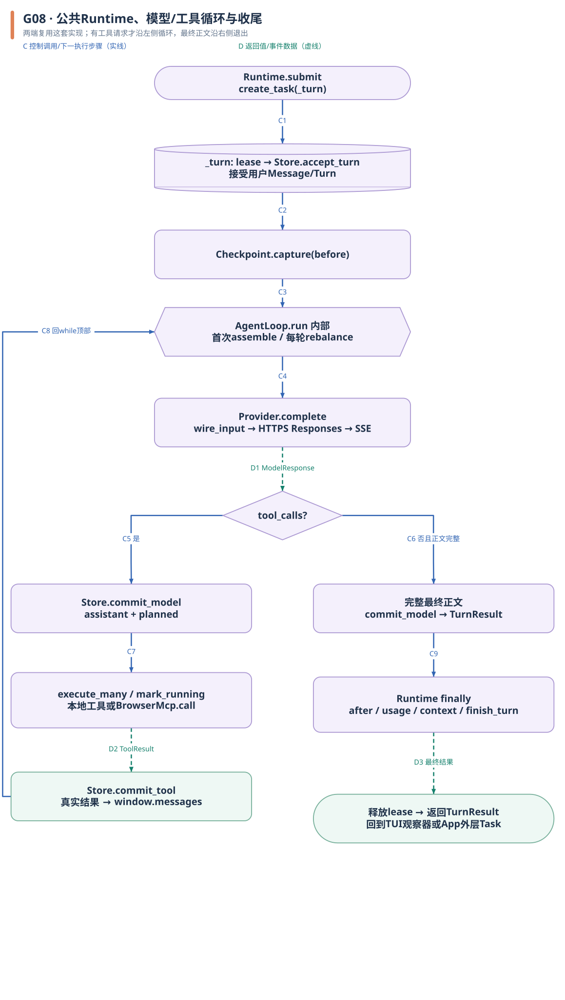

这里合并的是实现代码，不是两个进程中的Runtime对象。以下函数不按TUI/App选择另一模型实现。两端的输入分流已在T07/A11–A14完成，事件接收差异已在T09/A16展开。


### C01. Runtime.submit创建内层Task并接受Turn

两端在这里汇合：TUI直接submit，App经run包装后submit；输入是text、可选request_id以及当前Runtime的session状态。

源码节选：[src/kaki/runtime.py:179–190](https://github.com/anuolxl/kaki_agent/blob/41dc5033839a6ff26039cea40ba06827c1aac655/src/kaki/runtime.py#L179-L190)。

```python
    def submit(self, text: str, request_id: str | None = None) -> asyncio.Task:
        if not self.initialized:
            raise KakiError("Runtime还未就绪")
        if self.active and not self.active.done():
            raise KakiError("当前任务仍在运行；可以取消或回答待确认问题")
        if not text.strip():
            raise KakiError("任务不能为空")
        # 阅读：内层 Task 执行本轮业务，不是新线程，也不是另一个 Agent。
        self.active = asyncio.create_task(self._turn(text, request_id), name="kaki-user-turn")
        return self.active

    async def run(self, text: str, request_id: str | None = None) -> TurnResult:
        return await self.submit(text, request_id)
```

run等待submit返回的内层Task。submit核对Runtime.initialized和是否已有active任务，再把_turn交给事件循环。外层Task覆盖“会话/MCP准备+整个Runtime过程”，内层Task负责这一次业务Turn；两者不等于两个线程。

进入_turn：

源码节选：[src/kaki/runtime.py:200–227](https://github.com/anuolxl/kaki_agent/blob/41dc5033839a6ff26039cea40ba06827c1aac655/src/kaki/runtime.py#L200-L227)。

```python
        # 阅读：文件级租约还防止另一个 Kaki 进程同时执行此仓库。
        self.lease.acquire()
        try:
            # 阅读：把用户请求和 Turn 接受记录一起持久化，幂等检查在 Store 内。
            accepted, user, created = await self.store.run("accept_turn", self.session_id, text, request_id)
            if not created:
                rows = await self.store.run("turns", self.session_id)
                previous = next(row for row in rows if row["id"] == accepted)
                if previous["status"] not in {"completed", "failed", "interrupted", "cancelled"}:
                    raise KakiError("此请求已经被接受且尚未结束；不重复执行")
                import json

                data = json.loads(previous["result_json"] or "{}")
                if "turn_id" not in data:
                    raise KakiError("此请求已中断；请查看恢复信息并提交新请求")
                await self.emit("request.duplicate", accepted, {"request_id": request_id})
                return TurnResult(**data)
            turn = accepted
            self.active_turn = turn
            await self.emit(
                "turn.started", turn, {"session_id": self.session_id, "message_id": user.id, "text": text}
            )
            if self.snapshots_enabled:
                await self.emit("runtime.status", turn, {"text": "建立工作区基线快照…"})
                # 阅读：基线快照采用独立 shadow Git，不操作用户 Git index。
                snapshot = await self.checkpoint.capture(turn, "before")
                before = snapshot["id"]
                if snapshot["state"] != "ready":
                    warnings.append(snapshot.get("error", "快照失败"))
                    await self.emit("snapshot.warning", turn, snapshot)
            history = [m for m in await self.store.run("messages", self.session_id) if m.id != user.id]
```

先取得工作区执行lease，防止其他Kaki进程同时操作这个仓库。然后调用Store.accept_turn。真正的新请求持久化在下面的短事务中发生：

源码节选：[src/kaki/store.py:208–229](https://github.com/anuolxl/kaki_agent/blob/41dc5033839a6ff26039cea40ba06827c1aac655/src/kaki/store.py#L208-L229)。

```python
    ) -> tuple[str, Message, bool]:
        self._session(session)
        request_id = request_id or uid("r_")
        previous = self.db.execute("SELECT * FROM turns WHERE request_id=?", (request_id,)).fetchone()
        if previous:
            if previous["text"] != text or previous["session_id"] != session:
                raise KakiError("同一request_id不能提交不同任务")
            msg = next(m for m in self._messages(session) if m.turn_id == previous["id"] and m.role == "user")
            return previous["id"], msg, False
        turn = uid("t_")
        # 阅读：同一短事务内创建 Turn、用户消息及 turn.started 事件。
        with self.db:
            self.db.execute(
                "INSERT INTO turns(id,session_id,request_id,status,text,created) VALUES(?,?,?,?,?,?)",
                (turn, session, request_id, "running", text, now()),
            )
            message = self._append(session, turn, Message("user", text))
            self.db.execute(
                "UPDATE sessions SET updated=?,title=CASE WHEN title='新会话' THEN ? ELSE title END WHERE id=?",
                (now(), text[:50], session),
            )
            self._event(session, turn, "turn.started", {"request_id": request_id, "message_id": message.id})
        return turn, message, True
```

同一事务保存Turn、用户Message、会话更新时间及turn.started事件。request_id已存在时先比较会话和文本，已完成请求可返回旧结果，不重新执行工具。当前是新ID，因此生成turn_id，Runtime设置active_turn并发出进度事件。

**到这里才跨过“业务请求已经接受并落库”的边界。** 前面的202、Engine.pending_text、MCP准备完成都不是这个边界。下面的图只展开这次接单涉及的SQL数据往返，不把Store线程误解成远端数据库服务。

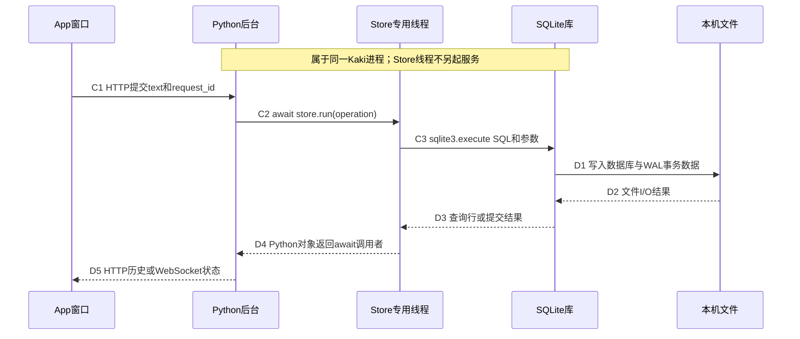

### C02. Turn落库后，先做before快照，再读取本会话历史

回到_turn的accept_turn下一行。本次新Turn已存在，接着在启用快照时调用capture(turn,"before")：

源码节选：[src/kaki/checkpoint.py:95–119](https://github.com/anuolxl/kaki_agent/blob/41dc5033839a6ff26039cea40ba06827c1aac655/src/kaki/checkpoint.py#L95-L119)。

```python
    async def capture(self, turn: str, phase: str) -> dict:
        identity = uid("snap_")
        metadata = {
            "root": str(self.workspace.root),
            "excludes_sha256": hashlib.sha256(EXCLUDES.encode()).hexdigest(),
        }
        await self.store.run("snapshot", identity, turn, phase, "creating", None, metadata)
        try:
            await self.ensure()
            # 阅读：操作的是独立 --git-dir 对应的 index；不是用户工作仓的 index。
            await self.git("add", "-A", "--", ".")
            _, staged, _ = await self.git("ls-files", "--stage", "-z")
            # 阅读：遇到 Gitlink 明确警告，不声称包含了嵌套仓文件快照。
            if any(x.startswith(b"160000 ") for x in staged.split(b"\0") if x):
                raise KakiError("快照发现嵌套Git单元；v0.1不把Gitlink当文件内容覆盖")
            rc, head, _ = await self.git("rev-parse", "--verify", "HEAD", check=False)
            changed, _, _ = await self.git("diff", "--cached", "--quiet", check=False)
            if rc or changed:
                await self.git("commit", "--allow-empty", "-m", f"Kaki {turn} [{phase}]")
                _, head, _ = await self.git("rev-parse", "HEAD")
                self.commits += 1
                if self.commits % 50 == 0:
                    await self.git("gc", "--auto")
            commit = head.decode().strip()
            metadata["unchanged"] = not bool(rc or changed)
            await self.store.run("snapshot", identity, turn, phase, "ready", commit, metadata)
            return {"id": identity, "commit": commit, "state": "ready", "phase": phase}
```

capture先保存creating记录，再初始化并更新独立shadow Git，最终写ready/failed。Git命令指定状态目录下的--git-dir，不使用用户仓库的index；遇到嵌套Gitlink会明确警告，不能声称保存了嵌套仓文件。

capture返回后，Runtime保存before引用；失败可发warning并继续。之后才读取当前session的messages，排除刚保存的本轮用户消息，得到history。

至此依次完成了：任务作用域确定 → 用户输入落库 → before快照 → 本轮历史载入。**这些动作都不是在后台刚启动时给未来任务预先完成的。**

### C03. 进入AgentLoop，第一件事是为当前任务assemble上下文

普通任务从_turn进入AgentLoop.run：

源码节选：[src/kaki/loop.py:15–24](https://github.com/anuolxl/kaki_agent/blob/41dc5033839a6ff26039cea40ba06827c1aac655/src/kaki/loop.py#L15-L24)。

```python
    async def run(
        self, turn: str, session: str, user: Message, history: list[Message], recovery: str = ""
    ) -> TurnResult:
        rt = self.runtime
        cfg = rt.config.agents.defaults
        definitions = rt.tools.definitions()
        # 阅读：有了真实user和history以后才组装本轮上下文。
        window = await rt.context.assemble(session, history, user, definitions, recovery=recovery)
        await rt.emit(
            "context.assembled", turn, window.metadata | {"estimated_tokens": window.estimated_tokens}
        )
```

definitions此时包含内置工具和刚发现的MCP工具。接着立即进入ContextEngine.assemble，当前还没走到主while：

源码节选：[src/kaki/context/engine.py:130–146](https://github.com/anuolxl/kaki_agent/blob/41dc5033839a6ff26039cea40ba06827c1aac655/src/kaki/context/engine.py#L130-L146)。

```python
    async def assemble(
        self,
        session: str,
        history: list[Message],
        user: Message,
        tools: list[dict],
        *,
        force: bool = False,
        recovery: str = "",
    ) -> AssembledContext:
        system, meta = await self.prefix(user, recovery)
        budget = self.budget(system, user, tools)
        if estimate([system, user], tools) > budget.input_limit:
            raise ContextOverflow(
                f"当前请求、规则和工具定义本身超出窗口，无法通过删历史解决（允许输入{budget.input_limit}）"
            )
        state = await self.store.run("context_get", session)
```

assemble先调用prefix，进入如下代码：

源码节选：[src/kaki/context/engine.py:45–74](https://github.com/anuolxl/kaki_agent/blob/41dc5033839a6ff26039cea40ba06827c1aac655/src/kaki/context/engine.py#L45-L74)。

```python
    async def prefix(self, user: Message, recovery: str = "") -> tuple[Message, dict]:
        memory_task = self.memory.segment(user.content)
        skill_task = asyncio.to_thread(self.skills.resolve, user.content)
        rules_task = asyncio.to_thread(self.rules.segment)
        # 阅读：规则、Skills、长期记忆作为上下文贡献者并发准备。
        (memory, mm), (skills, sm), rules = await asyncio.gather(memory_task, skill_task, rules_task)
        text = "\n\n---\n\n".join(
            x
            for x in [
                IDENTITY,
                f"工作目录：{self.workspace.root}\n状态目录：{self.workspace.state}",
                rules,
                memory,
                skills,
                recovery,
            ]
            if x
        )
        return Message("system", text), {**mm, **sm}

    def budget(self, system: Message, user: Message, tools: list[dict]) -> TokenBudget:
        # 阅读：配置窗口是本地预算；输出和安全余量先预留。
        d = self.config.agents.defaults
        margin = max(128, int(d.context_window_tokens * 0.02))
        return TokenBudget(
            d.context_window_tokens,
            d.max_tokens,
            count_text(system.content),
            count_text(json.dumps(tools, ensure_ascii=False)),
            count_text(user.content),
            margin,
        )
```

这里才用**本次user.content**召回项目记忆、匹配Skills，并读取规则正文；这些任务用gather准备。身份常量在模块加载时已经存在，但完整system前缀直到此处才组合。

Skills.resolve在本机读取SKILL.md，按名称/描述/部分正文做词项相关性排序，或识别显式$技能名、/skill技能名：

源码节选：[src/kaki/context/knowledge.py:129–146](https://github.com/anuolxl/kaki_agent/blob/41dc5033839a6ff26039cea40ba06827c1aac655/src/kaki/context/knowledge.py#L129-L146)。

```python
    def resolve(self, query: str) -> tuple[str, dict]:
        rows, failures = self.catalog()
        cfg = self.config.skill_forge
        always = [r for r in rows if r["always"]][: cfg.always_max]
        hits = (
            rank(query, [r["id"] + " " + r["description"] + " " + r["body"][:1800] for r in rows])
            if cfg.router.enabled
            else []
        )
        explicit = [r for r in rows if "$" + r["id"] in query or "/skill " + r["id"] in query]
        candidates = [
            r
            for r in explicit + [rows[i] for i, s in hits if s >= cfg.router.local_min_score]
            if r not in always
        ]
        candidates = list({r["id"]: r for r in candidates}.values())[: cfg.router.top_k]
        active = always + (candidates[: cfg.inject_max] if cfg.injection_mode == "full_body" else [])
        references = [r for r in candidates if r not in active]
```

这是技能相关性检索，不是先调用一个意图分类模型。Memory同样按当前query从本项目记录中召回。规则可能在Workspace.resolve时为解析继承链接读过一次，此处重新把相关正文组入当前输入；“发现规则路径”和“为当前任务构造Prompt”是两个阶段。

**返回路径：** 规则/记忆/Skills内容 → prefix返回system Message与元数据 → assemble继续计算budget。直到此处才有当前任务的输入预算。

### C04. 在assemble中选择历史，校验预算与工具配对，再返回窗口

默认窗口65536、输出8192时，安全余量为int(65536×2%)=1310，输入上限为56034；历史预算还要扣除system、工具schema和当前用户内容。估算使用tiktoken及wire表示；编码器首次加载也可能发生在这里，不是“后台模型已经预热”。

继续assemble的历史选择部分：

源码节选：[src/kaki/context/engine.py:164–190](https://github.com/anuolxl/kaki_agent/blob/41dc5033839a6ff26039cea40ba06827c1aac655/src/kaki/context/engine.py#L164-L190)。

```python
        history_tokens = sum(x["tokens"] for x in manifest.values() if isinstance(x, dict) and "tokens" in x)
        plan = ContextPlan(
            include_message_ids=[m.id for m in history],
            working_state_injection=json.dumps(working, ensure_ascii=False) if working else "",
        )
        fallback = {}
        assembled = None
        if history and (
            force or history_tokens >= budget.available_history * self.config.context.fast_path_threshold
        ):
            # 阅读：慢路径使用 Curator 私有工具挑选历史；不是把整库无限交给主模型。
            assembled, fallback = await self.curator.run(
                session, history, user, system, tools, budget, manifest, working, user.turn_id
            )
        elif not force or not history:
            assembled = await self.build_plan(session, history, user, system, tools, budget, manifest, plan)
            assembled.metadata["path"] = "fast"
        # 阅读：规划失败用确定性方案回退，仍须通过同一预算与协议校验。
        if assembled is None:
            protected = [m.id for g in self.protected_groups(history) for m in g]
            recent = [m.id for m in history[-16:]]
            high = sorted(history, key=lambda m: (manifest[str(m.id)]["relevance"], m.id), reverse=True)[:12]
            plan = ContextPlan(
                include_message_ids=sorted(set(protected + recent + [m.id for m in high])),
                working_state_injection=json.dumps(working, ensure_ascii=False) if working else "",
                notes="deterministic fallback",
            )
            assembled = await self.build_plan(session, history, user, system, tools, budget, manifest, plan)
            assembled.metadata.update(path="fallback", **fallback)
```

新空会话通常走fast；如果这次启动恢复了大量旧历史，首个新任务也可能走Curator。进入Curator时，它才发起独立kind=curator调用：

源码节选：[src/kaki/context/curator.py:139–151](https://github.com/anuolxl/kaki_agent/blob/41dc5033839a6ff26039cea40ba06827c1aac655/src/kaki/context/curator.py#L139-L151)。

```python
        try:
            async with asyncio.timeout(e.config.context.curator_timeout_seconds):
                for step in range(1, 13):
                    if estimate(messages, private_tools) > budget.context_length - 2048 - budget.margin:
                        return None, {"fallback_reason": "curator_input_limit"}
                    # 阅读：恢复旧长会话时，这可能先于main调用；它仍由这次任务触发。
                    response = await e.provider.complete(
                        messages,
                        private_tools,
                        model=e.config.context.curator_model,
                        max_tokens=min(2048, budget.reserved_output),
                        turn_id=turn_id,
                        kind="curator",
                    )
```

所以，**收到第一个新任务后的第一次模型调用不一定是main，也可能先是curator；但标准App/TUI没有在用户发任务之前主动调用Curator。** /compact也属于收到请求以后触发的分支。Curator失败则确定性回退，不无限等待。

候选历史和working state进入build_plan，经整组裁剪及最终门：

源码节选：[src/kaki/context/engine.py:106–128](https://github.com/anuolxl/kaki_agent/blob/41dc5033839a6ff26039cea40ba06827c1aac655/src/kaki/context/engine.py#L106-L128)。

```python
        fixed = replace(system, content=system.content + ("\n\n" + "\n\n".join(extra) if extra else ""))
        # 阅读：整组裁剪，不允许单独丢掉工具调用或它对应的结果。
        selected, validation = trim(
            history,
            list(ids),
            protected,
            {m.id: manifest.get(str(m.id), {}).get("relevance", 0.5) for m in history},
            fixed,
            user,
            tools,
            budget.input_limit,
        )
        if not validation["ok"]:
            raise ContextOverflow(
                "上下文计划无法通过预算或工具配对：" + json.dumps(validation, ensure_ascii=False)
            )
        messages = [fixed, *selected, user]
        # 阅读：最终预算门不通过就明确失败，不盲目向上游发送。
        assert_window(messages, tools, budget.input_limit)
        return AssembledContext(
            messages,
            budget,
            validation["estimated_tokens"],
            {"validation": validation, "included_ids": [m.id for m in selected], "plan": asdict(plan)},
        )
```

缺失ID、工具调用与结果不配对、固定内容本身超限，都不能靠盲目删当前用户请求解决。被省略的原文仍保留在messages及归档；保存context_state和JSONL诊断后，assemble返回AssembledContext。

**返回到调用方：** AgentLoop.run收到window，发context.assembled，初始化本轮计数与工具ctx。下一步才进入主控制while。

### C05. 进入本次Turn的主控制while，发起一次main模型调用

源码节选：[src/kaki/loop.py:55–88](https://github.com/anuolxl/kaki_agent/blob/41dc5033839a6ff26039cea40ba06827c1aac655/src/kaki/loop.py#L55-L88)。

```python
        iteration = 0
        while iteration < cfg.max_tool_iterations:
            iteration += 1
            if asyncio.current_task().cancelling():
                raise asyncio.CancelledError
            definitions = rt.tools.definitions()
            # 阅读：每轮工具输出都会增大窗口，因此每次调用模型前再次检查。
            updated = await rt.context.rebalance(session, window, definitions)
            if updated is not window:
                window = updated
                await rt.emit(
                    "context.compacted", turn, window.metadata | {"estimated_tokens": window.estimated_tokens}
                )
            await rt.emit("model.started", turn, {"iteration": iteration, "model": cfg.model})
            draft_text = ""
            try:
                # 阅读：模型只返回文本和工具请求，执行权仍在 Python 内核。
                response = await rt.provider.complete(
                    window.messages, definitions, turn_id=turn, kind="main", on_delta=on_delta
                )
            except ProviderError as exc:
                # 阅读：仅对尚无可见输出的上下文溢出，最多进行两次应急恢复。
                if exc.category == "context_overflow" and not exc.partial and compressions < 2:
                    from .context.history import shrink_tool_text

                    reduced, elided = shrink_tool_text(window.messages, 3)
                    if elided:
                        window.messages = reduced
                        compressions += 1
                        iteration -= 1
                        await rt.emit(
                            "context.compacted",
                            turn,
                            {"reason": "provider_context_overflow", "elided_tool_results": elided},
                        )
                        continue
                raise
```

max_tool_iterations默认40。每次迭代先检查取消，再rebalance，最后调用Provider.complete。rebalance检查的是**当前窗口**，因为工具结果追加后会增长，不是重新启动Runtime。

这就是Agent的推理主循环。它只属于当前Turn；空闲后台不会一遍遍执行这个while。若模型返回工具请求，完成工具观测后才进入下一次迭代；若返回完整最终正文则退出。

现在执行到第70行，按调用顺序进入Provider.complete，先转换wire输入：

源码节选：[src/kaki/provider.py:26–65](https://github.com/anuolxl/kaki_agent/blob/41dc5033839a6ff26039cea40ba06827c1aac655/src/kaki/provider.py#L26-L65)。

```python
        elif m.role == "user":
            parts = [{"type": "input_text", "text": m.content or "(empty)"}]
            parts.extend(expand_parts(m.parts, resolve_part))
            items.append({"role": "user", "content": parts})
        elif m.role == "assistant":
            if m.native_items:
                # Preserve the exact item ordering and opaque reasoning needed by the tool round-trip.
                items.extend(m.native_items)
            else:
                if m.content:
                    items.append(
                        {"role": "assistant", "content": [{"type": "output_text", "text": m.content}]}
                    )
                for call in m.tool_calls:
                    items.append(
                        {
                            "type": "function_call",
                            # 阅读：原生 output 项保持原顺序，包括工具调用依赖的 opaque reasoning。
                            "call_id": call["id"],
                            "name": call["name"],
                            "arguments": json.dumps(call["arguments"], ensure_ascii=False),
                        }
                    )
        elif m.role == "tool":
            output: Any = m.content or "(no output)"
            if m.parts:
                output = [{"type": "input_text", "text": output}, *expand_parts(m.parts, resolve_part)]
            items.append({"type": "function_call_output", "call_id": m.tool_call_id, "output": output})
        else:
            raise ProviderError(f"不支持的消息角色：{m.role}", "protocol")
    return "\n\n".join(instructions), items


def expand_parts(parts, resolver):
    result = []
    # 阅读：工具观测用 function_call_output 回传，靠 call_id 与请求配对。
    for p in parts:
        if "artifact_id" in p:
            result.append(
                resolver(p)
                if resolver
                else {"type": "input_image", "image_url": "artifact://" + p["artifact_id"]}
```

system变instructions；user变input_text/图片part；assistant优先保留native_items顺序；tool消息变带call_id的function_call_output。内部Message/数据库ID不会因为拼装而变成另一轮任务。

### C06. Provider记录网络尝试，然后接收SSE；增量先回到界面

wire_input返回instructions/items后，Provider构造请求：

源码节选：[src/kaki/provider.py:168–194](https://github.com/anuolxl/kaki_agent/blob/41dc5033839a6ff26039cea40ba06827c1aac655/src/kaki/provider.py#L168-L194)。

```python
        model = model or self.config.agents.defaults.model
        # 阅读：去掉配置中的 openai/前缀，作为兼容接口的 model 参数。
        api_model = model.removeprefix("openai/")
        instructions, items = await asyncio.to_thread(wire_input, messages, self.part_resolver)
        kwargs = {
            "model": api_model,
            "input": items,
            "instructions": instructions,
            # 阅读：通过 Responses 的流式协议接收增量。
            "stream": True,
            "max_output_tokens": max_tokens or self.config.agents.defaults.max_tokens,
            "store": False,
            "include": ["reasoning.encrypted_content"],
            "temperature": self.config.agents.defaults.temperature,
        }
        if tools:
            kwargs["tools"] = tools
            kwargs["tool_choice"] = tool_choice
        # No implicit fallback to another model or endpoint. Only unsupported optional parameters may be omitted.
        for attempt in range(4):
            # 阅读：有限尝试，每次尝试都有独立 llm_ 调用记录。
            call_id = uid("llm_")
            started = now()
            visible = False
            stream = None
            record = {
                "id": call_id,
                "turn_id": turn_id,
                "kind": kind,
                "model": model,
```

model从配置的openai/前缀规范化，input、instructions、工具schema、输出上限一同发送。tool_choice默认auto，让模型理解任务并判断是否调用工具；此处没有额外的intent分类阶段。

每次网络尝试先写model_calls：

源码节选：[src/kaki/provider.py:185–210](https://github.com/anuolxl/kaki_agent/blob/41dc5033839a6ff26039cea40ba06827c1aac655/src/kaki/provider.py#L185-L210)。

```python
        for attempt in range(4):
            call_id = uid("llm_")
            started = now()
            visible = False
            stream = None
            record = {
                "id": call_id,
                "turn_id": turn_id,
                "kind": kind,
                "model": model,
                "status": "running",
                "created": started,
                "metadata": {
                    "attempt": attempt + 1,
                    "protocol": "responses",
                    "omitted_parameters": sorted(self.disabled_parameters),
                },
            }
            if self.record:
                await self.record(record)
            # 阅读：先保存这次模型尝试，再发出HTTPS请求。
            try:
                active = {k: v for k, v in kwargs.items() if k not in self.disabled_parameters}
                response = None
                t0 = time.monotonic()
                stream = await self.client.responses.create(**active)
                async for event in stream:
```

走到responses.create才真正向配置的Right Code接口请求模型。客户端对象早在启动时构造，但真正网络请求现在才发生。标准启动没有自动执行doctor --probe，也没有自动调用embedding或模型缓存预热。

Provider随后消费SSE：

源码节选：[src/kaki/provider.py:210–249](https://github.com/anuolxl/kaki_agent/blob/41dc5033839a6ff26039cea40ba06827c1aac655/src/kaki/provider.py#L210-L249)。

```python
                async for event in stream:
                    typ = event.type
                    # 阅读：delta 先交给界面展示，不代表完整响应已经提交。
                    if typ == "response.output_text.delta":
                        visible = True
                        if on_delta:
                            await on_delta(event.delta, call_id)
                    # 阅读：只有完整终事件才转为 ModelResponse。
                    elif typ in ("response.completed", "response.incomplete"):
                        response = normalize_response(event.response, call_id)
                    elif typ in ("error", "response.failed"):
                        err = getattr(event, "error", None) or getattr(
                            getattr(event, "response", None), "error", None
                        )
                        raise ProviderError(
                            safe_error(getattr(err, "message", None) or err or typ),
                            "response_failed",
                            partial=visible,
                        )
                if response is None:
                    raise ProviderError(
                        "模型流提前断开，没有完整结束事件；未执行不完整工具请求",
                        "stream_incomplete",
                        partial=visible,
                    )
                # 阅读：响应被截断时，不执行不完整工具参数。
                if response.finish_reason != "completed" and response.tool_calls:
                    raise ProviderError(
                        "模型工具参数或响应被截断，未执行工具", "output_limit", partial=visible
                    )
                record.update(
                    status="completed",
                    ended=now(),
                    usage=response.usage,
                    metadata={
                        **record["metadata"],
                        "provider_id": response.provider_id,
                        "duration_ms": round((time.monotonic() - t0) * 1000),
                        "finish_reason": response.finish_reason,
                    },
                )
                if self.record:
                    await self.record(record)
```

遇到文本delta时，进入AgentLoop先前定义的on_delta回调：

源码节选：[src/kaki/loop.py:46–53](https://github.com/anuolxl/kaki_agent/blob/41dc5033839a6ff26039cea40ba06827c1aac655/src/kaki/loop.py#L46-L53)。

```python
        async def on_delta(text, call_id):
            nonlocal draft_last, draft_text
            draft_text += text
            rt.partial_text = draft_text
            await rt.emit("model.delta", turn, {"draft_id": call_id, "text": text})
            if time.monotonic() - draft_last > 0.7:
                draft_last = time.monotonic()
                await rt.store.run("draft", turn, draft_text)
```

它更新partial_text，发Runtime事件，并按节流保存草稿。App路径中的事件直接await Controller.observe，合并draft并通知WS队列；writer发送后页面更新。这个过程中还没有提交完整assistant消息，也不会执行半条工具指令。

on_delta返回后，继续Provider的async for。只有完整response.completed/incomplete终事件才调用normalize_response：

源码节选：[src/kaki/provider.py:67–119](https://github.com/anuolxl/kaki_agent/blob/41dc5033839a6ff26039cea40ba06827c1aac655/src/kaki/provider.py#L67-L119)。

```python
        else:
            result.append(p)
    return result


def normalize_response(response: Any, call_id: str) -> ModelResponse:
    data = response.model_dump(exclude_none=True) if hasattr(response, "model_dump") else response
    native = data.get("output", [])
    text = []
    calls = []
    for item in native:
        typ = item.get("type")
        if typ == "message":
            for part in item.get("content", []):
                if part.get("type") == "output_text":
                    text.append(part.get("text", ""))
                elif part.get("type") == "refusal":
                    text.append(part.get("refusal", ""))
        elif typ == "function_call":
            if not item.get("call_id") or not item.get("name"):
                raise ProviderError("模型返回缺少call_id/name的工具请求，未执行", "protocol")
            try:
                args = json.loads(item.get("arguments") or "{}")
                if not isinstance(args, dict):
                    args = {"_raw_arguments": item.get("arguments")}
            except ValueError:
                args = {"_raw_arguments": item.get("arguments")}
            calls.append(ToolCall(item["call_id"], item["name"], args))
    raw_usage = data.get("usage") or {}
    usage = {}
    if raw_usage:
        a = int(raw_usage.get("input_tokens", 0) or 0)
        b = int(raw_usage.get("output_tokens", 0) or 0)
        usage = {
            "prompt_tokens": a,
            "completion_tokens": b,
            "total_tokens": int(raw_usage.get("total_tokens", a + b) or a + b),
            "cached_tokens": int((raw_usage.get("input_tokens_details") or {}).get("cached_tokens", 0) or 0),
            "reasoning_tokens": int(
                (raw_usage.get("output_tokens_details") or {}).get("reasoning_tokens", 0) or 0
            ),
        }
    status = data.get("status") or "completed"
    if status == "incomplete":
        finish = (data.get("incomplete_details") or {}).get("reason", "incomplete")
    elif status == "completed":
        finish = "completed"
    else:
        raise ProviderError("模型响应未成功结束：" + str(status), "response_failed")
    return ModelResponse(
        "".join(text), calls, native, usage, finish, data.get("model", ""), call_id, data.get("id", "")
    )

```

normalize保留原生output，提取正文、函数名称/JSON参数、call_id和usage。cached_tokens只是下游返回的计数，不表示Kaki在这里建立了本地KV缓存；store=False控制Response保存，也不是缓存开关。

完整结果通过校验后，Provider写completed调用记录及耗时，返回ModelResponse给AgentLoop。流中断/截断工具请求会报错，不能执行不完整参数；401/403也不会自动换平台或密钥。

### C07. 回到AgentLoop：先判断tool_calls，再保存完整模型结果

我们现在回到公共C05那句await provider.complete之后，response已经是完整ModelResponse：

源码节选：[src/kaki/loop.py:89–103](https://github.com/anuolxl/kaki_agent/blob/41dc5033839a6ff26039cea40ba06827c1aac655/src/kaki/loop.py#L89-L103)。

```python
            if response.tool_calls:
                message, runs = await rt.store.run("commit_model", session, turn, response)
                window.messages.append(message)
                await rt.emit(
                    "model.committed",
                    turn,
                    {
                        "draft_id": response.call_id,
                        "message_id": message.id,
                        "text": response.text,
                        "tool_count": len(runs),
                    },
                )
                by_call = {r["tool_call_id"]: r for r in runs}
                observations = {}
```

如果模型没有请求工具，按真实分支直接进入公共C11的最终正文处理；这不是跳过初始化，而是模型本次不需要工具。

为了继续看完整闭环，本教学路径假设模型请求读取README。它此时只给出了工具名称和参数，尚未读文件。commit_model内部是：

源码节选：[src/kaki/store.py:243–272](https://github.com/anuolxl/kaki_agent/blob/41dc5033839a6ff26039cea40ba06827c1aac655/src/kaki/store.py#L243-L272)。

```python
    def _commit_model(self, session: str, turn: str, response: ModelResponse) -> tuple[Message, list[dict]]:
        # 阅读：assistant 消息、工具意图和 model.committed 事件属于同一事务。
        with self.db:
            self._assert_active(turn)
            msg = self._append(
                session,
                turn,
                Message(
                    "assistant",
                    response.text,
                    tool_calls=[asdict(c) for c in response.tool_calls],
                    native_items=response.native_items,
                ),
            )
            runs = []
            for call in response.tool_calls:
                run = {
                    "id": uid("run_"),
                    "tool_call_id": call.id,
                    "name": call.name,
                    "arguments": call.arguments,
                }
                self.db.execute(
                    "INSERT INTO tool_runs(id,turn_id,tool_call_id,name,arguments,state) VALUES(?,?,?,?,?,?)",
                    (run["id"], turn, call.id, call.name, dumps(call.arguments), "planned"),
                )
                runs.append(run)
            self._event(
                session, turn, "model.committed", {"message_id": msg.id, "model_call_id": response.call_id}
            )
        return msg, runs
```

同一短事务保存完整assistant原生项、全部planned工具和model.committed事件，返回run_id映射。模型call_id负责协议配对，本机run_id负责执行追踪，两者不能混用。

Loop接着定义started/completed两个回调，并调用execute_many。**定义回调不执行其中的SQL；实际在Registry运行相应阶段时才进入这些回调。** 下面按实际调用次序继续。

### C08. execute_many先调用started，确认running已提交后再分派工具

进入ToolRegistry.execute_many：

源码节选：[src/kaki/tools.py:252–278](https://github.com/anuolxl/kaki_agent/blob/41dc5033839a6ff26039cea40ba06827c1aac655/src/kaki/tools.py#L252-L278)。

```python
        async def one(c):
            await on_start(c)
            result = await self.execute(c, ctx)
            await on_complete(c, result)
            return result

        results = []
        i = 0
        while i < len(calls):
            t = self.tools.get(calls[i].name)
            if t and t.effect == "READ" and t.safe_read:
                end = i
                while end < len(calls):
                    s = self.tools.get(calls[end].name)
                    # 阅读：仅标记为安全只读的连续工具最多并发4个，其余串行。
                    if not s or s.effect != "READ" or not s.safe_read:
                        break
                    end += 1
                for at in range(i, end, 4):
                    async with asyncio.TaskGroup() as group:
                        tasks = [group.create_task(one(c)) for c in calls[at : min(at + 4, end)]]
                    results.extend(task.result() for task in tasks)
                i = end
            else:
                results.append(await one(calls[i]))
                i += 1
        return results

```

每个工具的one协程严格按on_start → execute → on_complete执行。连续安全READ最多并发4个，其余串行；这不改变“意图先持久化”的顺序。

现在先进入Loop传来的started：

源码节选：[src/kaki/loop.py:105–111](https://github.com/anuolxl/kaki_agent/blob/41dc5033839a6ff26039cea40ba06827c1aac655/src/kaki/loop.py#L105-L111)。

```python
                async def started(call):
                    await rt.store.run("mark_running", by_call[call.id]["id"])
                    await rt.emit(
                        "tool.started",
                        turn,
                        {"tool_call_id": call.id, "name": call.name, "arguments": call.arguments},
                    )
```

Store.mark_running检查planned和活跃Turn，再提交running及started时间。这个状态表示已进入该次执行尝试，不保证底层Shell已经越过参数校验；若此后中断没有结果，必须保守核对现场。

started返回Registry后，才执行self.execute：

源码节选：[src/kaki/tools.py:208–237](https://github.com/anuolxl/kaki_agent/blob/41dc5033839a6ff26039cea40ba06827c1aac655/src/kaki/tools.py#L208-L237)。

```python
    async def execute(self, call: ToolCall, ctx: dict) -> ToolResult:
        tool = self.tools.get(call.name)
        if not tool:
            return ToolResult("工具不存在：" + call.name, failed=True)
        args = dict(call.arguments)
        try:
            for key, prop in tool.parameters().get("properties", {}).items():
                if prop.get("type") == "integer" and isinstance(args.get(key), str) and args[key].isdigit():
                    # 阅读：参数先按工具的 JSON Schema 校验，再分派给处理函数。
                    args[key] = int(args[key])
            errors = sorted(
                Draft202012Validator(tool.parameters()).iter_errors(args), key=lambda e: str(e.path)
            )
            if errors:
                return ToolResult("参数校验失败：" + "; ".join(e.message for e in errors)[:1200], failed=True)
            if call.name == "kaki_ask_user":
                result = await tool.execute(args, ctx)
            else:
                timeout = (
                    (args.get("timeout") or self.config.tools.exec.timeout) + 10
                    if tool.effect == "EXECUTE"
                    else 120
                )
                # 阅读：除 ask_user 外都有超时边界；取消异常继续向上传播。
                result = await asyncio.wait_for(tool.execute(args, ctx), timeout)
            return self.bound(result, call.name)
        except asyncio.CancelledError:
            raise
        except Exception as exc:
            return ToolResult(
                "工具失败：" + safe_error(exc) + "\n请分析真实错误并更换方法，不要重复无效调用。", failed=True
            )
```

按名称找到处理器，校验JSON Schema、数值类型等，再带超时调用处理函数。普通错误变failed ToolResult供模型观察；CancelledError继续向上传播。下一步进入本次选中的实际处理器。

### C09. 处理器执行真实I/O；本地工具与浏览器工具各走自己的通道

当前教学路径是kaki_read，进入read：

源码节选：[src/kaki/tools.py:280–304](https://github.com/anuolxl/kaki_agent/blob/41dc5033839a6ff26039cea40ba06827c1aac655/src/kaki/tools.py#L280-L304)。

```python
        p = self.workspace.path(a["path"])
        if p.stat().st_size > 8 * 1024 * 1024:
            raise KakiError("文件超过8 MiB读取上限，请用搜索或Shell按范围查看")
        raw = await asyncio.to_thread(p.read_bytes)
        if b"\0" in raw[:8000]:
            raise KakiError("二进制文件，请使用适合该格式的工具")
        text = raw.decode("utf-8")
        lines = text.splitlines()
        offset = a.get("offset", 1)
        limit = a.get("limit", 200)
        body = "\n".join(
            f"{i + 1}: {line}" for i, line in enumerate(lines) if offset - 1 <= i < offset - 1 + limit
        )
        return ToolResult(
            json.dumps(
                {
                    "path": str(p),
                    "sha256": hashlib.sha256(raw).hexdigest(),
                    "total_lines": len(lines),
                    "next_offset": offset + limit if offset - 1 + limit < len(lines) else None,
                    "text": body,
                },
                ensure_ascii=False,
            )
        )
```

它检查工作区路径和文件大小，通过线程读取字节，拒绝二进制，返回行号、原内容hash、分页信息。到这里文件才被真正读取。后续编辑工具可用hash校验避免覆盖并发修改。

如果本次实际是Shell分支，则在这里启动进程，而不是在App启动时：

源码节选：[src/kaki/tools.py:442–462](https://github.com/anuolxl/kaki_agent/blob/41dc5033839a6ff26039cea40ba06827c1aac655/src/kaki/tools.py#L442-L462)。

```python
        process = await asyncio.create_subprocess_exec(
            "/bin/bash",
            "-c",
            command,
            cwd=cwd,
            env=env,
            stdout=asyncio.subprocess.PIPE,
            stderr=asyncio.subprocess.PIPE,
            # 阅读：单独进程组，取消时可结束命令及其子进程。
            start_new_session=True,
        )

        async def capture(reader):
            chunks = []
            size = 0
            discarded = 0
            while chunk := await reader.read(65536):
                # 阅读：每个输出流最多捕获8MiB；不是无限量的终端日志。
                room = max(0, 8 * 1024 * 1024 - size)
                chunks.append(chunk[:room])
                size += min(room, len(chunk))
                discarded += max(0, len(chunk) - room)
            return b"".join(chunks), discarded
```

源码节选：[src/kaki/tools.py:470–497](https://github.com/anuolxl/kaki_agent/blob/41dc5033839a6ff26039cea40ba06827c1aac655/src/kaki/tools.py#L470-L497)。

```python
        try:
            (out, out_discarded), (err, err_discarded) = await asyncio.wait_for(
                collect(), a.get("timeout", self.config.tools.exec.timeout)
            )
        except BaseException:
            # 阅读：超时/取消先 TERM，必要时再 KILL，之后继续传播异常。
            if process.returncode is None:
                with __import__("contextlib").suppress(ProcessLookupError):
                    os.killpg(process.pid, signal.SIGTERM)
                try:
                    await asyncio.wait_for(process.wait(), 2)
                except TimeoutError:
                    with __import__("contextlib").suppress(ProcessLookupError):
                        os.killpg(process.pid, signal.SIGKILL)
                    await process.wait()
            raise
        # 阅读：完成后的 stdout、stderr、退出码包装进 ToolResult。
        payload = {
            "command": command,
            "cwd": str(cwd),
            "exit_code": process.returncode,
            "stdout": out.decode(errors="replace"),
            "stderr": err.decode(errors="replace"),
            "capture_discarded_bytes": {"stdout": out_discarded, "stderr": err_discarded},
        }
        return ToolResult(
            json.dumps(payload, ensure_ascii=False),
            failed=process.returncode != 0,
            exit_code=process.returncode,
        )
```

stdout/stderr完成后才包装为结果，单流最多捕获8MiB；超时/取消结束进程组。较大已捕获输出再由bound转入artifact，不能把App中的摘要当无限完整终端流。

如果模型请求的是kaki_browser_*，Registry会进入App A14注册的call闭包，再到BrowserMcp.call：

源码节选：[src/kaki/browser_mcp.py:152–163](https://github.com/anuolxl/kaki_agent/blob/41dc5033839a6ff26039cea40ba06827c1aac655/src/kaki/browser_mcp.py#L152-L163)。

```python
    async def call(self, name: str, arguments: dict) -> ToolResult:
        await self.start()
        if self.task.done():
            raise KakiError("浏览器MCP已退出；请重新启动Kaki后重试")
        # 阅读：kaki_browser_别名映射回 MCP 的原工具名。
        original = next((t["original"] for t in self.tools if t["name"] == name), None)
        if not original:
            raise KakiError("未注册的浏览器工具")
        if "files" in arguments and isinstance(arguments["files"], list):
            arguments = {**arguments, "files": [str(self.workspace.path(p)) for p in arguments["files"]]}
        future = asyncio.get_running_loop().create_future()
        # 阅读：调用交给同一个 owner task；Future 传回结果或取消。
        await self.queue.put((original, arguments, future))
        return await future
```

此时已发现工具名和schema，通常复用同一MCP会话；调用参数经别名映射进入owner队列。owner取到请求后，按如下代码真正call_tool并规范化结果：

源码节选：[src/kaki/browser_mcp.py:85–128](https://github.com/anuolxl/kaki_agent/blob/41dc5033839a6ff26039cea40ba06827c1aac655/src/kaki/browser_mcp.py#L85-L128)。

```python
                    while True:
                        item = await self.queue.get()
                        if item is None:
                            break
                        name, arguments, future = item
                        if future.cancelled():
                            continue
                        operation = asyncio.create_task(session.call_tool(name, arguments=arguments))
                        future.add_done_callback(
                            lambda f, op=operation: op.cancel() if f.cancelled() and not op.done() else None
                        )
                        try:
                            result = await asyncio.wait_for(operation, opt.tool_timeout)
                            text = []
                            artifacts = []
                            parts = []
                            for block in result.content:
                                if isinstance(block, types.TextContent):
                                    text.append(block.text)
                                elif isinstance(block, types.ImageContent):
                                    raw = base64.b64decode(block.data, validate=True)
                                    suffix = ".png" if block.mimeType == "image/png" else ".jpg"
                                    a = self.workspace.artifact(raw, media_type=block.mimeType, suffix=suffix)
                                    artifacts.append(a)
                                    parts.append(
                                        {
                                            "type": "input_image",
                                            "artifact_id": a["artifact_id"],
                                            "media_type": block.mimeType,
                                        }
                                    )
                                    text.append("[image artifact: " + a["artifact_id"] + "]")
                                else:
                                    text.append(block.model_dump_json())
                            if getattr(result, "structuredContent", None):
                                text.append(json.dumps(result.structuredContent, ensure_ascii=False))
                            output = ToolResult(
                                "\n".join(text) or "(no output)",
                                failed=bool(result.isError),
                                artifacts=artifacts,
                                parts=parts,
                            )
                            if not future.done():
                                future.set_result(output)
```

文本、图片和structuredContent被转成ToolResult；图片保存artifact并给后续视觉输入留下parts。它不是另一个Agent推理循环。ask_user则走等待人的Future，回答仍归当前Turn。

**各分支在此汇合：** 处理器返回ToolResult → execute处理异常/限制展示大小 → 回到execute_many的one，开始on_complete。

### C10. completed保存真实观测，然后Loop继续下一次模型调用

进入Loop的completed回调：

源码节选：[src/kaki/loop.py:113–145](https://github.com/anuolxl/kaki_agent/blob/41dc5033839a6ff26039cea40ba06827c1aac655/src/kaki/loop.py#L113-L145)。

```python
                async def completed(call, result):
                    nonlocal failures, tool_count
                    # Persist each completed observation immediately, even if another safe read is still running.
                    observation = await rt.store.run(
                        "commit_tool", session, turn, by_call[call.id]["id"], result
                    )
                    observations[call.id] = observation
                    tool_count += 1
                    failures += int(result.failed)
                    if call.name == "kaki_exec" and rt.is_test_command(call.arguments.get("command", "")):
                        evidence = {
                            "command": call.arguments["command"],
                            "cwd": call.arguments.get("working_dir", str(rt.workspace.root)),
                            "exit_code": result.exit_code,
                            "artifacts": result.artifacts,
                            "run_id": by_call[call.id]["id"],
                        }
                        verification["commands"].append(evidence)
                        verification["status"] = (
                            "passed" if result.exit_code == 0 and not result.failed else "failed"
                        )
                    await rt.emit(
                        "tool.finished",
                        turn,
                        {
                            "tool_call_id": call.id,
                            "name": call.name,
                            "failed": result.failed,
                            "preview": result.text[:600],
                            "artifacts": result.artifacts,
                            "exit_code": result.exit_code,
                        },
                    )
```

它立刻commit_tool，不等待同批其他只读工具全部结束。底层事务是：

源码节选：[src/kaki/store.py:287–312](https://github.com/anuolxl/kaki_agent/blob/41dc5033839a6ff26039cea40ba06827c1aac655/src/kaki/store.py#L287-L312)。

```python
    def _commit_tool(self, session: str, turn: str, run: str, result: ToolResult) -> Message:
        # 阅读：工具行、tool 消息和 tool.finished 事件一起提交。
        with self.db:
            row = self.db.execute("SELECT * FROM tool_runs WHERE id=? AND turn_id=?", (run, turn)).fetchone()
            if not row or row["state"] not in ("running", "planned"):
                raise KakiError("工具结果已经提交或已标记未知")
            state = "failed" if result.failed else "succeeded"
            self.db.execute(
                "UPDATE tool_runs SET state=?,result_json=?,ended=? WHERE id=?",
                (state, dumps(asdict(result)), now(), run),
            )
            # 阅读：工具正文以不可信数据边界包装，不能提升成用户/系统授权。
            # The observation is data; it cannot acquire the priority of a user/system instruction.
            boundary = uid("data_")
            text = f"[{boundary}: untrusted tool data; source={row['name']}]\n{result.text}\n[/{boundary}]"
            msg = self._append(
                session,
                turn,
                Message(
                    "tool",
                    text,
                    tool_call_id=row["tool_call_id"],
                    parts=result.parts,
                    artifacts=result.artifacts,
                ),
            )
            self._event(session, turn, "tool.finished", {"run_id": run, "state": state, "message_id": msg.id})
        return msg
```

更新工具行、追加对应tool消息、记录tool.finished一起提交；观测正文按不可信数据包裹，不能提升成用户授权。

completed返回后，execute_many最终按输入顺序返回结果列表。回到Loop这段调用处继续：

源码节选：[src/kaki/loop.py:147–168](https://github.com/anuolxl/kaki_agent/blob/41dc5033839a6ff26039cea40ba06827c1aac655/src/kaki/loop.py#L147-L168)。

```python
                results = await rt.tools.execute_many(response.tool_calls, ctx, started, completed)
                for call, result in zip(response.tool_calls, results, strict=True):
                    window.messages.append(observations[call.id])
                    if result.failed and not any(
                        t in result.text.lower() for t in ["timeout", "timed out", "429", "rate limit"]
                    ):
                        hard_count = hard_count + 1 if hard_name == call.name else 1
                        hard_name = call.name
                    else:
                        hard_count = 0
                        hard_name = None
                    if hard_count >= 2 and hard_nudges < 2:
                        from dataclasses import replace

                        window.messages[-1] = replace(
                            window.messages[-1],
                            content=window.messages[-1].content
                            + "\n[Kaki] 同名工具连续硬失败，请分析原因并更换方法。",
                        )
                        hard_count = 0
                        hard_nudges += 1
                previous_tools = True
```

真实观测进入window.messages，再continue回公共C05while顶部，重新检查窗口和预算，向模型发送“前文+这次工具观测”。因此是模型根据实际结果决定下一步，不是工具自己偷偷再请求模型。

如果模型随后要求edit/exec测试，同样再走公共C07–C10；如果给出最终正文，就进入下一步。下图把刚才的这一轮模型/工具往返完整连起来；它从本轮Runtime已启动之后开始，不能当成空闲后台的循环。

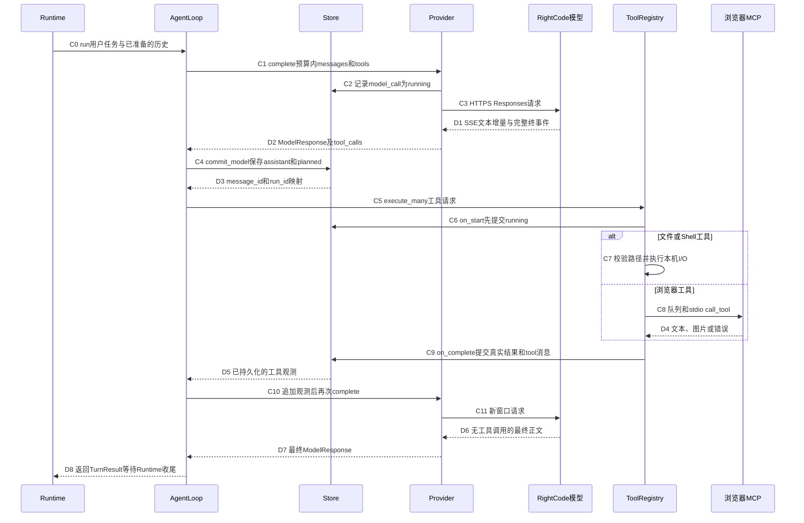

### C11. 模型给出最终正文：Loop返回TurnResult，但本轮还没完全结束

回到某次provider.complete返回之后。如果没有tool_calls，Loop先核对finish_reason与正文。截断响应走interrupted；空正文进入有限恢复；只有完整非空最终回答才执行：

源码节选：[src/kaki/loop.py:208–218](https://github.com/anuolxl/kaki_agent/blob/41dc5033839a6ff26039cea40ba06827c1aac655/src/kaki/loop.py#L208-L218)。

```python
                    continue
                raise ProviderError("模型空响应恢复次数已用尽；任务未被标为成功", "empty_response")
            msg, _ = await rt.store.run("commit_model", session, turn, response)
            await rt.emit(
                "model.committed",
                turn,
                # 阅读：这里生成 TurnResult；最终落库和 after 快照仍由 Runtime 负责。
                {"draft_id": response.call_id, "message_id": msg.id, "text": response.text},
            )
            return TurnResult(
                turn, "completed", response.text, "final_answer", tool_count, failures, verification
            )
```

完整assistant消息先入库，再返回TurnResult。正文可能从公共C06起就通过流式增量可见，因此用户看到文字不再增长，不能据此判断after快照、上下文和终态都已保存。

**返回路径：** AgentLoop.run → Runtime._turn中的result。下面继续执行_turn的finally，不重新启动下一轮任务。

### C12. Runtime按顺序完成after快照、用量、上下文和唯一终态

源码节选：[src/kaki/runtime.py:276–300](https://github.com/anuolxl/kaki_agent/blob/41dc5033839a6ff26039cea40ba06827c1aac655/src/kaki/runtime.py#L276-L300)。

```python
                    if self.snapshots_enabled and not self.closed:
                        try:
                            # 阅读：普通任务先等结束快照，所以文本不再增长仍可能在收尾。
                            snapshot = await asyncio.shield(self.checkpoint.capture(turn, "after"))
                            after = snapshot["id"]
                            if snapshot["state"] != "ready":
                                warnings.append(snapshot.get("error", "结束快照失败"))
                                await self.emit("snapshot.warning", turn, snapshot)
                        except Exception as exc:
                            warnings.append("结束快照失败：" + safe_error(exc))
                    elif self.snapshots_enabled:
                        warnings.append("程序退出，未等待结束快照；会话与已确定执行结果仍保留")
                    result.before_snapshot = before
                    result.after_snapshot = after
                    result.usage = await self.store.run("usage", turn)
                    try:
                        await self.context.after_turn(self.session_id, user, result)
                    except Exception as exc:
                        warnings.append("派生上下文更新失败，原始执行事实仍保留：" + safe_error(exc))
                    # 阅读：原始记录、上下文更新后，提交唯一 Turn 终态。
                    await self.store.run("finish_turn", result)
                    await self.emit("turn.finished", turn, as_result(result, warnings))
                    self.recovery_plan = {}
            finally:
                self.active_turn = ""
                # 阅读：释放租约后 Runtime Task 才真正返回。
                self.lease.release()
        return result
```

正常收尾按顺序做：

1. 等待after文件快照，保存ready引用或警告；这里只是当前Turn收尾。
2. 累计本Turn的main/curator/finalize等调用usage；调用缺失usage时记unknown_calls。
3. 更新working state中的目标、来源ID、未完成线索和last_turn，供下次新任务使用。
4. finish_turn提交终态、结果、快照引用和结束时间；仍未闭合的执行意图按规则补cancelled/unknown观测。
5. 发turn.finished，最后释放工作区lease，返回TurnResult。

其中finish_turn的关键事务是：

源码节选：[src/kaki/store.py:336–357](https://github.com/anuolxl/kaki_agent/blob/41dc5033839a6ff26039cea40ba06827c1aac655/src/kaki/store.py#L336-L357)。

```python
    def _finish_turn(self, result: TurnResult):
        with self.db:
            self._assert_active(result.turn_id)
            self._pending_observations(result.turn_id, reason=result.stop_reason)
            row = self.db.execute("SELECT session_id FROM turns WHERE id=?", (result.turn_id,)).fetchone()
            self.db.execute(
                "UPDATE turns SET status=?,stop_reason=?,error=?,result_json=?,before_snapshot=?,after_snapshot=?,ended=? WHERE id=?",
                (
                    result.status,
                    result.stop_reason,
                    result.error,
                    dumps(asdict(result)),
                    result.before_snapshot,
                    result.after_snapshot,
                    now(),
                    result.turn_id,
                ),
            )
            self.db.execute("UPDATE sessions SET updated=? WHERE id=?", (now(), row["session_id"]))
            self._event(row["session_id"], result.turn_id, "turn.finished", asdict(result))

    def _recover(self, session: str) -> list[dict]:
```

Store事务结束后，Runtime发turn.finished，随后释放lease并返回。TUI会在自己的事件消费者中更新界面；App的Controller会继续等外层Task结束。两个返回通道分别在T09/A16–A17解释，公共内核不直接操作Textual控件或WebSocket。

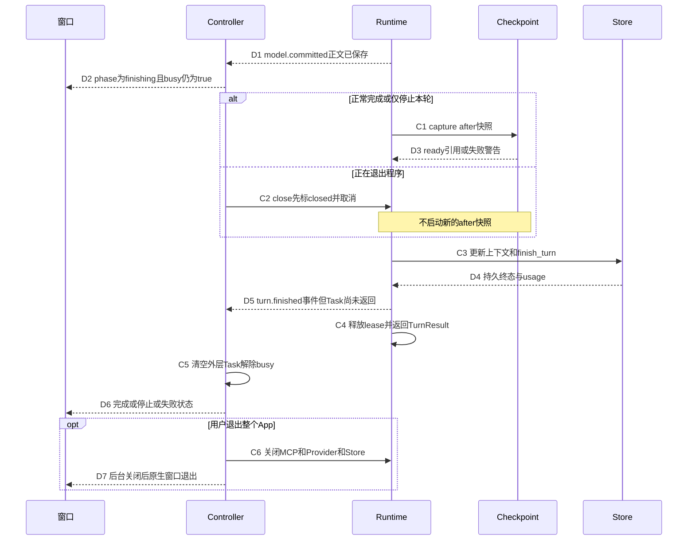

## 04. 两种交互的差异对照，以及如何判断模型请求是否相同

| 阶段 | TUI | App | 是否适合合并讲解 |
|---|---|---|---|
| 命令入口 | terminal_ui → KakiApp | launch → Server/Controller/WebKit | 不合并，调用关系不同 |
| 核心所在循环 | Textual事件循环中的Runtime | 原生模式后台asyncio线程中的Runtime | 调度环境分别说明 |
| MCP准备 | Runtime.initialize默认True，首任务前 | initialize显式False，首任务_execute补ensure_browser | 不合并时机 |
| 默认会话 | 未指定resume时新建 | 优先最近主模型兼容的未归档会话 | 不应假设同一句话历史相同 |
| 文本处理 | Input事件先strip | 检查trim非空，但传入原text | 原文可能不同 |
| 普通接单 | 本地submit_text → submit | HTTP/guard/send/Controller外层Task → run → submit | 汇合前单独说明 |
| 长度/归档/busy校验 | UI状态和Runtime基础校验 | 额外字符上限、JSON体上限、归档及外层busy检查 | 不合并成“完全一样” |
| request_id | Store接受时生成默认r_ID | 前端UUID显式传到Runtime | 内核幂等机制共用；同文本不自动去重 |
| 任务推理 | Runtime._turn / Context / AgentLoop / Provider / Tools | 同一套实现 | 合并为C链，避免重复源码 |
| 模型输出回流 | enqueue / consume_events / flush_tokens | observe / publish / WS / JS / detail | 不合并，数据通道不同 |
| 提问回答 | submit_text优先question_id → answer | JS检测question → HTTP answer → Controller校验 → answer | Future机制共用，接入分开 |
| 命令/undo | 本地command和RESTORE确认 | 功能主要由按钮/API；无图形化undo审批 | 分别说明，不能把任意slash文本视作同义 |
| 会话切换 | /resume直接更改执行会话 | 浏览不改变执行会话；发任务才按需switch | 不合并控制语义 |
| 停止 | Runtime.cancel已有active | Controller区分准备Task与active Turn | 底层取消共用，目标不同 |
| 退出 | close自己的Runtime并退出Textual | 关所有Engine/Server/WS，原生层等done再退窗口 | 生命周期分开 |

共用实现不是“同样的输入文字必然发出同样的Prompt”。配置、工作目录、会话历史、恢复提示、Skills/记忆匹配、工具发现结果和输入空白处理都会影响实际window。App默认恢复长历史时可能先调用Curator；TUI新空会话可能直接main，这仍是同一算法处理不同数据，不是两种模型引擎。

Runtime.snapshots_enabled只看policy和interactive。默认TUI/App的Runtime都interactive=True，不能说只有App有快照。Store事务、工具协议闭包、模型请求构造、有限重试、上下文窗口和恢复规则都属于公共C链。

App单实例锁不约束另一个TUI进程；工作区lease保护的是执行等独占阶段。这不等于已实现跨前端协同控制。不要把两个独立Runtime的active/question对象画成共享全局单例。

特殊分支按发生位置检查：没有项目时App可只有外壳；health200不证明Runtime及远端Key健康；TUI ready_event在失败分支也set，只表示尝试结束；App在MCP准备失败/取消时可能尚无Turn；断线不等于完成；输出停止增长仍可能在收尾。上述差异在各端章节各有对应源码，不用通过猜测界面现象反推执行结果。

## 05. 任务前后时机、日志与源码核对

两端的独立入口与公共执行代码都已展开。下面逐项核对发生时机，避免把对象构造当实际执行。App列均指**已经成功打开工作区**；无工作区时还没有对应Runtime/Store。

| 工作 | 默认App首任务前 | 默认App收到任务后 | TUI首任务前 |
|---|---|---|---|
| 加载Kaki Python依赖和配置 | 已完成；uv安装/启动器准备与Runtime分开 | 不每轮重新安装 | 已完成 |
| 读取Git根、规则入口、写workspace.json | 已完成 | 使用该工作区；不自动遍历全仓 | 已完成 |
| 规则文档的继承链接发现 | 已读相关入口以解析链接 | prefix再读取正文并组合 | 已发现 |
| 创建SQLite连接/迁移表结构 | 已完成 | 复用连接线程 | 已完成 |
| 创建/恢复session及中断状态 | 已完成；不重放旧操作 | 切会话时可再核对 | 已完成 |
| 读取旧context_state.plan | 已完成 | 重新计算本轮窗口 | 已完成 |
| 构造Provider、Context、Registry对象 | 已完成 | 复用对象 | 已完成 |
| 检查配置里的Key非空、地址形式 | 打开Runtime时本地校验 | 真实请求才知道远端是否接受 | 终端入口先校验 |
| 向Right Code发认证/推理请求 | 没有 | Provider.complete才发生 | 没有 |
| 构造内置工具schema和处理器引用 | 已完成；不等于执行 | 供模型选择和Registry分派 | 已完成 |
| 启动MCP并initialize/list_tools | 延迟 | 首次ensure_browser时发生 | 默认初始化时已做；关闭配置则不做 |
| 导航业务网页、读写代码、运行Shell | 没有 | 模型请求工具后才做 | 没有自动执行这些业务操作 |
| 在界面显示历史/订阅状态 | 已完成 | 按事件继续刷新 | consume_events和定时刷新已启动 |
| 新建/重命名/归档会话 | 用户可在首任务前操作 | 仍可按状态约束操作 | 有对应TUI命令 |
| 当前任务的用户Message/Turn | 尚无新Turn | accept_turn事务才创建 | 尚无新Turn |
| 当前任务的before/after快照 | 没有 | 本轮策略决定是否捕获 | 没有 |
| 按当前输入匹配Skills和召回记忆 | 没有当前query，不做此匹配 | ContextEngine.prefix执行 | 没有当前query |
| tokenizer预算估算/窗口选择/Curator | 没有本轮窗口，不主动运行 | assemble/rebalance按需执行 | 不主动运行 |
| 本地embedding/向量索引或缓存预热 | 无对应启动流程 | 当前也没有独立embedding/KV缓存模块 | 同样没有 |
| AgentLoop的while | 没进入 | 每个Turn按需进入，默认最多40次正常迭代 | 没进入 |

“后台运行”至少包含三类不同循环：

- asyncio事件循环：服务I/O、定时器和协程调度，App启动后持续存在。
- 视图消费循环：App的WS writer或TUI的consume_events，无消息时await队列；不向模型发新请求。
- AgentLoop.run：收到业务Turn才执行的有界推理/工具循环，返回后不空转等待下一条任务。

App实例锁长期保留；工作区执行lease在恢复和执行Turn等需要独占的阶段取得，不是整个待命期间一直占住。历史已经显示、Queue任务还活着、线程仍运行，都不等于大模型正在计算。

### 日志查询与验证范围

常用位置仍在每项目Kaki状态目录：

```text
~/.kaki/projects/<仓库名>-<路径hash>/
├── workspace.json
├── kaki.sqlite3
├── context/traces/<session_id>/<turn_id>.jsonl
├── context/archive/
├── artifacts/
├── browser-mcp.log
└── checkpoints/kaki-shadow.git/
```

先查turns是否已经有本次turn_id，再按它查看events、model_calls、tool_runs和messages。没有Turn可能仍在App接收/准备阶段；没有tool_runs也可能只是纯对话；模型调用次数可能因curator、重试或finalize超过一轮。events只保存关键事实，不是每个UI增量。

```bash
kaki_log_db="$HOME/.kaki/projects/byteview-mp-media_platform-d43b352d573e14cd/kaki.sqlite3"
sqlite3 -readonly -header -column "$kaki_log_db" "
SELECT id, session_id, status, datetime(created,'+8 hours') AS started_beijing,
       substr(text,1,60) AS request
FROM turns ORDER BY created DESC LIMIT 10;
"
```

```bash
kaki_turn_id="t_替换成实际ID"
sqlite3 -readonly -line "$kaki_log_db" <<SQL
SELECT text,status,stop_reason,error,result_json FROM turns WHERE id='$kaki_turn_id';
SELECT seq,created,type,payload FROM events WHERE turn_id='$kaki_turn_id' ORDER BY seq;
SELECT name,arguments,state,started,ended,result_json FROM tool_runs WHERE turn_id='$kaki_turn_id' ORDER BY rowid;
SELECT id,kind,model,status,usage,metadata FROM model_calls WHERE turn_id='$kaki_turn_id' ORDER BY created;
SELECT seq,role,content FROM messages WHERE turn_id='$kaki_turn_id' ORDER BY seq;
SQL
```

App正常启动不自动生成统一app.log。需要启动输出/未捕获异常时，先退出已有App再显式重定向；MCP stderr单独写browser-mcp.log，不会被这个重定向自动汇总。

```bash
mkdir -p "$HOME/.kaki/logs"
kaki-agent -C /path/to/repo >> "$HOME/.kaki/logs/app.log" 2>&1
# 另一终端
tail -f "$HOME/.kaki/logs/app.log"
```

此前的启动边界验证在临时Git工作区使用真实AppController/Runtime/Store和Textual挂载流程，注入记录型Provider/MCP替身，核对触发次序。它验证的是本机调度边界，不声称是真实模型、浏览器或原生GUI验收：

验证使用全新空会话，没有触发Curator；恢复长历史时，首个新请求还可能先增加curator模型调用，不能机械套用下面的一次main调用计数。

| 观察点 | 模拟模型complete次数 | 模拟MCP start次数 | 新Turn数 |
|---|---|---|---|
| App工作区就绪、读取会话后、尚未发任务 | 0 | 0 | 0 |
| App首次任务执行结束 | 1 | 1 | 1 |
| TUI挂载、初始化和历史加载完成，尚未发任务 | 0 | 1 | 0 |

记录次序为runtime.ready → user.send → browser.start → turn.started → snapshot.before → context.assembled → model.started → provider.complete → model.committed → snapshot.after → turn.finished。TUI中消费者已活跃、发送按钮已开放，但仍未发模型请求。本验证没有修改业务仓库或调用付费模型。

### 对象索引

| 对象 / 标识 | 在主线哪里首次确定 | 用途 |
|---|---|---|
| workspace_id / Workspace | T01 / A05 | 规范Git根和项目状态隔离 |
| Store / SQLite连接 | T04 / A05–A06 | 同进程单连接线程保存事实 |
| Provider / Context / Registry | T04 / A07 | 可复用的依赖对象，不等于已运行任务 |
| session_id | T04 / A08 | 包含多次Turn的一段连续对话 |
| Engine.task / phase / pending_text | A13 | App外层调度和视图投影 |
| Runtime.active | C01 | 执行_turn的内层asyncio.Task |
| request_id / turn_id | T07 / A11 / C01 | 请求幂等与这次业务执行作用域 |
| Message.id / seq | C01及后续提交 | 稳定消息ID与每会话顺序号，二者不同 |
| AssembledContext | C03–C04 | 当前任务的真实可发送窗口 |
| ModelResponse / provider_id | C06 | 完整模型输出及上游关联ID |
| tool_call_id / run_id | C07 | 协议配对ID与本机执行意图ID |
| ToolResult | C09–C10 | 真实工具正文、退出码、失败标志和附件 |
| TurnResult | C11–C12 / A17 | 本轮结果、用量、验证记录、快照和终态 |

IDE建议先沿所选前端的章节下断点，再进入公共C链。原默认App调用顺序可参考：cli.entry → desktop.launch → AppServer.start → open_workspace → Runtime.initialize → 页面接单 → Controller._execute → Runtime._turn → ContextEngine.assemble → AgentLoop → Provider.complete → Registry → Store.commit_tool → Runtime.finally → Controller.finally。源码固定链接就在每一步，不先要求读者把模块说明记住再回头找调用关系。

SQLite使用方式见[官方serverless说明](https://sqlite.org/serverless.html)和[Python sqlite3文档](https://docs.python.org/3.12/library/sqlite3.html)；WAL旁文件见[SQLite WAL说明](https://sqlite.org/wal.html)。Kaki完整字段/接口以[核心契约](module-spec/core.md)、[App契约](module-spec/app.md)为准，安装操作见[App指南](app-guide.md)。本次只重排和补充讲解，未修改Agent运行逻辑、配置或数据库结构。