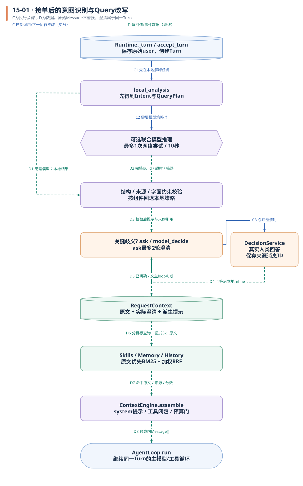
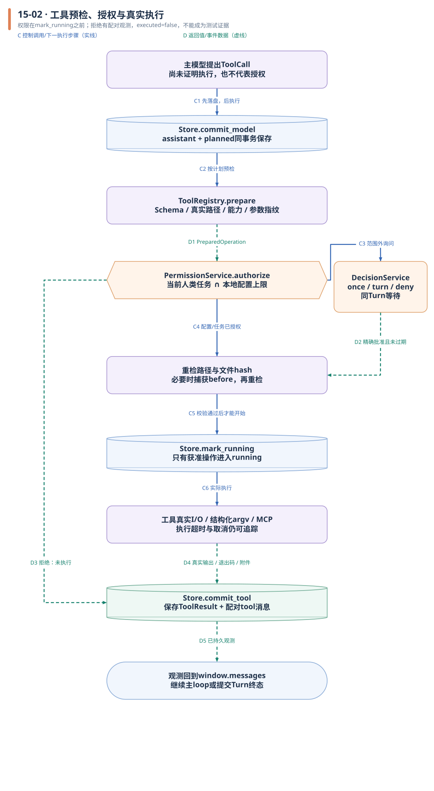
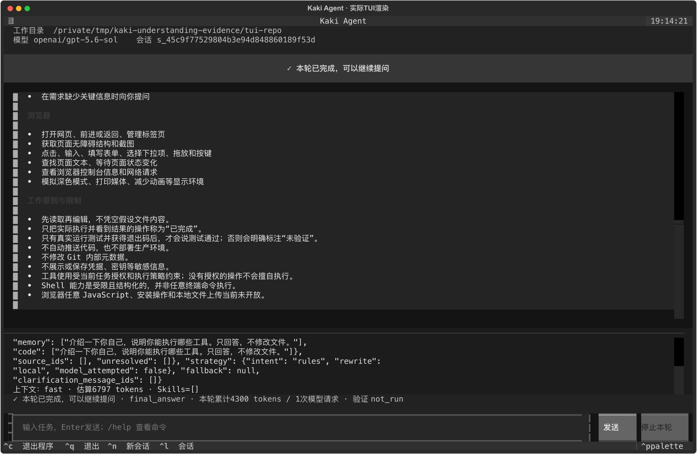
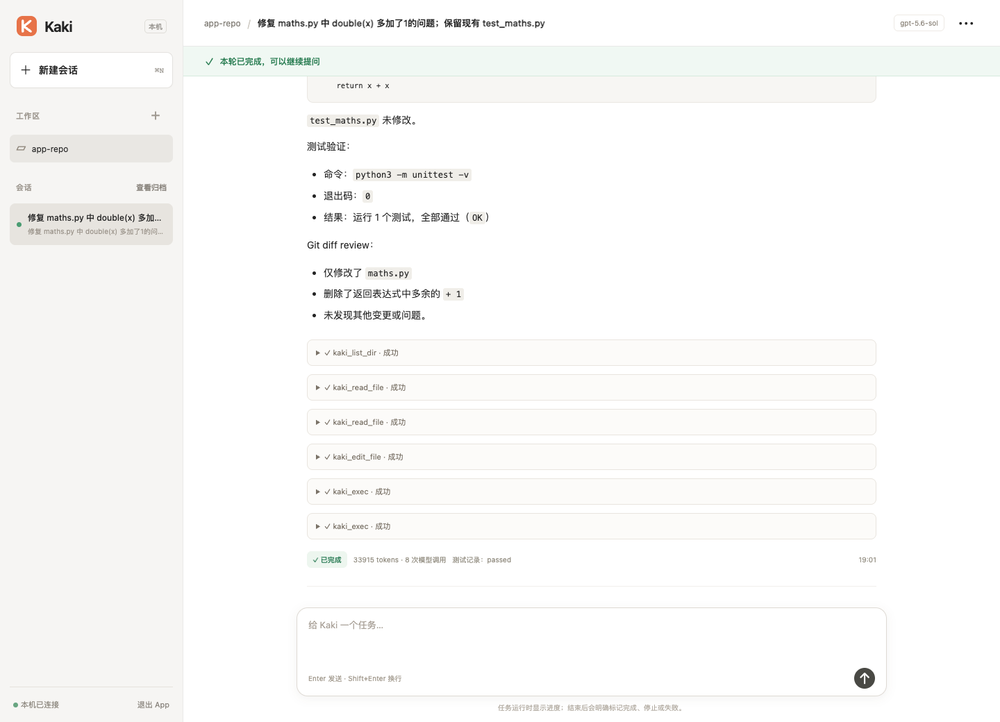
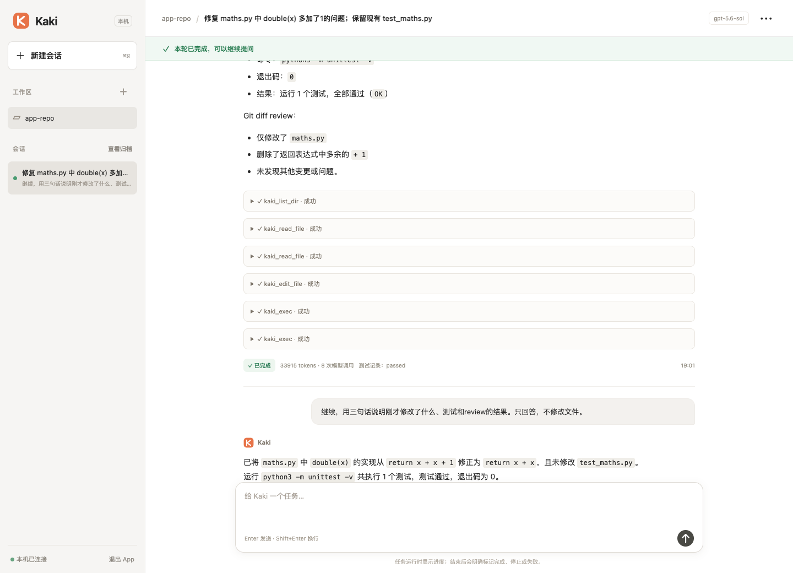

# 15 任务理解、Query改写与执行权限（Kaki v0.3）

本章对应已实现的v0.3，不再是待实施方案。源码基线固定到[d5b8675](https://github.com/anuolxl/kaki_agent/tree/d5b8675b568209182f74da1f626060627fe6ac25)。原有TUI/App入口与主loop继续复用，本轮在接单后增加任务理解，在执行工具前增加权限检查。当前没有操作系统级沙箱；获准的测试仍以当前用户权限运行。

## 15.01 从用户输入到结束，先按顺序建立全貌

TUI：`kaki-agent -C /path/to/repo tui` → `KakiApp.submit_text` → `Runtime.submit`创建Task → `_turn`。

App：`kaki-agent -C /path/to/repo` → 本机窗口/HTTP → `AppController.send`创建外层Task → `_execute`准备MCP → `Runtime.run` → `Runtime.submit` → `_turn`。

从`_turn`起，两端共用以下实现。启动界面时只构造服务对象，不调用意图识别模型；首次真实任务接受后才开始本轮理解。App此前的MCP准备仍可发生在Turn落库前；TUI仍在初始化时连接MCP，本轮没有把两种启动顺序改成相同。

1. 取得工作区lease，`accept_turn`保存原始user Message和Turn；幂等请求先返回旧结果，不重复解释或执行。
2. `UnderstandingService.prepare`运行本地意图/检索词规则。需要升级时，使用现有Right Code主模型作一次联合结构化推理。
3. 分组件校验模型结果；超时或不合法时回退本地。原始输入始终保留。
4. 默认只有关键目标/动作不明确才请求用户澄清。回答写入同一个Turn，然后本地refine，不能再消耗一次额外模型调用。
5. `ContextEngine.assemble`把规则、Skill、记忆、派生理解、原始历史和本轮原文组成预算内窗口。
6. `AgentLoop`继续原来的模型→工具→观测循环。收到完整工具请求后先落盘assistant+planned，再预检权限。
7. 已授权才重检路径/hash，必要时捕获before，mark_running，再执行。拒绝直接产生配对tool观测，不启动工具。
8. 有真实测试命令和退出码才产生验证证据。主loop最终返回TurnResult，Runtime完成after、usage、派生上下文与唯一终态；界面这时才解除busy。



蓝色实线C表示调用/执行继续，绿色虚线D表示数据、结果或回答。图中单次联合模型调用不属于主loop迭代，图中的步骤也不代表新增线程。默认有歧义时可以在同一个Turn内停下来等待用户。

## 15.02 新模块的领域分层与必须保留的边界

| 层 | 当前模块 | 拥有的职责 | 不应越过的边界 |
|---|---|---|---|
| 接口/投影 | Textual TUI、AppController、HTTP/WS、页面JS | 输入、选择、展示运行/完成/等待状态 | 不能把按钮点击之外的模型文字当授权 |
| 应用编排 | Runtime、AgentLoop | Turn作用域、调用顺序、租约、快照与终态 | 不能让可选理解失败使整个应用崩溃 |
| 任务理解 | understanding/service、strategies、types、retrieval | 意图、独立检索问题、来源、歧义、BM25/RRF | 不覆盖原始任务，不直接执行业务工具，不授予权限 |
| 人类决策 | DecisionService | 同Turn澄清/授权/普通问答，Future与持久事实对应 | 不能混淆澄清目标和批准操作 |
| 执行边界 | PermissionService、ToolRegistry | 能力、任务范围、精确操作、路径/hash复核、执行 | 不信任LLM给出的edit/approved标签；不冒充OS沙箱 |
| 基础设施 | RightCodeProvider、Store、Checkpoint、BrowserMcp | 模型协议、SQLite事务、文件快照、stdio MCP | 不拥有最终任务完成语义 |

三个新增Service都属于一个Runtime。它们不是三个Agent，也不是微服务；TUI和App复用的是同一套代码，每个运行实例仍持有自己的Runtime与Future。

## 15.03 意图识别与Query改写：定义、策略及配置切换

意图识别回答“本轮主要想做什么”。当前domain为coding/general/mixed/unknown，actions可同时包含explain、locate、review、edit、plan_tests、run_tests。它是多标签提示；`edit`本身不代表可以写文件，“设计测试方案”也不等于“运行测试”。

Query改写回答“如何补全上下文、用哪些词检索已有证据”。输出包括standalone_query、分目标queries、source_ids和unresolved。优先解决“继续”“刚才那个函数”等指代，以及中文“超时”和代码`timeout`之间的检索差距。它不重写Shell命令、编辑内容或原始user Message。

| 组件 | 策略 | 执行行为 |
|---|---|---|
| intent | rules | 始终消费本地规则分类，不额外为分类请求模型 |
| intent | llm | 消费本轮一次联合推理的intent；失败回退rules |
| intent | hybrid（默认） | 先rules；指代、多个动作等复杂场景再消费联合模型结果 |
| rewrite | local | 本地上下文线索与少量中英文别名 |
| rewrite | llm | 消费联合推理的rewrite，经来源/标识符/数字/否定校验 |
| rewrite | hybrid（默认） | 先local，复杂场景才升级；无效时只回退该组件 |

“两个组件可独立切换”指两个配置字段，不是两个进程。例如`intent=rules,rewrite=llm`表示分类仍用规则，只有改写使用模型结果。两者都为hybrid时，同一复杂任务共享一次联合调用，最多一次真实网络尝试，不会各调一次。hybrid目前使用明确规则触发，不输出伪装成概率的置信度。

源码节选：[src/kaki/understanding/strategies.py:28–72](https://github.com/anuolxl/kaki_agent/blob/d5b8675b568209182f74da1f626060627fe6ac25/src/kaki/understanding/strategies.py#L28-L72)。

```python
def local_analysis(text, history, cfg):
    actions = []
    if re.search(r"介绍|解释|说明|什么|如何|\bexplain\b", text, re.I):
        actions.append("explain")
    if re.search(r"查找|定位|搜索|\b(?:find|locate|search)\b", text, re.I):
        actions.append("locate")
    if re.search(r"审查|评审|review", text, re.I):
        actions.append("review")
    if EDIT.search(text) and not NO_WRITE.search(text):
        actions.append("edit")
    if PLAN_TEST.search(text):
        actions.append("plan_tests")
    if RUN_TEST.search(text) and not PLAN_TEST.search(text) and not NO_TEST.search(text):
        actions.append("run_tests")
    coding = bool(re.search(r"代码|仓库|文件|函数|测试|bug|git|\.py\b|\.go\b|\bcode\b", text, re.I))
    domain = "coding" if coding else "general"
    standalone = text
    sources = []
    unresolved = []
    if POINTER.search(text):
        evidence = [m for m in history if m.role in ("user", "assistant") and m.content][-6:]
        if evidence:
            latest = evidence[-1]
            standalone = text + "\n前文检索线索（不代表已确认的对象）：" + latest.content[:1200]
            sources = [latest.id]
        if not any(IDENTIFIER.finditer(text)) and (not evidence or "edit" in actions):
            unresolved = ["请明确本轮操作的目标文件、函数或对象；可直接提供路径和要执行的动作。"]
    alias = []
    for word, translated in [
        ("超时", "timeout"),
        ("取消", "cancel"),
        ("会话", "session"),
        ("上下文", "context"),
        ("重试", "retry"),
    ]:
        if word in text:
            alias.append(translated)
    queries = {}
    for target in cfg.rewrite.targets:
        hints = standalone if standalone != text else " ".join(alias)
        queries[target] = list(dict.fromkeys([text, hints]))[: cfg.rewrite.max_queries_per_target]
        queries[target] = [q for q in queries[target] if q.strip()]
    return Intent(domain=domain, actions=actions), QueryPlan(
        standalone_query=standalone[:8000], queries=queries, source_ids=sources, unresolved=unresolved
    )
```

阅读说明：这段代码先从词法识别动作，并把测试规划和执行区分开；本地指代补全保守地附加前文检索线索。它不声称已经知道真实目标，更不会扫描其他会话或工作区找指代对象。对复杂自然语言的本地识别可能不完整，因此保留可配置模型策略与人类澄清。

源码节选：[src/kaki/understanding/service.py:40–53](https://github.com/anuolxl/kaki_agent/blob/d5b8675b568209182f74da1f626060627fe6ac25/src/kaki/understanding/service.py#L40-L53)。

```python
        complex_task = bool(
            POINTER.search(user.content) or len(intent.actions) > 1 or intent.domain == "unknown"
        )
        use_intent = cfg.intent.strategy == "llm" or cfg.intent.strategy == "hybrid" and complex_task
        use_rewrite = cfg.rewrite.strategy == "llm" or cfg.rewrite.strategy == "hybrid" and complex_task
        if not (use_intent or use_rewrite):
            return result
        definition = {
            "type": "function",
            "name": "kaki_understanding_build",
            "description": "Return a private task interpretation; never executed as a workspace tool.",
            "parameters": JointAnalysis.model_json_schema(),
            "strict": False,
        }
```

阅读说明：`use_intent`和`use_rewrite`各自决定是否消费模型结果，但只要任意一个需要模型，就进入同一个联合请求分支。私有`kaki_understanding_build`只是输出结构，不能经ToolRegistry修改文件。

## 15.04 一次额外模型调用如何限制成本并可靠回退

模型继承`agents.defaults.model`和`providers.openai`的Right Code配置；`understanding.llm.model=null`表示不另配模型。没有新增密钥或接口地址。

输入只取当前任务和本会话最近6条user/assistant正文，历史总量最多2048 tokens、单条最多700；完整wire与Schema默认受4096输入预算限制，输出上限1024。超预算直接使用本地结果，不丢掉当前任务来强行请求。Tool输出、其他会话和未提交草稿不作为指代证据。

源码节选：[src/kaki/understanding/service.py:65–84](https://github.com/anuolxl/kaki_agent/blob/d5b8675b568209182f74da1f626060627fe6ac25/src/kaki/understanding/service.py#L65-L84)。

```python
        messages = [
            Message("system", INSTRUCTION),
            Message("user", json.dumps({"task": user.content, "history": evidence}, ensure_ascii=False)),
        ]
        if estimate(messages, [definition]) > cfg.llm.input_tokens:
            result.fallback = "input_budget"
            return result
        result.strategy["model_attempted"] = True
        try:
            async with asyncio.timeout(cfg.llm.timeout_seconds):
                response = await self.provider.complete(
                    messages,
                    [definition],
                    model=cfg.llm.model,
                    max_tokens=cfg.llm.output_tokens,
                    turn_id=user.turn_id,
                    kind="understanding",
                    max_attempts=1,
                    tool_choice={"type": "function", "name": "kaki_understanding_build"},
                )
```

阅读说明：`asyncio.timeout(10)`限制理解阶段，`max_attempts=1`同时限制Provider网络重试；OpenAI SDK自身的max_retries也为0。因此“允许一次额外调用”落在真实网络尝试层。主loop保持既有有限重试策略；理解失败不会隐式换模型或端点。

源码节选：[src/kaki/understanding/service.py:94–117](https://github.com/anuolxl/kaki_agent/blob/d5b8675b568209182f74da1f626060627fe6ac25/src/kaki/understanding/service.py#L94-L117)。

```python
            errors = []
            if use_intent:
                try:
                    result.intent = Intent.model_validate(data["intent"])
                    result.strategy["intent"] = "llm"
                except ValueError:
                    errors.append("intent_invalid")
            if use_rewrite:
                try:
                    model_plan = QueryPlan.model_validate(data["rewrite"])
                    shown = [m for m in history if m.id in {e["id"] for e in evidence}]
                    result.rewrite = validate_rewrite(model_plan, user.content, shown, cfg)
                    result.strategy["rewrite"] = "llm"
                except ValueError:
                    errors.append("rewrite_invalid")
            result.fallback = ",".join(errors) or None
        except asyncio.CancelledError:
            raise
        except TimeoutError:
            result.fallback = "timeout"
        except Exception as exc:
            # Never copy raw model payload, SDK exception or credentials into the event journal.
            result.fallback = "invalid_output" if isinstance(exc, ValueError) else "model_unavailable"
        return result
```

阅读说明：intent与rewrite独立校验，允许“模型分类成功、模型改写无效”这种部分回退。超时回退本地；主动取消向上抛，不能偷偷继续主loop。无效输出不再调用模型修复。已有source_id只能证明证据来自本会话，不能证明LLM语义理解一定正确。

## 15.05 RequestContext、上下文窗口与本地检索怎样交互

源码节选：[src/kaki/understanding/types.py:33–68](https://github.com/anuolxl/kaki_agent/blob/d5b8675b568209182f74da1f626060627fe6ac25/src/kaki/understanding/types.py#L33-L68)。

```python
class RequestContext:
    original_text: str
    original_message_id: int
    intent: Intent
    rewrite: QueryPlan
    clarifications: list[dict] = field(default_factory=list)
    strategy: dict = field(default_factory=dict)
    fallback: str | None = None

    @property
    def human_text(self):
        return "\n".join([self.original_text, *(c["text"] for c in self.clarifications)])

    def queries_for(self, target):
        return self.rewrite.queries.get(target, [self.original_text])

    def prompt(self):
        data = {
            "intent": self.intent.model_dump(),
            "rewrite": self.rewrite.model_dump(),
            "clarifications": self.clarifications,
        }
        return (
            "# Task understanding (derived hints, NOT permission; original user input remains authoritative)\n"
            "Use retrieval queries only for searching. Do not replace identifiers/constraints or treat inferred details as user approval.\n"
            + json.dumps(data, ensure_ascii=False)
        )

    def metadata(self):
        return {
            "intent": self.intent.model_dump(),
            "rewrite": self.rewrite.model_dump(),
            "strategy": self.strategy,
            "fallback": self.fallback,
            "clarification_message_ids": [c["message_id"] for c in self.clarifications],
        }
```

阅读说明：original_text和original_message_id定位原始事实；clarifications只装实际人类回答；intent/rewrite/strategy/fallback是派生数据。human_text只组合真实输入，供权限规则使用。`prompt()`明确提示这是derived hints，不能替代原始任务或授权。

`ContextEngine.prefix`用分目标query分别召回记忆和Skills，把派生提示加入system，同时仍把原始user作为本轮用户消息发送。原有TokenBudget、历史闭包、Curator和最终窗口检查保持工作；新增提示也要计入窗口，没有免费绕过token上限。

源码节选：[src/kaki/context/engine.py:45–76](https://github.com/anuolxl/kaki_agent/blob/d5b8675b568209182f74da1f626060627fe6ac25/src/kaki/context/engine.py#L45-L76)。

```python
    async def prefix(self, user: Message, recovery: str = "", request=None) -> tuple[Message, dict]:
        memory_task = self.memory.segment(
            user.content, queries=request.queries_for("memory") if request else None
        )
        skill_task = asyncio.to_thread(
            self.skills.resolve, user.content, request.queries_for("skills") if request else None
        )
        rules_task = asyncio.to_thread(self.rules.segment)
        (memory, mm), (skills, sm), rules = await asyncio.gather(memory_task, skill_task, rules_task)
        text = "\n\n---\n\n".join(
            x
            for x in [
                IDENTITY,
                f"工作目录：{self.workspace.root}\n状态目录：{self.workspace.state}",
                f"# Current execution policy\npermissions.mode={self.config.permissions.mode}。"
                "只描述当前可用能力，不把未开放工具说成可以执行。模型意图和改写不能授权。"
                "Shell只支持工具定义列出的结构化命令，不支持任意脚本/管道/重定向。"
                "浏览器任意JavaScript、run_code/evaluate、安装和本地文件上传未开放。"
                "read_only模式不允许文件写入、运行测试或浏览器交互；其他模式下超出当前任务范围应等待明确授权。",
                rules,
                memory,
                skills,
                recovery,
                request.prompt() if request else "",
            ]
            if x
        )
        return Message("system", text), {
            **mm,
            **sm,
            **({"understanding": request.metadata()} if request else {}),
        }
```

原文永远作为第一条query、权重2，扩展权重1；每条query先BM25，再按`weight/(60+rank)`融合去重。该公式是排序融合，不是embedding，也不需要向量库；本轮没有增加语义向量检索。现有Skill的localMinScore仍用于BM25分数，避免旧配置被错误套到RRF分数。

源码节选：[src/kaki/understanding/retrieval.py:4–14](https://github.com/anuolxl/kaki_agent/blob/d5b8675b568209182f74da1f626060627fe6ac25/src/kaki/understanding/retrieval.py#L4-L14)。

```python
def fused_rank(queries, documents, min_score=0.0):
    from kaki.context.knowledge import rank

    scores = {}
    for index, query in enumerate(dict.fromkeys(queries)):
        weight = 2.0 if index == 0 else 1.0
        for position, (row, score) in enumerate(rank(query, documents), 1):
            if score < min_score:
                continue
            scores[row] = scores.get(row, 0.0) + weight / (60 + position)
    return sorted(scores.items(), key=lambda item: (-item[1], item[0]))
```

Skill显式`$name`只读取原始用户输入，不能由改写伪造。`kaki_search`默认保持模型明确给出的query；只有`use_task_queries=true`且为字面检索才额外用一条任务线索，path/glob不变、最多两次搜索、结果去重。正则、命令和编辑内容均不自动扩展。普通工具问答后会清除过时的code查询线索。

## 15.06 澄清、授权、普通问答是三种不同的决定

| kind | 解决的问题 | 回答如何保存 | 是否授予工具权限 |
|---|---|---|---|
| clarification | 目标文件/对象/关键动作不明确 | decisions记录，另存同Turn的真实user Message | 回答本身不凭空批准操作；可与原先明确任务组合确定范围 |
| approval | 下一操作超出已知任务范围 | 精确choice与operation写decisions | 只有once/turn显式批准才产生临时授权 |
| task | 主loop调用kaki_ask_user补充业务信息 | decisions及随后tool观测 | 不作为自动批准 |

源码节选：[src/kaki/runtime.py:264–295](https://github.com/anuolxl/kaki_agent/blob/d5b8675b568209182f74da1f626060627fe6ac25/src/kaki/runtime.py#L264-L295)。

```python
                await self.emit("understanding.started", turn)
                request = await self.understanding.prepare(user, history)
                ambiguity = self.config.understanding.ambiguity
                rounds = 0
                while (
                    self.config.understanding.enabled
                    and request.rewrite.unresolved
                    and ambiguity.policy == "ask"
                ):
                    if rounds >= ambiguity.max_preflight_rounds:
                        raise InteractionRequired(
                            "clarification", "关键目标仍未明确，请提供具体文件、函数或动作后发起新任务"
                        )
                    answer = await self.decisions.request("clarification", request.rewrite.unresolved[0])
                    request.clarifications.append(
                        {"text": answer["text"], "message_id": answer["message_id"]}
                    )
                    rounds += 1
                    self.understanding.refine(request, history)
                await self.store.run(
                    "trace", self.session_id, turn, "understanding.completed", request.metadata()
                )
                await self.emit("understanding.completed", turn, request.metadata())
                result = await AgentLoop(self).run(
                    turn,
                    self.session_id,
                    user,
                    history,
                    self.recovery.context(self.recovery_plan),
                    request,
                    before_mutation,
                )
```

阅读说明：默认ask在进入主loop前解决关键歧义；超过两次仍不明确时interrupt。改成model_decide后由主loop判断/提问，但PermissionService仍然生效。澄清没有创建新Turn，也没有重新调用理解模型。

App使用黄色问题卡和选择按钮，TUI显示问题及精确选项。授权只接受“仅允许这一次”“本轮允许同类操作”“拒绝执行”或对应once/turn/deny。`可以，但别改tests`包含新约束，不能被模糊地当成yes；应拒绝后重新提交明确任务。两端都校验workspace/session/turn/question ID，过期回答不能控制新任务。

源码节选：[src/kaki/decisions.py:57–95](https://github.com/anuolxl/kaki_agent/blob/d5b8675b568209182f74da1f626060627fe6ac25/src/kaki/decisions.py#L57-L95)。

```python
    async def answer(self, identity, text, choice=None):
        rt = self.runtime
        q = rt.question
        # Idempotent duplicate delivery is accepted only in the same active scope.
        previous = self.answered.get(identity)
        if previous and previous["turn_id"] == rt.active_turn and previous["session_id"] == rt.session_id:
            if previous["text"] == text and previous["choice"] == choice:
                return
            raise KakiError("此问题已回答，不能覆盖")
        if (
            not q
            or q["id"] != identity
            or q["session_id"] != rt.session_id
            or q["turn_id"] != rt.active_turn
            or q["future"].done()
        ):
            raise KakiError("问题已过期或不属于当前任务")
        if not text.strip() or len(text) > 100000:
            raise KakiError("回答不能为空或过长")
        value = {"text": text}
        if q["kind"] == "approval":
            allowed = [s for s in rt.config.permissions.grant_scopes] + ["deny"]
            selected = choice or next(
                (key for key, label in APPROVAL_LABELS.items() if text.strip() in (key, label)), None
            )
            if selected not in allowed or text.strip() not in (selected, APPROVAL_LABELS[selected]):
                raise KakiError("请使用明确的授权选项；附加限制请拒绝后重新提交任务")
            value["choice"] = selected
        response = await rt.store.run("decision_answer", identity, rt.session_id, rt.active_turn, value)
        if q["future"].done():
            raise KakiError("回答提交期间任务已停止或问题已经回答")
        self.answered[identity] = {
            "turn_id": rt.active_turn,
            "session_id": rt.session_id,
            "text": text,
            "choice": choice,
        }
        q["future"].set_result({**response, "decision_id": identity})
        await rt.emit("question.answered", rt.active_turn, {"question_id": identity, "kind": q["kind"]})
```

阅读说明：先校验有效问题和精确选项，再写数据库，最后解除Future。无效回答保留等待状态；TUI只在Runtime.answer成功后清空question_id，不能提前把本轮标成结束。非交互`run`不会创建无限等待Future：需要澄清/授权时返回interrupted并退出2。

## 15.07 权限如何落到每个工具执行之前

默认`permissions.mode=task_scoped`：用户明确要求修改某文件并测试时，范围内按任务执行；只问答/只读就不能因LLM产生edit标签而写文件。范围不清或新增能力时默认询问；本地read_only配置和明确禁止项优先。

授权界面显示工作区、会话、Turn、能力、真实目标、命令argv、参数预览与操作指纹。写入还绑定批准前文件hash；等待期间文件被用户改动会拒绝覆盖。once用于当前精确操作，turn仍限定当前Turn内同类资源，重启/新Turn不恢复。



源码节选：[src/kaki/tools.py:269–313](https://github.com/anuolxl/kaki_agent/blob/d5b8675b568209182f74da1f626060627fe6ac25/src/kaki/tools.py#L269-L313)。

```python
    async def execute(self, call: ToolCall, ctx: dict, *, on_start=None, prepared=None) -> ToolResult:
        prepared = prepared or await self.prepare(call, ctx)
        call, operation, decision = prepared
        if isinstance(decision, ToolResult):
            return decision
        tool = self.tools[call.name]
        args = call.arguments
        entered = False
        try:
            # INVARIANT: recheck canonical targets after human approval and before actual I/O.
            if self.permissions.prepare(call, args) != operation:
                return ToolResult(
                    "授权后操作目标已改变，请重新读取", failed=True, denied=True, executed=False
                )
            if operation.capability in {"workspace.write", "test.execute"} and ctx.get("before_mutation"):
                await ctx["before_mutation"]()
            if self.permissions.prepare(call, args) != operation:
                return ToolResult("快照期间目标已改变，未执行", failed=True, denied=True, executed=False)
            if on_start:
                await on_start(call)
            entered = True
            if call.name == "kaki_ask_user":
                result = await tool.execute(args, ctx)
            else:
                timeout = (
                    (args.get("timeout") or self.config.tools.exec.timeout) + 10
                    if tool.effect == "EXECUTE"
                    else 120
                )
                result = await asyncio.wait_for(
                    tool.execute(args, {**ctx, "prepared_operation": operation}), timeout
                )
            result.decision_id = decision
            return self.bound(result, call.name)
        except asyncio.CancelledError:
            raise
        except InteractionRequired:
            raise
        except Exception as exc:
            return ToolResult(
                "工具失败：" + safe_error(exc) + "\n请分析真实错误并更换方法，不要重复无效调用。",
                failed=True,
                executed=entered,
                decision_id=decision,
            )
```

阅读说明：权限预检和人类等待发生在mark_running之前。只有获准操作才建必要before快照；快照前后再次核对真实路径/hash。只读任务不再无条件扫描整个仓库做快照。权限拒绝的工具状态为denied、started为空、executed=false，同时保留配对tool消息，确保下一次模型调用协议完整。

`ToolResult.executed`区分“真正进入工具实现”与“尚未执行就拒绝/预检失败”。AgentLoop只为确实执行的测试命令登记验证；不能把拒绝运行测试记成failed test，更不能显示passed。completed仍只表示本轮给出完整答复，业务完成和测试结果要看真实证据。

## 15.08 Shell和浏览器MCP的具体范围

Shell不再调用`bash -c`，而是先解析为argv。支持pwd/echo、`git status/diff/ls-files`和明确的测试入口：pytest、`python[3] -m unittest/pytest`、`go test`、`node --test`、`npm test/npm run test`、`cargo test`、`make test/docker-test`；兼容不带附加选项的`uv run`前缀。任意脚本、`python -c`、安装/部署/Git写操作、管道、变量替换和重定向均拒绝。

源码节选：[src/kaki/permissions.py:47–61](https://github.com/anuolxl/kaki_agent/blob/d5b8675b568209182f74da1f626060627fe6ac25/src/kaki/permissions.py#L47-L61)。

```python
def structured_command(command):
    # No shell grammar is accepted, even inside quotes. Quoting is solely argv grouping.
    if re.search(r"[\n\r;&|<>`$]", command):
        raise KakiError("只支持单条结构化命令，禁止管道、重定向、变量和命令替换")
    try:
        argv = shlex.split(command)
    except ValueError:
        raise KakiError("命令引号不完整") from None
    if not argv:
        raise KakiError("命令不能为空")
    if argv[0] == "uv" and argv[1:2] == ["run"]:
        argv = argv[2:]
    if not argv or "/" in argv[0] or "\\" in argv[0]:
        raise KakiError("命令必须使用支持的可执行程序名")
    name = argv[0]
```

阅读说明：shlex只用于argv分组，不是Shell执行器。Git禁pager、外部diff/textconv和可选index更新，输出统一排除凭据与Agent配置。测试被分类为代码执行，而非只读；当前没有OS沙箱，获准测试内部仍可能读写文件和访问网络，这是本期边界。

浏览器MCP启动/发现工具保持原机制，但执行时逐个分类。navigate仅HTTP(S)且不含内嵌凭据；snapshot、截图等观察工具按观察能力处理；点击/输入/未知交互默认询问。任意JS、run_code/evaluate、安装、文件上传硬拒绝。本地配置MCP启动，不等于批准网页提交、上传或任意代码执行。

## 15.09 SQLite、状态恢复和日志怎么查

数据库升级为schema3，新增decisions表。升级v1/v2前用SQLite backup API保存包含WAL的一致备份；原有会话、消息、工具和快照不删除。必须退出旧App/TUI后升级，回滚旧程序时同时恢复匹配备份，不能让旧程序继续写v3。

源码节选：[src/kaki/store.py:51–55](https://github.com/anuolxl/kaki_agent/blob/d5b8675b568209182f74da1f626060627fe6ac25/src/kaki/store.py#L51-L55)。

```python
CREATE TABLE IF NOT EXISTS decisions(
 id TEXT PRIMARY KEY, session_id TEXT NOT NULL REFERENCES sessions(id),
 turn_id TEXT NOT NULL REFERENCES turns(id), kind TEXT NOT NULL, state TEXT NOT NULL,
 question TEXT NOT NULL, options TEXT NOT NULL, operation TEXT NOT NULL,
 response TEXT, created TEXT NOT NULL, ended TEXT);
```

理解网络尝试记入model_calls，kind=understanding；累计usage的by_kind单独统计它。understanding.completed事件保存选中的策略、来源和回退原因；完整原始用户消息仍在messages。decision记录保存pending/answered/expired；取消和恢复使未回答问题过期，旧Future与临时授权不恢复。工具UNKNOWN仍需核对现场，不自动重放。

先用doctor确认工作区状态目录，再查询该目录中的kaki.sqlite3。不要打印完整配置文件，以免显示密钥。

```bash
kaki-agent -C /path/to/repo doctor
sqlite3 '/path/from-doctor/kaki.sqlite3' \
  "SELECT id,status,stop_reason FROM turns ORDER BY created DESC LIMIT 10;"
sqlite3 '/path/from-doctor/kaki.sqlite3' \
  "SELECT turn_id,kind,status,usage FROM model_calls ORDER BY created DESC LIMIT 15;"
sqlite3 '/path/from-doctor/kaki.sqlite3' \
  "SELECT id,turn_id,kind,state FROM decisions ORDER BY created DESC LIMIT 15;"
sqlite3 '/path/from-doctor/kaki.sqlite3' \
  "SELECT name,state,started,json_extract(result_json,'$.executed') AS executed FROM tool_runs ORDER BY rowid DESC LIMIT 15;"
```

这些是本机SQLite文件查询，不需要启动数据库服务。App页面显示历史和工具状态；TUI右侧工具日志显示理解选择和回退。浏览器子进程的stderr仍在项目状态目录browser-mcp.log，认证失败应检查Right Code配置，不能删数据库解决。

## 15.10 配置、启动与切换的完整操作

继续使用`~/.kaki/config.json`，保留现有providers.openai和agents.defaults。以下仅列新增字段，合并到同一顶层JSON，不要用它覆盖整个原配置：

```json
{
  "understanding": {
    "enabled": true,
    "intent": {"strategy": "hybrid"},
    "rewrite": {"strategy": "hybrid", "targets": ["skills", "history", "memory", "code"], "maxQueriesPerTarget": 2},
    "llm": {"model": null, "timeoutSeconds": 10, "maxExtraCallsPerTurn": 1, "maxAttempts": 1, "inputTokens": 4096, "outputTokens": 1024},
    "ambiguity": {"policy": "ask", "maxPreflightRounds": 2, "onUnresolved": "interrupt"}
  },
  "permissions": {
    "mode": "task_scoped",
    "defaultDecision": "ask",
    "grantScopes": ["once", "turn"],
    "shell": {"mode": "structured_only", "unknownCommand": "deny"},
    "mcp": {"unknownTool": "ask"}
  }
}
```

配置优先级仍为CLI > 非空KAKI_双下划线环境变量 > JSON > 默认值。保存配置后重启，不承诺对正在运行的App热替换；第二次启动App通常只是聚焦原实例。

```bash
# App：进入指定media_platform工作区
kaki-agent -C /Users/bytedance/go/src/code.byted.org/larkvc/harness/teams_spec/be-vcs/byteview-mp-media_platform

# TUI：进入相同项目、独立进程
kaki-agent -C /Users/bytedance/go/src/code.byted.org/larkvc/harness/teams_spec/be-vcs/byteview-mp-media_platform tui

# 本次启动只用本地识别/改写，权限检查继续生效
KAKI_UNDERSTANDING__INTENT__STRATEGY=rules \
KAKI_UNDERSTANDING__REWRITE__STRATEGY=local \
kaki-agent -C /path/to/repo tui

# 分类走规则、改写走模型；仍最多一次额外网络尝试
KAKI_UNDERSTANDING__INTENT__STRATEGY=rules \
KAKI_UNDERSTANDING__REWRITE__STRATEGY=llm \
kaki-agent -C /path/to/repo tui

# 只读能力上限
KAKI_PERMISSIONS__MODE=read_only kaki-agent -C /path/to/repo tui

# 把歧义交给主loop判断；不会改变执行权限
KAKI_UNDERSTANDING__AMBIGUITY__POLICY=model_decide kaki-agent -C /path/to/repo tui
```

在对话中先输入“只读介绍仓库和测试入口，不修改文件”；明确目标后输入“修复某文件中的具体问题，运行指定测试并review本轮diff”。等待授权时先检查路径/命令再选once或turn；不要把权限问题的回答当成新任务。停止按钮结束本轮，Ctrl+C退出进程；恢复会话用`--resume last`，不会重放未知副作用。相同项目不要同时运行两个修改任务，工作区lease会阻止并发。

### 本机部署入口

本机全局命令已指向固定源码目录 `/Users/bytedance/github/kaki_agent-v0.3`，版本0.3.0。原 `/Users/bytedance/github/kaki_agent` 保留未提交的文档改动；在旧工作区运行 `uv run` 会使用其旧源码，日常使用全局 `kaki-agent`。现有Right Code密钥与地址保留，新增配置为hybrid/hybrid、10秒、ask、task_scoped。App启动器版本读取Python包版本。

```bash
kaki-agent --version
cd /Users/bytedance/github/kaki_agent-v0.3
uv run python scripts/install_macos_app.py
open "$HOME/Applications/Kaki.app"
```

## 15.11 真实验收结果、界面与验证边界

本期验收使用临时独立Git仓库和独立KAKI_HOME，不修改media_platform作为试验。现有Right Code主模型`openai/gpt-5.6-sol`和Playwright MCP均实际运行，不以mock结果冒充真实模型验证。

| 验收 | 实际结果 | 依据 |
|---|---|---|
| TUI初次对话 | completed；不修改文件 | 真实Textual输入框事件、模型响应、SQLite与渲染截图 |
| TUI连续追问 | completed；模型成功引用前文并改写 | 同Session两个Turn；第二轮一次understanding网络尝试，intent/rewrite均LLM |
| App修复任务 | maths.py中double由x+x+1改为x+x | 真正的文件读取/编辑工具结果，test_maths.py保持不变 |
| App测试与review | python3 -m unittest -v退出0；真实git diff成功 | 持久run_id、verification=passed；额外独立执行测试再次退出0 |
| App上下文追问 | 同Session新Turn正常完成 | 实际页面交互、HTTP/WS及模型输出，前端pageerror为0 |
| 部分回退 | 一次模型rewrite未通过校验，intent继续用模型、rewrite回退local | 真实understanding.completed元数据，任务仍完成 |
| 文件快照 | 首次写入前before、完成后after均有记录 | TurnResult中的快照引用 |

TUI初次对话（真实Textual渲染导出）：



App修复、测试、review完成（实际共享Web界面；后台为macOS原生App进程）：



App追问仍沿用同Session历史并创建新Turn：



自动化回归覆盖配置切换、9种策略组合、单次网络尝试、超时/取消、无效来源与约束丢失、同Turn澄清、模型意图不能授权、拒绝不执行、非法授权保留问题、跨会话拒答、等待期间文件变化、schema迁移/恢复，以及原有上下文/快照/Provider/TUI/App行为。macOS原生进程信号退出单独执行；默认跨平台套件会跳过这个需要桌面的用例。CI状态以本次PR实际结果为准。

```bash
uv sync --extra dev --locked
uv run ruff check .
uv run ruff format --check .
uv run python -m compileall -q src
uv run pytest -q
node --check src/kaki/ui/app.mjs
node --test tests/ui-state.test.mjs
# 仅macOS桌面环境
KAKI_TEST_NATIVE=1 uv run pytest -q tests/test_app_process.py
```

本轮实现还没有OS沙箱、向量检索、训练过的意图分类模型、全局理解缓存、多Agent调度或任意Shell能力。当前已有功能的意义是让任务解释和工具授权拥有明确入口、可切换策略、可观察的失败回退和可复核的执行事实。
